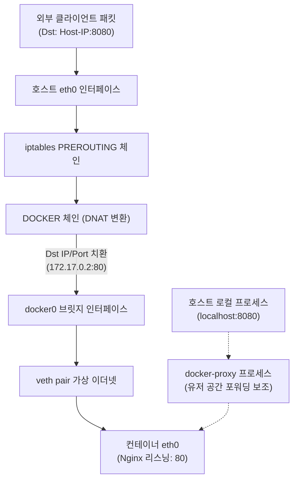
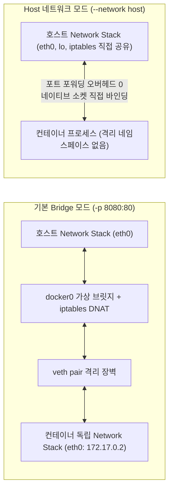

> Dockerfile에 분명 `EXPOSE 8080`을 명시했음에도 왜 호스트 외부에서는 컨테이너로 접속할 수 없을까요? Docker의 네트워크 패킷 전달 원리와 iptables 커널 레벨 바인딩, 그리고 `--network host` 모드의 위험천만한 함정을 실무 관점에서 완벽하게 정리합니다.
{: .prompt-info }

Docker를 처음 접하거나 로컬 개발 환경에서 컨테이너를 배포할 때 가장 흔히 겪는 트러블슈팅 중 하나가 바로 **"포트를 열었는데 왜 접속이 안 되는가?"**입니다.

분명 Dockerfile 빌드 스크립트에 `EXPOSE 8080`을 기재했고 컨테이너 내부 애플리케이션 로그에도 `Tomcat started on port 8080`이 정상 출력되는데, 호스트 머신 브라우저에서 `http://localhost:8080`을 호출하면 허무하게 `Connection refused` 에러를 마주하게 됩니다.

이 문제는 Docker의 네트워크 모델이 호스트 운영체제의 리눅스 네트워크 스택 및 방화벽 서브시스템(`iptables`)과 어떻게 상호작용하는지 이해하면 명쾌하게 풀립니다. 이번 글에서는 **EXPOSE의 진짜 정체부터 `-p` 옵션이 리눅스 커널에 생성하는 DNAT 룰, 초고성능을 내지만 보안을 파괴하는 `--network host` 모드의 실체, 그리고 방화벽을 우회하는 `0.0.0.0` 바인딩의 치명적 위험**까지 깊이 있게 살펴보겠습니다.

---

## 1. "Dockerfile에 EXPOSE를 썼는데 접속이 안 됩니다": EXPOSE의 실체

많은 개발자가 `EXPOSE` 명령어를 리눅스의 방화벽 포트를 여는 명령(`ufw allow` 등)이나 프로세스가 포트를 리스닝(`listen`)하게 만드는 지시어로 오해합니다.

결론부터 말씀드리면, **`EXPOSE`는 호스트나 컨테이너의 포트를 전혀 열지 않으며, 네트워크 패킷 라우팅에도 아무런 영향을 주지 않습니다.**

```dockerfile
FROM eclipse-temurin:21-jre-alpine
WORKDIR /app
COPY build/libs/api-server.jar app.jar

# ⚠️ 이 지시어는 실제로 포트를 개방하거나 바인딩하지 않습니다!
EXPOSE 8080

ENTRYPOINT ["java", "-jar", "app.jar"]
```

### EXPOSE는 단순한 '문서화(Metadata)'에 불과합니다

Docker 공식 문서에서도 명시하듯, `EXPOSE`는 **이미지를 빌드하는 사람과 컨테이너를 실행하는 사람 사이의 문서화(Documentation) 협약**일 뿐입니다.

실제로 이미지를 빌드한 뒤 `docker inspect`로 메타데이터를 조회해 보면 그 실체를 확인할 수 있습니다.

```bash
$ docker inspect my-api-server:latest | jq '.[0].Config.ExposedPorts'
{
  "8080/tcp": {}
}
```

이처럼 `ExposedPorts`라는 JSON 메타데이터 필드에 객체 키로 등록될 뿐, 리눅스 커널 레벨의 소켓 바인딩이나 방화벽 규칙 생성은 1바이트도 일어나지 않습니다.

### 대문자 `-P`(`--publish-all`) 플래그와의 유일한 연결점

`EXPOSE`가 런타임에 직접적인 영향을 미치는 유일한 경우는 컨테이너 실행 시 대문자 `-P` 옵션을 붙였을 때입니다.

```bash
$ docker run -d -P --name my-app my-api-server:latest
$ docker port my-app
8080/tcp -> 0.0.0.0:32768
```

대문자 `-P`를 주면 Docker 데몬은 Dockerfile의 `EXPOSE`에 명시된 포트들을 호스트의 임시 포트 범위(Ephemeral Port, 보통 32768~60999) 중 빈 포트에 무작위로 매핑해 줍니다. 

> 하지만 실무 프로덕션 환경에서는 포트 번호가 매번 바뀌는 비결정적 배포 방식을 절대 사용할 수 없으므로, 대문자 `-P`는 사실상 테스트용에 그치며 실무에서는 소문자 `-p`(`--publish`)로 명시적 매핑을 수행해야 합니다.
{: .prompt-warning }

---

## 2. `-p 8080:80`의 뒷단: iptables DNAT와 docker-proxy

컨테이너 내부의 포트를 외부와 연결하려면 소문자 `-p <호스트포트>:<컨테이너포트>`를 사용해야 합니다.

```bash
docker run -d -p 8080:80 --name web-nginx nginx:alpine
```

이 한 줄의 명령어가 실행될 때, 리눅스 호스트 머신 내부에서는 크게 두 가지 핵심 동작이 일어납니다.



### 1) 리눅스 커널 iptables의 DNAT(Destination NAT) 변환

Docker 데몬은 호스트의 리눅스 커널 netfilter/iptables에 자체 체인(`DOCKER`)을 주입합니다. 호스트의 8080 포트로 들어오는 패킷의 목적지 IP와 포트를 컨테이너의 가상 사설 IP(`172.17.0.2`)와 80 포트로 변환하는 **DNAT** 규칙을 추가합니다.

호스트 서버에서 iptables NAT 테이블을 직접 조회해 보면 이를 명확히 볼 수 있습니다.

```bash
$ sudo iptables -t nat -L DOCKER -n -v

Chain DOCKER (2 references)
 pkts bytes target     prot opt in     out     source      destination         
    0     0 DNAT       tcp  --  !docker0 *     0.0.0.0/0   0.0.0.0/0   tcp dpt:8080 to:172.17.0.2:80
```

- `!docker0`: 패킷이 컨테이너 내부 브릿지망(`docker0`)이 아닌 외부 인터페이스(`eth0` 등)에서 인입되었을 때
- `tcp dpt:8080`: 도착지 포트가 TCP 8080이면
- `to:172.17.0.2:80`: 목적지 IP와 포트를 컨테이너의 사설 IP인 `172.17.0.2:80`으로 재작성(DNAT)하여 커널 레벨에서 즉시 고속 포워딩합니다.

### 2) docker-proxy의 보조 역할

커널의 DNAT만으로 대부분의 패킷이 라우팅되는데, `ps aux | grep docker-proxy`를 쳐보면 왜 별도의 바이너리가 포트마다 떠 있을까요?

```bash
root  12480  0.0  0.1  ... /usr/bin/docker-proxy -proto tcp -host-ip 0.0.0.0 -host-port 8080 -container-ip 172.17.0.2 -container-port 80
```

`docker-proxy`는 커널 레벨 DNAT 처리가 불가능하거나 라우팅이 복잡한 환경(예: 호스트 로컬 루프백에서 컨테이너로 통신하는 Hairpin NAT 시나리오 또는 IPv6 프록싱)을 지원하기 위해 유저 공간(User Space)에서 소켓을 열어두고 패킷을 양방향 릴레이하는 안전장치입니다.

---

## 3. 초고성능과 격리 파괴의 줄타기: `--network host` 모드

기본 브릿지 모드의 `-p` 바인딩은 안전하고 격리된 환경을 제공하지만, 모든 네트워크 패킷이 **호스트 가상 브릿지(`docker0`) -> veth pair -> iptables DNAT 검사 -> TCP 체크섬 재계산**이라는 복잡한 커널 오버헤드를 거칩니다.

초당 수십만 건의 패킷을 처리해야 하는 고성능 API 게이트웨이나 WebRTC 미디어 서버, 레이턴시에 극도로 민감한 고성능 인메모리 캐시 클러스터에서는 이 오버헤드가 CPU 사용률 증가와 레이턴시 튐(Latency Spike)의 원인이 됩니다. 이때 고려하는 옵션이 바로 `--network host`입니다.



### host 모드의 동작 원리

`--network host` 모드로 컨테이너를 실행하면 Docker는 해당 컨테이너에 대해 **독립적인 Network Namespace를 아예 생성하지 않습니다.** 컨테이너 프로세스가 호스트의 네트워크 네임스페이스를 그대로 공유합니다.

- 컨테이너 프로세스가 `bind(8080)`를 호출하면 호스트 머신의 8080 포트가 즉시 점유됩니다.
- 포트 포워딩(`-p`) 옵션을 붙일 필요가 없으며, 붙이더라도 완전히 무시됩니다.
- veth pair와 iptables DNAT 계층이 완전히 제거되므로 순수 베어메탈(Bare-metal) 수준의 네이티브 네트워크 I/O 성능을 뽑아낼 수 있습니다.

### 하지만 따라오는 3가지 치명적 함정

> 네트워크 성능이 아무리 뛰어나도 컨테이너 격리의 근간을 무너뜨리기 때문에 실무에서는 다음의 트레이드오프를 반드시 인지해야 합니다.
{: .prompt-danger }

1. **포트 충돌(Port Collision) 위험**:  
   독립된 네트워크 네임스페이스가 없으므로 동일한 서버 내에서 같은 포트를 사용하는 컨테이너를 2개 이상 띄울 수 없습니다. (예: 8080 포트를 쓰는 Spring Boot 애플리케이션을 단일 서버에 2대 띄워 무중단 롤링 배포를 할 수 없음)
2. **보안 격리 해제(Security Vulnerability)**:  
   컨테이너 내부 프로세스가 호스트의 루프백(`127.0.0.1`)을 비롯한 모든 네트워크 인터페이스에 제약 없이 접근할 수 있습니다. 만약 컨테이너가 원격 코드 실행(RCE) 공격을 당하면 호스트의 로컬 DB나 내부 관리 포트까지 무방비로 털릴 수 있습니다.
3. **macOS / Windows 환경에서의 동작 불능**:  
   macOS와 Windows의 Docker Desktop은 경량 리눅스 가상머신(HyperKit / WSL2) 위에서 구동됩니다. 따라서 `--network host`를 주더라도 **Mac 로컬 호스트가 아니라 VM 내부 호스트에 바인딩**됩니다. 결과적으로 Mac의 브라우저에서 `localhost:8080`으로 접근할 수 없는 낭패를 보게 됩니다.

---

## 4. UFW와 보안그룹을 무력화하는 `0.0.0.0` 바인딩의 위험

실무에서 가장 빈번하게 발생하는 대형 보안 사고 중 하나가 바로 **"AWS Security Group이나 호스트 UFW 방화벽으로 분명 외부 접근을 막아뒀는데, 컨테이너 내부 포트가 공용 인터넷에 노출되는 현상"**입니다.

### 범인은 기본값으로 동작하는 `0.0.0.0` 바인딩

우리가 습관적으로 사용하는 `-p 8080:80`은 축약형이며, 실제로는 다음과 같이 해석됩니다.

```bash
docker run -d -p 0.0.0.0:8080:80 nginx:alpine
```

호스트 머신에 공인 IP(Public IP)와 사설 IP(Private IP)가 모두 할당되어 있다면, `0.0.0.0` 바인딩은 **공인 인터넷을 향해 열린 인터페이스까지 포함하여 모든 네트워크 인터페이스에 포트를 개방**합니다.

더 위험한 점은 **Docker 데몬이 리눅스 커널의 방화벽 체인을 가로채는 방식**에 있습니다.

```
[인터넷 인입 패킷]
       │
       ▼
iptables PREROUTING
       │
       ▼
iptables DOCKER 체인 (Docker가 DNAT 변환 수행 후 FORWARD로 직행)
       │
       ├─► FORWARD 체인 (컨테이너로 패킷 전달 완료!)
       │
       └─► INPUT 체인 (일반적인 OS 방화벽인 UFW 규칙이 위치하는 곳 - 패킷이 도달조차 안 함!)
```

일반적으로 Ubuntu 등에서 설정하는 `ufw deny 8080`은 `INPUT` 체인에 등록됩니다. 그러나 Docker가 등록한 포워딩 규칙은 `PREROUTING` 단계에서 DNAT되어 `FORWARD` 체인으로 빠져나가기 때문에 **UFW 방화벽 규칙을 완벽하게 우회(Bypass)**해 버립니다.

방화벽을 켜두었다고 안심하고 있던 Redis(6379), PostgreSQL(5432) 컨테이너가 외부 인터넷 스캐너에 그대로 노출되어 랜섬웨어 공격을 받는 대표적인 원인이 바로 이것입니다.

### 보안 해결책: 명시적 루프백(`127.0.0.1`) 바인딩

외부 인터넷에 직접 노출될 필요가 없고, 호스트 내부의 리버스 프록시(Nginx, Caddy, Envoy)나 로컬 애플리케이션만 접근해야 하는 컨테이너는 **반드시 `127.0.0.1`로 바인딩 대상을 한정**해야 합니다.

```bash
# 외부 인터페이스를 차단하고 로컬 루프백만 허용
docker run -d -p 127.0.0.1:8080:8080 --name payment-api my-api:latest
```

`docker-compose.yml`에서도 다음과 같이 명시적으로 IP를 고정하는 습관을 들이는 것이 좋습니다.

```yaml
services:
  # 외부 트래픽을 직접 받는 리버스 프록시만 공용 포트 개방
  reverse-proxy:
    image: nginx:alpine
    ports:
      - "80:80"
      - "443:443"
    depends_on:
      - internal-api

  # 백엔드 API와 데이터베이스는 로컬 루프백 또는 컨테이너 내부망으로 격리
  internal-api:
    image: my-internal-api:latest
    ports:
      - "127.0.0.1:8080:8080" # 호스트 로컬에서만 디버깅 가능하도록 제한

  internal-redis:
    image: redis:7-alpine
    # 포트 노출 없이 compose 내부 네트워크로만 통신
    expose:
      - "6379"
```

> 내부 컨테이너끼리만 통신하는 DB나 캐시 서비스는 호스트 머신의 `ports`로 매핑할 필요조차 없습니다. 같은 사용자 정의 네트워크에 묶어둔 뒤 컨테이너 이름(DNS)으로 직접 호출하는 것이 가장 안전합니다.
{: .prompt-tip }

---

## 5. 포트 바인딩 방식 비교 및 실무 가이드라인

상황에 따라 어떤 네트워크 및 포트 바인딩 전략을 선택해야 하는지 정리해 보겠습니다.

| 구분 | 문법 예시 | 동작 메커니즘 | 실무 권장 사용처 | 주의사항 |
| :--- | :--- | :--- | :--- | :--- |
| **EXPOSE** | `EXPOSE 8080` | 메타데이터 기록 (포트 개방 X) | Dockerfile 문서화, `-P` 힌트 | 외부 접속 불가 |
| **기본 바인딩** | `-p 8080:8080` | `0.0.0.0` 대상 iptables DNAT | 외부 퍼블릭 트래픽 진입점 (Web, Proxy) | UFW 우회 위험, 무방비 노출 주의 |
| **로컬 루프백 바인딩** | `-p 127.0.0.1:8080:8080` | `lo` 대상 iptables DNAT | 리버스 프록시 뒷단 API, 로컬 개발 DB | 외부 공인망 직접 인입 원천 차단 |
| **host 네트워크** | `--network host` | 호스트 네트워크 스택 직접 공유 | 초고성능 I/O, 패킷 프록시, WebRTC | 포트 충돌, 보안 격리 상실, Mac 미지원 |

### 실무 배포 전 3초 점검 루틴

1. **Dockerfile의 `EXPOSE`에 의존하고 있지 않은가?**  
   실제 트래픽을 받으려면 반드시 `compose.yaml`이나 `docker run` 실행 시점에 `-p`를 명시해야 합니다.
2. **민감한 내부 포트가 `0.0.0.0`으로 뚫려 있지 않은가?**  
   호스트에서 `ss -tulpn | grep LISTEN` 또는 `netstat -tulpn`을 실행하여 `0.0.0.0:5432`나 `0.0.0.0:6379`처럼 위험하게 열려 있는 컨테이너가 없는지 확인하십시오.
3. **`--network host`가 꼭 필요한 성능 요구사항인가?**  
   단순 편의성을 위해 host 모드를 사용하고 있다면 브릿지 네트워크와 DNS 서비스 디스커버리 기반의 격리 구조로 전환하십시오.
