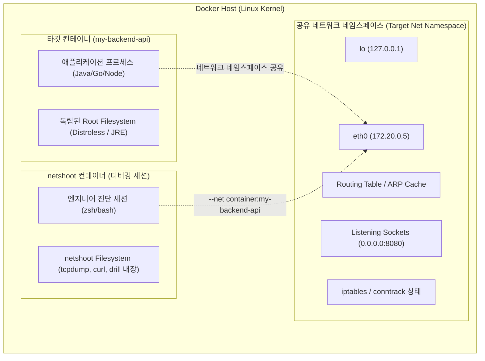
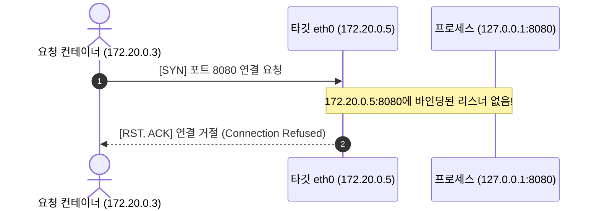
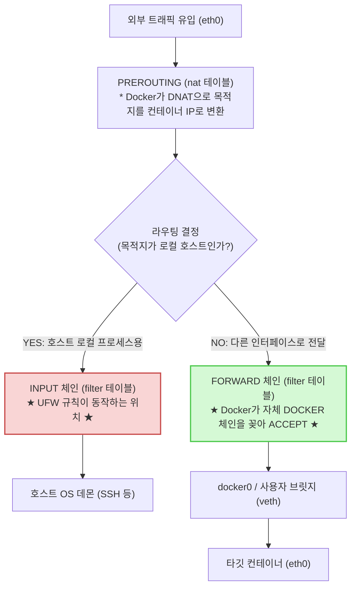

> 프로덕션 경량 컨테이너(Distroless, Alpine)에서 네트워크 장애가 발생했을 때 진단 도구가 없어 막막했던 경험이 있으신가요? 대상 컨테이너의 네트워크 네임스페이스를 그대로 공유하는 **netshoot**을 활용해 `tcpdump`로 L4/L7 패킷을 뜯어보고, 실무에서 자주 겪는 Docker의 UFW 방화벽 우회 현상까지 완벽히 진단·해결하는 방법을 정리합니다.

---

## 1. 프로덕션 컨테이너의 딜레마: "ping도, curl도 없다"

백엔드 애플리케이션을 운영하다 보면 가장 골치 아픈 장애 중 하나가 바로 **"분명 서비스는 떠 있는데 컨테이너 간 통신이 안 되는 상황"**입니다. 로컬이나 개발 환경에서는 잘 되던 통신이 스테이징이나 프로덕션 환경에 올라가면 `Connection refused`, `Connection timed out`, 혹은 DNS 해석 실패(NXDOMAIN)를 뿜어내며 멈칫거립니다.

원인을 찾기 위해 터미널을 열고 컨테이너 내부로 진입하려고 명령어를 입력합니다.

```bash
docker exec -it my-backend-api /bin/bash
# OCI runtime exec failed: exec: "/bin/bash": stat /bin/bash: no such file or directory
```

bash가 없어서 `/bin/sh`로 들어가 보아도 상황은 달라지지 않습니다.

```bash
docker exec -it my-backend-api sh
/ # ping redis-cache
# sh: ping: not found
/ # curl http://order-service:8080/health
# sh: curl: not found
/ # netstat -tlpn
# sh: netstat: not found
```

{: .prompt-warning }
> 최근 프로덕션 환경에서는 이미지 용량 최소화와 보안 취약점(CVE) 공격 표면을 줄이기 위해 **Google Distroless, Scratch, Alpine-slim** 같은 초경량 베이스 이미지를 기본으로 채택합니다. 따라서 쉘(`sh`) 자체가 없거나, 통신을 점검할 `ping`, `curl`, `netstat`, `dig` 등의 필수 진단 도구가 완전히 제거되어 있습니다.

그렇다고 실시간으로 장애가 발생 중인 프로덕션 컨테이너에 `apt-get install iputils-ping curl`을 실행하거나, 디버깅 도구를 추가한 새 이미지를 다시 빌드해서 배포할 수는 없습니다. 그렇게 하면 컨테이너가 재시작되면서 **장애 발생 당시의 메모리 상태와 네트워크 소켓 세션이 모두 증발**해버리기 때문입니다.

---

## 2. 구원투수 netshoot: 네트워크 네임스페이스 침투 원리

이 딜레마를 단번에 해결해 주는 도구가 바로 **[nicolaka/netshoot](https://github.com/nicolaka/netshoot)**입니다. netshoot은 네트워크 트러블슈팅에 필요한 거의 모든 CLI 도구(`tcpdump`, `curl`, `grpcurl`, `drill`, `dig`, `mtr`, `ngrep`, `socat`, `iperf3`, `iproute2` 등)를 집대성한 진단용 컨테이너 이미지입니다.

여기서 핵심은 netshoot을 독립된 별도 컨테이너로 띄우는 것이 아니라, **문제가 발생한 대상 컨테이너의 네트워크 스택 안으로 직접 밀어 넣는 것**입니다.

### `--net container:<target-id>`의 동작 메커니즘

리눅스 컨테이너 격리의 근간은 커널의 **네임스페이스(Namespaces)**입니다. 프로세스 격리를 위한 PID, 파일시스템 격리를 위한 Mount, 네트워크 격리를 위한 Net 네임스페이스 등이 분리되어 동작합니다.

도커의 `--net container:<container-id>` 옵션을 사용하면, 신규 컨테이너(netshoot)가 자체 가상 네트워크 인터페이스를 만드는 대신 **타깃 컨테이너의 네트워크 네임스페이스(`CLONE_NEWNET`)를 그대로 공유**합니다.



파일시스템과 프로세스 트리는 분리되어 있으므로 타깃 컨테이너의 런타임 환경은 전혀 훼손되지 않지만, **루프백(`127.0.0.1`), 가상 인터페이스(`eth0`), 라우팅 테이블, 열린 포트 소켓 목록은 완전히 동일한 시야**를 갖게 됩니다.

### netshoot 침투 실행하기

다음 원라이너 명령어로 즉시 대상 컨테이너 내부 네트워크로 진입합니다.

```bash
docker run -it --rm \
  --net container:my-backend-api \
  --cap-add=NET_ADMIN \
  --cap-add=NET_RAW \
  nicolaka/netshoot
```

{: .prompt-tip }
> 패킷 캡처(`tcpdump`, `promiscuous mode`)나 네트워크 인터페이스 조작을 위해서는 `--cap-add=NET_ADMIN`과 `--cap-add=NET_RAW` 권한을 함께 부여하는 것이 좋습니다.

침투 후 `ip addr` 및 `ss` 명령을 내려보면, 타깃 컨테이너의 IP와 리스닝 포트가 그대로 노출되는 것을 즉시 확인할 수 있습니다.

```bash
# 타깃 컨테이너의 인터페이스 확인
netshoot # ip addr show eth0
24: eth0@if25: <BROADCAST,MULTICAST,UP,LOWER_UP> mtu 1500 qdisc noqueue state UP
    inet 172.20.0.5/16 brd 172.20.255.255 scope global eth0

# 타깃 컨테이너가 실제로 열고 있는 포트 확인
netshoot # ss -tlpn
State      Recv-Q     Send-Q          Local Address:Port          Peer Address:Port
LISTEN     0          128                 127.0.0.1:8080               0.0.0.0:*
```

---

## 3. 실전 패킷 뜯어보기: tcpdump로 통신 장애 원인 규명

이제 netshoot의 무기를 활용해 실제 현업에서 발생하는 대표적인 네트워크 장애 2가지를 패킷 레벨에서 분석해 보겠습니다.

### 장애 유형 1: "서버는 떴는데 외부 컨테이너에서 접근 시 Connection Refused"

위의 `ss -tlpn` 출력 결과를 다시 살펴보십시오.
로컬 주소가 `127.0.0.1:8080`으로 바인딩되어 있습니다. 스프링 부트나 Node.js, FastAPI 등의 애플리케이션이 `0.0.0.0`이 아닌 `localhost`에 바인딩되어 있으면, 동일 네트워크 대역의 다른 컨테이너가 `172.20.0.5:8080`으로 보낸 요청을 수신하지 못하고 커널이 즉시 **RST(Reset)** 패킷을 던져버립니다.

실제로 패킷을 감시해 보겠습니다. netshoot 쉘에서 `tcpdump`를 실행합니다.

```bash
tcpdump -nnvv -i eth0 port 8080
```

다른 컨테이너에서 `curl http://172.20.0.5:8080`을 시도했을 때 tcpdump에 찍히는 패킷입니다.

```text
12:15:30.102345 IP (tos 0x0, ttl 64, id 41201, offset 0, flags [DF], proto TCP (6), length 60)
    172.20.0.3.49822 > 172.20.0.5.8080: Flags [S], cksum 0x3a12, seq 1928374650, win 64240, options [mss 1460,sackOK,TS val 1827364 ecr 0], length 0

12:15:30.102380 IP (tos 0x0, ttl 64, id 0, offset 0, flags [DF], proto TCP (6), length 40)
    172.20.0.5.8080 > 172.20.0.3.49822: Flags [R.], cksum 0x5b3f, seq 0, ack 1928374651, win 0, length 0
```



`Flags [S]`(SYN) 요청이 들어오자마자 커널 네트워크 스택이 `Flags [R.]`(RST/ACK)를 즉각 회신합니다. 타깃 프로세스가 `0.0.0.0:8080`이 아닌 루프백에만 묶여 있음을 1초 만에 증명할 수 있습니다.

### 장애 유형 2: 도커 내장 DNS 질의 실패 (NXDOMAIN)

`order-service`라는 이름으로 HTTP 요청을 보냈는데 `Could not resolve host` 에러가 난다면, netshoot 내의 `drill` 도구로 도커 내장 DNS(`127.0.0.11:53`)에 직접 질의합니다.

```bash
# 도커 내장 DNS 서버로 직접 질의
drill @127.0.0.11 order-service

# 질의와 동시에 백그라운드에서 DNS UDP 패킷 감시
tcpdump -n -i eth0 udp port 53
```

만약 두 컨테이너가 서로 다른 사용자 정의 브릿지 네트워크에 속해 있다면, 내장 DNS는 해당 이름을 해석하지 못하고 응답 코드 `NXDOMAIN`을 반환합니다. 이 역시 패킷 분석을 통해 즉각 확인 가능합니다.

---

## 4. 호스트의 거대한 함정: Ubuntu UFW를 켰는데 Docker가 포트를 뚫어버린다?

컨테이너 간 내부 통신을 점검하다 보면 자주 마주치는 또 다른 충격적인 문제가 있습니다. 바로 **"Ubuntu 서버에서 UFW 방화벽으로 특정 포트를 막아두었는데, Docker 컨테이너가 그 포트를 외부 인터넷에 그대로 개방해버리는 현상"**입니다.

### 왜 UFW가 무력화되는가? (Netfilter 패킷 파이프라인)

많은 엔지니어가 `ufw default deny incoming`, `ufw allow 22`만 설정해 두면 8080 포트는 외부에서 접근할 수 없을 것이라 믿습니다. 하지만 `docker run -p 8080:8080`을 실행하는 순간, 전 세계 어디서나 8080 포트로 접속이 가능해집니다.

이유는 **Linux Netfilter 체인 처리 순서**에 있습니다.



{: .prompt-warning }
> 1. 외부 패킷이 호스트 NIC에 도달하면 `PREROUTING` 단계에서 Docker가 등록한 DNAT 규칙에 의해 목적지 IP가 호스트 IP에서 컨테이너 내부 사설 IP(`172.20.0.X`)로 변환됩니다.
> 2. 리눅스 커널은 목적지가 로컬 호스트 자신이 아니라고 판단하여 패킷을 `INPUT` 체인이 아닌 **`FORWARD` 체인**으로 넘깁니다.
> 3. **UFW의 기본 방화벽 규칙은 `INPUT` 체인에만 걸려 있습니다.**
> 4. Docker 데몬은 `FORWARD` 체인 맨 위에 자신의 포워딩 허용 규칙(`DOCKER` 체인)을 자동으로 삽입하므로, 패킷은 UFW를 완전히 바이패스(Bypass)하여 컨테이너로 직행합니다.

### 잘못된 해결책: `{"iptables": false}` 설정의 위험성

구글링을 해보면 `/etc/docker/daemon.json`에 `{"iptables": false}`를 넣으라는 글이 많습니다. **절대 이렇게 해결해서는 안 됩니다.**

`iptables: false`로 설정하면 Docker 데몬이 iptables를 전혀 제어하지 않아 컨테이너 간의 통신과 외부 아웃바운드 인터넷 통신을 위한 NAT(MASQUERADE) 규칙까지 모두 사라집니다. 결과적으로 컨테이너 내부에서 외부 API를 호출하거나 패키지를 다운로드할 수 없게 되는 2차 대장애를 유발합니다.

### 올바른 해결책: DOCKER-USER 체인 또는 ufw-docker 활용

#### 방법 1. Docker 공식 권장 `DOCKER-USER` iptables 체인 활용

Docker는 관리자가 커스텀 방화벽 규칙을 적용할 수 있도록 `filter` 테이블의 `FORWARD` 체인 최상단에 `DOCKER-USER` 체인을 미리 만들어 둡니다. 이 체인은 Docker 데몬이 재시작되어도 덮어쓰지 않습니다.

특정 사내 공인 IP(`203.0.113.50`)만 8080 포트에 접근하도록 허용하고 나머지는 차단하려면 다음과 같이 규칙을 선언합니다.

```bash
# 1. 기존 연결 유지 규칙 (ESTABLISHED, RELATED 허용)
sudo iptables -A DOCKER-USER -m conntrack --ctstate RELATED,ESTABLISHED -j ACCEPT

# 2. 사내 신뢰 IP만 8080 포트 허용
sudo iptables -A DOCKER-USER -i eth0 -s 203.0.113.50 -p tcp --dport 8080 -j ACCEPT

# 3. 외부 인터페이스(eth0)를 통한 나머지 8080 접속 차단
sudo iptables -A DOCKER-USER -i eth0 -p tcp --dport 8080 -j DROP

# 4. 그 외 Docker 기본 규칙으로 리턴
sudo iptables -A DOCKER-USER -j RETURN
```

#### 방법 2. 실무 추천 오픈소스 `ufw-docker` 유틸리티

복잡한 iptables 원시 명령어가 부담스럽다면, GitHub에서 검증된 오픈소스 도구인 **[chaifeng/ufw-docker](https://github.com/chaifeng/ufw-docker)**를 설치하는 것이 가장 직관적입니다.

```bash
# ufw-docker 설치
sudo wget -O /usr/local/bin/ufw-docker https://github.com/chaifeng/ufw-docker/raw/master/ufw-docker
sudo chmod +x /usr/local/bin/ufw-docker

# UFW의 after.rules에 Docker FORWARD 필터링 연동 설정 주입
sudo ufw-docker install
sudo systemctl restart ufw
```

설치 후에는 일반 UFW 명령을 쓰듯이 Docker 컨테이너의 포트를 안전하게 제어할 수 있습니다.

```bash
# my-backend 컨테이너의 8080 포트를 특정 IP 대역에만 허용
sudo ufw-docker allow my-backend 8080/tcp from 192.168.1.0/24

# 현재 Docker 방화벽 적용 상태 조회
sudo ufw-docker status
```

---

## 5. 요약: 컨테이너 네트워크 트러블슈팅 치트시트

마지막으로 실무 장애 대응 시 즉시 활용할 수 있는 명령어를 정리합니다.

| 상황 | 추천 명령어 |
| :--- | :--- |
| **타깃 네트워크 침투** | `docker run -it --rm --net container:<id> --cap-add=NET_ADMIN nicolaka/netshoot` |
| **리스닝 포트/바인딩 IP 확인** | `ss -tlpn` 또는 `netstat -tlpn` |
| **실시간 패킷 캡처** | `tcpdump -nnvv -i eth0 port <port>` |
| **HTTP 평문 페이로드 감시** | `ngrep -W byline -d eth0 'HTTP' 'port 8080'` |
| **도커 내장 DNS 질의 검증** | `drill @127.0.0.11 <service-name>` |
| **호스트 Docker 방화벽 제어** | `ufw-docker allow <container-name> <port>` |

프로덕션 환경의 경량 컨테이너에서 네트워크 이슈가 발생했을 때 당황하여 컨테이너를 재시작하지 마시고, **netshoot으로 네트워크 네임스페이스에 침투해 실시간 패킷을 직접 관측**해 보시기 바랍니다. 문제를 짐작하는 대신 패킷 단위로 명확한 원인을 규명할 수 있습니다.
