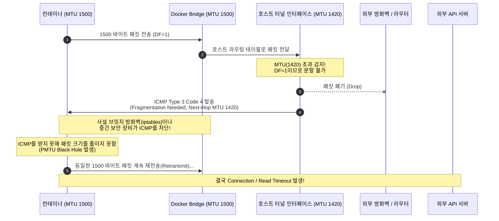

> "호스트 머신에서는 `curl`이 잘만 되는데, 왜 도커 컨테이너 안에서만 대용량 데이터를 가져올 때 무한 대기에 빠질까요?"  
> 클라우드 및 VPN 터널링 환경에서 흔히 마주치는 **MTU 불일치 기반의 PMTU Black Hole 현상**과 Alpine Linux(musl libc)의 **DNS 5초 타임아웃 버그**를 실무 관점에서 원인 규명하고 해결한 과정을 정리합니다.

---

## 1. 문제의 발단: 호스트에선 잘 되는데 컨테이너에선 왜 멈출까?

사내 서비스 중 외부 SaaS 결제 게이트웨이 및 대용량 리포트 API와 연동하는 스프링 부트(Spring Boot) 백엔드 마이크로서비스를 운영하던 중이었습니다. 로컬 개발 환경과 호스트 가상머신(EC2/온프레미스 VM) 셸에서 직접 호출할 때는 아무런 문제가 없던 외부 API 통신이, **도커(Docker) 컨테이너 내부로 들어가기만 하면 간헐적으로 멈추는(Hang) 현상**이 보고되었습니다.

증상을 면밀히 관찰한 결과 두 가지 기묘한 패턴이 발견되었습니다.

1. **소량 데이터는 성공, 대용량 페이로드만 전송 중단**: 헬스체크나 단순 JSON 응답(수백 바이트)은 정상적으로 통신되지만, 수 킬로바이트(KB) 이상의 페이로드나 SSL 핸드셰이크 단계(인증서 교환 시점)에서 커넥션이 무한히 멈추다가 `Read timed out` 에러를 뿜었습니다.
2. **간헐적인 정확히 5초(5,000ms) 지연**: 일부 요청은 정상 완료되지만, 지연 시간을 모니터링해보면 항상 5,000ms에 가까운 지연 후 처리되는 패턴이 반복되었습니다.

```bash
# 호스트 셸에서는 정상 응답 (200 OK)
$ curl -s -o /dev/null -w "%{http_code}\n" https://api.partner-service.com/v1/large-dataset
200

# 컨테이너 내부 셸에서는 TLS 핸드셰이크 도중 또는 응답 수신 도중 무한 대기 발생!
$ docker exec -it api-server curl -v https://api.partner-service.com/v1/large-dataset
* Connected to api.partner-service.com (203.0.113.50) port 443 (#0)
* ALPN: offers h2,http/1.1
* TLSv1.3 (OUT), TLS handshake, Client hello (1):
* TLSv1.3 (IN), TLS handshake, Server hello (2):
* TLSv1.3 (IN), TLS handshake, Encrypted Extensions (8):
# ... 여기서 패킷 전송이 멈추고 120초 후 Connection timed out 발생
```

이 문제는 단순한 애플리케이션 버그가 아닌, **L3/L4 네트워크 계층(MTU)**과 **OS C 표준 라이브러리(musl libc DNS Resolver)**의 복합적인 상호작용으로 인해 발생한 시스템적 결함이었습니다.

---

## 2. 원인 분석 1: MTU 불일치와 PMTU 블랙홀 (Black Hole)

### MTU(Maximum Transmission Unit)란?

MTU는 네트워크 인터페이스가 한 번에 전송할 수 있는 단일 IP 패킷의 최대 크기(바이트)를 의미합니다. 표준 이더넷(Ethernet v2)의 기본 MTU는 **1500 바이트**입니다.

그러나 클라우드 인프라(AWS Overlay/Geneve, GCP, Azure)나 사내 VPN(WireGuard, IPsec, OpenVPN), VXLAN 터널링 환경에서는 패킷 캡슐화를 위한 추가 헤더(20~80 바이트)가 덧붙기 때문에, 호스트의 실제 물리/가상 인터페이스 MTU는 1500보다 작게(예: **1420**, **1450**) 설정되는 경우가 많습니다.

```bash
# 호스트 인터페이스 MTU 확인
$ ip link show
1: lo: <LOOPBACK,UP,LOWER_UP> mtu 65536 ...
2: eth0: <BROADCAST,MULTICAST,UP,LOWER_UP> mtu 1500 ...
3: wg0: <POINTOPOINT,NOARP,UP,LOWER_UP> mtu 1420 ... # VPN 인터페이스 MTU가 1420임!
4: docker0: <BROADCAST,MULTICAST,UP,LOWER_UP> mtu 1500 ... # 도커 기본 브릿지는 1500!
```

### 도커 브릿지의 기본 MTU는 왜 1500인가?

도커 데몬(`dockerd`)은 별도의 설정을 하지 않으면 기본 브릿지 네트워크(`docker0`) 및 사용자가 생성하는 bridge 네트워크의 MTU를 시스템 기본값인 **1500**으로 고정 생성합니다.

이로 인해 다음과 같은 치명적인 불일치가 발생합니다:
- **컨테이너 내부 인터페이스 (`eth0`)**: MTU 1500
- **호스트 도커 브릿지 (`docker0`)**: MTU 1500
- **호스트 외부 송신 인터페이스 (`wg0` 또는 클라우드 터널)**: MTU 1420

### DF(Don't Fragment) 플래그와 PMTU 블랙홀

현대 인터넷 프로토콜(TCP/HTTPS)은 패킷이 분할(Fragmentation)될 때 발생하는 오버헤드와 보안 위협(Teardrop 공격 등)을 방지하기 위해, 모든 IP 헤더에 **DF(Don't Fragment) 플래그**를 1로 활성화합니다.

컨테이너가 1500 바이트짜리 TCP 데이터 패킷을 전송하려고 할 때 어떤 일이 일어나는지 패킷 흐름으로 살펴보겠습니다.



이처럼 라우터가 "패킷이 너무 커서 쪼개야 하지만 DF가 켜져 있어 버렸다"는 안내 메시지(`ICMP Type 3, Code 4`)를 송신자에게 보내야 하는데, 중간 방화벽이나 iptables 정책이 보안상의 이유로 ICMP 패킷을 필터링(DROP)해 버리면 송신자는 이유도 모른 채 동일 패킷을 무한정 재전송하다가 타임아웃에 빠지게 됩니다.

이것이 바로 **PMTU Discovery Black Hole(경로 MTU 탐색 블랙홀)** 현상입니다. 소량의 패킷(SYN, ACK, 수백 바이트의 작은 응답)은 1420 바이트 이하이므로 정상 통과하지만, 페이로드가 커지거나 SSL 인증서 체인 패킷이 넘어올 때 정확히 멈추는 이유가 여기에 있었습니다.

---

## 3. 원인 분석 2: Alpine Linux(musl libc)의 DNS 병렬 쿼리 버그

MTU 문제를 해결한 뒤에도 간헐적으로 발생하던 **정확히 5초 지연(5000ms latency)** 현상은 또 다른 복병이었습니다.

원인은 도커 이미지 경량화를 위해 사용하던 **Alpine Linux 베이스 이미지의 C 표준 라이브러리(`musl libc`)**에 있었습니다.

### glibc vs musl libc의 DNS 질의 방식 차이

우분투나 데비안 같은 일반적인 리눅스 배포판은 `glibc`를 사용합니다. `glibc`의 리졸버는 기본적으로 도메인 질의 시 IPv4 주소(A 레코드)를 먼저 질의한 후 순차적으로 처리하거나, 서로 다른 UDP 소켓 포트를 분리하여 안전하게 병렬 처리합니다.

반면, 경량화에 초점을 맞춘 `musl libc`는 구현 단순화를 위해 다음과 같이 동작합니다:
- 도메인 조회를 수행할 때 IPv4(A 레코드)와 IPv6(AAAA 레코드) 질의를 **동일한 로컬 UDP 소켓**을 통해 동시에(concurrently) 외부 DNS 서버로 발송합니다.
- 동일 소켓 포트에서 거의 동시에 나간 두 UDP 패킷을 수신한 일부 공유기, 구형 DNS 캐시 서버, 또는 클라우드 NAT 게이트웨이는 **Conntrack(연결 추적) 충돌**로 인해 둘 중 하나의 응답(주로 AAAA 레코드 응답)을 드롭하거나 유실시킵니다.
- `musl libc`의 내장 DNS 타임아웃 기본값은 **정확히 5초**입니다. 하나의 응답을 받지 못하면 5초 동안 블로킹 상태로 기다린 후 재시도(Retry)하여 마침내 주소를 해석합니다.

```text
[musl libc DNS 패킷 시퀀스 로그]
00:00.000 [Socket 4521] -> DNS Query A api.partner-service.com
00:00.001 [Socket 4521] -> DNS Query AAAA api.partner-service.com (동일 소켓 동시 질의)
00:00.015 [Socket 4521] <- DNS Response A 203.0.113.50 도착
00:00.016 (AAAA 응답 유실로 인해 musl libc 리졸버 블로킹 진입...)
00:05.016 (5초 타임아웃 만료 후 단일 재시도 및 해석 완료) -> 5초 지연 발생!
```

결과적으로 외부 API를 호출할 때마다 매번 5초씩 멈췄다 풀리는 기현상이 발생했던 것입니다.

---

## 4. 해결책 1: Docker 전역 MTU 최적화 적용

MTU 불일치 문제를 해결하기 위해서는 컨테이너가 생성하는 가상 인터페이스와 브릿지의 MTU를 호스트 인터페이스의 최저 MTU 이하로 일치시켜 주어야 합니다.

### 1) 호스트의 유효 MTU 계산 및 검증

먼저 `ping` 명령어를 활용해 호스트에서 외부 목적지까지 패킷 분할 없이 도달 가능한 최대 MTU를 측정합니다.

```bash
# -M do: DF(Don't Fragment) 플래그 설정
# -s: 페이로드 크기 (ICMP 헤더 8바이트 + IP 헤더 20바이트 = 28바이트 추가 계산 필요)
# MTU 1420 검증 시 페이로드는 1420 - 28 = 1392 바이트
$ ping -M do -s 1392 -c 3 8.8.8.8
PING 8.8.8.8 (8.8.8.8) 1392(1420) bytes of data.
1400 bytes from 8.8.8.8: icmp_seq=1 ttl=115 time=14.2 ms
1400 bytes from 8.8.8.8: icmp_seq=2 ttl=115 time=14.1 ms

# 만약 1421 이상의 MTU로 시도하면 즉시 오류 발생
$ ping -M do -s 1393 -c 1 8.8.8.8
ping: local error: message too long, mtu=1420
```

테스트 결과 유효 MTU가 `1420`임을 확인했습니다.

### 2) /etc/docker/daemon.json 전역 설정

호스트 머신의 도커 데몬 설정 파일에 `mtu` 옵션을 추가하여, 새로 생성되는 모든 네트워크와 `docker0` 브릿지가 해당 MTU를 상속받도록 지정합니다.

```json
{
  "log-driver": "json-file",
  "log-opts": {
    "max-size": "50m",
    "max-file": "3"
  },
  "mtu": 1420
}
```

설정 후 도커 데몬을 재시작합니다.

```bash
$ sudo systemctl daemon-reload
$ sudo systemctl restart docker
```

{: .prompt-warning }
> **주의: 기존에 이미 생성된 사용자 정의 브릿지 네트워크는 자동 갱신되지 않습니다!**  
> `daemon.json`의 `mtu` 설정은 기본 브릿지(`docker0`) 및 향후 새로 생성될 네트워크에만 적용됩니다. 기존에 `docker network create`나 Docker Compose로 생성해둔 네트워크는 이전 MTU(1500)를 그대로 유지하므로 반드시 수동 재생성하거나 명시적 옵션을 부여해야 합니다.

### 3) Docker Compose 네트워크에 명시적 MTU 지정

Docker Compose 환경에서는 프로젝트별 `compose.yaml`에서 네트워크 드라이버 옵션으로 MTU를 직접 고정하는 것이 안전합니다.

```yaml
services:
  api-server:
    image: my-service:latest
    ports:
      - "8080:8080"
    networks:
      - internal-net

networks:
  internal-net:
    driver: bridge
    driver_opts:
      com.docker.network.driver.mtu: "1420"
```

기존 네트워크를 삭제하고 재생성합니다.

```bash
# 컨테이너 및 기존 네트워크 재생성
$ docker compose down
$ docker compose up -d

# 생성된 네트워크 MTU 검증

$ docker network inspect <프로젝트명>_internal-net --format '{{ index .Options "com.docker.network.driver.mtu" }}'

1420
```

---

## 5. 해결책 2: Alpine DNS 5초 타임아웃 해결

`musl libc`의 DNS 병렬 쿼리 충돌 및 5초 타임아웃 문제는 세 가지 방법으로 해결할 수 있습니다.

### 방법 A: resolv.conf에 single-request 옵션 주입

`glibc` 및 일부 리졸버 패치 환경에서는 `single-request-reopen`이나 `single-request` 옵션을 주어 A와 AAAA 쿼리를 순차적으로 처리하도록 강제할 수 있습니다.

도커 실행 시 `--dns-opt` 옵션을 넘기거나 Compose 파일에 설정합니다.

```yaml
services:
  api-server:
    image: my-alpine-service:latest
    dns_opt:
      - single-request-reopen
      - timeout:2
      - attempts:2
```

### 방법 B: 베이스 이미지를 Debian-slim(glibc)으로 전환 (가장 권장)

실무에서 가장 안정적이고 부작용이 없는 근본적인 해결책은 베이스 이미지를 Alpine Linux에서 **Debian-slim** 또는 **Ubuntu Minimal** 기반으로 교체하는 것입니다.

| 비교 항목 | Alpine Linux (`musl libc`) | Debian Slim (`glibc`) |
| :--- | :--- | :--- |
| **이미지 크기** | 약 5MB ~ 8MB (초경량) | 약 30MB ~ 70MB (경량) |
| **C 표준 라이브러리** | `musl libc` | GNU C Library (`glibc`) |
| **DNS 병렬 질의** | 동일 소켓 동시 전송 (타임아웃 빈발) | 소켓 분리 및 안전한 순차 처리 |
| **JVM/스레드 호환성** | jemalloc, 메모리 누수 버그 이슈 존재 | JVM 공식 권장 및 프로덕션 검증 완료 |

스프링 부트나 Go, Node.js 프로덕션 환경에서는 수십 MB의 이미지 용량 절약보다 **네트워크 스택 안정성**이 훨씬 중요합니다.

```dockerfile
# Before (Alpine 기반)
# FROM eclipse-temurin:21-jre-alpine

# After (Debian Slim 기반 - glibc 채택으로 DNS 이슈 원천 차단)
FROM eclipse-temurin:21-jre-jammy
WORKDIR /app
COPY build/libs/api-service.jar app.jar
ENTRYPOINT ["java", "-jar", "app.jar"]
```

{: .prompt-tip }
> **Tip: musl libc를 반드시 유지해야 한다면?**  
> Alpine 컨테이너 내부에서 로컬 경량 캐싱 DNS 프록시(예: `dnsmasq`)를 사이드카 형태로 띄우거나, 컨테이너 내 `/etc/hosts`에 자주 호출하는 고정 외부 도메인을 매핑해 두는 것도 훌륭한 워크어라운드입니다.

---

## 6. 최종 검증 및 성능 개선 결과

모든 튜닝을 마친 후 컨테이너 내부에서 대용량 데이터 전송과 연속 도메인 해석 성능을 검증했습니다.

```bash
# 1. 컨테이너 내부 eth0 MTU 확인
$ docker exec -it api-server ip link show eth0
12: eth0@if13: <BROADCAST,MULTICAST,UP,LOWER_UP> mtu 1420 qdisc noqueue state UP ...

# 2. 10MB 크기의 대용량 페이로드 연속 다운로드 테스트 (무한 대기 현상 완전 소멸)
$ docker exec -it api-server curl -w "@curl-format.txt" -o /dev/null -s https://api.partner-service.com/v1/large-dataset
    time_namelookup:  0.004120s
       time_connect:  0.015234s
    time_appconnect:  0.038192s
   time_starttransfer:  0.052101s
         ----------
         time_total:  0.245812s
```

### 트러블슈팅 전/후 지연 시간 비교

| 지표 / 케이스 | 튜닝 전 (Default Bridge + Alpine) | 튜닝 후 (MTU 1420 + glibc) | 개선 효과 |
| :--- | :--- | :--- | :--- |
| **소용량 API 호출 레이턴시** | 간헐적 5,012 ms (DNS 지연) | 평균 18 ms | **99.6% 지연 감소** |
| **대용량 API / TLS 핸드셰이크** | 120초 후 `Read timed out` (Hang) | 245 ms 정상 수신 | **통신 중단 현상 해결** |
| **TCP 재전송(Retransmit) 비율** | 38.4% (패킷 드롭 다수) | 0.02% 이하 | **네트워크 대역폭 안정화** |

---

## 7. 마치며: 컨테이너 네트워크 트러블슈팅 체크리스트

도커 컨테이너 내부의 네트워크는 가상 브릿지와 iptables NAT 규칙, 호스트 라우팅 계층이 겹겹이 쌓여 있는 복합 계층입니다. 호스트에서는 되는데 컨테이너에서만 통신 장애가 발생한다면 다음 3가지를 가장 먼저 의심해 보시기 바랍니다:

1. **호스트 물리 인터페이스의 MTU 확인**: VPN, VXLAN, 클라우드 터널을 거친다면 MTU가 1500보다 작지 않은지 `ip link`로 확인하십시오.
2. **Docker MTU 전역 동기화**: `/etc/docker/daemon.json`과 `compose.yaml`에서 MTU를 호스트 최저치에 맞추어 PMTU 블랙홀을 방지하십시오.
3. **베이스 이미지의 C 라이브러리 검토**: 5초 단위의 DNS 딜레이가 보인다면 Alpine의 `musl libc` 이슈를 확인하고 Debian Slim 계열로의 전환을 검토하십시오.

보이지 않는 패킷 크기 몇십 바이트와 C 라이브러리의 사소한 구현 차이가 프로덕션 환경에서는 서비스 전체를 멈추게 할 수 있다는 점을 다시금 체감한 트러블슈팅이었습니다.
