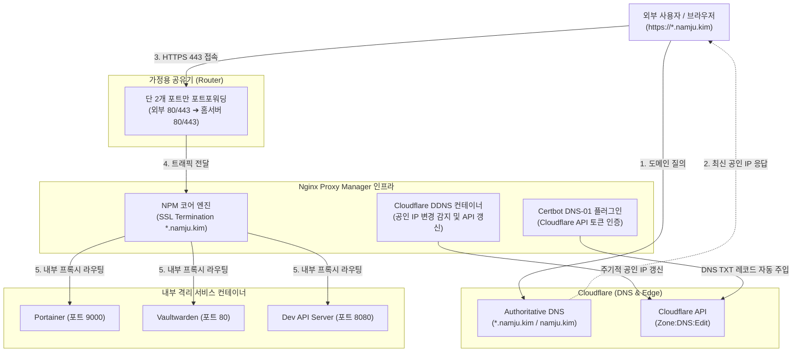

> 가정용 인터넷의 유동 IP 환경에서 홈서버를 안정적으로 외부에 서비스하려면 실시간 IP 갱신과 안전한 역방향 프록시(Reverse Proxy) 구성이 필수적입니다. Cloudflare API 기반 DDNS로 공인 IP를 자동 동기화하고, Nginx Proxy Manager(NPM)의 DNS-01 챌린지를 통해 포트 개방 없이 와일드카드 SSL 인증서(`*.namju.kim`)를 발급·라우팅하는 실무 파이프라인을 정리합니다.

---

## 1. 홈서버 외부 노출 시 마주치는 세 가지 기술적 장벽

맥 미니(Mac mini)나 소형 x86 미니 PC를 활용해 개인 개발 서버(Homelab)를 구축하다 보면, 로컬 네트워크(192.168.x.x)를 넘어 외부에서도 개발 중인 웹 서비스, 포테이너(Portainer), 개인 위키 등에 접속해야 하는 순간이 찾아옵니다.

하지만 가정용 인터넷 회선 환경에서 직접 서버를 운영할 때는 클라우드(AWS, GCP) 환경과 다른 세 가지 현실적인 문제에 직면하게 됩니다.

1. **주기적으로 변하는 유동 IP (Dynamic IP)**: 대부분의 가정용 ISP는 주기적으로 공인 IP(Public IP)를 재할당합니다. 공유기가 재부팅되거나 통신사 임대 기간이 만료되면 기껏 등록해 둔 DNS A 레코드의 목적지 IP가 어긋나 외부 접속이 끊깁니다.
2. **포트 지옥과 보안 취약점**: 구동하는 서비스가 늘어날 때마다 공유기 관리자 페이지에서 포트포워딩(8080, 9000, 3000 등)을 하나씩 추가하다 보면, 어떤 포트가 어디로 연결되는지 관리가 불가능해지고 외부에 불필요한 포트가 무방비로 열리게 됩니다.
3. **80 포트 차단과 Let's Encrypt Rate Limit**: 통신사에 따라 인바운드 80(HTTP) 포트를 원천 차단하는 경우가 있어 기본 HTTP-01 챌린지 방식으로 SSL 인증서를 발급받기 어렵습니다. 또한 서브도메인(`portainer.namju.kim`, `git.namju.kim`, `api.namju.kim`)마다 인증서를 따로 발급받다 보면 Let's Encrypt의 주간 발급 제한(Rate Limit)에 걸리거나 갱신 누락이 발생합니다.

이 문제를 가장 깔끔하고 우아하게 해결하는 아키텍처가 바로 **Cloudflare DDNS + Nginx Proxy Manager(NPM) + DNS-01 와일드카드 인증서**의 조합입니다.

---

## 2. 전체 네트워크 아키텍처 및 트래픽 흐름

외부 사용자가 브라우저에서 `https://subdomain.namju.kim`으로 접근했을 때, 트래픽이 홈서버 내부의 대상 컨테이너까지 도달하는 전체 구조는 다음과 같습니다.



핵심 동작 원리는 다음과 같습니다.

- **Cloudflare DDNS 컨테이너**: 홈서버에서 5분마다 외부 공인 IP를 확인하고, IP가 바뀌었을 때만 Cloudflare API를 호출하여 도메인 A 레코드를 갱신합니다.
- **DNS-01 챌린지**: 80 포트를 통한 웹서버 검증(HTTP-01) 대신, Cloudflare API를 통해 `_acme-challenge.namju.kim` TXT 레코드를 일시적으로 생성하여 도메인 소유권을 입증합니다. 이를 통해 **인터넷 80 포트가 닫혀 있어도**, 그리고 하나의 인증서로 모든 서브도메인을 커버하는 **와일드카드 인증서(`*.namju.kim`)**를 손쉽게 발급받을 수 있습니다.
- **Nginx Proxy Manager (NPM)**: 공유기로부터 들어온 443(HTTPS) 트래픽을 받아 와일드카드 SSL을 복호화(SSL Termination)한 뒤, 서브도메인 이름에 맞춰 Docker 내부 브리지 네트워크(`npm-network`) 상의 대상 컨테이너로 전달합니다.

---

## 3. 1단계: Cloudflare API 토큰 발급 및 보안 스코프 설정

DNS-01 챌린지와 DDNS 갱신을 수행하려면 Cloudflare 계정에서 최소 권한 원칙(Principle of Least Privilege)을 적용한 전용 API 토큰(API Token)을 발급받아야 합니다.

> [!WARNING]
> 모든 권한을 가진 전역 API 키(Global API Key)는 절대로 사용하지 마세요. 홈서버 설정 파일에 노출될 경우 Cloudflare에 등록된 모든 도메인의 제어권이 탈취될 수 있습니다. 반드시 특정 도메인(Zone)에만 국한된 제한적 API Token을 생성해야 합니다.
{: .prompt-warning }

1. [Cloudflare 대시보드](https://dash.cloudflare.com/)에 로그인한 뒤 우측 상단 프로필 ➔ **My Profile(내 프로필)** ➔ **API Tokens** 탭으로 이동합니다.
2. **Create Token(토큰 생성)** 버튼을 클릭하고, 화면 하단의 **Custom Token(사용자 지정 토큰)** 템플릿에서 `Get started`를 선택합니다.
3. 다음과 같이 권한과 리소스 범위를 엄격하게 제한합니다:
   - **Token name**: `homelab-dns-controller`
   - **Permissions**:
     - `Zone` - `DNS` - `Edit` (DNS 레코드 생성/수정/삭제 권한)
     - `Zone` - `Zone` - `Read` (도메인 존 목록 조회 권한)
   - **Zone Resources**:
     - `Include` - `Specific zone` - `namju.kim` (본인의 홈서버 도메인 선택)
   - **TTL / Client IP Filtering**: (선택 사항) 특정 IP 대역에서만 토큰을 사용하도록 제한 가능
4. 생성을 완료하면 40자리의 API 토큰 문자열이 한 번만 표시됩니다. 이 토큰을 안전한 비밀번호 관리자에 복사해 둡니다.

---

## 4. 2단계: DDNS 및 Nginx Proxy Manager 통합 배포 (`compose.yaml`)

홈서버 인프라를 일관되게 관리하기 위해 Cloudflare DDNS와 NPM을 단일 `compose.yaml`로 정의합니다. 공통 프록시 네트워크(`npm-network`)를 생성하여 향후 추가될 다른 컨테이너들도 손쉽게 프록시에 연결할 수 있도록 설계합니다.

### 4.1 환경 변수 분리 (`.env`)

인증 토큰과 도메인 정보를 코드와 분리하여 관리합니다.

```ini
# .env (홈랩 인프라 루트 디렉토리)
TZ=Asia/Seoul

# Cloudflare DDNS 설정
CF_API_TOKEN=v1.0-masked-token-xxxx-your-real-token
CF_DOMAINS=namju.kim,*.namju.kim

# NPM 관리자 포트 바인딩 (로컬 호스트 전용)
NPM_ADMIN_PORT=81
```

> [!TIP]
> 81번 NPM 웹 대시보드 포트는 외부 인터넷으로 포트포워딩하지 마세요. 로컬 LAN(`192.168.x.x:81`) 또는 향후 구성할 VPN(Tailscale/WireGuard)을 통해서만 안전하게 접속하는 것이 보안상 매우 중요합니다.
{: .prompt-tip }

### 4.2 완성형 `compose.yaml` 정의

DDNS 클라이언트로는 Go 언어 기반으로 가볍고 신뢰성이 높은 `favonia/cloudflare-ddns`를 사용하고, 리버스 프록시로는 직관적인 웹 UI와 자동 SSL 갱신 데몬을 내장한 `jc21/nginx-proxy-manager`를 사용합니다.

```yaml
# compose.yaml (홈랩 프록시 스택)
name: homelab-gateway

services:
  # 1. Cloudflare Dynamic DNS Updater
  cloudflare-ddns:
    image: favonia/cloudflare-ddns:latest
    container_name: cloudflare-ddns
    restart: unless-stopped
    environment:
      - CLOUDFLARE_API_TOKEN=${CF_API_TOKEN}
      - DOMAINS=${CF_DOMAINS}
      - PROXIED=false               # 홈서버 직접 연결 시 false (DNS Only)
      - UPDATE_CRON=@every 5m       # 5분 주기로 공인 IP 감지
      - IP6_PROVIDER=none           # IPv4 단일 회선인 경우 IPv6 비활성화
      - TZ=${TZ}
    network_mode: host              # 호스트 공인 IP를 정확히 감지하기 위해 host 모드 사용
    logging:
      driver: "json-file"
      options:
        max-size: "10m"
        max-file: "3"

  # 2. Nginx Proxy Manager Core
  nginx-proxy-manager:
    image: jc21/nginx-proxy-manager:latest
    container_name: nginx-proxy-manager
    restart: unless-stopped
    ports:
      - "80:80"                     # HTTP 표준 인바운드
      - "443:443"                   # HTTPS 표준 인바운드
      - "${NPM_ADMIN_PORT}:81"      # 관리자 웹 콘솔
    environment:
      - DISABLE_IPV6=true
      - TZ=${TZ}
    volumes:
      - ./data:/data                # NPM 설정, 호스트 라우팅 SQLite DB 저장소
      - ./letsencrypt:/etc/letsencrypt # 발급된 Let's Encrypt SSL 인증서 영속화
    networks:
      - npm-network
    depends_on:
      - cloudflare-ddns

networks:
  npm-network:
    name: npm-network
    driver: bridge
```

컨테이너를 기동합니다.

```bash
docker compose up -d
```

기동 후 DDNS 로그를 확인하여 A 레코드가 정상적으로 감지되고 갱신되었는지 검증합니다.

```bash
docker logs -f cloudflare-ddns
```

```text
# 정상 동작 로그 예시
INFO: favonia/cloudflare-ddns ...
INFO: Checking public IP addresses...
INFO: Detected IPv4 address: 121.135.xxx.xxx
INFO: Updating DNS records for namju.kim and *.namju.kim...
INFO: Successfully updated DNS records.
```

---

## 5. 3단계: DNS-01 챌린지를 통한 와일드카드 SSL 인증서 발급

공유기 설정 페이지에서 **외부 80/443 포트가 홈서버의 내부 IP(예: 192.168.0.50)의 80/443 포트로 포워딩**되도록 규칙을 등록한 뒤, NPM 웹 콘솔에서 인증서를 발급합니다.

1. 웹 브라우저에서 `http://192.168.0.50:81`로 접속합니다.
   - 기본 계정: `admin@example.com` / `changeme`
   - 최초 로그인 시 관리자 이메일과 안전한 비밀번호로 즉시 변경합니다.
2. 상단 메뉴에서 **SSL Certificates** ➔ **Add SSL Certificate** ➔ **Let's Encrypt**를 클릭합니다.
3. 모달 창에서 다음과 같이 값을 입력합니다:
   - **Domain Names**: `*.namju.kim`, `namju.kim` (두 개 모두 입력 후 Enter)
   - **Email Address for Let's Encrypt**: 본인의 실제 알림 이메일 입력
   - **Use a DNS Challenge**: **ON (체크 활성화)**
   - **DNS Provider**: `Cloudflare` 선택
   - **Credentials File Content**:
     ```ini
     # 기존 내용을 지우고 발급받은 API 토큰을 입력합니다.
     dns_cloudflare_api_token = v1.0-masked-token-xxxx-your-real-token
     ```
   - **Propagation Seconds**: `120` (Cloudflare 네임서버 전파 대기 시간, 기본 30초보다 넉넉하게 120초 권장)
   - **I Agree to the Let's Encrypt Subscriber Agreement**: **ON**
4. **Save**를 누르면 NPM 백그라운드에서 Certbot이 Cloudflare API를 호출하여 임시 TXT 레코드를 생성하고, Let's Encrypt의 검증을 거쳐 와일드카드 인증서를 즉시 다운로드합니다.

발급이 완료되면 SSL 목록에 `*.namju.kim, namju.kim` 항목이 표시되며, 유효기간 3개월과 자동 갱신 상태가 활성화됩니다.

---

## 6. 4단계: 서브도메인 Proxy Host 라우팅 및 실무 필수 옵션

이제 프록시 호스트를 생성하여 서브도메인별로 내부 서비스를 연결합니다. 예를 들어 동일한 도커 호스트에서 구동 중인 Portainer 컨테이너(`portainer:9000`)를 `portainer.namju.kim`으로 연결하는 과정입니다.

### 6.1 같은 Docker 네트워크(`npm-network`)에 서비스 참여시키기

외부 서비스 컨테이너(예: Portainer)가 NPM과 통신하려면 동일한 Docker 네트워크에 속해 있어야 합니다. 대상 서비스의 `compose.yaml`에 외부 네트워크(`external: true`)를 지정합니다.

```yaml
# portainer/compose.yaml
services:
  portainer:
    image: portainer/portainer-ce:latest
    container_name: portainer
    restart: unless-stopped
    volumes:
      - /var/run/docker.sock:/var/run/docker.sock
      - portainer_data:/data
    networks:
      - npm-network # NPM과 공유하는 네트워크

volumes:
  portainer_data:

networks:
  npm-network:
    external: true
```

### 6.2 NPM 대시보드에서 Proxy Host 등록

1. NPM 대시보드 ➔ **Hosts** ➔ **Proxy Hosts** ➔ **Add Proxy Host**를 클릭합니다.
2. **Details** 탭 설정:
   - **Domain Names**: `portainer.namju.kim`
   - **Scheme**: `http`
   - **Forward Hostname / IP**: `portainer` (동일 Docker 네트워크 내부에서는 컨테이너 이름으로 바로 통신 가능)
   - **Forward Port**: `9000`
   - **Cache Assets**: OFF
   - **Block Common Exploits**: ON (기본적인 SQL Injection, XSS 패턴 차단)
   - **Websockets Support**: **ON (필수!)**
     > [!IMPORTANT]
     > Portainer의 웹 셸(Exec 콘솔)이나 로그 실시간 스트리밍, Nextcloud의 파일 동기화 등 실시간 양방향 통신을 사용하는 서비스는 반드시 **Websockets Support**를 켜야 세션 끊김 현상이 발생하지 않습니다.
     {: .prompt-important }
3. **SSL** 탭 설정:
   - **SSL Certificate**: 이전 단계에서 발급받은 `*.namju.kim, namju.kim` 와일드카드 인증서 선택
   - **Force SSL**: ON (모든 HTTP 80 요청을 HTTPS 443으로 301 리다이렉트)
   - **HTTP/2 Support**: ON (다중화 스트리밍 성능 향상)
   - **HSTS Enabled**: ON (브라우저 수준의 강력한 보안 강제)
4. **Save**를 누르면 설정이 즉시 Nginx 설정 파일로 컴파일되어 반영됩니다.

이제 외부 브라우저에서 `https://portainer.namju.kim`으로 접속하면, 녹색 자물쇠와 함께 유효한 Let's Encrypt SSL 인증서가 적용된 Portainer 대시보드가 열리는 것을 확인할 수 있습니다.

---

## 7. 운영 및 보안 트러블슈팅 가이드

### 7.1 Cloudflare Proxy(주황색 구름)와 DNS Only(회색 구름) 선택 기준

Cloudflare DDNS 설정 시 `PROXIED` 플래그는 기본적으로 `false`(회색 구름, DNS Only)를 권장합니다.

| 구분 | DNS Only (회색 구름, 권장) | Cloudflare Proxied (주황색 구름) |
| :--- | :--- | :--- |
| **공인 IP 노출** | 노출됨 (직접 통신) | 은닉됨 (Cloudflare 엣지 IP 경유) |
| **SSL 인증서** | 홈서버 NPM 와일드카드 직접 종단 | Cloudflare Edge 인증서 + 홈서버 인증서 (Full Strict) |
| **파일 업로드 용량** | 제한 없음 (Nginx `client_max_body_size` 기준) | 무료 플랜 기준 단일 요청 100MB 엄격 제한 |
| **비표준 포트 및 스트리밍** | 제한 없음 | WebSocket/대용량 미디어 스트리밍 시 정책 제약 발생 가능 |

홈서버에서 대용량 파일 전송(Nextcloud)이나 영상 스트리밍(Jellyfin/Plex)을 운용한다면 Cloudflare의 100MB 업로드 한계와 약관 위반을 방지하기 위해 **DNS Only**로 운영하거나, 해당 도메인만 서브도메인별로 분리하는 것이 좋습니다.

### 7.2 인증서 자동 갱신 주기와 주기적 헬스체크

NPM 내부에는 Certbot 데몬이 백그라운드 크론으로 상주하며, 만료 30일 전부터 매일 DNS-01 챌린지를 시도하여 인증서를 자동 갱신합니다.

인증서 상태가 의심스럽다면 컨테이너 내부에서 직접 테스트 갱신 명령을 실행해 볼 수 있습니다:

```bash
docker exec -it nginx-proxy-manager certbot renew --dry-run
```

`--dry-run` 테스트에서 에러가 발생하지 않는다면, 3개월마다 인증서 만료를 걱정할 필요 없이 100% 무중단으로 홈서버의 와일드카드 SSL 환경이 유지됩니다.

---

## 8. 마치며

Cloudflare DDNS와 Nginx Proxy Manager를 결합한 홈서버 게이트웨이는 다음과 같은 강력한 이점을 제공합니다.

- ISP의 유동 IP 변경에도 5분 이내로 자동 복구되어 안정적인 접속 보장
- 공유기에서 단 2개의 포트(80, 443)만 개방하여 홈 네트워크 공격 표면(Attack Surface) 최소화
- 단 한 번의 DNS-01 챌린지로 서브도메인 개수 제한 없는 와일드카드 SSL 발급 및 자동 갱신
- 향후 신규 서비스 추가 시 `compose.yaml`에서 `npm-network`만 연결하고 NPM 웹 콘솔에서 도메인을 매핑하는 극도의 운영 편의성

다음 포스트에서는 이 게이트웨이 위에 올라가는 다양한 홈서버 컨테이너들을 웹 UI에서 한눈에 관리하고, Git 저장소(GitOps)와 연동하여 자동으로 배포하는 **Portainer CE 운영 전략**을 다루겠습니다.
