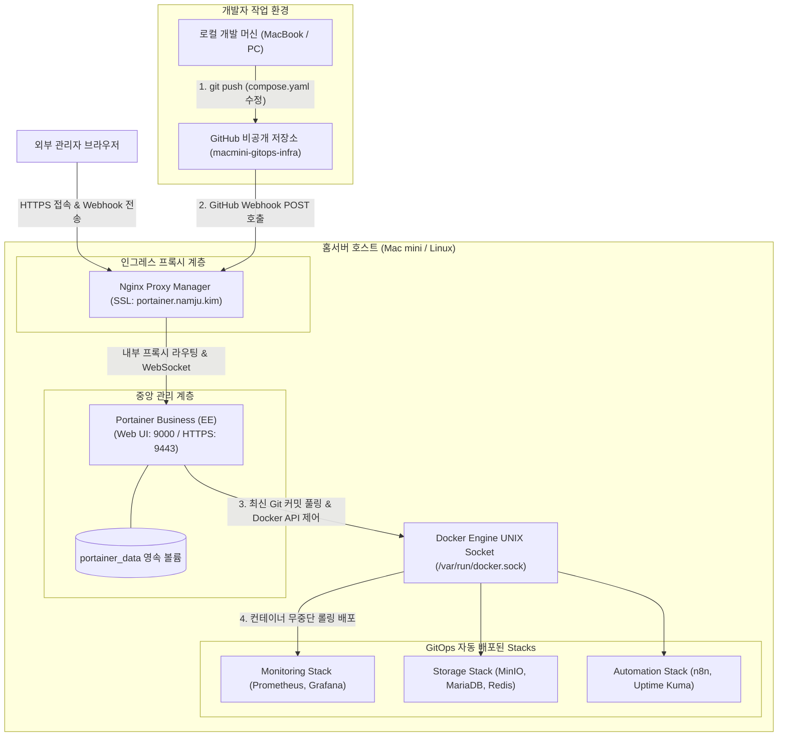

> 홈서버에서 운영하는 컨테이너가 늘어날수록 SSH 터미널 접속을 통한 수동 배포 방식은 심각한 관리 피로를 야기합니다. Portainer 공식의 **'Take 3 Nodes Free'** 정책을 활용하여 상용 버전인 **Portainer Business Edition(EE)**을 100% 무료로 구축하고, GitHub 비공개 저장소(`macmini-gitops-infra`)의 Webhook과 연동하여 선언적 GitOps 자동 배포 파이프라인을 완성하는 아키텍처를 정리합니다.

---

## 1. 배경: 왜 CE 대신 처음부터 Business Edition(EE)인가?

홈서버 환경에서 도커 컨테이너를 GUI로 관리하고자 할 때 대부분 당연하게 커뮤니티 에디션(CE)을 먼저 설치합니다. 하지만 많은 분들이 놓치고 있는 강력한 공식 혜택이 있습니다.

Portainer 공식 홈페이지에서는 개인 홈랩, 학생, 소규모 엔지니어를 위해 **상용 엔터프라이즈 버전인 Portainer Business Edition (EE) 라이선스를 최대 3개 노드까지 평생 무료("Take 3 Nodes Free")**로 상시 제공하고 있습니다.

### 1.1 홈랩 환경에서 Business Edition(EE)이 압도적인 이유

| 비교 항목 | Portainer Community (CE) | **Portainer Business (EE 3 Nodes Free)** |
| :--- | :--- | :--- |
| **라이선스 비용** | 오픈소스 (무료) | **3개 노드 평생 무료 (Free)** |
| **Git Webhook 자동 배포** | 지원 안 됨 또는 제한적 (수동 5분 Polling) | **공식 네이티브 지원 (Webhook 즉시 반영)** |
| **Git 인증 및 권한** | 기본 PAT 인증 | **세분화된 Git 자격 증명 및 브랜치 잠금** |
| **감사 로그 (Activity Logs)** | 지원 안 됨 | **모든 컨테이너 조작/셸 접근 기록 추적** |
| **레지스트리 관리** | 기본 등록 | **취약점 스캔 및 프라이빗 레지스트리 캐싱** |
| **RBAC (역할 기반 접근 제어)** | 단순 관리자/사용자 분리 | **팀/유저별 세밀한 권한 제어** |

개인 맥미니나 홈서버는 어차피 단일 노드 또는 2~3대 이내로 운영되므로, **3 Nodes Free 정책만으로 모든 엔터프라이즈 기능을 0원**에 온전히 누릴 수 있습니다. 특히 GitHub 저장소에 코드를 푸시하자마자 즉시 서버에 반영되는 **'진짜 GitOps'**를 구현하려면 Webhook을 완벽히 지원하는 EE 에디션이 필수적입니다.

---

## 2. 전체 GitOps 배포 파이프라인 아키텍처

개발자가 로컬 머신에서 Git 저장소에 Compose 파일을 커밋하고 푸시하면, GitHub Webhook이 홈서버의 Portainer EE로 신호를 보내 컨테이너를 무중단으로 자동 배포하는 전체 구조입니다.



---

## 3. 1단계: 3 Nodes Free 무료 라이선스 키 발급

Portainer Business Edition을 실행하기 전에 1분 만에 무료 라이선스 키를 발급받습니다.

1. 웹 브라우저에서 [Portainer 공식 Take 3 Nodes Free 페이지](https://www.portainer.io/take-3)에 접속합니다.
2. 이름과 이메일 주소를 입력하고 라이선스 발급을 신청합니다.
3. 입력한 이메일 함을 확인하면 **25자리 라이선스 키 문자열(`XXXX-XXXX-XXXX-...`)**이 즉시 도착해 있습니다. 이 키를 안전하게 보관합니다.

---

## 4. 2단계: Portainer Business(EE) 컨테이너 배포 (`compose.yaml`)

처음부터 `portainer/portainer-ee:latest` 이미지를 사용하여 컨테이너를 배포합니다.

### 4.1 디렉토리 구조 및 `compose.yaml` 작성

홈서버의 관리 스택 디렉토리(`~/homelab/portainer`)에 설정 파일을 생성합니다.

```yaml
# compose.yaml (Portainer Business EE 스택)
name: homelab-management

services:
  portainer:
    image: portainer/portainer-ee:latest
    container_name: portainer
    restart: unless-stopped
    security_opt:
      - no-new-privileges:true
    ports:
      - "127.0.0.1:9000:9000"       # 호스트 로컬 루프백 바인딩 (외부 직접 노출 차단)
      - "127.0.0.1:9443:9443"       # 자체 HTTPS 포트 (선택 사항)
    volumes:
      - /etc/localtime:/etc/localtime:ro
      - /var/run/docker.sock:/var/run/docker.sock:rw # 호스트 도커 데몬 소켓 마운트
      - portainer_data:/data        # Portainer 설정, 계정, 라이선스 영속화
    networks:
      - npm-network                 # NPM 리버스 프록시와 통신하는 브릿지 네트워크

volumes:
  portainer_data:
    name: portainer_data

networks:
  npm-network:
    external: true
```

> [!WARNING]
> 호스트 포트를 `0.0.0.0:9000`으로 열어두면 공유기 포트포워딩 환경이나 로컬 네트워크에서 포트 스캔을 통해 관리자 웹 콘솔이 그대로 노출됩니다. 반드시 `127.0.0.1:9000:9000`으로 로컬호스트에만 바인딩하고, 외부 접근은 NPM 리버스 프록시만을 경유하도록 격리해야 합니다.
{: .prompt-warning }

### 4.2 컨테이너 기동 및 초기 라이선스 등록

```bash
docker compose up -d
```

> [!IMPORTANT]
> **초기 접속 타임아웃 규칙**: Portainer 컨테이너가 최초 구동된 후 **5분 이내**에 관리자 계정을 생성하지 않으면 보안을 위해 웹 서버가 자동으로 잠깁니다. 만약 접속이 늦어져 화면이 닫혔다면 `docker restart portainer` 명령어로 컨테이너를 재시작한 뒤 접속해야 합니다.
{: .prompt-important }

1. 브라우저에서 `http://<홈서버_IP>:9000`에 접속합니다.
2. 초기 관리자(`admin`) 아이디와 강력한 비밀번호를 생성합니다.
3. 다음 화면에서 **라이선스 등록(Submit License)** 창이 나타납니다. 이메일로 수신한 **3 Nodes Free 라이선스 키**를 붙여넣고 제출하면 모든 비즈니스 에디션 기능이 즉시 언락됩니다.

---

## 5. 3단계: Nginx Proxy Manager 리버스 프록시 및 WebSocket 연동

내부 9000 포트 대신 `https://portainer.namju.kim` 도메인으로 안전하게 접근하도록 리버스 프록시 호스트를 등록합니다.

### 5.1 Proxy Host 세부 설정

NPM 관리자 대시보드(`http://<홈서버_IP>:81`)에서 **Add Proxy Host**를 클릭합니다.

1. **Details 탭**:
   - **Domain Names**: `portainer.namju.kim`
   - **Scheme**: `http`
   - **Forward Hostname / IP**: `portainer` (동일한 `npm-network` 내부이므로 서비스명 사용)
   - **Forward Port**: `9000`
   - **Block Common Exploits**: ON
   - **Websockets Support**: **ON (필수!)**
     > [!CAUTION]
     > Portainer의 핵심 기능인 웹 콘솔(컨테이너 내부 `docker exec` 터미널 접속) 및 실시간 로그 스트리밍은 HTTP WebSocket을 통해 전송됩니다. 이 옵션을 켜지 않으면 셸 접속 시 즉시 연결이 끊어집니다.
     {: .prompt-caution }
2. **SSL 탭**:
   - **SSL Certificate**: 미리 발급해 둔 `*.namju.kim` 와일드카드 인증서 선택
   - **Force SSL**: ON
   - **HTTP/2 Support**: ON
   - **HSTS Enabled**: ON

---

## 6. 4단계: Git 저장소 연동 및 Webhook 기반 GitOps Stacks 배포

Portainer Business의 진가는 Git 저장소와 연동하여 인프라를 코드로 관리(IaC)하는 **Git-backed Stacks** 기능에서 발휘됩니다.

### 6.1 GitHub Personal Access Token (PAT) 발급

비공개 저장소(`macmini-gitops-infra`)를 안전하게 클론하기 위해 최소 권한 토큰을 생성합니다.

1. GitHub ➔ **Settings** ➔ **Developer Settings** ➔ **Personal Access Tokens** ➔ **Fine-grained tokens**로 이동합니다.
2. 설정값:
   - **Repository access**: `Only select repositories` ➔ `macmini-gitops-infra` 선택
   - **Permissions**: `Repository permissions` ➔ `Contents`를 **Read-only**로 설정 (불필요한 쓰기 권한 원천 차단)
3. 발급된 토큰 문자열(`github_pat_xxxx...`)을 복사합니다.

### 6.2 Portainer에서 Git Stack 생성 및 Webhook 연동

1. Portainer 좌측 메뉴에서 **Stacks** ➔ **Add stack**을 클릭합니다.
2. **Name**: `homelab-storage`
3. **Build method**: **Repository** 선택
4. 세부 설정:
   - **Repository URL**: `https://github.com/<본인계정>/macmini-gitops-infra.git`
   - **Repository reference**: `refs/heads/main`
   - **Compose path**: `stacks/storage/compose.yaml`
   - **Authentication**: ON ➔ GitHub 아이디 및 PAT 토큰 입력
5. **GitOps Webhook 활성화 (EE 전용 핵심 기능)**:
   - **Auto update**: **ON**
   - **Mechanism**: **Webhook** 선택
   - 화면에 표시되는 고유 **Webhook URL**을 복사합니다:
     ```text
     https://portainer.namju.kim/api/stacks/webhooks/xxxx-xxxx-xxxx
     ```
6. 하단의 **Deploy the stack** 버튼을 클릭합니다.

### 6.3 GitHub Repository Webhook 등록

1. GitHub 저장소(`macmini-gitops-infra`) ➔ **Settings** ➔ **Webhooks** ➔ **Add webhook**을 클릭합니다.
2. **Payload URL**: 방금 Portainer에서 복사한 Webhook URL 입력
3. **Content type**: `application/json` 선택
4. **Which events**: `Just the push event` 선택
5. **Add webhook** 저장

이제 로컬 개발 환경에서 `compose.yaml`을 수정하고 `git push origin main`을 실행하는 즉시, GitHub이 Portainer에 신호를 보내 **단 5초 만에 홈서버 컨테이너가 무중단으로 최신 상태로 갱신**됩니다. 5분 주기로 헛돌던 수동 폴링과는 차원이 다른 실시간 GitOps 파이프라인이 완성됩니다.

---

## 7. 5단계: 도커 소켓 보안과 EE 감사 로그(Activity Logs) 활용

Portainer는 호스트의 루트 권한과 동일한 `/var/run/docker.sock`을 제어하므로 보안 다층 방어가 필수적입니다.

### 7.1 엔터프라이즈 감사 로그 (Activity Logs) 점검
Portainer Business 좌측 메뉴의 **Activity Logs**로 이동하면, 누가 언제 어떤 컨테이너를 재시작했는지, 어떤 이미지의 환경 변수를 조회했는지, 웹 콘솔 셸에 접속했는지가 초 단위로 모두 기록됩니다. 홈서버에 비정상적인 변경이 발생했을 때 원인을 추적하는 강력한 무기가 됩니다.

### 7.2 외부 접근 통제 (NPM Access Lists)
Portainer 관리자 페이지는 원칙적으로 외부 공인 IP에 무방비로 개방하지 않는 것이 안전합니다.
NPM의 **Access Lists** 기능을 설정하여 홈 네트워크 내부 IP 대역(`192.168.0.0/16`) 또는 사설 VPN(Tailscale `100.64.0.0/10`)에서만 접근할 수 있도록 차단 규칙을 적용하는 것을 적극 권장합니다.

---

## 8. 마치며

처음부터 무료로 제공되는 Portainer Business Edition(EE)을 홈서버의 두뇌로 배치함으로써 다음과 같은 성과를 얻었습니다.

- SSH 접속 없이 브라우저에서 모든 컨테이너와 볼륨, 네트워크를 직관적으로 제어
- GitHub 저장소(`macmini-gitops-infra`)와 Webhook을 연동하여 Git Push 한 번으로 끝나는 완전한 GitOps 배포 파이프라인 완성
- 활동 감사 로그(Activity Logs)와 RBAC를 통한 상용 서비스 수준의 홈랩 인프라 보안 구축

중앙 관리 시스템이 갖춰졌다면, 다음 과제는 백그라운드에서 실행되는 수십 개 오픈소스 컨테이너의 베이스 이미지를 항상 최신 보안 패치 상태로 유지하는 자동화입니다.

다음 포스트에서는 컨테이너의 최신 이미지를 주기적으로 감지하여 무중단으로 교체해 주는 **Watchtower 자동 갱신 전략**을 다루겠습니다.
