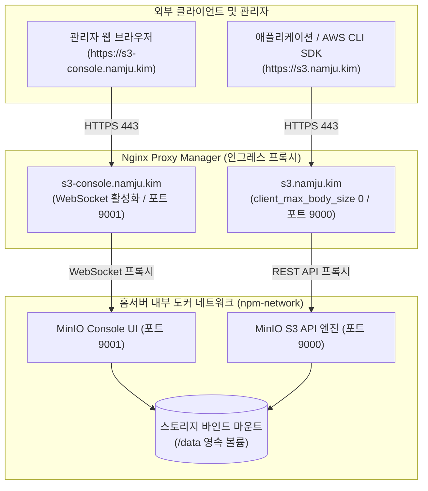

> 홈서버 환경에서 미디어 파일, 백업 아카이브, 정적 에셋을 관리할 때 AWS S3와 동일한 API 표준을 제공하는 고성능 오픈소스 객체 스토리지 MinIO를 구축합니다. API(9000)와 콘솔(9001) 포트 분리, Nginx Proxy Manager(NPM) 연동 시 필수 웹소켓 설정, 서비스 계정 발급 및 데이터 백업 영속화 전략까지 실무 운영 노하우를 상세히 정리합니다.

---

## 1. 홈서버에 객체 스토리지(Object Storage)가 필요한 이유

홈서버(Homelab)에서 운영하는 서비스가 늘어나다 보면 데이터 저장 방식에 대한 고민이 깊어집니다. 개인 블로그 에셋, n8n 자동화 워크플로우의 실행 결과물, 일일 데이터베이스 덤프 백업, 개인 포토 갤러리 및 위키 미디어 파일 등 보관해야 할 비정형 데이터는 끊임없이 쌓여갑니다.

초기에는 이러한 데이터들을 각 컨테이너의 바인드 마운트 디렉터리나 호스트 파일시스템(SMB, NFS)에 직접 저장하곤 합니다. 하지만 이 방식은 몇 가지 명확한 한계를 지닙니다.

1. **강한 결합도와 마이그레이션 장벽**: 애플리케이션 코드가 특정 로컬 절대 경로(`/mnt/storage/...`)에 종속되어 컨테이너 이설이나 클라우드 전환 시 코드 수정이 불가피합니다.
2. **클라우드 비용의 현실적 부담**: AWS S3나 Google Cloud Storage 같은 퍼블릭 클라우드는 뛰어난 내구성을 제공하지만, 수백 기가바이트에서 테라바이트 단위의 백업 데이터를 저장하기 시작하면 매달 누적되는 스토리지 비용과 특히 네트워크 아웃바운드(Egress) 전송 비용이 큰 부담으로 작용합니다.
3. **표준 API 생태계 활용 불가**: 최신 오픈소스 애플리케이션(n8n, Vaultwarden, Grafana, Mastodon, Nextcloud 등)과 최신 백엔드 프레임워크(Spring Boot, Node.js, Python)는 사실상의 업계 표준(De Facto Standard)으로 **AWS S3 API**를 채택하고 있습니다.

**MinIO**는 바로 이 간극을 완벽하게 메워주는 솔루션입니다. Go 언어로 작성되어 가볍고 초당 수 기가바이트의 처리량을 내는 고성능 오픈소스 객체 스토리지 엔진으로, AWS S3 API 규격을 100% 충실하게 지원합니다. 

기존의 `aws-cli`, `rclone`, 또는 AWS SDK(`@aws-sdk/client-s3`, `spring-cloud-aws-starter-s3`, `boto3`)에서 엔드포인트 URL(`endpoint`)만 홈서버 주소로 변경하면 클라우드와 동일한 개발 및 운영 경험을 무료로 누릴 수 있습니다.

---

## 2. MinIO 포트 이원화 아키텍처 및 트래픽 흐름

MinIO를 배포할 때 가장 먼저 이해해야 하는 핵심 아키텍처는 **S3 API 포트**와 **웹 콘솔(Console) 포트**의 분리입니다.

과거 MinIO는 9000번 단일 포트에서 API와 웹 브라우저 UI를 동시에 서비스했으나, 최신 아키텍처에서는 보안 격리와 트래픽 특성을 고려하여 두 포트가 완전히 독립되었습니다.

- **S3 API 포트 (기본 9000)**: 애플리케이션 SDK, AWS CLI, 백업 도구가 접근하는 순수 무상태(Stateless) REST API 엔드포인트입니다.
- **Web Console 포트 (기본 9001)**: 관리자가 웹 브라우저를 통해 버킷을 생성하고, 모니터링 지표를 확인하며, IAM 키를 발급하는 관리용 UI 대시보드입니다. 내부적으로 실시간 이벤트 로그 및 리소스 상태를 갱신하기 위해 **WebSocket**을 사용합니다.

따라서 Nginx Proxy Manager(NPM)를 통해 외부에 노출할 때도 두 개의 독립된 서브도메인(`s3.namju.kim`, `s3-console.namju.kim`)으로 분리하여 라우팅해야 합니다.



---

## 3. MinIO 배포를 위한 디렉터리 구성 및 Docker Compose 설정

홈 디렉터리 하위에 MinIO 전용 디렉터리를 만들고 설정 파일과 영속 데이터 디렉터리를 분리합니다.

```text
~/homelab/minio/
├── docker-compose.yml
├── .env.example
├── .env
└── data/                # 실제 S3 객체 데이터가 저장되는 볼륨 디렉터리
```

### 3.1 환경 변수 템플릿 (`.env.example`)

MinIO의 최신 버전은 과거의 `MINIO_ACCESS_KEY`와 `MINIO_SECRET_KEY` 대신, **`MINIO_ROOT_USER`**와 **`MINIO_ROOT_PASSWORD`** 환경 변수를 표준으로 사용합니다.

```ini
# ~/homelab/minio/.env.example

# MinIO 루트 관리자 계정 설정 (비밀번호는 최소 8자 이상 권장)
MINIO_ROOT_USER=admin
MINIO_ROOT_PASSWORD=your_super_secret_homelab_password!

# 도메인 및 리버스 프록시 연동 설정
# 콘솔 및 API에서 서명 검증 및 올바른 리다이렉트 URL을 생성하기 위해 명시합니다.
MINIO_SERVER_URL=https://s3.namju.kim
MINIO_BROWSER_REDIRECT_URL=https://s3-console.namju.kim

# 타임존 설정
TZ=Asia/Seoul
```

> [!WARNING]
> 루트 비밀번호(`MINIO_ROOT_PASSWORD`)는 모든 버킷과 객체에 대한 최고 관리자 권한을 가집니다. 운영 환경에서는 반드시 영문 대소문자, 숫자, 특수문자를 혼합한 강력한 비밀번호를 설정하시고, `.env` 파일은 절대 Git 저장소에 커밋되지 않도록 주의해야 합니다.
{: .prompt-warning }

### 3.2 완성형 `docker-compose.yml`

공식 최신 컨테이너 이미지는 Docker Hub 외에도 Red Hat Quay 레지스트리(`quay.io/minio/minio`)를 통해 배포됩니다. Rate Limit 걱정 없이 안정적으로 다운로드할 수 있는 Quay 레지스트리를 지정합니다.

```yaml
# ~/homelab/minio/docker-compose.yml
services:
  minio:
    image: quay.io/minio/minio:RELEASE.2024-10-13T13-34-11Z
    container_name: minio
    restart: unless-stopped
    command: server /data --console-address ":9001"
    environment:
      MINIO_ROOT_USER: ${MINIO_ROOT_USER}
      MINIO_ROOT_PASSWORD: ${MINIO_ROOT_PASSWORD}
      MINIO_SERVER_URL: ${MINIO_SERVER_URL}
      MINIO_BROWSER_REDIRECT_URL: ${MINIO_BROWSER_REDIRECT_URL}
      TZ: ${TZ:-Asia/Seoul}
    volumes:
      - ./data:/data
    ports:
      # 호스트 로컬 디버깅용 포트 매핑 (외부 인터넷에는 NPM을 통해서만 노출)
      - "127.0.0.1:9000:9000"
      - "127.0.0.1:9001:9001"
    networks:
      - npm-network
    healthcheck:
      test: ["CMD", "mc", "ready", "local"]
      interval: 30s
      timeout: 10s
      retries: 3
      start_period: 20s
    deploy:
      resources:
        limits:
          memory: 1536M

networks:
  npm-network:
    external: true
```

설정의 주요 포인트는 다음과 같습니다:
- `command: server /data --console-address ":9001"`: 스토리지 경로를 `/data`로 지정하고, 콘솔 포트를 고정 포트 `9001`로 바인딩합니다. 이 옵션을 생략하면 매번 임의의 동적 포트로 실행되어 역방향 프록시 연동이 불가능해집니다.
- `ports`: 호스트 루프백(`127.0.0.1`)에만 바인딩하여 공유기 포트포워딩을 통한 무단 외부 직접 접속을 차단합니다.
- `networks`: Nginx Proxy Manager 컨테이너가 속해 있는 외부 네트워크(`npm-network`)에 조인시켜 컨테이너 호스트명(`minio`)으로 안전하게 라우팅되도록 합니다.

컨테이너를 기동합니다:

```bash
docker compose up -d
```

---

## 4. Nginx Proxy Manager(NPM) 연동 및 필수 웹소켓 설정

도메인 접속 환경을 위해 Nginx Proxy Manager 관리자 화면(`https://npm.namju.kim:81`)에서 2개의 Proxy Host를 등록합니다.

### 4.1 MinIO 콘솔 프록시 등록 (`s3-console.namju.kim`)

관리자 웹 대시보드용 프록시 호스트 설정입니다.

1. **Details 탭**:
   - **Domain Names**: `s3-console.namju.kim`
   - **Scheme**: `http`
   - **Forward Hostname / IP**: `minio` (동일 Docker 네트워크 내 컨테이너 이름)
   - **Forward Port**: `9001`
   - **Cache Assets**: OFF
   - **Block Common Exploits**: ON
   - **Websockets Support**: **ON (반드시 활성화!)**
2. **SSL 탭**:
   - Cloudflare DNS-01 챌린지로 발급받은 와일드카드 인증서(`*.namju.kim`) 선택
   - **Force SSL**: ON
   - **HTTP/2 Support**: ON
   - **HSTS Enabled**: ON

> [!IMPORTANT]
> **Websockets Support 활성화는 필수입니다.**
> MinIO 웹 콘솔은 SPA(Single Page Application) 구조로 동작하며, 실시간 버킷 용량 추이, 서버 I/O 지표, 이벤트 로그를 모니터링하기 위해 백엔드와 지속적인 WebSocket 커넥션을 맺습니다. 이 옵션이 꺼져 있으면 대시보드 로딩 시 `Connection Closed` 경고가 반복되거나 파일 업로드 진행률이 멈추는 에러가 발생합니다.
{: .prompt-warning }

### 4.2 MinIO S3 API 프록시 등록 (`s3.namju.kim`)

애플리케이션과 SDK가 요청을 보낼 REST API 전용 프록시 호스트 설정입니다.

1. **Details 탭**:
   - **Domain Names**: `s3.namju.kim`
   - **Scheme**: `http`
   - **Forward Hostname / IP**: `minio`
   - **Forward Port**: `9000`
   - **Block Common Exploits**: ON
   - **Websockets Support**: OFF
2. **SSL 탭**:
   - 와일드카드 인증서(`*.namju.kim`) 선택, **Force SSL** 활성화
3. **Advanced 탭 (대용량 업로드 및 스트리밍 최적화)**:
   기본 Nginx 설정은 요청 본문 크기(`client_max_body_size`)가 `1M`로 제한되어 있습니다. 대용량 백업 파일(수 GB ~ 수십 GB) 업로드 시 `413 Request Entity Too Large` 에러가 발생하므로 다음 커스텀 지시문을 추가합니다.

```nginx
# 대용량 객체 업로드 제한 해제 (0은 무제한)
client_max_body_size 0;

# 버퍼링 비활성화로 I/O 지연 최소화
proxy_http_version 1.1;
proxy_request_buffering off;
proxy_buffering off;

# 타임아웃 방지
proxy_connect_timeout 300;
proxy_send_timeout 300;
proxy_read_timeout 300;
send_timeout 300;
```

---

## 5. 버킷 생성 및 최소 권한 Service Account 발급

도메인 설정이 완료되면 웹 브라우저에서 `https://s3-console.namju.kim`으로 접속합니다.

### 5.1 버킷(Bucket) 생성
1. `.env`에 정의한 `MINIO_ROOT_USER`와 `MINIO_ROOT_PASSWORD`로 로그인합니다.
2. 좌측 메뉴의 **Administrator** ➔ **Buckets**를 클릭하고 **Create Bucket** 버튼을 누릅니다.
3. 용도별 버킷을 생성합니다:
   - `homelab-backups`: n8n 워크플로우 백업, DB 덤프 보관용
   - `media-assets`: 이미지 및 블로그 정적 파일 보관용
4. (선택 사항) 필요에 따라 **Versioning**(객체 버전 관리)이나 **Object Locking**(랜섬웨어 방지용 WORM)을 활성화할 수 있습니다.

### 5.2 전용 Access Key 및 Secret Key 발급 (최소 권한 원칙)
루트 계정의 자격 증명을 일반 애플리케이션 설정 파일에 하드코딩하는 것은 보안상 매우 위험합니다. 특정 버킷에만 접근할 수 있는 전용 서비스 계정(Service Account)을 발급해야 합니다.

1. 좌측 메뉴의 **User** ➔ **Access Keys**로 이동하여 **Create access key**를 클릭합니다.
2. 시스템이 자동으로 생성한 **Access Key**와 **Secret Key**를 안전한 패스워드 관리자(Vaultwarden 등)에 저장합니다.
3. **Restrict permissions**를 토글하여 특정 버킷(`homelab-backups`)에만 읽기/쓰기가 가능하도록 인라인 정책(Policy) JSON을 지정합니다:

```json
{
  "Version": "2012-10-17",
  "Statement": [
    {
      "Effect": "Allow",
      "Action": [
        "s3:GetBucketLocation",
        "s3:ListBucket"
      ],
      "Resource": [
        "arn:aws:s3:::homelab-backups"
      ]
    },
    {
      "Effect": "Allow",
      "Action": [
        "s3:GetObject",
        "s3:PutObject",
        "s3:DeleteObject"
      ],
      "Resource": [
        "arn:aws:s3:::homelab-backups/*"
      ]
    }
  ]
}
```

이제 이 Access Key는 다른 버킷(`media-assets` 등)의 내용을 절대 열람하거나 삭제할 수 없습니다.

---

## 6. S3 호환 클라이언트 연동 및 검증

발급받은 키와 도메인이 실제로 S3 API와 완벽히 호환되는지 터미널과 코드를 통해 검증합니다.

### 6.1 AWS CLI를 통한 검증
표준 `aws-cli` 도구의 `--endpoint-url` 옵션만 추가하면 MinIO와 즉시 통신할 수 있습니다.

```bash
# 환경 변수에 발급받은 서비스 계정 키 주입
export AWS_ACCESS_KEY_ID="minio_service_user_key"
export AWS_SECRET_ACCESS_KEY="minio_secret_token_password"
export AWS_DEFAULT_REGION="us-east-1"

# 1. 버킷 목록 조회
aws --endpoint-url https://s3.namju.kim s3 ls

# 2. 로컬 테스트 파일 업로드
echo "MinIO Homelab S3 Integration Test" > test-file.txt
aws --endpoint-url https://s3.namju.kim s3 cp test-file.txt s3://homelab-backups/test-file.txt

# 3. 업로드된 객체 조회
aws --endpoint-url https://s3.namju.kim s3 ls s3://homelab-backups/
```

### 6.2 Spring Boot 애플리케이션 연동 (Kotlin)
백엔드 프로젝트에서 `software.amazon.awssdk:s3` 라이브러리를 사용할 때의 설정입니다.

```kotlin
// src/main/kotlin/com/example/homelab/config/S3StorageConfig.kt
package com.example.homelab.config

import org.springframework.beans.factory.annotation.Value
import org.springframework.context.annotation.Bean
import org.springframework.context.annotation.Configuration
import software.amazon.awssdk.auth.credentials.AwsBasicCredentials
import software.amazon.awssdk.auth.credentials.StaticCredentialsProvider
import software.amazon.awssdk.regions.Region
import software.amazon.awssdk.services.s3.S3Client
import java.net.URI

@Configuration
class S3StorageConfig(
    @Value("\${s3.endpoint:https://s3.namju.kim}") private val endpoint: String,
    @Value("\${s3.access-key}") private val accessKey: String,
    @Value("\${s3.secret-key}") private val secretKey: String,
) {

    @Bean
    fun s3Client(): S3Client {
        return S3Client.builder()
            .endpointOverride(URI.create(endpoint))
            .region(Region.US_EAST_1)
            .credentialsProvider(
                StaticCredentialsProvider.create(
                    AwsBasicCredentials.create(accessKey, secretKey)
                )
            )
            // MinIO 연동 시 핵심 설정: 경로 스타일(Path-Style) 강제 활성화
            .forcePathStyle(true)
            .build()
    }
}
```

> [!TIP]
> **`forcePathStyle(true)` 설정의 이유**:  
> AWS S3는 기본적으로 가상 호스팅 스타일(`https://{bucket-name}.s3.namju.kim`) 주소 형식을 사용합니다. 하지만 홈서버 환경에서 버킷마다 별도의 서브도메인 DNS 레코드를 등록하지 않고 공용 API 엔드포인트(`https://s3.namju.kim/{bucket-name}`)로 통신하기 위해서는 반드시 **경로 스타일(Path-Style Access)**을 강제해야 합니다.
{: .prompt-tip }

---

## 7. 스토리지 영속화 및 홈서버 데이터 백업 전략

MinIO는 분산 클러스터 모드 외에도 단일 디스크 모드(Standalone)를 완벽히 지원합니다. 호스트 볼륨 디렉터리(`~/homelab/minio/data`)를 들여다보면 다음과 같은 구조로 파일이 저장됩니다.

```text
data/
├── .minio.sys/             # MinIO 내부 메타데이터, 사용자, 정책, 파트 정보
├── homelab-backups/        # 생성된 버킷 이름이 그대로 디렉터리명이 됨
│   └── test-file.txt       # 업로드된 객체 원본 파일
└── media-assets/
```

단일 드라이브 스탠드얼론 모드에서는 파일이 복잡한 바이너리 블록으로 쪼개지지 않고 일반 파일 형태로 보관되므로, 만에 하나 MinIO 컨테이너 데몬에 문제가 생겨도 호스트 파일시스템에서 원본 데이터를 즉시 복구할 수 있는 직관적인 장점이 있습니다.

### `mc`(MinIO Client)를 활용한 2차 외부 백업 자동화
데이터의 영속성을 더욱 보장하기 위해 외장 HDD나 원격 NAS로 주기적 미러링을 수행하는 백업 스크립트를 작성할 수 있습니다.

```bash
#!/usr/bin/env bash
# ~/homelab/minio/scripts/backup-minio.sh
set -euo pipefail

BACKUP_DEST="/mnt/external-hdd/minio-backup-$(date +%Y%m%d)"
mkdir -p "${BACKUP_DEST}"

# rsync를 활용한 데이터 디렉터리 원본 복제
echo "Starting MinIO data directory synchronization..."
rsync -av --delete ~/homelab/minio/data/ "${BACKUP_DEST}/"

# 7일 이상 지난 백업 자동 정리
find /mnt/external-hdd/ -maxdepth 1 -name "minio-backup-*" -mtime +7 -exec rm -rf {} +
echo "MinIO backup completed successfully."
```

이 스크립트를 호스트의 `crontab`에 등록하여 매일 새벽 3시에 자동 실행하도록 구성합니다:

```bash
0 3 * * * /home/user/homelab/minio/scripts/backup-minio.sh >> /var/log/minio-backup.log 2>&1
```

---

## 8. 정리

홈서버에 MinIO를 구축함으로써 얻을 수 있는 이점은 다음과 같습니다.

1. **완벽한 S3 생태계 호환**: 클라우드 의존성 없이 표준 AWS SDK와 CLI를 그대로 활용할 수 있습니다.
2. **포트 분리와 안전한 라우팅**: 무상태 API(9000)와 웹소켓 기반 콘솔(9001)을 서브도메인별로 분리하고 NPM으로 SSL을 자동 적용했습니다.
3. **최소 권한 기반의 보안 체계**: 서비스 계정별 인라인 IAM 정책을 통해 버킷 단위 격리를 달성했습니다.
4. **투명한 데이터 영속화**: 표준 로컬 파일시스템 기반 영속화로 안전한 2차 백업 파이프라인을 완성했습니다.

다음 포스트에서는 홈서버의 다양한 애플리케이션이 공통으로 사용할 **중앙 데이터베이스(MariaDB)와 고성능 캐시 계층(Redis)**을 구축하고 자원을 효율적으로 격리·공유하는 방법을 살펴보겠습니다.
