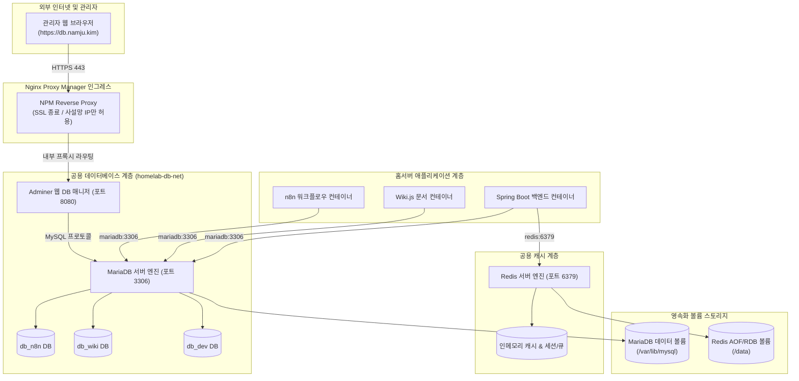

> 홈서버에서 구동하는 다양한 컨테이너 서비스들이 공유할 수 있는 중앙 데이터베이스(MariaDB)와 인메모리 캐시 계층(Redis)을 구축합니다. 개별 서비스마다 DB를 띄우는 리소스 낭비를 해소하고, `utf8mb4` 인코딩 설정, Redis의 AOF/RDB 하이브리드 영속화, 내부 브릿지 네트워크 격리, Adminer를 통한 Nginx Proxy Manager 연동 및 자동 백업 전략을 상세히 정리합니다.

---

## 1. 개별 DB 컨테이너 남발의 한계와 중앙 공용 계층 도입 이유

홈서버(Mac mini 또는 저전력 미니 PC)를 운영하면서 n8n(워크플로우 자동화), Vaultwarden(비밀번호 관리자), 개인 위키(Wiki.js), Uptime Kuma, 그리고 토이 프로젝트용 Spring Boot/Node.js 웹 서비스 등 다양한 컨테이너를 하나씩 추가하다 보면 흔히 마주치는 안티패턴이 있습니다.

바로 각 서비스의 `docker-compose.yml`마다 MySQL, PostgreSQL, Redis 컨테이너를 서비스별로 개별 실행하는 방식입니다.

이러한 개별 DB 운영 방식은 세 가지 치명적인 문제를 야기합니다:

1. **극심한 메모리 및 CPU 자원 낭비**: 일반적인 홈서버 하드웨어는 RAM이 16GB에서 32GB 내외로 한정되어 있습니다. DB 인스턴스마다 기본적으로 점유하는 InnoDB 버퍼 풀, 커넥션 풀 메모리, 캐시 영역이 중복 할당되어 유휴 상태에서도 수 기가바이트의 메모리가 낭비됩니다.
2. **백업 및 유지보수의 파편화**: 서비스마다 서로 다른 데이터 볼륨 디렉터리가 생성되어 백업 스크립트가 파편화되고, 주기적인 스냅샷이나 버전 업그레이드 시 일관된 유지보수가 불가능해집니다.
3. **포트 충돌 및 관리 복잡성**: 호스트 포트 번호(`3306`, `3307`, `3308`...)가 난립하여 어떤 포트가 어떤 애플리케이션의 DB인지 추적하기 어려워집니다.

이를 해결하기 위해 홈서버 내에 **중앙 공용 데이터베이스(MariaDB)**와 **중앙 캐시 계층(Redis)**을 전용 컨테이너 인프라로 통합합니다. 

단일 MariaDB 인스턴스 내에서 서비스별로 독립된 논리적 데이터베이스(`db_n8n`, `db_wiki`, `db_app`)와 권한이 격리된 전용 사용자 계정(`user_n8n`, `user_wiki`, `user_app`)을 분리하고, Redis 역시 키 접두사(Key Prefix)나 데이터베이스 인덱스를 활용해 공유하면 메모리 사용량을 최소화하면서 엔터프라이즈급의 체계적인 관리가 가능해집니다.

---

## 2. 전체 네트워크 아키텍처 및 보안 격리 구조

공용 데이터베이스와 캐시 계층은 홈서버의 핵심 데이터가 모이는 곳이므로 네트워크 보안 격리가 무엇보다 중요합니다. 외부 인터넷에 3306이나 6379 포트를 직접 노출해서는 안 되며, 도커 내부 브릿지 네트워크(`homelab-db-net`)를 통해 인가된 컨테이너만 접근하도록 제한해야 합니다.



핵심 아키텍처 원칙은 다음과 같습니다:
- **내부 서비스 간 통신**: `SVC_n8n`, `SVC_Wiki` 등 내부 컨테이너들은 `homelab-db-net` 브릿지 네트워크를 통해 호스트 포트 포워딩 없이 컨테이너 이름(`mariadb:3306`, `redis:6379`)으로 직접 빠르고 안전하게 통신합니다.
- **웹 관리 인터페이스(Adminer)**: 가벼운 단일 PHP 기반 웹 DB 관리 도구인 Adminer를 함께 구동하고, `npm-network`에만 연결하여 Nginx Proxy Manager를 통해 도메인(`db.namju.kim`)으로 접근합니다.
- **포트 미노출 원칙**: MariaDB와 Redis의 포트는 공인 인터넷은 물론 호스트 외부 인터페이스(`0.0.0.0`)에도 바인딩하지 않으며, 개발자 PC에서의 로컬 디버깅 편의를 위해 필요한 경우에만 루프백(`127.0.0.1:3306`)으로 제한합니다.

---

## 3. MariaDB utf8mb4 다국어 인코딩 및 my.cnf 커스텀 설정

MySQL 및 MariaDB의 기본 설정이나 과거 `utf8` 인코딩은 가변 3바이트만을 지원하여 최신 웹 환경에서 이모지(Emoji, 😀🎉)나 특수 한자, 고대어 문자가 입력될 경우 `Incorrect string value` 예외를 발생시키며 저장이 실패합니다.

따라서 컨테이너 기동 시 4바이트 유니코드를 온전히 지원하는 **`utf8mb4`** 문자셋과 최신 정렬 규칙인 **`utf8mb4_unicode_ci`**를 서버 및 클라이언트 전역에 강제해야 합니다.

### 3.1 커스텀 `my.cnf` 설정 파일

홈서버 환경(RAM 1GB 할당 기준)에 최적화된 설정 파일을 준비합니다.

```ini
# ~/homelab/database/config/mariadb/my.cnf

[client]
default-character-set = utf8mb4

[mysql]
default-character-set = utf8mb4

[mysqld]
# 문자셋 및 Collation 설정 (이모지 완벽 지원)
character-set-server = utf8mb4
collation-server = utf8mb4_unicode_ci
character_set_server = utf8mb4
collation_server = utf8mb4_unicode_ci

# 네트워크 및 커넥션 풀 최적화
max_connections = 150
max_connect_errors = 1000
connect_timeout = 10
wait_timeout = 600
interactive_timeout = 600

# InnoDB 엔진 버퍼 풀 및 I/O 튜닝 (홈서버 RAM 용량 기준 1GB 권장)
innodb_buffer_pool_size = 1G
innodb_log_file_size = 256M
innodb_log_buffer_size = 16M
innodb_file_per_table = 1
innodb_flush_log_at_trx_commit = 2
innodb_flush_method = O_DIRECT

# 슬로우 쿼리 로그 활성화 (2초 이상 소요 쿼리 감지)
slow_query_log = 1
slow_query_log_file = /var/log/mysql/mariadb-slow.log
long_query_time = 2

# 대소문자 구분 정책 (테이블명 소문자 강제)
lower_case_table_names = 1
```

> [!TIP]
> `innodb_flush_log_at_trx_commit = 2` 설정은 트랜잭션 커밋마다 매번 디스크 플러시를 수행하지 않고 초당 1회씩 플러시하도록 하여 쓰기 I/O 성능을 비약적으로 높입니다. 홈서버의 SSD 수명을 보호하면서도 전원 차단 시 최대 1초 내외의 트랜잭션 손실만 감수하는 최적의 실무 절충점입니다.
{: .prompt-tip }

### 3.2 자동 초기화 스크립트 (`initdb.d/01-init-databases.sql`)

컨테이너가 최초 생성될 때 실행될 초기 데이터베이스 및 서비스별 전용 사용자 생성 SQL을 정의합니다.

```sql
-- ~/homelab/database/initdb.d/01-init-databases.sql

-- 1. n8n 워크플로우 전용 DB 및 계정
CREATE DATABASE IF NOT EXISTS `n8n_db` CHARACTER SET utf8mb4 COLLATE utf8mb4_unicode_ci;
CREATE USER IF NOT EXISTS 'n8n_user'@'%' IDENTIFIED BY 'n8n_strong_secret_password!';
GRANT ALL PRIVILEGES ON `n8n_db`.* TO 'n8n_user'@'%';

-- 2. Wiki.js 전용 DB 및 계정
CREATE DATABASE IF NOT EXISTS `wiki_db` CHARACTER SET utf8mb4 COLLATE utf8mb4_unicode_ci;
CREATE USER IF NOT EXISTS 'wiki_user'@'%' IDENTIFIED BY 'wiki_strong_secret_password!';
GRANT ALL PRIVILEGES ON `wiki_db`.* TO 'wiki_user'@'%';

-- 3. 개발용 토이 프로젝트 DB 및 계정
CREATE DATABASE IF NOT EXISTS `dev_app_db` CHARACTER SET utf8mb4 COLLATE utf8mb4_unicode_ci;
CREATE USER IF NOT EXISTS 'dev_user'@'%' IDENTIFIED BY 'dev_strong_secret_password!';
GRANT ALL PRIVILEGES ON `dev_app_db`.* TO 'dev_user'@'%';

-- 권한 즉시 적용
FLUSH PRIVILEGES;
```

---

## 4. Redis 비밀번호 인증 및 AOF/RDB 하이브리드 영속화

Redis는 기본적으로 메모리 상에서만 데이터를 다루기 때문에 컨테이너가 예기치 않게 재부팅되거나 호스트가 재시작되면 모든 캐시 및 세션 데이터가 증발합니다. 또한 비밀번호가 설정되지 않은 Redis가 외부에 노출될 경우 크립토마이너 악성코드의 주된 표적이 됩니다.

이를 방지하기 위해 **인증 비밀번호 강제**와 **AOF/RDB 하이브리드 영속화**를 적용합니다.

### 4.1 커스텀 `redis.conf` 구성

```ini
# ~/homelab/database/config/redis/redis.conf

# 1. 네트워크 및 보안 설정
bind 0.0.0.0
protected-mode yes
port 6379
tcp-backlog 511
timeout 0
tcp-keepalive 300

# 필수: 강력한 인증 패스워드 설정
requirepass your_strong_redis_auth_password!

# 2. RDB(Redis Database) 바이너리 스냅샷 영속화 주기
# 900초(15분) 동안 1개 이상 키 변경 시 스냅샷
save 900 1
# 300초(5분) 동안 10개 이상 키 변경 시 스냅샷
save 300 10
# 60초(1분) 동안 10000개 이상 키 변경 시 스냅샷
save 60 10000

stop-writes-on-bgsave-error yes
rdbcompression yes
rdbchecksum yes
dbfilename dump.rdb
dir /data

# 3. AOF(Append Only File) 실시간 명령 로그 영속화
appendonly yes
appendfilename "appendonly.aof"
# 매 1초마다 백그라운드 디스크 동기화 (성능과 내구성의 최적 균형)
appendfsync everysec
no-appendfsync-on-rewrite no
auto-aof-rewrite-percentage 100
auto-aof-rewrite-min-size 64mb

# 4. 메모리 제한 및 LRU 축출 정책 (홈서버 RAM 512MB 제한)
maxmemory 512mb
maxmemory-policy allkeys-lru
```

- **RDB**: 특정 시점의 전체 메모리 스냅샷을 압축된 단일 바이너리 파일(`dump.rdb`)로 저장하므로 장애 복구 시 기동 속도가 매우 빠릅니다.
- **AOF**: 모든 쓰기 연산을 순차 로그(`appendonly.aof`)로 1초 간격마다 기록하므로, 갑작스러운 전원 장애에도 최대 1초 분량의 데이터만 유실됩니다.
- **하이브리드 모드**: Redis 5.0 이상부터 기본 적용되는 하이브리드 방식을 통해 복구 속도와 데이터 무결성을 모두 챙깁니다.

---

## 5. 완성형 Docker Compose 환경 구성

공용 데이터 인프라를 한곳에서 통제하기 위한 디렉터리 레이아웃입니다.

```text
~/homelab/database/
├── docker-compose.yml
├── .env.example
├── .env
├── config/
│   ├── mariadb/
│   │   └── my.cnf
│   └── redis/
│       └── redis.conf
├── initdb.d/
│   └── 01-init-databases.sql
└── data/
    ├── mariadb/         # MySQL 실제 테이블스페이스 데이터 디렉터리
    └── redis/           # dump.rdb 및 appendonly.aof 저장 디렉터리
```

### 5.1 환경 변수 템플릿 (`.env.example`)

```ini
# ~/homelab/database/.env.example

# MariaDB 관리자 비밀번호
MARIADB_ROOT_PASSWORD=super_secret_mariadb_root_password!

# MariaDB 호스트 바인딩 포트 (로컬 루프백에만 제한)
MARIADB_HOST_PORT=127.0.0.1:3306

# Redis 인증 비밀번호
REDIS_PASSWORD=super_secret_redis_auth_password!

# Redis 호스트 바인딩 포트 (로컬 루프백에만 제한)
REDIS_HOST_PORT=127.0.0.1:6379

# 시스템 타임존
TZ=Asia/Seoul
```

### 5.2 완성형 `docker-compose.yml`

```yaml
# ~/homelab/database/docker-compose.yml
services:
  mariadb:
    image: mariadb:11.4
    container_name: mariadb
    restart: unless-stopped
    environment:
      MARIADB_ROOT_PASSWORD: ${MARIADB_ROOT_PASSWORD}
      TZ: ${TZ:-Asia/Seoul}
    volumes:
      - ./data/mariadb:/var/lib/mysql
      - ./config/mariadb/my.cnf:/etc/mysql/conf.d/custom.cnf:ro
      - ./initdb.d:/docker-entrypoint-initdb.d:ro
    ports:
      # 로컬 호스트 디버깅용 (127.0.0.1에만 바인딩하여 외부 직접 노출 원천 차단)
      - "${MARIADB_HOST_PORT:-127.0.0.1:3306}:3306"
    networks:
      - homelab-db-net
    healthcheck:
      test: ["CMD", "healthcheck.sh", "--connect", "--innodb_initialized"]
      interval: 15s
      timeout: 5s
      retries: 5
      start_period: 30s
    deploy:
      resources:
        limits:
          memory: 2048M

  redis:
    image: redis:7.4-alpine
    container_name: redis
    restart: unless-stopped
    command: ["redis-server", "/usr/local/etc/redis/redis.conf"]
    environment:
      TZ: ${TZ:-Asia/Seoul}
    volumes:
      - ./data/redis:/data
      - ./config/redis/redis.conf:/usr/local/etc/redis/redis.conf:ro
    ports:
      - "${REDIS_HOST_PORT:-127.0.0.1:6379}:6379"
    networks:
      - homelab-db-net
    healthcheck:
      test: ["CMD", "redis-cli", "-a", "${REDIS_PASSWORD}", "ping"]
      interval: 10s
      timeout: 3s
      retries: 3
      start_period: 10s
    deploy:
      resources:
        limits:
          memory: 768M

  adminer:
    image: adminer:4-fastcgi-apache
    container_name: adminer
    restart: unless-stopped
    depends_on:
      mariadb:
        condition: service_healthy
    networks:
      - homelab-db-net
      - npm-network
    deploy:
      resources:
        limits:
          memory: 256M

networks:
  homelab-db-net:
    name: homelab-db-net
    driver: bridge
  npm-network:
    external: true
```

컨테이너 기동 전 디렉터리를 만들고 실행합니다:

```bash
mkdir -p data/mariadb data/redis
docker compose up -d
```

---

## 6. Nginx Proxy Manager 연동 및 타 서비스 컨테이너 연결

### 6.1 Adminer 웹 GUI 역방향 프록시 및 보안 설정 (`db.namju.kim`)

NPM 관리자 대시보드에서 `db.namju.kim` 서브도메인을 등록합니다.

1. **Details**:
   - **Domain Names**: `db.namju.kim`
   - **Forward Host**: `adminer` (Adminer는 `npm-network`와 `homelab-db-net` 양쪽에 조인되어 있음)
   - **Forward Port**: `80` (FastCGI Apache 기본 포트)
   - **Block Common Exploits**: ON
2. **SSL**:
   - 와일드카드 인증서(`*.namju.kim`) 지정 및 **Force SSL** 활성화
3. **Access Lists (필수 보안 조치)**:
   데이터베이스 관리 웹 UI는 외부에 무방비로 노출될 경우 심각한 공격 대상이 됩니다. NPM의 **Access Lists** 메뉴에서 규칙을 생성하여 적용합니다:
   - **Access List 이름**: `Homelab-Internal-Only`
   - **Authorization**: HTTP Basic Auth 계정 추가 (2차 비밀번호)
   - **Access 규칙**: 사설 IP 대역만 Allow 설정 (`192.168.0.0/16`, `10.0.0.0/8`, `172.16.0.0/12`), 나머지는 전부 Deny.

### 6.2 타 서비스 컨테이너(예: n8n, Spring Boot)에서의 연결 방법

다른 디렉터리에 위치한 애플리케이션 컨테이너가 공용 DB와 통신할 때는, 해당 서비스의 `docker-compose.yml`에서 `homelab-db-net`을 외부 네트워크로 선언하고 연결하기만 하면 됩니다.

```yaml
# ~/homelab/n8n/docker-compose.yml 예시
services:
  n8n:
    image: docker.n8n.io/n8nio/n8n:latest
    restart: unless-stopped
    environment:
      - DB_TYPE=mariadb
      - DB_MYSQLDB_DATABASE=n8n_db
      - DB_MYSQLDB_HOST=mariadb        # 컨테이너 호스트명으로 즉시 통신
      - DB_MYSQLDB_PORT=3306
      - DB_MYSQLDB_USER=n8n_user
      - DB_MYSQLDB_PASSWORD=n8n_strong_secret_password!
    networks:
      - homelab-db-net
      - npm-network

networks:
  homelab-db-net:
    external: true
  npm-network:
    external: true
```

이 방식을 통해 서비스 컨테이너는 공용 DB의 포트 번호를 외부에 노출하지 않고도 도커 내부 DNS(`127.0.0.11`)를 통해 `mariadb:3306` 및 `redis:6379`로 안전하게 통신할 수 있습니다.

---

## 7. 자동 데이터 백업 파이프라인 및 복구 전략

중앙 공용 데이터베이스로 모든 서비스의 데이터가 통합되었으므로, 백업 파이프라인 역시 단 하나의 스크립트로 일괄 관리할 수 있습니다.

### 7.1 일일 데이터베이스 덤프 백업 스크립트

MariaDB 공식 백업 유틸리티인 `mariadb-dump`를 컨테이너 내부에서 실행하여 논리적 덤프를 생성하고 압축합니다.

```bash
#!/usr/bin/env bash
# ~/homelab/database/scripts/backup-databases.sh
set -euo pipefail

BACKUP_DIR="/home/user/homelab/backups/mariadb"
DATE_STR="$(date +%Y%m%d_%H%M%S)"
ENV_FILE="/home/user/homelab/database/.env"

# 환경 변수 로드
if [ -f "${ENV_FILE}" ]; then
  # shellcheck source=/dev/null
  export $(grep -v '^#' "${ENV_FILE}" | xargs)
fi

mkdir -p "${BACKUP_DIR}"

echo "[${DATE_STR}] Starting automated MariaDB database backup..."

# 대상 데이터베이스 목록
DATABASES=("n8n_db" "wiki_db" "dev_app_db")

for DB in "${DATABASES[@]}"; do
  FILE_NAME="${BACKUP_DIR}/${DB}_${DATE_STR}.sql.gz"
  echo "Dumping database: ${DB} -> ${FILE_NAME}"
  
  docker exec -i mariadb mariadb-dump \
    -u root \
    -p"${MARIADB_ROOT_PASSWORD}" \
    --single-transaction \
    --quick \
    --routines \
    --triggers \
    "${DB}" | gzip -9 > "${FILE_NAME}"
done

# 7일 이상 경과한 오래된 백업 파일 자동 삭제
find "${BACKUP_DIR}" -type f -name "*.sql.gz" -mtime +7 -delete

echo "[${DATE_STR}] MariaDB backup successfully completed."
```

### 7.2 Redis RDB 스냅샷 동기화 백업

Redis는 `bgsave` 명령을 내린 후 스냅샷 파일(`dump.rdb`)을 백업 디렉터리로 복사합니다.

```bash
# Redis 백그라운드 저장 트리거 및 파일 복사
docker exec -i redis redis-cli -a "${REDIS_PASSWORD}" bgsave
sleep 5
cp ~/homelab/database/data/redis/dump.rdb "/home/user/homelab/backups/redis/dump_${DATE_STR}.rdb"
```

### 7.3 장애 복구(Restore) 절차

데이터 유실이나 시스템 마이그레이션 시 압축된 덤프 파일을 통해 신속히 복원합니다:

```bash
# 특정 데이터베이스 복구 명령어
gunzip < /home/user/homelab/backups/mariadb/n8n_db_20261020_040000.sql.gz | \
  docker exec -i mariadb mariadb -u root -p${MARIADB_ROOT_PASSWORD} n8n_db
```

---

## 8. 정리

MariaDB와 Redis를 홈서버의 중앙 공용 인프라로 격리·통합함으로써 다음과 같은 운영상의 이점을 얻었습니다:

1. **메모리 및 연산 자원 극대화**: 서비스마다 개별 DB를 띄우던 메모리 낭비를 제거하여 16GB RAM 홈서버에서도 여유로운 리소스를 확보했습니다.
2. **다국어 및 이모지 무결성 보장**: `utf8mb4` 전역 설정을 통해 다양한 웹 애플리케이션의 유니코드 입력을 오류 없이 지원합니다.
3. **하이브리드 영속화와 보안**: 강력한 패스워드 인증과 AOF/RDB 영속화로 데이터 유실 위험을 차단했습니다.
4. **중앙 집중식 백업 체계**: 하나의 자동화 스크립트로 모든 서비스의 데이터베이스를 일괄 덤프하고 버전 관리할 수 있게 되었습니다.

다음 포스트에서는 이렇게 구축된 홈서버 인프라의 CPU, 메모리, 스토리지 I/O 메트릭을 실시간으로 수집하고 모니터링하기 위한 **Prometheus와 Node Exporter** 파이프라인 구축을 살펴보겠습니다.
