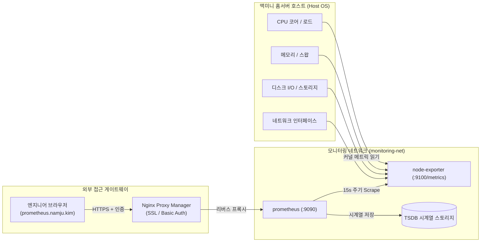

> 맥미니 홈서버 환경에서 호스트 시스템의 자원 상태(CPU, RAM, 디스크 I/O, 네트워크 트래픽)를 안정적으로 수집하기 위해 Node Exporter와 Prometheus를 컨테이너로 배포하고, 스토리지 용량을 고려한 시계열 데이터 보관(Retention) 정책 및 NPM(Nginx Proxy Manager) 리버스 프록시 보안 설정까지 전체 파이프라인을 구축합니다.

---

## 1. 홈서버 모니터링의 필요성과 풀(Pull) 기반 아키텍처

개인 프로젝트와 토이 서비스를 24시간 가동하는 홈서버(Mac mini 또는 저전력 x86 서버)를 운영하다 보면 다양한 돌발 상황과 마주하게 됩니다. 특정 컨테이너의 메모리 누수로 호스트 스왑(Swap)이 급증하거나, 로그 파일 누적으로 디스크 용량이 고갈되어 전체 Docker 데몬이 멈추는 현상이 대표적입니다.

안정적인 서비스 운영을 위해서는 장애가 발생한 이후 대응하는 것이 아니라, 시스템 지표의 추세를 지속해서 관측하고 이상 징후를 조기에 감지할 수 있는 모니터링 시스템이 필수적입니다.

이를 위해 클라우드 네이티브 환경의 표준 메트릭 수집 엔진인 **Prometheus**와 하드웨어 및 OS 지표를 노출하는 **Node Exporter**를 조합한 풀(Pull) 기반 수집 아키텍처를 구성합니다.



Prometheus는 에이전트가 중앙 서버로 지표를 밀어 넣는 푸시(Push) 방식 대신, 중앙의 Prometheus 서버가 주기적으로 각 Exporter의 HTTP 엔드포인트(`/metrics`)를 호출하여 지표를 긁어오는 **풀(Pull) 방식**으로 동작합니다. 수집 주기를 중앙에서 통제할 수 있어 타깃 시스템에 과도한 부하를 주지 않으며, 타깃이 다운되었을 때 즉각 수집 실패(`UP == 0`)로 감지할 수 있는 장점이 있습니다.

---

## 2. Node Exporter 호스트 네임스페이스 및 볼륨 마운트 원리

Node Exporter를 Docker 컨테이너로 구동할 때 가장 흔히 범하는 실수는 컨테이너 내부의 `/proc`이나 `/sys`를 그대로 읽게 두는 것입니다. Docker 컨테이너는 격리된 네임스페이스를 사용하므로, 아무런 볼륨 마운트 없이 실행하면 컨테이너 자체에 할당된 가상 지표만 노출될 뿐 실제 호스트의 메트릭을 전혀 읽을 수 없습니다.

따라서 호스트 운영체제의 커널 파일시스템을 컨테이너 내부로 읽기 전용(`:ro`) 마운트하고, Node Exporter가 해당 경로를 바라보도록 실행 옵션을 전달해야 합니다.

```text
/proc (호스트)  ──> /host/proc:ro (컨테이너)  [--path.procfs=/host/proc]
/sys  (호스트)  ──> /host/sys:ro  (컨테이너)  [--path.sysfs=/host/sys]
/     (호스트)  ──> /rootfs:ro    (컨테이너)  [--path.rootfs=/rootfs]
```

또한 Docker 컨테이너가 생성하는 수많은 오버레이 파일시스템(`overlay`, `shm`)이나 임시 가상 파일시스템은 호스트 디스크 메트릭에 불필요한 노이즈를 만듭니다. 이를 걸러내기 위해 `--collector.filesystem.mount-points-exclude` 정규식을 활용해 실제 물리 디스크 마운트 지점만 선별하여 수집하도록 설정합니다.

> Node Exporter 컨테이너에 호스트 파일시스템을 마운트할 때는 보안을 위해 반드시 읽기 전용 플래그(`:ro`)를 부여해야 합니다. 쓰기 권한이 부여될 경우 컨테이너 침해 시 호스트 시스템 전체가 위험에 노출될 수 있습니다.
{: .prompt-warning }

---

## 3. Prometheus 타깃 설정 및 홈서버 최적화 Retention 정책

Prometheus는 수집한 메트릭을 메모리에 버퍼링한 뒤 2시간 단위의 불변 블록(Block)으로 디스크(TSDB)에 기록합니다. 대규모 엔터프라이즈 서버와 달리 스토리지 용량이 한정된 홈서버에서는 무제한으로 데이터를 쌓아둘 경우 디스크 풀(Full) 장애로 이어집니다.

따라서 컨테이너 실행 플래그를 통해 **보관 기간(Retention Time)**과 **보관 용량(Retention Size)**을 명시적으로 제한해야 합니다.

### 3.1. TSDB 보관 정책 플래그
- `--storage.tsdb.retention.time=30d`: 메트릭 데이터를 최대 30일간 보관합니다. 30일이 지난 데이터 블록은 백그라운드 콤팩션(Compaction) 시 자동으로 영구 삭제됩니다.
- `--storage.tsdb.retention.size=20GB`: 총 저장소 사용량이 20GB에 도달하면 30일이 지나지 않았더라도 가장 오래된 블록부터 즉시 삭제하여 디스크 고갈을 원천 차단합니다.
- `--storage.tsdb.wal-compression`: WAL(Write-Ahead Log)을 Snappy 알고리즘으로 압축하여 쓰기 I/O와 디스크 사용량을 최대 40% 절감합니다.

### 3.2. `prometheus.yml` 스크랩 설정
수집 주기(`scrape_interval`)는 15초로 설정합니다. 홈서버 환경에서 15초는 CPU 부하를 최소화하면서도 장애 상황을 신속히 포착할 수 있는 최적의 밸런스입니다.

---

## 4. 완성형 `docker-compose.yml` 및 환경 설정

프로젝트를 체계적으로 관리하기 위해 홈 디렉터리 하위에 모니터링 전용 디렉터리를 구성합니다.

```text
~/homelab-monitoring/
├── .env
├── docker-compose.yml
└── prometheus/
    └── prometheus.yml
```

### 4.1. `prometheus/prometheus.yml`
Prometheus가 메트릭을 긁어올 타깃을 정의합니다. Docker Compose 내부 브릿지 네트워크 DNS를 활용하므로 컨테이너 서비스 이름인 `node-exporter:9100`으로 직접 지정합니다.

```yaml
# prometheus/prometheus.yml
global:
  scrape_interval: 15s
  evaluation_interval: 15s
  scrape_timeout: 10s

scrape_configs:
  - job_name: "prometheus"
    static_configs:
      - targets: ["localhost:9090"]

  - job_name: "node-exporter"
    static_configs:
      - targets: ["node-exporter:9100"]
```

### 4.2. 환경 변수 파일 (`.env`)
포트 및 외부 도메인 정보를 파일로 분리하여 구성의 재사용성을 높입니다.

```bash
# .env
PROMETHEUS_PORT=9090
NODE_EXPORTER_PORT=9100
TZ=Asia/Seoul
```

### 4.3. 완성형 `docker-compose.yml`
다음은 즉시 구동 가능한 완성형 Compose 명세서입니다.

```yaml
# docker-compose.yml
services:
  prometheus:
    image: prom/prometheus:v2.54.1
    container_name: monitoring-prometheus
    restart: unless-stopped
    user: "65534:65534" # nobody 계정으로 실행하여 최소 권한 준수
    command:
      - "--config.file=/etc/prometheus/prometheus.yml"
      - "--storage.tsdb.path=/prometheus"
      - "--web.console.libraries=/usr/share/prometheus/console_libraries"
      - "--web.console.templates=/usr/share/prometheus/consoles"
      - "--storage.tsdb.retention.time=30d"
      - "--storage.tsdb.retention.size=20GB"
      - "--storage.tsdb.wal-compression"
      - "--web.enable-lifecycle" # curl -X POST /-/reload 지원
    ports:
      - "${PROMETHEUS_PORT:-9090}:9090"
    volumes:
      - ./prometheus/prometheus.yml:/etc/prometheus/prometheus.yml:ro
      - prometheus_data:/prometheus
    networks:
      - monitoring-net
    depends_on:
      - node-exporter

  node-exporter:
    image: prom/node-exporter:v1.8.2
    container_name: monitoring-node-exporter
    restart: unless-stopped
    command:
      - "--path.procfs=/host/proc"
      - "--path.sysfs=/host/sys"
      - "--path.rootfs=/rootfs"
      - "--collector.filesystem.mount-points-exclude=^/(sys|proc|dev|host|etc)($$|/)"
    ports:
      - "${NODE_EXPORTER_PORT:-9100}:9100"
    volumes:
      - /proc:/host/proc:ro
      - /sys:/host/sys:ro
      - /:/rootfs:ro
    networks:
      - monitoring-net

volumes:
  prometheus_data:
    name: homelab_prometheus_data

networks:
  monitoring-net:
    name: homelab_monitoring_net
    driver: bridge
```

설정 작성이 완료되면 백그라운드로 서비스를 실행합니다.

```bash
docker compose up -d
```

```text
[+] Running 3/3
 ✔ Network homelab_monitoring_net         Created   0.1s
 ✔ Container monitoring-node-exporter     Started   0.3s
 ✔ Container monitoring-prometheus        Started   0.5s
```

---

## 5. NPM(Nginx Proxy Manager) 리버스 프록시 연동 및 보안 강화

Prometheus 웹 콘솔(`:9090`)을 외부에서 접속하거나 모바일 브라우저로 열어보기 위해 Nginx Proxy Manager를 통해 도메인(`prometheus.namju.kim`)을 연결합니다.

> **보안 주의:** Prometheus 자체는 기본적으로 사용자 로그인이나 인증 기능을 내장하고 있지 않습니다. 공인 IP나 도메인으로 포트를 그대로 외부에 노출하면 홈서버의 상세 메트릭(IP 대역, 실행 중인 프로세스, 스토리지 구조)이 전 세계에 무방비로 공개됩니다.
{: .prompt-danger }

### 5.1. NPM Proxy Host 설정
1. NPM 관리자 대시보드(`nginx-proxy-manager`)에 접속합니다.
2. **Hosts > Proxy Hosts > Add Proxy Host**를 클릭하고 아래와 같이 입력합니다.
   - **Domain Names**: `prometheus.namju.kim`
   - **Scheme**: `http`
   - **Forward Hostname / IP**: 호스트 내부 IP 또는 Docker 게이트웨이 IP (동일 Docker 네트워크에 연결된 경우 `monitoring-prometheus`)
   - **Forward Port**: `9090`
   - **Block Common Exploits**: ON
   - **Websockets Support**: ON
3. **SSL 탭**:
   - Let's Encrypt 와일드카드 인증서(`*.namju.kim`)를 선택합니다.
   - **Force SSL**: ON
   - **HTTP/2 Support**: ON
   - **HSTS Enabled**: ON

### 5.2. Access List를 통한 Basic Auth (HTTP 기본 인증) 적용
외부 침입을 차단하기 위해 NPM의 **Access Lists** 기능을 반드시 활성화합니다.

1. NPM 대시보드의 **Access Lists > Add Access List** 메뉴로 이동합니다.
2. **Name**: `Admin Access Only`
3. **Authorization 탭**: 관리자 아이디(`admin`)와 강력한 비밀번호를 등록합니다.
4. 다시 **Proxy Hosts > Edit > Access List** 항목에서 방금 생성한 `Admin Access Only`를 지정하고 저장합니다.

이제 브라우저에서 `https://prometheus.namju.kim`에 접속하면 HTTP 기본 인증 팝업이 뜨며, 인증을 통과한 사용자만 안전하게 Prometheus 웹 대시보드에 접근할 수 있습니다.

---

## 6. 메트릭 수집 검증 및 핵심 PromQL 쿼리

컨테이너가 정상적으로 동작하는지 터미널과 Prometheus UI에서 직접 검증합니다.

### 6.1. Node Exporter 엔드포인트 응답 검증
터미널에서 Node Exporter의 메트릭 엔드포인트를 호출하여 지표가 텍스트 스트림 형태로 정상 출력되는지 확인합니다.

```bash
curl -s http://localhost:9100/metrics | head -n 15
```

```text
# HELP go_gc_duration_seconds A summary of the pause duration of garbage collection cycles.
# TYPE go_gc_duration_seconds summary
go_gc_duration_seconds{quantile="0"} 0
go_gc_duration_seconds{quantile="0.25"} 0
go_gc_duration_seconds{quantile="0.5"} 0
go_gc_duration_seconds{quantile="0.75"} 0
go_gc_duration_seconds{quantile="1"} 0
go_gc_duration_seconds_sum 0
go_gc_duration_seconds_count 0
# HELP node_cpu_seconds_total Seconds the cpus spent in each mode.
# TYPE node_cpu_seconds_total counter
node_cpu_seconds_total{cpu="0",mode="idle"} 18392.12
node_cpu_seconds_total{cpu="0",mode="system"} 412.38
node_cpu_seconds_total{cpu="0",mode="user"} 823.15
```

### 6.2. Prometheus Targets 수집 상태 확인
브라우저로 Prometheus UI에 접속한 후 상단 메뉴의 **Status > Targets**로 이동합니다.

```text
Endpoint                  State   Labels                                 Last Scrape
http://localhost:9090/metrics       UP      instance="localhost:9090", job="prometheus"    1.2s ago
http://node-exporter:9100/metrics  UP      instance="node-exporter:9100", job="node-exporter" 2.4s ago
```

모든 타깃의 `State`가 초록색 **UP**으로 표시되면 메트릭 수집 파이프라인이 정상 동작하는 것입니다.

### 6.3. 홈서버 자원 진단을 위한 필수 PromQL 3선
Prometheus **Graph** 탭에서 실행할 수 있는 핵심 시스템 PromQL 쿼리입니다.

1. **전체 CPU 사용률 (%)**:
   ```promql
   100 - (avg by (instance) (rate(node_cpu_seconds_total{mode="idle"}[5m])) * 100)
   ```
   전체 CPU 코어 중 유휴(Idle) 상태의 비율을 계산한 뒤 100에서 차감하여 실제 CPU 사용률을 실시간 백분율로 도출합니다.

2. **메모리 실제 사용률 (%)**:
   ```promql
   (1 - (node_memory_MemAvailable_bytes / node_memory_MemTotal_bytes)) * 100
   ```
   단순 `MemFree`가 아닌 캐시/버퍼를 고려한 실제 사용 가능 메모리(`MemAvailable`)를 기준으로 정확한 메모리 점유율을 계산합니다.

3. **호스트 루트 파일시스템 사용률 (%)**:
   ```promql
   100 - ((node_filesystem_avail_bytes{mountpoint="/rootfs"} * 100) / node_filesystem_size_bytes{mountpoint="/rootfs"})
   ```
   Node Exporter에 마운트된 루트 볼륨(`/rootfs`)의 남은 공간을 기반으로 디스크 사용률을 계산합니다.

---

## 정리

홈서버 환경에서 시스템 메트릭을 수집하기 위한 핵심 포인트를 정리하면 다음과 같습니다.

1. **호스트 파일시스템 마운트**: 컨테이너 격리를 뚫고 호스트 자원을 수집하려면 `/proc`, `/sys`, `/` 경로를 읽기 전용(`:ro`)으로 마운트하고 커맨드 플래그를 정확히 매핑해야 합니다.
2. **스토리지 용량 관리**: `--storage.tsdb.retention.time`과 `--storage.tsdb.retention.size`를 동시에 지정하여 디스크 풀 장애를 사전에 방지해야 합니다.
3. **보안 게이트웨이 적용**: Prometheus는 기본 인증이 없으므로 NPM을 통해 SSL을 적용하고 Basic Auth(Access List)로 외부 접근을 엄격히 통제해야 합니다.

다음 포스트에서는 시스템 지표에 이어 홈서버에서 구동 중인 핵심 백엔드 데이터베이스인 **MariaDB**와 **Redis**의 내부 동작 상태를 수집하기 위해 `mysqld_exporter`와 `redis_exporter`를 연동하는 방법을 살펴보겠습니다.
