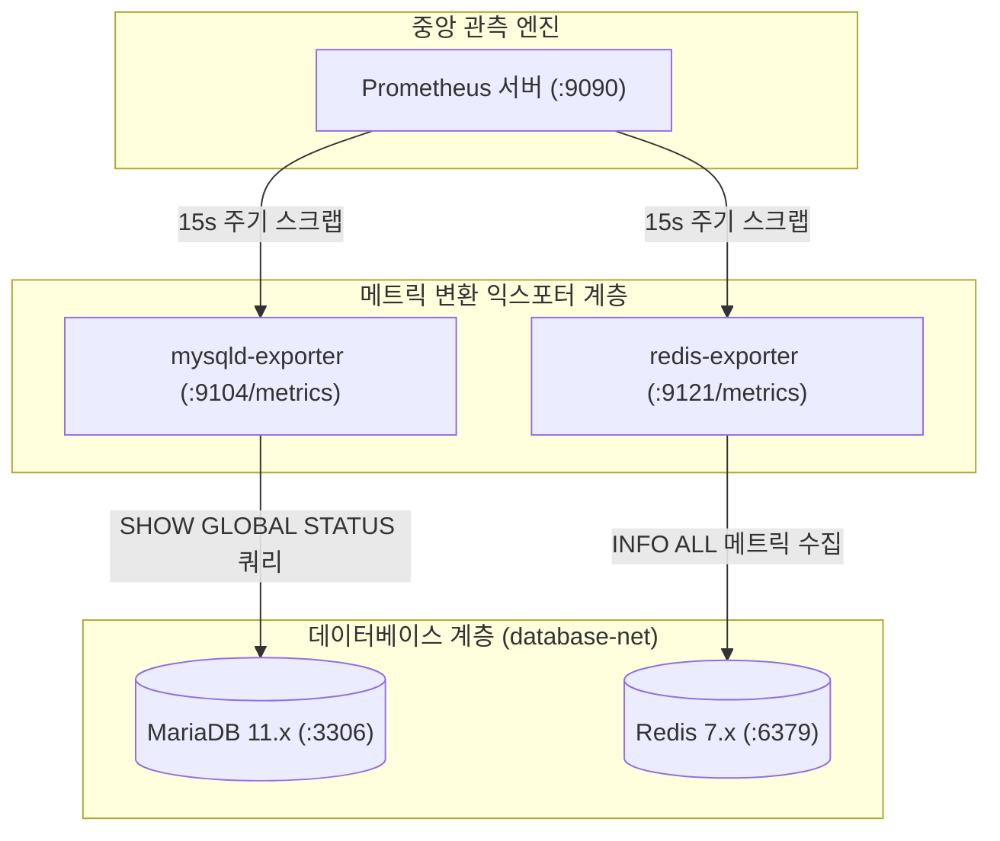

> 홈서버에서 구동되는 핵심 데이터 저장소인 MariaDB와 Redis의 런타임 내부 상태를 안전하게 관측하기 위해 최소 권한 원칙을 준수한 모니터링 전용 계정을 설정하고, mysqld_exporter와 redis_exporter를 Docker Compose 환경에 배포하여 Prometheus 메트릭 수집 파이프라인에 연동하는 실무 절차를 정리합니다.

---

## 1. 데이터베이스 관측성(Observability)의 필요성과 아키텍처

이전 글에서 Node Exporter를 통해 호스트 OS의 CPU와 메모리, 디스크 사용률을 수집했습니다. 하지만 시스템 레벨의 지표만으로는 데이터베이스 내부에서 일어나는 이상 징후를 파악할 수 없습니다.

예를 들어 MariaDB의 `max_connections` 한계에 도달해 백엔드 애플리케이션의 HikariCP 커넥션 풀이 타임아웃을 뿜어내고 있거나, Redis 인스턴스의 캐시 적중률(Hit Ratio)이 급락하여 DB로 트래픽이 직접 쏟아지는 상황은 호스트 CPU 사용률만 봐서는 원인을 즉각 규명하기 어렵습니다.

따라서 데이터베이스 엔진의 내부 상태 지표를 표준 Prometheus 포맷으로 변환해 주는 **`mysqld_exporter`**와 **`redis_exporter`**를 도입해야 합니다.



각 익스포터는 주기적으로 데이터베이스에 연결하여 상태 점검 명령(`SHOW GLOBAL STATUS`, `INFO ALL`)을 수행하고, 이를 Prometheus가 해석할 수 있는 텍스트 메트릭 엔드포인트(`/metrics`)로 변환하여 서빙합니다.

---

## 2. MariaDB 최소 권한(Least Privilege) 모니터링 계정 구성

데이터베이스 메트릭을 수집할 때 관리자(`root`) 계정의 자격 증명을 익스포터 환경 변수에 그대로 넘기는 것은 심각한 보안 취약점을 만듭니다. 익스포터 컨테이너가 침해당할 경우 데이터베이스 전체의 CRUD 권한이 탈취되기 때문입니다.

따라서 **최소 권한 원칙(Principle of Least Privilege)**에 따라 오직 모니터링 지표 조회에만 필요한 전용 계정을 생성하고 제한된 권한만 부여해야 합니다.

### 2.1. 모니터링 전용 계정 및 권한 생성 SQL
MariaDB 콘솔(`mariadb -u root -p`)에 접속하여 아래 스크립트를 실행합니다.

```sql
-- 1. 모니터링 전용 계정 생성 (원격 접속 허용 및 강력한 패스워드 설정)
CREATE USER 'exporter'@'%' IDENTIFIED BY '${MARIADB_EXPORTER_PASSWORD}' WITH MAX_USER_CONNECTIONS 3;

-- 2. 필수 권한 부여
GRANT PROCESS, REPLICATION CLIENT, SELECT ON *.* TO 'exporter'@'%';

-- 3. 권한 테이블 리로드
FLUSH PRIVILEGES;
```

부여된 권한의 상세 역할은 다음과 같습니다.
- **`PROCESS`**: 현재 데이터베이스에서 실행 중인 스레드 및 쿼리 상태(`SHOW PROCESSLIST`)를 수집하는 데 필요합니다. 슬로우 쿼리나 락(Lock) 대기 스레드를 추적할 수 있습니다.
- **`REPLICATION CLIENT`**: 마스터-슬레이브 복제 상태(`SHOW SLAVE STATUS`, `SHOW MASTER STATUS`)와 복제 지연(Seconds Behind Master) 지표를 조회하는 데 필수적입니다.
- **`SELECT ON *.*`**: `performance_schema` 및 `information_schema`의 테이블 크기, 인덱스 통계, 엔진 상태 지표를 조회하기 위해 필요합니다.
- **`WITH MAX_USER_CONNECTIONS 3`**: 익스포터가 비정상적으로 커넥션을 남발하여 실제 서비스 커넥션 풀을 잠식하지 않도록 최대 연결 수를 3개로 엄격히 제한합니다.

> 실무 팁: 실제 프로덕션 환경에서는 `${MARIADB_EXPORTER_PASSWORD}` 자리에 알파벳 대소문자, 숫자, 특수문자가 조합된 20자 이상의 무작위 문자열을 생성하여 주입합니다.
{: .prompt-tip }

---

## 3. Redis 핵심 관측 지표와 `redis_exporter`

Redis는 단일 스레드 기반의 이벤트 루프로 명령어를 처리하므로, 실시간 성능 저하 요인을 세밀하게 추적해야 합니다. `redis_exporter`는 내부적으로 Redis `INFO ALL` 명령어를 실행하여 수백 개의 지표를 수집합니다.

### 3.1. 반드시 추적해야 할 4대 핵심 지표
1. **메모리 포화도 및 단편화**:
   - `used_memory_rss` vs `used_memory`: 실제 OS 할당 메모리와 Redis 데이터 메모리의 비율.
   - `mem_fragmentation_ratio`: 1.5 이상으로 치솟을 경우 심각한 메모리 단편화 발생을 의미합니다.
2. **클라이언트 커넥션 풀**:
   - `connected_clients`: 현재 활성화된 클라이언트 수.
   - `blocked_clients`: `BLPOP`, `BRPOP` 등으로 블로킹 대기 중인 스레드 수.
3. **처리량(Throughput)**:
   - `instantaneous_ops_per_sec`: 초당 처리 명령어 수 (QPS).
4. **캐시 적중률(Hit Ratio)**:
   - `keyspace_hits`와 `keyspace_misses`의 비율로 산출하며, 90% 이상을 유지하는지 지속 관측해야 합니다.

Redis에 `requirepass` 인증이 걸려 있는 경우, `redis_exporter` 실행 시 `REDIS_PASSWORD` 환경 변수를 지정해 안전하게 인증을 처리합니다.

---

## 4. 완성형 `docker-compose.yml` 및 환경 구성

기존 모니터링 스택 디렉터리(`~/homelab-monitoring`)를 확장하여 데이터베이스 익스포터를 추가합니다.

```text
~/homelab-monitoring/
├── .env
├── docker-compose.yml
└── prometheus/
    └── prometheus.yml
```

### 4.1. 환경 변수 파일 (`.env`)
데이터베이스 접속 비밀번호는 절대로 Git에 커밋하지 않고 로컬 `.env` 파일에 안전하게 보관합니다.

```bash
# .env
TZ=Asia/Seoul
PROMETHEUS_PORT=9090

# MariaDB Exporter 접속 자격 증명
MARIADB_HOST=mariadb
MARIADB_PORT=3306
MARIADB_EXPORTER_USER=exporter
MARIADB_EXPORTER_PASSWORD=export_secret_pass_1234!

# Redis Exporter 접속 자격 증명
REDIS_HOST=redis
REDIS_PORT=6379
REDIS_PASSWORD=redis_secure_auth_pass_5678!
```

### 4.2. 완성형 `docker-compose.yml`
기존 시스템 모니터링 컨테이너와 함께 `mysqld-exporter` 및 `redis-exporter`를 정의합니다. 컨테이너 간 안전한 통신을 위해 `homelab_internal_net` 네트워크를 공유합니다.

```yaml
# docker-compose.yml
services:
  # 1. Prometheus 엔진
  prometheus:
    image: prom/prometheus:v2.54.1
    container_name: monitoring-prometheus
    restart: unless-stopped
    user: "65534:65534"
    command:
      - "--config.file=/etc/prometheus/prometheus.yml"
      - "--storage.tsdb.path=/prometheus"
      - "--storage.tsdb.retention.time=30d"
      - "--storage.tsdb.retention.size=20GB"
      - "--storage.tsdb.wal-compression"
      - "--web.enable-lifecycle"
    ports:
      - "${PROMETHEUS_PORT:-9090}:9090"
    volumes:
      - ./prometheus/prometheus.yml:/etc/prometheus/prometheus.yml:ro
      - prometheus_data:/prometheus
    networks:
      - monitoring-net

  # 2. MariaDB Exporter
  mysqld-exporter:
    image: prom/mysqld-exporter:v0.15.1
    container_name: monitoring-mysqld-exporter
    restart: unless-stopped
    environment:
      # DATA_SOURCE_NAME 포맷: user:password@(host:port)/
      DATA_SOURCE_NAME: "${MARIADB_EXPORTER_USER}:${MARIADB_EXPORTER_PASSWORD}@(${MARIADB_HOST}:${MARIADB_PORT})/"
    command:
      - "--collect.global_status"
      - "--collect.global_variables"
      - "--collect.info_schema.innodb_metrics"
      - "--collect.info_schema.processlist"
      - "--collect.info_schema.tables"
      - "--collect.auto_increment.columns"
    networks:
      - monitoring-net
      - database-net

  # 3. Redis Exporter
  redis-exporter:
    image: oliver006/redis_exporter:v1.63.0-alpine
    container_name: monitoring-redis-exporter
    restart: unless-stopped
    environment:
      REDIS_ADDR: "redis://${REDIS_HOST}:${REDIS_PORT}"
      REDIS_PASSWORD: "${REDIS_PASSWORD}"
      REDIS_EXPORTER_LOG_FORMAT: "json"
    networks:
      - monitoring-net
      - database-net

volumes:
  prometheus_data:
    name: homelab_prometheus_data

networks:
  monitoring-net:
    name: homelab_monitoring_net
    driver: bridge
  database-net:
    name: homelab_database_net
    external: true # 기존 DB 컨테이너들이 속한 외부 네트워크 연결
```

> **네트워크 분리 설계:** `mysqld-exporter`와 `redis-exporter`의 포트(`9104`, `9121`)는 호스트 외부로 포트 포워딩(`ports:`)하지 않고 Docker 내부 브릿지 네트워크(`monitoring-net`) 안에서만 Prometheus와 통신하도록 설계하여 외부 공격 표면을 원천 차단합니다.
{: .prompt-info }

---

## 5. Prometheus `scrape_configs` 타깃 추가

Prometheus가 새로 배포된 두 개의 Exporter를 인식할 수 있도록 `prometheus/prometheus.yml` 파일에 스크랩 잡(Job)을 추가합니다.

```yaml
# prometheus/prometheus.yml
global:
  scrape_interval: 15s
  evaluation_interval: 15s
  scrape_timeout: 10s

scrape_configs:
  - job_name: "prometheus"
    static_configs:
      - targets: ["localhost:9090"]

  - job_name: "node-exporter"
    static_configs:
      - targets: ["node-exporter:9100"]

  # MariaDB 수집 잡 추가
  - job_name: "mariadb"
    scrape_interval: 15s
    scrape_timeout: 10s
    static_configs:
      - targets: ["mysqld-exporter:9104"]
        labels:
          environment: "production"
          service: "mariadb"

  # Redis 수집 잡 추가
  - job_name: "redis"
    scrape_interval: 15s
    scrape_timeout: 10s
    static_configs:
      - targets: ["redis-exporter:9121"]
        labels:
          environment: "production"
          service: "redis"
```

설정 변경 후 컨테이너를 재시작하지 않고 Prometheus의 Lifecycle 리로드 API를 호출하여 무중단으로 반영합니다.

```bash
# Prometheus 설정 무중단 핫 리로드
curl -X POST http://localhost:9090/-/reload
```

---

## 6. 메트릭 연동 검증 및 실무 PromQL 진단 쿼리

터미널과 Prometheus UI에서 데이터베이스 메트릭이 정상 수집되는지 검증합니다.

### 6.1. Exporter 내부 메트릭 출력 확인
Docker 네트워크 내부에서 메트릭이 수락되는지 `docker exec`로 테스트합니다.

```bash
docker exec -it monitoring-prometheus wget -qO- http://mysqld-exporter:9104/metrics | grep mysql_up
```

```text
# HELP mysql_up Whether the MySQL server is up.
# TYPE mysql_up gauge
mysql_up 1
```

`mysql_up 1` 및 `redis_up 1` 값이 반환되면 데이터베이스 인증과 메트릭 수집이 완벽히 성공한 것입니다.

### 6.2. 핵심 데이터베이스 진단 PromQL 쿼리

1. **MariaDB 커넥션 점유율 (%)**:
   ```promql
   (mysql_global_status_threads_connected / mysql_global_variables_max_connections) * 100
   ```
   현재 연결된 스레드 수를 최대 허용 커넥션으로 나눈 값입니다. 80%를 상회하면 애플리케이션의 커넥션 누수나 DB 풀 고갈을 의심해야 합니다.

2. **MariaDB 초당 쿼리 처리량 (QPS)**:
   ```promql
   rate(mysql_global_status_queries[1m])
   ```
   데이터베이스에 유입되는 쿼리의 초당 인입 속도를 실시간으로 관측합니다.

3. **Redis 캐시 적중률 (Cache Hit Ratio, %)**:
   ```promql
   (rate(redis_keyspace_hits_total[5m]) / 
   (rate(redis_keyspace_hits_total[5m]) + rate(redis_keyspace_misses_total[5m]))) * 100
   ```
   Redis 캐시가 백엔드 쿼리를 얼마나 효과적으로 방어해 주고 있는지 검증하는 핵심 KPI입니다.

4. **Redis 메모리 사용량 (Bytes & 포화도)**:
   ```promql
   redis_memory_used_bytes / redis_memory_max_bytes * 100
   ```
   설정된 `maxmemory` 대비 실제 점유율을 추적하여 OOM 방출(`eviction`) 발생 위험을 사전에 차단합니다.

---

## 정리

MariaDB와 Redis의 내부 런타임 지표를 안정적으로 수집하기 위한 핵심 포인트를 정리하면 다음과 같습니다.

1. **최소 권한 계정 분리**: MariaDB에 `PROCESS`, `REPLICATION CLIENT`, `SELECT` 권한만 가진 전용 `exporter` 계정을 생성하여 자격 증명 탈취 위험을 차단했습니다.
2. **네트워크 포트 비노출**: Exporter들의 포트는 호스트로 포워딩하지 않고 내부 Docker 브릿지 네트워크 안에서 Prometheus만 접근하도록 격리했습니다.
3. **핵심 운영 지표 확립**: 단순 Liveness를 넘어 커넥션 포화도, QPS, 캐시 적중률, 메모리 단편화율 등 실무 진단용 PromQL을 구축했습니다.

다음 포스트에서는 Node Exporter와 데이터베이스 Exporter들로부터 수집된 모든 시계열 데이터를 한눈에 파악할 수 있는 **Grafana 통합 대시보드 구축**과 임계치 초과 시 텔레그램/디스코드로 즉각 알림을 발송하는 **Alerting 시스템 구축**을 다루겠습니다.
