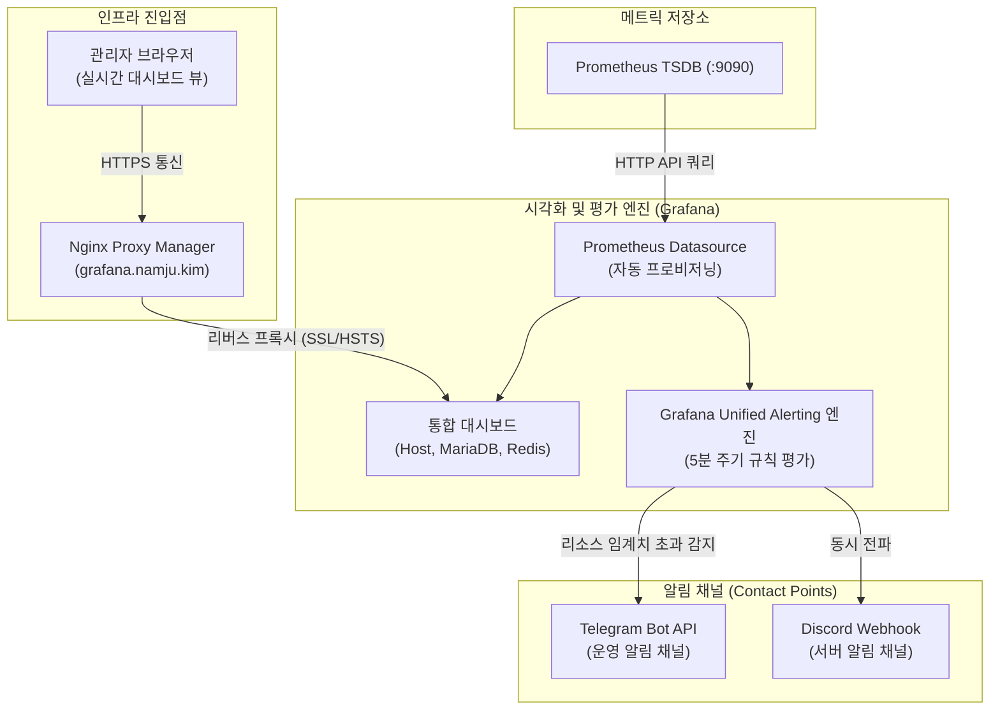

> Prometheus로 수집한 홈서버의 시스템 및 데이터베이스 시계열 메트릭을 Grafana로 통합 시각화하고, NPM(Nginx Proxy Manager)을 통한 안전한 외부 접속 환경 구성 및 호스트 자원 고갈 시 텔레그램과 디스코드로 즉각 상황을 전파하는 Unified Alerting 시스템을 구축합니다.

---

## 1. 모니터링 시각화와 알림(Alerting) 아키텍처

앞선 연재를 통해 Node Exporter, mysqld_exporter, redis_exporter를 배포하고 Prometheus에 시계열 데이터를 축적했습니다. 하지만 원시(Raw) 시계열 데이터를 PromQL 콘솔로 매번 직접 쿼리하는 방식은 전체 인프라의 거시적 건강 상태를 파악하기 어렵고, 이상 징후가 발생했을 때 즉각 인지할 수 없습니다.

사람이 24시간 모니터링 화면을 감시할 수 없으므로, **"직관적인 통합 시각화 대시보드"**와 **"임계치 초과 시 자동으로 푸시 알림을 발송하는 Alerting 엔진"**이 반드시 결합되어야 합니다.

이를 위해 오픈소스 관측성 시각화의 사실상 표준인 **Grafana**를 도입합니다.



Grafana는 내부 데이터소스(Datasource)를 통해 Prometheus로부터 시계열 데이터를 질의하여 대시보드에 렌더링할 뿐만 아니라, 설정된 규칙에 따라 메트릭을 주기적으로 평가하여 조건 충족 시 외부 메신저로 장애 알림을 발송합니다.

---

## 2. Grafana 컨테이너 구조 및 데이터소스 프로비저닝

Grafana를 컨테이너로 배포할 때 UI에서 마우스 클릭으로 데이터소스를 일일이 등록하는 것은 환경 재구축 시 번거로울 뿐만 아니라 형상 관리(IaC) 측면에서도 적절하지 않습니다.

Grafana의 **프로비저닝(Provisioning)** 메커니즘을 사용하면 컨테이너 기동 시 YAML 설정 파일을 읽어와 Prometheus 데이터소스를 자동으로 등록할 수 있습니다.

### 2.1. 데이터소스 자동 프로비저닝 설정 파일
호스트의 `grafana/provisioning/datasources/prometheus.yml` 경로에 아래 파일을 작성합니다.

```yaml
# grafana/provisioning/datasources/prometheus.yml
apiVersion: 1

datasources:
  - name: Prometheus
    type: prometheus
    access: proxy
    # 동일 Docker 브릿지 네트워크 내 Prometheus 서비스명 지정
    url: http://monitoring-prometheus:9090
    isDefault: true
    editable: false
    jsonData:
      timeInterval: 15s
      httpMethod: POST
```

- `url: http://monitoring-prometheus:9090`: Docker 네트워크 내부 DNS를 활용하여 Prometheus 컨테이너에 직접 접속합니다. 호스트 포트 바인딩에 의존하지 않으므로 네트워크 격리 수준이 높습니다.
- `editable: false`: 실수로 웹 UI에서 데이터소스 설정을 변경하거나 삭제하는 사고를 방지합니다.

> **볼륨 권한 주의사항:** Grafana 컨테이너는 기본적으로 `472:472` UID/GID(grafana 계정)로 실행됩니다. 호스트 경로를 직접 바인드 마운트할 경우 권한 에러(`Permission denied`)가 발생할 수 있으므로, 명명된 도커 볼륨(`grafana_data`)을 사용하거나 호스트 디렉터리에 `chown -R 472:472 ./grafana/data` 권한을 사전에 부여해야 합니다.
{: .prompt-warning }

---

## 3. 홈서버 필수 공식 대시보드 3선

Grafana 커뮤니티에는 전 세계 엔지니어들이 검증한 고품질 공식 대시보드가 오픈소스로 공개되어 있습니다. 처음부터 패널을 하나씩 만드는 대신 검증된 대시보드 ID를 임포트하여 즉시 사용합니다.

### 3.1. Node Exporter Full (대시보드 ID: `1860`)
- **주요 관측 패널**: CPU 코어별 로드 현황, RAM 메모리 및 스왑(Swap) 점유율, 시스템 가동 시간(Uptime), 디스크 마운트별 잔여 용량, 네트워크 인터페이스별 실시간 인/아웃바운드 대역폭.
- **특징**: 홈서버 하드웨어의 모든 병목 지점을 단 하나의 화면에서 한눈에 파악할 수 있는 표준 대시보드입니다.

### 3.2. MySQL / MariaDB Overview (대시보드 ID: `7362`)
- **주요 관측 패널**: QPS(Queries Per Second), 현재 활성 커넥션 수(Threads Connected), 슬로우 쿼리 발생 추이, InnoDB 버퍼 풀 적중률(Buffer Pool Hit Ratio).
- **특징**: 백엔드 스프링 부트 애플리케이션과의 커넥션 문제 및 DB 병목 현상을 진단하는 데 최적화되어 있습니다.

### 3.3. Redis Exporter Dashboard (대시보드 ID: `11835`)
- **주요 관측 패널**: 메모리 점유율(`used_memory`), 인메모리 단편화율(`mem_fragmentation_ratio`), 캐시 적중률(Hit Rate), 초당 명령어 처리량(Commands/sec), 클라이언트 커넥션 수.
- **특징**: 인메모리 캐시 서버의 과부하 및 메모리 누수를 감지하는 데 필수적입니다.

---

## 4. 완성형 `docker-compose.yml` 및 환경 설정

기존 모니터링 스택 디렉터리(`~/homelab-monitoring`)에 Grafana 구성을 추가합니다.

```text
~/homelab-monitoring/
├── .env
├── docker-compose.yml
├── grafana/
│   └── provisioning/
│       └── datasources/
│           └── prometheus.yml
└── prometheus/
    └── prometheus.yml
```

### 4.1. 환경 변수 파일 (`.env`)
Grafana 관리자 패스워드와 외부 서비스 연동 토큰을 안전하게 정의합니다.

```bash
# .env
TZ=Asia/Seoul
PROMETHEUS_PORT=9090
GRAFANA_PORT=3000

# Grafana 관리자 계정 설정
GF_SECURITY_ADMIN_USER=admin
GF_SECURITY_ADMIN_PASSWORD=grafana_secure_admin_pass_9999!
GF_SERVER_DOMAIN=grafana.namju.kim
GF_SERVER_ROOT_URL=https://grafana.namju.kim/

# 알림 채널 토큰 (마스킹 처리)
TELEGRAM_BOT_TOKEN=1234567890:ABCdefGHIjklMNOpqrsTUVwxyz_SAMPLE
TELEGRAM_CHAT_ID=-1001234567890
DISCORD_WEBHOOK_URL=https://discord.com/api/webhooks/1234567890/sample_token_abcdefg
```

### 4.2. 완성형 `docker-compose.yml`

```yaml
# docker-compose.yml
services:
  prometheus:
    image: prom/prometheus:v2.54.1
    container_name: monitoring-prometheus
    restart: unless-stopped
    user: "65534:65534"
    command:
      - "--config.file=/etc/prometheus/prometheus.yml"
      - "--storage.tsdb.path=/prometheus"
      - "--storage.tsdb.retention.time=30d"
      - "--storage.tsdb.retention.size=20GB"
      - "--storage.tsdb.wal-compression"
      - "--web.enable-lifecycle"
    ports:
      - "${PROMETHEUS_PORT:-9090}:9090"
    volumes:
      - ./prometheus/prometheus.yml:/etc/prometheus/prometheus.yml:ro
      - prometheus_data:/prometheus
    networks:
      - monitoring-net

  grafana:
    image: grafana/grafana:11.2.0
    container_name: monitoring-grafana
    restart: unless-stopped
    ports:
      - "${GRAFANA_PORT:-3000}:3000"
    environment:
      - TZ=${TZ:-Asia/Seoul}
      - GF_SECURITY_ADMIN_USER=${GF_SECURITY_ADMIN_USER:-admin}
      - GF_SECURITY_ADMIN_PASSWORD=${GF_SECURITY_ADMIN_PASSWORD}
      - GF_USERS_ALLOW_SIGN_UP=false
      - GF_SERVER_DOMAIN=${GF_SERVER_DOMAIN}
      - GF_SERVER_ROOT_URL=${GF_SERVER_ROOT_URL}
      - GF_INSTALL_PLUGINS=grafana-clock-panel,grafana-piechart-panel
    volumes:
      - grafana_data:/var/lib/grafana
      - ./grafana/provisioning/datasources:/etc/grafana/provisioning/datasources:ro
    networks:
      - monitoring-net
    depends_on:
      - prometheus

volumes:
  prometheus_data:
    name: homelab_prometheus_data
  grafana_data:
    name: homelab_grafana_data

networks:
  monitoring-net:
    name: homelab_monitoring_net
    driver: bridge
```

설정 후 컨테이너를 구동합니다.

```bash
docker compose up -d grafana
```

---

## 5. NPM(Nginx Proxy Manager) 리버스 프록시 및 WebSocket 설정

브라우저에서 `https://grafana.namju.kim`으로 접근할 수 있도록 Nginx Proxy Manager를 설정합니다.

### 5.1. NPM Proxy Host 설정
1. NPM 관리자 웹 콘솔에 로그인합니다.
2. **Hosts > Add Proxy Host**:
   - **Domain Names**: `grafana.namju.kim`
   - **Scheme**: `http`
   - **Forward Hostname / IP**: 호스트 IP 또는 내부 게이트웨이 IP
   - **Forward Port**: `3000`
   - **Block Common Exploits**: ON
   - **Websockets Support**: **ON (반드시 활성화)**
3. **SSL 탭**:
   - 도메인 와일드카드 SSL 인증서 선택
   - **Force SSL**: ON
   - **HTTP/2 Support**: ON
   - **HSTS Enabled**: ON

> **Websockets Support 필수:** Grafana 대시보드의 실시간 패널 스트리밍과 Grafana Live 기능은 웹소켓(WebSocket)을 기반으로 동작합니다. NPM에서 `Websockets Support`를 켜지 않으면 패널 데이터 갱신 시 `WebSocket connection failed` 에러가 콘솔에 누적됩니다.
{: .prompt-danger }

---

## 6. Grafana Unified Alerting: 텔레그램 & 디스코드 알림 구축

서버에 이상이 생겼을 때 즉각 인지할 수 있도록 Grafana의 Unified Alerting 시스템을 설정합니다.

### 6.1. 알림 채널(Contact Points) 등록
Grafana UI 사이드바에서 **Alerting > Contact points > Add contact point**를 차례로 클릭합니다.

1. **Telegram 채널 설정**:
   - **Name**: `Homelab Telegram Alerts`
   - **Integration**: `Telegram`
   - **BOT API Token**: `${TELEGRAM_BOT_TOKEN}`
   - **Chat ID**: `${TELEGRAM_CHAT_ID}`
   - **Test**: 클릭하여 테스트 메시지가 텔레그램 방에 정상 수신되는지 확인합니다.

2. **Discord 채널 설정**:
   - **Name**: `Homelab Discord Alerts`
   - **Integration**: `Discord`
   - **Webhook URL**: `${DISCORD_WEBHOOK_URL}`
   - **Test**: 디스코드 특정 채널로 봇 알림이 인입되는지 확인합니다.

### 6.2. 핵심 Alert Rules(경고 규칙) 정의
**Alerting > Alert rules > New alert rule**에서 홈서버 안전을 위한 2대 규칙을 작성합니다.

#### 규칙 1: CPU 과부하 지속 감지 (Warning)
- **Rule name**: `HostHighCpuUsage`
- **Metric Query**:
  ```promql
  100 - (avg by (instance) (rate(node_cpu_seconds_total{mode="idle"}[5m])) * 100)
  ```
- **Condition**: `IS ABOVE 90`
- **Evaluation interval**: 1분마다 평가, `Pending period` 5분 설정
- **의미**: 홈서버 CPU 사용률이 90% 이상으로 5분간 지속될 때만 경고를 발송합니다. 일시적인 빌드/배포 스파이크로 인한 알림 피로도를 효과적으로 방지합니다.

#### 규칙 2: 호스트 디스크 잔여 용량 부족 감지 (Critical)
- **Rule name**: `HostDiskSpaceCritical`
- **Metric Query**:
  ```promql
  (node_filesystem_avail_bytes{mountpoint="/rootfs"} * 100) / node_filesystem_size_bytes{mountpoint="/rootfs"}
  ```
- **Condition**: `IS BELOW 10`
- **Evaluation interval**: 1분마다 평가, `Pending period` 1분 설정
- **의미**: 루트 디스크 잔여 공간이 10% 미만으로 떨어지는 즉시 치명적(Critical) 알림을 전파하여 Docker 데몬 동결 사고를 미연에 방지합니다.

---

## 7. 대시보드 임포트 및 시각화 검증

대시보드 임포트는 Grafana UI에서 1분 안에 완료할 수 있습니다.

1. `https://grafana.namju.kim` 접속 후 관리자 계정으로 로그인합니다.
2. 좌측 메뉴의 **Dashboards > New > Import**를 클릭합니다.
3. **Import via grafana.com** 입력창에 대시보드 ID `1860`을 입력하고 **Load**를 누릅니다.
4. 데이터소스 선택 드롭다운에서 자동 프로비저닝된 `Prometheus`를 선택한 뒤 **Import**를 완료합니다.
5. 동일한 절차로 MySQL(`7362`) 및 Redis(`11835`) 대시보드도 임포트합니다.

이제 화려하고 정교한 대시보드를 통해 호스트와 데이터베이스의 런타임 지표가 실시간으로 갱신되는 모습을 확인할 수 있습니다.

---

## 정리

Grafana를 통한 통합 관측 및 알림 파이프라인의 핵심 설계 포인트를 정리하면 다음과 같습니다.

1. **프로비저닝을 통한 형상 관리**: 데이터소스를 수동 등록하지 않고 `provisioning/datasources/prometheus.yml` 파일로 코드화하여 컨테이너 재배포 시에도 설정을 유지했습니다.
2. **리버스 프록시 웹소켓 지원**: NPM 연동 시 WebSocket을 활성화하여 Grafana Live의 실시간 지표 갱신 안정성을 확보했습니다.
3. **노이즈 없는 알림 설계**: 텔레그램과 디스코드로 CPU 5분 지속 초과 및 디스크 10% 미만 상태만 필터링하여 실질적인 운영 경고만 수신하도록 구축했습니다.

시계열 메트릭 파이프라인(Prometheus + Grafana)이 완성되었으므로, 다음 포스트에서는 컨테이너 내부에서 출력되는 텍스트 로그들을 한곳으로 모아 검색하고 분석할 수 있는 **Docker ELK(Elasticsearch, Logstash, Kibana) 중앙 집중 로그 스택 구축**을 살펴보겠습니다.
