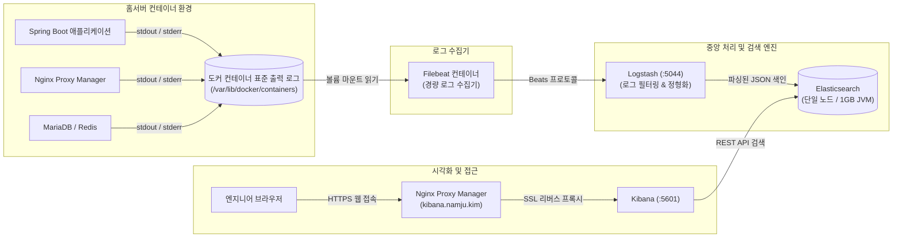

> 홈서버에서 구동되는 여러 컨테이너의 표준 출력 로그를 터미널마다 일일이 확인하는 한계를 극복하고, 리소스가 제한된 환경에 맞추어 JVM 힙 메모리를 최적화한 경량 Docker ELK(Elasticsearch, Logstash, Kibana) 스택을 구축하여 실시간 중앙 집중 로그 검색 및 보관 파이프라인을 완성합니다.

---

## 1. 분산 컨테이너 환경에서 중앙 집중 로그의 필요성

홈서버 환경에 Spring Boot 백엔드, MariaDB, Redis, Nginx Proxy Manager, 기타 마이크로서비스 컨테이너들이 늘어나면 운영 시 가장 큰 병목은 **"로그 추적"**에서 발생합니다.

특정 API 호출이 실패했을 때 터미널 창을 여러 개 띄우고 `docker logs -f <container_name>`을 번갈아 가며 조회하는 방식은 다음과 같은 명확한 한계를 가집니다.

1. **컨테이너 생명주기와 로그 증발**: 컨테이너가 예기치 않게 종료되거나 재생성(`docker compose down && up`)되면 이전 에러 로그가 유실될 위험이 큽니다.
2. **시간대 동기화 및 크로스 분석 불가**: 게이트웨이(NPM)에서 발생한 502 에러와 백엔드 애플리케이션의 NullPointerException 예외 로그를 타임스탬프 기준으로 교차 검증하기 어렵습니다.
3. **전체 텍스트 검색 부재**: 수천 줄의 로그 파일에서 특정 트랜잭션 ID나 에러 키워드를 빠르게 필터링할 수 없습니다.

이를 해결하기 위해 로그 수집 및 전체 텍스트 검색의 표준인 **ELK(Elasticsearch, Logstash, Kibana) 스택**을 도입합니다.



---

## 2. 홈서버를 위한 Elasticsearch & Logstash 경량화 튜닝

Elasticsearch는 본래 대규모 분산 클러스터를 전제로 설계되어 기본 상태에서는 상당한 양의 RAM(기본 4GB~8GB 이상)을 요구합니다. 홈서버(16GB~32GB 메모리 환경)에서 다른 서비스들과 공존하기 위해서는 철저한 리소스 상한선 설정이 필수적입니다.

### 2.1. 단일 노드 모드 지정 (`discovery.type=single-node`)
클러스터 마스터 선출이나 복제본 샤드 구성을 비활성화하여 단일 인스턴스에서 메모리 오버헤드 없이 즉시 기동되도록 만듭니다.

### 2.2. JVM 힙(Heap) 메모리 고정
- **Elasticsearch**: `ES_JAVA_OPTS: "-Xms1g -Xmx1g"`  
  홈서버의 컨테이너 로그 수집 용도로는 최소 1GB, 최대 1GB의 힙 메모리면 충분합니다. 최소값(`-Xms`)과 최대값(`-Xmx`)을 동일하게 고정하여 힙 리사이징에 따른 JVM 가비지 컬렉션(GC) 일시 정지를 방지합니다.
- **Logstash**: `LS_JAVA_OPTS: "-Xms512m -Xmx512m"`  
  Logstash는 이벤트 버퍼링과 필터링 작업에 512MB 정도의 힙이면 홈서버 트래픽을 지연 없이 처리할 수 있습니다.

### 2.3. 호스트 커널 매개변수 설정 (`vm.max_map_count`)
Elasticsearch는 mmap 카운트가 부족하면 기동 단계에서 비정상 종료됩니다. 호스트 머신에서 커널 파라미터를 영구적으로 상향해야 합니다.

```bash
# 호스트 터미널에서 즉시 적용
sudo sysctl -w vm.max_map_count=262144

# 서버 재부팅 후에도 유지되도록 /etc/sysctl.conf에 등록
echo "vm.max_map_count=262144" | sudo tee -a /etc/sysctl.conf
```

> macOS 호스트 환경(Docker Desktop)에서는 가상 머신 내부 설정이 자동 처리되지만, Linux 기반 베어메탈 홈서버에서는 `vm.max_map_count` 미설정 시 Elasticsearch 컨테이너가 `max virtual memory areas vm.max_map_count [65530] is too low` 에러와 함께 즉사합니다.
{: .prompt-danger }

---

## 3. Logstash 파이프라인 및 Filebeat 설정

로그를 정제하여 Elasticsearch에 전달하는 파이프라인을 구성합니다.

### 3.1. `logstash/pipeline/logstash.conf`
Filebeat로부터 전달받은 Docker JSON 로그를 파싱하고 타임스탬프를 보정합니다.

```ruby
# logstash/pipeline/logstash.conf
input {
  beats {
    port => 5044
  }
}

filter {
  # Docker 기본 컨테이너 로그(JSON 형태) 파싱
  if [container][image][name] {
    mutate {
      add_field => { "service_name" => "%{[container][name]}" }
    }
  }

  # 날짜 파싱 및 표준 타임스탬프 등록
  date {
    match => [ "timestamp", "ISO8601" ]
    target => "@timestamp"
  }
}

output {
  elasticsearch {
    hosts => ["http://elasticsearch:9200"]
    index => "homelab-docker-logs-%{+YYYY.MM.dd}"
    user => "elastic"
    password => "${ELASTIC_PASSWORD}"
  }
}
```

### 3.2. `filebeat/filebeat.yml`
호스트의 Docker 컨테이너 로그 경로를 마운트하여 실시간으로 수집합니다.

```yaml
# filebeat/filebeat.yml
filebeat.inputs:
  - type: container
    paths:
      - /var/lib/docker/containers/*/*.log
    processors:
      - add_docker_metadata:
          host: "unix:///var/run/docker.sock"

output.logstash:
  hosts: ["logstash:5044"]
```

---

## 4. 완성형 `docker-compose.yml` 및 환경 구성

ELK 스택 전용 디렉터리를 구성합니다.

```text
~/homelab-elk/
├── .env
├── docker-compose.yml
├── filebeat/
│   └── filebeat.yml
└── logstash/
    └── pipeline/
        └── logstash.conf
```

### 4.1. 환경 변수 파일 (`.env`)
Elasticsearch와 Kibana 접속 비밀번호를 명시합니다.

```bash
# .env
ELASTIC_VERSION=8.15.2
ELASTIC_PASSWORD=elk_secure_cluster_pass_2026!
KIBANA_PASSWORD=kibana_system_secure_pass_2026!
ES_PORT=9200
KIBANA_PORT=5601
TZ=Asia/Seoul
```

### 4.2. 완성형 `docker-compose.yml`

```yaml
# docker-compose.yml
services:
  elasticsearch:
    image: docker.elastic.co/elasticsearch/elasticsearch:${ELASTIC_VERSION:-8.15.2}
    container_name: elk-elasticsearch
    restart: unless-stopped
    environment:
      - node.name=homelab-es01
      - cluster.name=homelab-logs
      - discovery.type=single-node
      - bootstrap.memory_lock=true
      - "ES_JAVA_OPTS=-Xms1g -Xmx1g"
      - ELASTIC_PASSWORD=${ELASTIC_PASSWORD}
      - xpack.security.enabled=true
      - xpack.security.http.ssl.enabled=false # 내부 통신 단순화
    ulimits:
      memlock:
        soft: -1
        hard: -1
      nofile:
        soft: 65535
        hard: 65535
    ports:
      - "127.0.0.1:${ES_PORT:-9200}:9200" # 호스트 로컬 루프백에만 바인딩
    volumes:
      - es_data:/usr/share/elasticsearch/data
    networks:
      - logging-net

  logstash:
    image: docker.elastic.co/logstash/logstash:${ELASTIC_VERSION:-8.15.2}
    container_name: elk-logstash
    restart: unless-stopped
    environment:
      - "LS_JAVA_OPTS=-Xms512m -Xmx512m"
      - ELASTIC_PASSWORD=${ELASTIC_PASSWORD}
    volumes:
      - ./logstash/pipeline/logstash.conf:/usr/share/logstash/pipeline/logstash.conf:ro
    ports:
      - "127.0.0.1:5044:5044"
    networks:
      - logging-net
    depends_on:
      - elasticsearch

  kibana:
    image: docker.elastic.co/kibana/kibana:${ELASTIC_VERSION:-8.15.2}
    container_name: elk-kibana
    restart: unless-stopped
    environment:
      - SERVER_NAME=kibana.namju.kim
      - ELASTICSEARCH_HOSTS=http://elasticsearch:9200
      - ELASTICSEARCH_USERNAME=elastic
      - ELASTICSEARCH_PASSWORD=${ELASTIC_PASSWORD}
      - I18N_LOCALE=ko-KR # 한국어 UI 설정
    ports:
      - "${KIBANA_PORT:-5601}:5601"
    networks:
      - logging-net
    depends_on:
      - elasticsearch

  filebeat:
    image: docker.elastic.co/beats/filebeat:${ELASTIC_VERSION:-8.15.2}
    container_name: elk-filebeat
    user: root # 도커 로그 파일 읽기 권한 확보
    restart: unless-stopped
    volumes:
      - ./filebeat/filebeat.yml:/usr/share/filebeat/filebeat.yml:ro
      - /var/lib/docker/containers:/var/lib/docker/containers:ro
      - /var/run/docker.sock:/var/run/docker.sock:ro
    networks:
      - logging-net
    depends_on:
      - logstash

volumes:
  es_data:
    name: homelab_es_data

networks:
  logging-net:
    name: homelab_logging_net
    driver: bridge
```

설정 후 전체 스택을 가동합니다.

```bash
docker compose up -d
```

---

## 5. NPM(Nginx Proxy Manager) 리버스 프록시 연동

Kibana 웹 UI(`:5601`)를 외부에서 안전하게 접근할 수 있도록 Nginx Proxy Manager를 통해 도메인(`kibana.namju.kim`)을 연결합니다.

### 5.1. NPM Proxy Host 설정
- **Domain Names**: `kibana.namju.kim`
- **Scheme**: `http`
- **Forward Hostname / IP**: 호스트 내부 IP
- **Forward Port**: `5601`
- **Block Common Exploits**: ON
- **Websockets Support**: ON
- **SSL 탭**:
  - `*.namju.kim` Let's Encrypt 인증서 선택
  - **Force SSL**: ON
  - **HTTP/2 Support**: ON

### 5.2. 대용량 로그 검색을 위한 타임아웃 튜닝 (Custom Nginx Configuration)
Kibana에서 수일 치 대용량 로그를 집계할 때 Nginx 기본 타임아웃(60s)으로 인해 504 Gateway Timeout 에러가 발생할 수 있습니다. NPM의 **Advanced** 탭에 아래 지시어를 추가합니다.

```nginx
proxy_read_timeout 300s;
proxy_connect_timeout 300s;
proxy_send_timeout 300s;
client_max_body_size 50M;
```

---

## 6. Kibana 데이터 뷰(Data View) 등록 및 검색 실습

스택이 정상 가동되면 브라우저에서 `https://kibana.namju.kim`에 접속합니다.

1. `elastic` 계정과 설정한 `${ELASTIC_PASSWORD}`로 로그인합니다.
2. 좌측 메뉴의 **Management > Stack Management > Data Views**(과거 Index Patterns)로 이동합니다.
3. **Create data view**를 클릭합니다.
   - **Name**: `Homelab Containers`
   - **Index pattern**: `homelab-docker-logs-*`
   - **Timestamp field**: `@timestamp`
4. 저장을 완료한 후 좌측 메뉴의 **Analytics > Discover**로 이동합니다.

이제 홈서버에서 구동되는 모든 컨테이너의 표준 출력이 밀리초 단위로 집약되며, `service_name: "spring-app"`이나 `message: "ERROR"`와 같은 KQL(Kibana Query Language) 쿼리를 활용해 원하는 장애 로그를 1초 만에 찾아낼 수 있습니다.

---

## 7. 홈서버를 위한 인덱스 수명 주기(ILM) 보관 정책

로그가 무제한으로 쌓이면 Elasticsearch의 샤드 수와 디스크 사용량이 감당할 수 없을 정도로 불어납니다. 홈서버의 안정성을 위해 **인덱스 수명 주기 관리(ILM)** 정책을 반드시 적용해야 합니다.

Kibana의 **Stack Management > Index Lifecycle Policies**에서 새 정책을 생성합니다.

1. **Policy Name**: `homelab-7day-retention`
2. **Hot Phase**: 기본 유지
3. **Warm / Cold Phase**: 비활성화 (홈서버는 단일 노드이므로 티어 이동 불필요)
4. **Delete Phase 활성화**:
   - **Move to delete phase after**: `7 days` (7일 경과 시)
5. 저장을 완료한 후 `homelab-docker-logs-*` 인덱스 템플릿에 해당 ILM 정책을 바인딩합니다.

이렇게 설정해 두면 7일이 지난 일자별 인덱스는 백그라운드에서 자동으로 완전 삭제되어 디스크 여유 공간이 항상 보장됩니다.

---

## 정리

홈서버 환경에서 경량 Docker ELK 스택을 성공적으로 구축하기 위한 핵심 요소를 요약하면 다음과 같습니다.

1. **자원 상한 고정**: 단일 노드 설정(`discovery.type=single-node`)과 JVM 힙 메모리 고정(`ES 1GB`, `Logstash 512MB`)을 통해 홈서버의 물리 메모리를 고갈시키지 않도록 방어했습니다.
2. **Filebeat + Docker 메타데이터 파이프라인**: 호스트 컨테이너 로그를 안전하게 읽어와 서비스명과 표준 타임스탬프가 매핑된 구조화된 JSON으로 변환했습니다.
3. **ILM 기반 자동 디스크 관리**: 7일 보관 주기를 적용하여 디스크 풀 장애 없이 항구적으로 무중단 운영할 수 있는 토대를 마련했습니다.

이로써 **Prometheus + Grafana(시계열 메트릭 모니터링)**와 **ELK Stack(중앙 집중 로그 분석)**이라는 홈서버 관측성(Observability)의 2대 축이 완벽하게 확립되었습니다.
