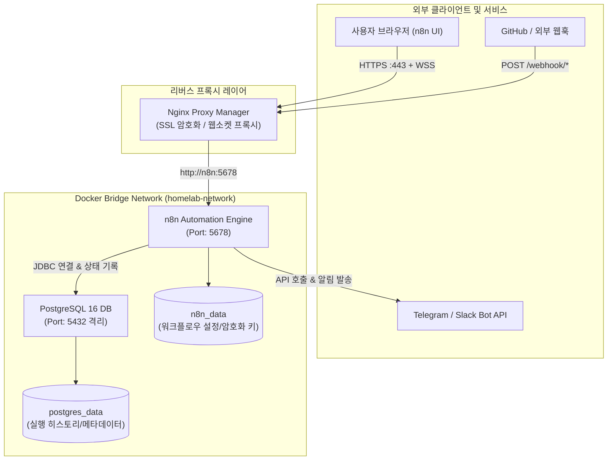
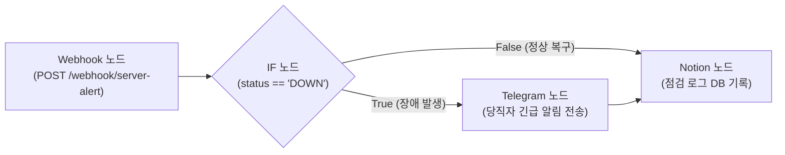
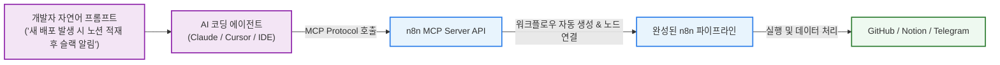

> Zapier나 Make 같은 클라우드 SaaS의 유료 플랜 비용과 데이터 프라이버시 한계를 극복하기 위해, 오픈소스 워크플로우 자동화 도구인 n8n을 Docker Compose와 PostgreSQL 기반으로 직접 호스팅하고 웹훅 수신부터 알림 발송까지 안정적인 이벤트 파이프라인을 구축하는 과정을 다룹니다.

---

## 1. 워크플로우 자동화 도구의 셀프호스팅 필요성

사이드 프로젝트나 홈랩을 운영하다 보면 수많은 반복 작업과 이벤트 알림을 자동화해야 하는 순간이 찾아옵니다.

- 서버 헬스체크 실패나 컨테이너 다운 이벤트 발생 시 텔레그램이나 슬랙으로 긴급 알림 전송
- 깃허브 웹훅(Webhook)을 수신하여 릴리즈 노트 파싱 후 노션 데이터베이스에 자동 기록
- 주기적인 백업 완료 로그를 집계하여 일일 리포트 생성 및 이메일 발송

이러한 파이프라인을 구축할 때 흔히 Zapier나 Make를 먼저 떠올리게 됩니다. 하지만 클라우드 SaaS 서비스는 다음과 같은 명확한 한계를 지닙니다.

1. **무료 플랜의 실행 횟수(Task Run) 제한**: 1분에 한 번씩 헬스체크를 수행하거나 대량 웹훅을 처리하면 월간 한도가 순식간에 소진됩니다.
2. **데이터 외부 유출 및 보안 우려**: 사내 내부 API 토큰, 서버 접속 키, 민감한 페이로드가 제3자 클라우드 서버를 경유해야 합니다.
3. **복잡한 로직 및 커스텀 코드 실행의 제약**: JavaScript(Node.js)나 Python 스크립트를 자유롭게 실행하고 외부 라이브러리를 바인딩하는 데 제약이 큽니다.

**n8n(nodemation)**은 페어코드 라이선스(Fair-code) 기반의 강력한 오픈소스 워크플로우 자동화 도구입니다. 400여 개 이상의 풍부한 노드 연동을 기본 지원하며, 자체 호스팅 환경에서는 실행 횟수나 워크플로우 개수에 제약 없이 무제한으로 파이프라인을 구동할 수 있습니다.

---

## 2. 전체 아키텍처 및 네트워크 통신 구조

n8n의 기본 설정은 단일 SQLite 파일을 데이터베이스로 사용합니다. 하지만 수많은 이벤트가 비동기로 유입되는 워크플로우 엔진 특성상 SQLite는 동시 트랜잭션 쓰기 락(Lock) 이슈와 영속성 불안정성을 야기할 수 있습니다. 따라서 안정적인 프로덕션급 홈랩 구성을 위해 **PostgreSQL 16**을 전용 데이터베이스로 연동합니다.

또한 n8n 웹 UI의 실시간 노드 실행 상태 스트리밍 및 로그 갱신을 위해 **웹소켓(WebSocket)**을 지원하는 Nginx Proxy Manager(NPM)를 리버스 프록시 앞단에 배치합니다.



---

## 3. 디렉토리 구조 및 Docker Compose 명세서

n8n 설정 파일과 PostgreSQL 데이터가 안전하게 마운트될 수 있도록 호스트 디렉토리를 구조화합니다.

```text
n8n/
├── docker-compose.yml
├── .env
└── data/
    ├── n8n/
    └── postgres/
```

### 3.1 환경 변수 정의 (`.env`)

민감한 데이터베이스 비밀번호와 웹훅 도메인 주소는 별도의 `.env` 파일로 분리합니다.

```env
# .env
# PostgreSQL 설정
POSTGRES_USER=n8n_admin
POSTGRES_PASSWORD=n8n_secure_db_password_xxxx
POSTGRES_DB=n8n

# n8n 서비스 도메인 및 웹훅 설정
DOMAIN_NAME=n8n.example.com
SUBDOMAIN=n8n
GENERIC_TIMEZONE=Asia/Seoul
N8N_ENFORCE_SETTINGS_FILE_PERMISSIONS=true
N8N_ENCRYPTION_KEY=your_generated_random_32char_key_xxxx
```

> [!NOTE]
> `N8N_ENCRYPTION_KEY`는 노드에 저장되는 인증 정보(API Key, OAuth Token)를 암호화하는 핵심 키입니다. 설정 후 변경하면 기존 저장된 자격 증명을 복호화할 수 없으므로 안전한 곳에 별도로 백업해 두어야 합니다.

### 3.2 Docker Compose 파일 작성 (`docker-compose.yml`)

PostgreSQL 컨테이너가 정상적으로 헬스체크를 통과한 후 n8n 엔진이 기동되도록 `condition: service_healthy` 조건을 적용합니다.

```yaml
# docker-compose.yml
services:
  postgres:
    image: postgres:16-alpine
    container_name: n8n-postgres
    restart: unless-stopped
    environment:
      POSTGRES_USER: ${POSTGRES_USER}
      POSTGRES_PASSWORD: ${POSTGRES_PASSWORD}
      POSTGRES_DB: ${POSTGRES_DB}
    volumes:
      - ./data/postgres:/var/lib/postgresql/data
    networks:
      - homelab-network
    healthcheck:
      test: ["CMD-SHELL", "pg_isready -h localhost -U ${POSTGRES_USER} -d ${POSTGRES_DB}"]
      interval: 5s
      timeout: 5s
      retries: 10

  n8n:
    image: docker.n8n.io/n8nio/n8n:latest
    container_name: n8n-app
    restart: unless-stopped
    ports:
      - "5678:5678"
    environment:
      - DB_TYPE=postgresdb
      - DB_POSTGRESDB_HOST=postgres
      - DB_POSTGRESDB_PORT=5432
      - DB_POSTGRESDB_DATABASE=${POSTGRES_DB}
      - DB_POSTGRESDB_USER=${POSTGRES_USER}
      - DB_POSTGRESDB_PASSWORD=${POSTGRES_PASSWORD}
      - N8N_HOST=${DOMAIN_NAME}
      - N8N_PORT=5678
      - N8N_PROTOCOL=https
      - NODE_ENV=production
      - WEBHOOK_URL=https://${DOMAIN_NAME}/
      - GENERIC_TIMEZONE=${GENERIC_TIMEZONE}
      - N8N_ENFORCE_SETTINGS_FILE_PERMISSIONS=${N8N_ENFORCE_SETTINGS_FILE_PERMISSIONS}
      - N8N_ENCRYPTION_KEY=${N8N_ENCRYPTION_KEY}
      - EXECUTIONS_DATA_PRUNE=true
      - EXECUTIONS_DATA_MAX_AGE=168 # 7일 지난 실행 로그 자동 삭제
    volumes:
      - ./data/n8n:/home/node/.n8n
    depends_on:
      postgres:
        condition: service_healthy
    networks:
      - homelab-network

networks:
  homelab-network:
    name: homelab-network
    driver: bridge
```

---

## 4. 리버스 프록시 연동 및 웹소켓(WebSocket) 활성화

n8n은 에디터 캔버스에서 노드를 테스트 실행할 때 실시간 진행 상황을 웹소켓(Push 연결)으로 브라우저에 전달합니다. 따라서 Nginx Proxy Manager(NPM)를 사용할 때 일반 HTTP 프록시 설정 외에 **Websockets Support**를 반드시 켜주어야 합니다.

### NPM 프록시 호스트 설정

1. **Domain Names**: `n8n.example.com`
2. **Forward Hostname / IP**: `n8n-app` (동일 Docker 네트워크인 경우) 또는 호스트 IP
3. **Forward Port**: `5678`
4. **Cache Assets**: OFF
5. **Block Common Exploits**: ON
6. **Websockets Support**: **ON (반드시 활성화)**

```nginx
# Websockets Support 활성화 시 자동 주입되는 내부 Nginx 지시문 예시
proxy_http_version 1.1;
proxy_set_header Upgrade $http_upgrade;
proxy_set_header Connection "upgrade";
proxy_set_header Host $host;
```

> [!WARNING]
> 만약 `WEBHOOK_URL` 환경 변수를 지정하지 않거나 리버스 프록시의 HTTPS 도메인과 일치시키지 않으면, Webhook 노드가 내부 Docker IP(`http://localhost:5678`)로 엔드포인트를 노출하여 GitHub이나 슬랙 등 외부 서비스에서 호출 시 `Connection Refused` 에러가 발생합니다.

---

## 5. 실무 워크플로우 구축: 서버 헬스체크 및 텔레그램 알림

컨테이너 기동 후 브라우저에서 `https://n8n.example.com`에 접속하여 초기 관리자 계정을 생성합니다. 이후 홈서버 모니터링 시스템에서 실패 이벤트를 전송받아 처리하는 실무 자동화 파이프라인을 구성합니다.



### 단계별 노드 구성 가이드

1. **Webhook 노드**:
   - HTTP Method: `POST`
   - Path: `server-alert`
   - Response Mode: `On Received` (200 OK 즉시 반환)
   - 전송받을 JSON 페이로드 예시:
     ```json
     {
       "service": "api-gateway",
       "status": "DOWN",
       "timestamp": "2026-10-30T10:15:00Z",
       "error_message": "Connection timed out (504)"
     }
     ```

2. **IF 노드 (조건 분기)**:
   - 조건 식: `{{ $json.body.status }}` Equal to `DOWN`
   - 장애 상태일 때만 True 경로로 흘려보내 불필요한 알림 피로도를 방지합니다.

3. **Telegram 노드 (즉시 경보)**:
   - Operation: `Send Text Message`
   - Chat ID: `${TELEGRAM_CHAT_ID}`
   - 메시지 본문 마크다운 포맷팅:
     ```text
     🚨 [홈서버 장애 감지]
     - 서비스: {{ $json.body.service }}
     - 상태: {{ $json.body.status }}
     - 시각: {{ $json.body.timestamp }}
     - 오류 내용: {{ $json.body.error_message }}
     ```

4. **Notion 노드 (이력 아카이빙)**:
   - 장애 발생 여부와 상관없이 노션 '인프라 점검 일지' 데이터베이스에 새 페이지를 생성하여 발생 이력을 누적합니다.

---

## 6. 💡 차세대 자동화: MCP(Model Context Protocol) 지원과 AI 기반 워크플로우 구축

과거의 워크플로우 자동화는 사람이 웹 캔버스 위에서 수십 개의 노드를 마우스로 일일이 끌어다 놓고 복잡한 JSON 경로(`$json.body...`)를 손수 매핑해야 했습니다. 하지만 최신 n8n 환경에서는 **MCP(Model Context Protocol)** 지원과 AI 에이전트 기능 덕분에 이러한 구축 패러다임이 완전히 바뀌었습니다.

### 6.1 사람이 플로우를 다 만들 필요가 없는 이유
1. **n8n AI Workflow Builder (자연어 생성)**:
   - n8n 캔버스 상단에서 *"GitHub Webhook을 받아 릴리즈 본문을 마크다운으로 파싱한 뒤, 조건에 따라 Notion DB에 적재하고 Telegram 봇으로 알림을 보내는 파이프라인 만들어줘"*라고 자연어로 요청하면 AI가 필요한 노드 배치와 조건 분기(IF) 설정을 순식간에 자동으로 조립해 줍니다.
2. **MCP(Model Context Protocol) 서버/클라이언트 연동**:
   - n8n은 Anthropic이 제창한 오픈 표준인 **MCP**를 완벽하게 지원합니다.
   - **Claude Desktop / Cursor / AI 에이전트 ➔ n8n 호출**: AI 코딩 에이전트에게 n8n MCP 서버를 연결해 두면, 에이전트가 n8n에 등록된 수많은 외부 서비스(GitHub, Slack, DB, Google Sheets 등)를 자신의 '도구(Tool)'로 인식하여 스스로 n8n 워크플로우를 트리거하고 결과를 수집합니다.
   - **n8n 내부의 MCP Tool 노드**: n8n의 AI Agent 노드 안에 다양한 MCP 서버(예: 로컬 파일시스템 탐색, 브라우징, DB 쿼리 등)를 장착하여 자율적으로 작업을 완수하는 자율 에이전트 파이프라인을 구성할 수 있습니다.



결과적으로 개발자는 세부적인 노드 파라미터와 씨름할 필요 없이, **상위 비즈니스 로직과 데이터 요구사항만 AI 에이전트에 지시**함으로써 수 분 만에 견고한 엔터프라이즈급 자동화 파이프라인을 구축할 수 있습니다.

---

## 7. 운영 유지보수 및 실행 이력 가지치기(Pruning)

수백 개의 워크플로우가 하루에도 수천 번씩 실행되면 PostgreSQL 데이터베이스의 용량이 급격히 증가합니다.

Docker Compose 환경 변수에서 다음 옵션을 설정해 두면 오래된 실행 이력이 매일 자정에 자동으로 정리됩니다:

```yaml
- EXECUTIONS_DATA_PRUNE=true
- EXECUTIONS_DATA_MAX_AGE=168 # 7일간의 히스토리만 유지
- EXECUTIONS_DATA_PRUNE_MAX_COUNT=10000
```

수동으로 컨테이너를 업데이트할 때는 데이터 볼륨이 보존되도록 아래 명령을 통해 새 이미지를 가져와 재기동합니다.

```bash
# 최신 n8n 이미지 다운로드 및 컨테이너 무중단 롤링 업데이트
docker compose pull
docker compose up -d --remove-orphans
```

---

## 8. 마치며

n8n을 도커와 PostgreSQL 조합으로 홈랩에 셀프호스팅하면, 외부 SaaS의 비용이나 데이터 유출 걱정 없이 완벽하게 격리된 환경에서 다양한 자동화 시나리오를 구현할 수 있습니다.

특히 Webhook 노드와 NPM의 리버스 프록시 웹소켓 연결을 올바르게 매핑해 두면 깃허브 액션, 홈서버 모니터링, 메시징 봇을 유기적으로 엮어내는 훌륭한 이벤트 허브 역할을 수행하게 됩니다. 다음 글에서는 이러한 홈서버의 상태를 24시간 감시하고 장애를 감지하는 초경량 모니터링 도구인 **Uptime Kuma**의 구축 방법을 다루어 보겠습니다.
