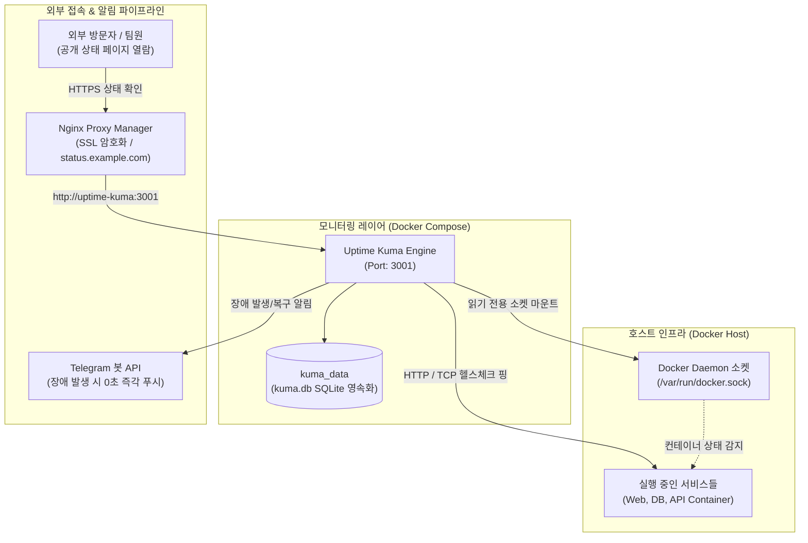
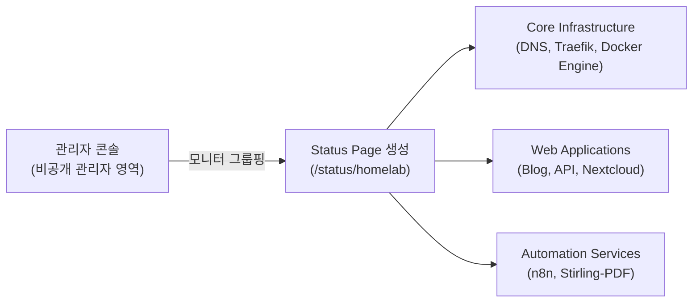

> 프로메테우스와 그라파나의 무거운 리소스 부담 없이, 홈서버에 구동 중인 웹 서비스와 도커 컨테이너의 가동 상태를 24시간 실시간 감시하고 장애 발생 시 텔레그램으로 즉각 통보하는 초경량 모니터링 도구 Uptime Kuma 구축 전략을 정리합니다.

---

## 1. 홈서버에 초경량 모니터링 시스템이 필요한 이유

홈랩이나 개인 서버를 운영하다 보면 배포해 둔 블로그, 개인 클라우드(Nextcloud), API 서버 등이 알 수 없는 이유로 다운되는 상황을 겪게 됩니다.

- 배포 스크립트 오작동이나 OOM(Out of Memory)으로 백엔드 프로세스가 예기치 않게 종료된 경우
- Let's Encrypt SSL 인증서 갱신이 실패하여 외부 접속이 차단된 경우
- 데이터베이스 컨테이너 헬스체크는 통과했으나 웹 서버 포트 바인딩이 유실된 경우

이러한 문제를 사전에 인지하기 위해 흔히 프로메테우스(Prometheus) + 그라파나(Grafana) 조합을 검토하곤 합니다. 하지만 홈랩 환경에서는 다음과 같은 진입 장벽이 존재합니다.

1. **과도한 메모리 및 CPU 리소스 점유**: 메트릭 수집 데몬(Exporter)과 시계열 DB(TSDB)가 상시 구동되면서 수백 MB~수 GB의 메모리를 소모합니다.
2. **높은 설정 복잡도**: 단순한 서비스 다운 알림을 받는 데도 수십 줄의 PromQL 쿼리와 Alertmanager YAML 명세 작성이 요구됩니다.

**Uptime Kuma**는 Node.js와 SQLite/Vue.js 기반의 초경량 자체 호스팅 모니터링 도구입니다. 단일 컨테이너(메모리 100MB 내외)로 구동되며, 직관적인 대시보드에서 마우스 클릭 몇 번으로 HTTP(s), TCP, DNS, 도커 컨테이너 상태를 등록하고 즉시 알림 채널을 연동할 수 있습니다.

---

## 2. 전체 아키텍처 및 헬스체크 수집 구조

Uptime Kuma는 정해진 주기(기본 60초)마다 타겟 서비스에 핑(Ping) 또는 HTTP 요청을 보내 응답 코드(200 OK)와 레이턴시를 측정합니다. 또한 호스트의 도커 소켓(`/var/run/docker.sock`)을 볼륨으로 마운트하면 개별 컨테이너의 라이프사이클 이벤트를 직접 감지할 수 있습니다.



---

## 3. 디렉토리 구조 및 Docker Compose 명세서

데이터가 저장될 호스트 경로를 생성하고 Compose 명세서를 작성합니다.

```text
uptime-kuma/
├── docker-compose.yml
└── data/
```

### Docker Compose 파일 작성 (`docker-compose.yml`)

도커 컨테이너 자체의 구동 상태(running, restarting, dead)를 직접 모니터링하기 위해 호스트의 도커 소켓을 **읽기 전용(`:ro`)**으로 마운트합니다.

```yaml
# docker-compose.yml
services:
  uptime-kuma:
    image: louislam/uptime-kuma:1.23.16
    container_name: uptime-kuma
    restart: always
    ports:
      - "3001:3001"
    volumes:
      - ./data:/app/data
      - /var/run/docker.sock:/var/run/docker.sock:ro # 도커 컨테이너 모니터링용 (읽기 전용)
    environment:
      - UPTIME_KUMA_PORT=3001
      - TZ=Asia/Seoul
    networks:
      - homelab-network
    security_opt:
      - no-new-privileges:true

networks:
  homelab-network:
    name: homelab-network
    driver: bridge
```

> [!CAUTION]
> `/var/run/docker.sock`은 호스트의 도커 데몬을 제어할 수 있는 루트 권한 통로입니다. 보안 사고를 방지하기 위해 반드시 읽기 전용 플래그(`:ro`)를 붙이고, 컨테이너에 `no-new-privileges:true` 보안 옵션을 명시해야 합니다.

컨테이너를 백그라운드로 실행합니다:

```bash
docker compose up -d
```

---

## 4. 리버스 프록시(NPM) 연동 및 웹소켓 설정

Uptime Kuma 대시보드는 실시간 하트비트(Heartbeat) 차트와 레이턴시 그래프를 WebSocket을 통해 브라우저로 스트리밍합니다. Nginx Proxy Manager 설정 시 **Websockets Support**가 필수적입니다.

### NPM 프록시 호스트 설정 가이드

1. **Domain Names**: `status.example.com`
2. **Forward Scheme / IP / Port**: `http` / `uptime-kuma` (또는 로컬 IP) / `3001`
3. **Websockets Support**: **ON (반드시 활성화)**
4. **SSL 설정**: Let's Encrypt 인증서 발급, `Force SSL` 및 `HTTP/2 Support` 활성화

만약 웹소켓 설정이 비활성화되어 있다면, 대시보드 상단에 `Cannot connect to the socket server` 경고 배너가 지속적으로 출력되거나 실시간 핑 갱신이 멈추게 됩니다.

---

## 5. 핵심 모니터링 타겟 등록 및 실무 활용

초기 접속(`https://status.example.com`) 시 관리자 계정을 생성한 뒤, 대시보드 좌측 상단의 **Add New Monitor** 버튼을 눌러 모니터를 등록합니다.

### 5.1 HTTP(s) 웹 서비스 및 SSL 만료일 감지

웹 사이트나 API 엔드포인트를 감시할 때 가장 기본이 되는 방식입니다.

- **Monitor Type**: `HTTP(s)`
- **URL**: `https://api.example.com/health`
- **Heartbeat Interval**: `60`초
- **Retries**: `2`회 (일시적인 네트워크 지연으로 인한 오탐 방지)
- **Certificate Expiry Notification**: `ON`
  - 인증서 만료 14일, 7일 전에 사전 경고 알림을 발송하도록 설정하여 만료 사고를 예방합니다.

### 5.2 도커 컨테이너 직접 감시 (Docker Container)

포트가 외부에 노출되지 않은 백그라운드 워커 컨테이너(예: Celery, n8n 워커)의 프로세스 생존 여부를 감시합니다.

- **Monitor Type**: `Docker Container`
- **Docker Daemon**: `Local (/var/run/docker.sock)`
- **Container Name / ID**: `n8n-app` 또는 `n8n-postgres`

컨테이너가 비정상 종료되어 종료 코드(Exit Code 1 등)로 떨어지거나 재시작 루프에 빠지면 즉시 감지됩니다.

---

## 6. 텔레그램 즉시 장애 알림 연동

장애가 발생했을 때 1초 이내에 모바일 푸시 알림을 받을 수 있도록 텔레그램 봇을 연동합니다.

1. 텔레그램 `@BotFather`를 통해 새 봇을 생성하고 `API Token`을 발급받습니다.
2. 알림을 수신할 채널 또는 사용자 ID(`Chat ID`)를 확인합니다.
3. Uptime Kuma 설정 메뉴의 **Settings > Notification > Setup Notification**으로 이동합니다.
4. **Notification Type**: `Telegram` 선택 후 파라미터를 입력합니다:
   - **Bot Token**: `123456789:AAHxxxxxxxxx_xxxxxxxxx` (마스킹 처리)
   - **Chat ID**: `987654321`

```text
[장애 감지 알림 메시지 예시]
🔴 [Service Down] api-gateway
URL: https://api.example.com/health
Error: 502 Bad Gateway
Time: 2026-11-01 10:45:12 (KST)
```

복구되었을 때는 초록색 배너와 함께 서비스가 다시 온라인으로 돌아왔다는 회복 메시지가 자동으로 전송됩니다.

---

## 7. 커스텀 공개 상태 페이지(Status Page) 구축

Uptime Kuma의 가장 강력한 기능 중 하나는 사내 동료나 외부 사용자에게 보여줄 수 있는 **공개 상태 페이지(Status Page)**를 몇 번의 클릭만으로 생성할 수 있다는 점입니다.



### 상태 페이지 구성 단계

1. 대시보드 상단 메뉴에서 **Status Pages**를 클릭하고 **New Status Page**를 생성합니다.
2. **Title**: `Namju's Homelab Status`
3. **URL Slug**: `/status/homelab`
4. **Description**: `실시간 홈서버 인프라 및 서비스 가동률 대시보드`
5. **Group Services**:
   - `Core Infras`: NPM, PostgreSQL, Redis
   - `Applications`: Blog, Uptime Kuma, n8n
6. **Custom CSS / Footer**: 회사 로고나 개인 블로그 링크(`https://namju.kim`)를 푸터에 등록합니다.

완성된 상태 페이지는 로그인 세션 없이도 누구나 열람할 수 있으며, 90일간의 서비스 업타임 퍼센트(예: 99.98%)와 일자별 가동 기록을 미려한 바 차트로 투명하게 공개할 수 있습니다.

---

## 8. 마치며

Uptime Kuma는 복잡한 시계열 메트릭 설정 없이도 서비스의 생존 여부(Liveness)와 응답 지연을 가장 효과적으로 감시할 수 있는 최적의 모니터링 솔루션입니다.

도커 소켓 읽기 전용 마운트와 텔레그램 봇, 그리고 NPM 웹소켓 프록시를 적절히 구성해 두면, 홈서버에 장애가 발생하는 즉시 모바일 알림을 받아 신속하게 대처할 수 있습니다. 
