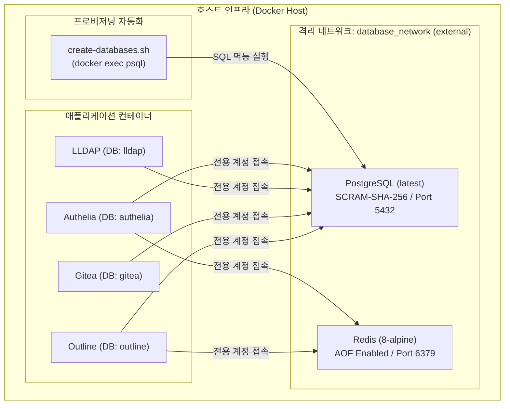

> 기존에 개별 컨테이너마다 분산되어 운영되던 데이터베이스를 고성능 PostgreSQL과 Redis 캐시 계층으로 일원화하고, 각 서비스별 격리된 계정과 데이터베이스를 멱등하게 프로비저닝하는 홈랩 v2 코어 데이터베이스 아키텍처를 정리합니다.

---

## 1. 홈랩 v1의 한계와 v2 데이터베이스 재설계 배경

홈서버를 장기간 운영하다 보면 서비스 수가 점차 늘어나면서 데이터베이스 관리 비용이 급격하게 증가합니다. 홈랩 v1에서는 MariaDB 컨테이너 하나에 여러 웹 애플리케이션의 테이블을 공용 사용자로 몰아넣거나, 일부 서비스는 자체 내장 SQLite를 사용하여 다음과 같은 문제가 발생했습니다.

1. **권한 격리 부재**: 단일 DB 유저를 여러 컨테이너가 공유하면서 특정 서비스의 설정 오류나 침해가 발생했을 때 다른 서비스 데이터까지 유출될 위험이 있었습니다.
2. **인증 표준 및 확장성 한계**: 최신 셀프 호스팅 도구(LLDAP, Authelia, Outline 등)는 PostgreSQL의 JSONB, SCRAM-SHA-256 암호화 인증, 고도화된 트랜잭션 격리 수준을 기본 권장 사양으로 요구합니다.
3. **재배포 시 수작업 의존**: 서버를 새로 세팅하거나 컨테이너를 재생성할 때마다 각 서비스용 데이터베이스와 계정을 수동 SQL 쿼리로 직접 생성해야 해 휴먼 에러가 빈번했습니다.

이를 해결하기 위해 홈랩 v2에서는 **PostgreSQL + SCRAM-SHA-256** 및 **Redis 8(Alpine)**을 코어 공용 데이터베이스로 표준화하고, 멱등성(Idempotency)을 보장하는 쉘 스크립트를 통해 신규 서비스 추가 시 안전하게 전용 계정과 데이터베이스가 프로비저닝되도록 아키텍처를 개선했습니다.

---

## 2. 코어 데이터베이스 네트워크 토폴로지

보안을 위해 데이터베이스 포트를 호스트의 공인 IP나 모든 인터페이스(`0.0.0.0`)에 개방하지 않고, 호스트 내부 관리 IP 또는 사설 도커 브릿지 네트워크(`database_network`)를 통해서만 통신하도록 격리합니다.



- **외부 격리 네트워크(`database_network`)**: 사전에 `docker network create database_network`로 수동 생성하여, 데이터베이스 스택이 재시작되더라도 컨테이너 간의 DNS 해석과 연결이 유지됩니다.
- **최소 권한의 법칙**: LLDAP, Authelia, Gitea, Outline은 오직 자신에게 할당된 데이터베이스의 소유권(Owner)만 가지며 다른 서비스의 DB에는 접근할 수 없습니다.

---

## 3. Docker Compose 스택 정의

데이터베이스 스택의 `docker-compose.yaml` 파일입니다. 환경 변수는 `.env` 파일로 분리하고, 변수 미지정 시 즉시 에러가 발생하도록 `:?required` 검증 문법을 적용했습니다.

```yaml
# database/docker-compose.yaml
name: database

services:
  postgres:
    image: postgres:latest
    container_name: postgres
    restart: unless-stopped
    environment:
      TZ: Asia/Seoul
      POSTGRES_USER: ${POSTGRES_USER:?required}
      POSTGRES_PASSWORD: ${POSTGRES_PASSWORD:?required}
      POSTGRES_DB: ${POSTGRES_DB:-postgres}
      POSTGRES_INITDB_ARGS: "--auth-host=scram-sha-256"
    ports:
      # 호스트의 바인딩 IP를 명시하여 무분별한 외부 노출 차단
      - "${SERVER_IP:?required}:5432:5432"
    volumes:
      - postgres_data:/var/lib/postgresql/data
    networks:
      - database_network
    healthcheck:
      test:
        - CMD-SHELL
        - 'pg_isready -U "$$POSTGRES_USER" -d "$$POSTGRES_DB"'
      interval: 10s
      timeout: 5s
      retries: 5
      start_period: 30s

  redis:
    image: redis:8-alpine
    container_name: redis
    restart: unless-stopped
    environment:
      TZ: Asia/Seoul
    command:
      - redis-server
      - --appendonly
      - "yes"
    ports:
      - "${SERVER_IP:?required}:6379:6379"
    volumes:
      - redis_data:/data
    networks:
      - database_network
    healthcheck:
      test:
        - CMD
        - redis-cli
        - ping
      interval: 10s
      timeout: 5s
      retries: 5
      start_period: 20s

volumes:
  postgres_data:
  redis_data:

networks:
  database_network:
    external: true
```

### 핵심 설정 분석
1. `POSTGRES_INITDB_ARGS: "--auth-host=scram-sha-256"`: 기본 MD5 인증 대신 안전한 솔트 기반 해시 인증(SCRAM-SHA-256)을 강제하여 무차별 대입 공격 및 스니핑을 방어합니다.
2. `redis-server --appendonly yes`: 인메모리 휘발 방지를 위해 AOF(Append Only File)를 활성화하여 세션 데이터와 캐시 상태를 디스크에 실시간 기록합니다.
3. `healthcheck`: 각 컨테이너가 정상적으로 요청을 받을 수 있는 상태인지 검증하여, 다른 스택(`depends_on`)에서 준비 상태를 신뢰할 수 있게 합니다.

---

## 4. 멱등성을 보장하는 데이터베이스 자동 프로비저닝 스크립트

PostgreSQL 기본 컨테이너는 최초 초기화 시 단 하나의 데이터베이스와 사용자만 생성합니다. 여러 서비스가 공용 인스턴스를 공유하려면 컨테이너 기동 후 각 애플리케이션용 사용자와 데이터베이스를 추가해야 합니다.

아래는 `database/scripts/create-databases.sh` 스크립트로, 대상 사용자나 데이터베이스가 이미 존재하는지 카탈로그(`pg_roles`, `pg_database`)를 검사한 후 안전하게 생성(`\gexec`)합니다.

```bash
#!/usr/bin/env bash
# database/scripts/create-databases.sh
set -euo pipefail

# 스크립트 위치 기준으로 database 디렉터리로 이동
cd "$(dirname "$0")/.."

# .env 환경변수 로드
set -a
source .env
set +a

# 프로비저닝 대상 DB 및 사용자 목록
DB_NAMES=(lldap authelia gitea outline)
DB_USERS=(lldap_user authelia_user gitea_user outline_user)
DB_PASS_VARS=(
  LLDAP_DB_PASSWORD
  AUTHELIA_DB_PASSWORD
  GITEA_DB_PASSWORD
  OUTLINE_DB_PASSWORD
)

for i in "${!DB_NAMES[@]}"; do
  db="${DB_NAMES[$i]}"
  user="${DB_USERS[$i]}"
  pass_var="${DB_PASS_VARS[$i]}"
  password="${!pass_var:?Missing $pass_var}"

  echo "==> Creating/checking: $db (User: $user)"

  docker exec \
    -e PGPASSWORD="$POSTGRES_PASSWORD" \
    -e TARGET_DB="$db" \
    -e TARGET_USER="$user" \
    -e TARGET_PASSWORD="$password" \
    postgres sh -c '
      psql -X -v ON_ERROR_STOP=1 \
        -U "$POSTGRES_USER" -d postgres \
        -v db="$TARGET_DB" \
        -v dbuser="$TARGET_USER" \
        -v dbpass="$TARGET_PASSWORD" <<'"'"'SQL'"'"'
SELECT format(
  '"'"'CREATE ROLE %I LOGIN PASSWORD %L'"'"',
  :'"'"'dbuser'"'"', :'"'"'dbpass'"'"'
)
WHERE NOT EXISTS (
  SELECT 1 FROM pg_roles WHERE rolname = :'"'"'dbuser'"'"'
)
\gexec

SELECT format(
  '"'"'CREATE DATABASE %I OWNER %I'"'"',
  :'"'"'db'"'"', :'"'"'dbuser'"'"'
)
WHERE NOT EXISTS (
  SELECT 1 FROM pg_database WHERE datname = :'"'"'db'"'"'
)
\gexec
SQL
    '
done

echo "==> All application databases are ready."
```

### `\gexec` 메타 명령어를 활용한 멱등성 처리 원리
일반 SQL DDL 문법에는 `CREATE ROLE IF NOT EXISTS`가 지원되지 않습니다. 따라서 `SELECT format(...) WHERE NOT EXISTS (...)` 쿼리로 DDL 문자열을 조건부 생성하고, `\gexec` 명령어를 통해 이전 쿼리 결과로 출력된 문자열을 즉시 실행(Execute)하는 방식을 채택했습니다. 덕분에 스크립트를 몇 번이고 반복 실행해도 중복 에러가 발생하지 않습니다.

---

## 5. 실행 및 정상 프로비저닝 검증

외부 네트워크를 먼저 생성하고 컨테이너를 기동한 뒤 프로비저닝 스크립트를 실행합니다.

```bash
# 1. 공용 데이터베이스 네트워크 생성
docker network create database_network

# 2. 데이터베이스 스택 기동
docker compose up -d

# 3. 헬스체크 정상 통과 확인
docker compose ps

# 4. DB 자동 프로비저닝 스크립트 실행
chmod +x scripts/create-databases.sh
./scripts/create-databases.sh
```

실행 후 생성된 데이터베이스와 소유자를 확인합니다:

```bash
docker exec -it postgres psql -U postgres -c "\l"
```

출력 결과에서 `lldap`, `authelia`, `gitea`, `outline` 데이터베이스가 각각의 소유자(`*_user`)로 격리 생성된 것을 확인할 수 있습니다. 이제 홈랩의 모든 백엔드 서비스가 신뢰할 수 있는 중앙 영속성 계층을 확보했습니다.
