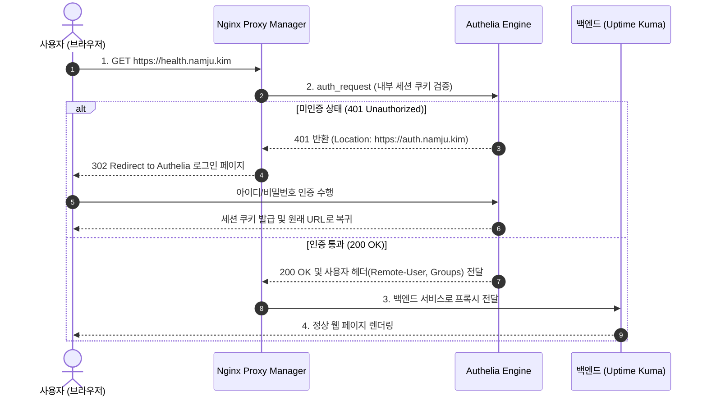
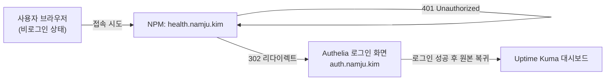

> 관리자 대시보드나 내부 웹 서비스가 외부에 무방비로 노출되는 위험을 방어하기 위해, Nginx Proxy Manager와 Authelia를 결합하여 웹 요청 직전 관문을 가로막는 Forward Auth 및 OIDC 기반 중앙 통합 로그인(SSO) 시스템을 구축합니다.

---

## 1. 셀프 호스팅 웹 서비스의 보안 딜레마

홈랩에 서비스가 늘어날 때 가장 큰 보안 위협은 **인증 체계가 없거나 취약한 관리자 대시보드(Portainer, Uptime Kuma 등)가 외부 인터넷에 직접 노출되는 것**입니다.

- 서비스 자체의 패스워드 무차별 대입(Brute-force) 공격 방어 기능 부재
- 오래된 웹 프레임워크 취약점(CVE)으로 인한 인증 우회 가능성
- 서비스마다 로그인 세션 만료 정책이 달라 발생하는 세션 하이재킹 위험

이를 완벽히 차단하는 방법은 **역방향 프록시(Reverse Proxy) 계층에서 애플리케이션으로 패킷이 도달하기 전에 먼저 중앙 인증 서버의 승인을 강제하는 Forward Auth**를 구현하는 것입니다.

**Authelia**는 오픈소스 인증 및 권한 부여 서버로, 다음 두 가지 강력한 인증 방식을 모두 지원합니다:
1. **Forward Auth (Reverse Proxy Subrequest)**: 자체 로그인 기능이 없는 서비스 앞단에 Nginx의 `auth_request`를 걸어 Authelia 로그인 세션이 유효할 때만 트래픽을 통과시킵니다.
2. **OIDC (OpenID Connect) Provider**: Gitea, Outline과 같은 현대적인 웹 애플리케이션에 표준 OAuth2/OIDC 인증 토큰을 발급하여 단일 계정 로그인을 지원합니다.

---

## 2. Forward Auth 트래픽 흐름 및 아키텍처

사용자가 보호된 도메인(`health.namju.kim`)에 접근할 때의 인증 검증 파이프라인입니다.



---

## 3. Authelia 서비스 및 설정 정의

`identity/docker-compose.yaml`에서 Authelia 컨테이너는 LLDAP 헬스체크가 정상 통과한 후 기동되도록 `depends_on`을 구성합니다.

```yaml
# identity/docker-compose.yaml (Authelia 발췌)
  authelia:
    image: authelia/authelia:latest
    container_name: authelia
    restart: unless-stopped
    depends_on:
      lldap:
        condition: service_healthy
    environment:
      TZ: Asia/Seoul
      X_AUTHELIA_CONFIG_FILTERS: template
      AUTHELIA_AUTHENTICATION_BACKEND_LDAP_PASSWORD: "${LLDAP_ADMIN_PASSWORD:?required}"
      AUTHELIA_IDENTITY_VALIDATION_RESET_PASSWORD_JWT_SECRET: "${AUTHELIA_JWT_SECRET:?required}"
      AUTHELIA_SESSION_SECRET: "${AUTHELIA_SESSION_SECRET:?required}"
      AUTHELIA_STORAGE_ENCRYPTION_KEY: "${AUTHELIA_STORAGE_ENCRYPTION_KEY:?required}"
      AUTHELIA_STORAGE_POSTGRES_PASSWORD: ${AUTHELIA_DB_PASSWORD:?required}
    volumes:
      - ./authelia:/config
    networks:
      - proxy_network
      - identity_backend
      - database_network
```

### Authelia 핵심 구성 (`authelia/configuration.yml`)

Authelia 설정 파일에서는 LLDAP 백엔드, Redis 세션 저장소, PostgreSQL 스토리지, 세부 도메인별 접근 제어 규칙(ACL), OIDC 클라이언트를 선언합니다.

```yaml
# identity/authelia/configuration.yml
server:
  address: "tcp://:9091"

log:
  level: info

totp:
  issuer: "namju.kim"

authentication_backend:
  password_reset:
    disable: true
  password_change:
    disable: true
  ldap:
    implementation: custom
    address: "ldap://lldap:3890"
    base_dn: "dc=namju,dc=kim"
    additional_users_dn: "ou=people"
    users_filter: "(&(|({username_attribute}={input})({mail_attribute}={input}))(objectClass=person))"
    username_attribute: "uid"
    mail_attribute: "mail"
    display_name_attribute: "displayName"
    additional_groups_dn: "ou=groups"
    groups_filter: "(member={dn})"
    group_name_attribute: "cn"
    user: "uid=admin,ou=people,dc=namju,dc=kim"

access_control:
  default_policy: deny
  rules:
    - domain: health.namju.kim
      subject:
        - "group:admin"
      policy: one_factor

    - domain: traffic.namju.kim
      subject:
        - "group:admin"
      policy: one_factor

    - domain: git.namju.kim
      subject:
        - "group:developer"
      policy: one_factor

    - domain: outline.namju.kim
      subject:
        - "group:guest"
        - "group:admin"
        - "group:developer"
      policy: one_factor

session:
  cookies:
    - domain: "namju.kim"
      authelia_url: "https://auth.namju.kim"
      inactivity: "5 minutes"
      expiration: "1 hour"
      remember_me: "1 month"
  redis:
    host: redis
    port: 6379
    database_index: 0

storage:
  postgres:
    address: tcp://postgres:5432
    database: authelia
    username: authelia_user
    password: ${AUTHELIA_DB_PASSWORD:?required}

identity_providers:
  oidc:
    hmac_secret: "54c5a054c396ad124500b89b1e7d603b39ecbc35c37b26b9ce56d3bd921be7296423442308e23463289beb4ad3c169543e3b3b5c76e148692639e39cd0a3c5ca"
    jwks:
      - key: '{{ secret "/config/secrets/oidc/private.pem" | mindent 10 "|" | msquote }}'
    clients:
      - client_id: portainer
        client_name: Portainer BE
        client_secret: "$pbkdf2-sha512$310000$gI2d1fup36kXKjCy.OvgqQ$1nvV5YblpBtrIOfBhvtEKvbnVKchCsxtZ64upAKVI/21jQr2crhPJOp/n/e49blfHkSjLRvF4ONuLywII9lt7w"
        public: false
        authorization_policy: one_factor
        redirect_uris:
          - https://portainer.namju.kim
        scopes:
          - openid
          - profile
          - groups
          - email
        response_types:
          - code
        grant_types:
          - authorization_code
        token_endpoint_auth_method: client_secret_post
```

### OIDC 클라이언트 시크릿 생성 팁
Authelia v4.38+ 에서는 평문 클라이언트 시크릿을 허용하지 않습니다. 반드시 컨테이너 CLI를 통해 PBKDF2 다이제스트 해시를 생성하여 등록해야 합니다:

```bash
docker exec authelia \
  authelia crypto hash generate pbkdf2 \
  --variant sha512 \
  --random \
  --random.length 64 \
  --random.charset rfc3986
```

---

## 4. Nginx Proxy Manager 스니펫 연동

Nginx Proxy Manager(NPM) 컨테이너에 snippets 디렉터리를 볼륨으로 마운트(`- ./npm/snippets:/snippets`)하고 다음 두 스니펫 파일을 배치합니다.

### 1) 내부 인증 검증 엔드포인트 (`authelia-location.conf`)

```nginx
# /snippets/authelia-location.conf
set $upstream_authelia http://authelia:9091/api/authz/auth-request;

location /internal/authelia/authz {
    internal;
    proxy_pass $upstream_authelia;

    proxy_set_header X-Original-Method $request_method;
    proxy_set_header X-Original-URL $scheme://$host$request_uri;
    proxy_set_header X-Forwarded-For $remote_addr;
    proxy_set_header Content-Length "";
    proxy_set_header Connection "";

    proxy_pass_request_body off;
    proxy_next_upstream error timeout invalid_header http_500 http_502 http_503;
    proxy_redirect http:// $scheme://;
    proxy_http_version 1.1;
    proxy_cache_bypass $cookie_session;
    proxy_no_cache $cookie_session;
    proxy_buffers 4 32k;
    client_body_buffer_size 128k;

    send_timeout 5m;
    proxy_read_timeout 240;
    proxy_send_timeout 240;
    proxy_connect_timeout 240;
}
```

### 2) 서브리퀘스트 및 리다이렉트 처리 (`authelia-authrequest.conf`)

```nginx
# /snippets/authelia-authrequest.conf
auth_request /internal/authelia/authz;

auth_request_set $user $upstream_http_remote_user;
auth_request_set $groups $upstream_http_remote_groups;
auth_request_set $name $upstream_http_remote_name;
auth_request_set $email $upstream_http_remote_email;

proxy_set_header Remote-User $user;
proxy_set_header Remote-Groups $groups;
proxy_set_header Remote-Email $email;
proxy_set_header Remote-Name $name;

auth_request_set $redirection_url $upstream_http_location;
error_page 401 =302 $redirection_url;
```

---

## 5. NPM 대시보드 적용 및 검증

이제 보호하고자 하는 웹 호스트(예: `health.namju.kim`)의 NPM 프록시 호스트 설정 화면에서 **Advanced** 탭으로 이동한 뒤 아래 두 줄을 삽입합니다:

```nginx
include /snippets/authelia-location.conf;
include /snippets/authelia-authrequest.conf;
```



설정 저장 후 시크릿 모드 브라우저에서 `https://health.namju.kim`에 접속하면, Uptime Kuma 화면 대신 **Authelia 포털(`https://auth.namju.kim`)로 즉시 리다이렉트**됩니다. LLDAP에 등록된 계정으로 로그인하면 세션 쿠키가 발급되며, ACL 정책(`group:admin`) 검증을 거쳐 원본 서비스로 매끄럽게 통과합니다.

이로써 홈랩 내 모든 민감한 관리자 페이지는 브라우저 단계에서부터 강력한 다단계 방어선을 갖추게 되었습니다.
