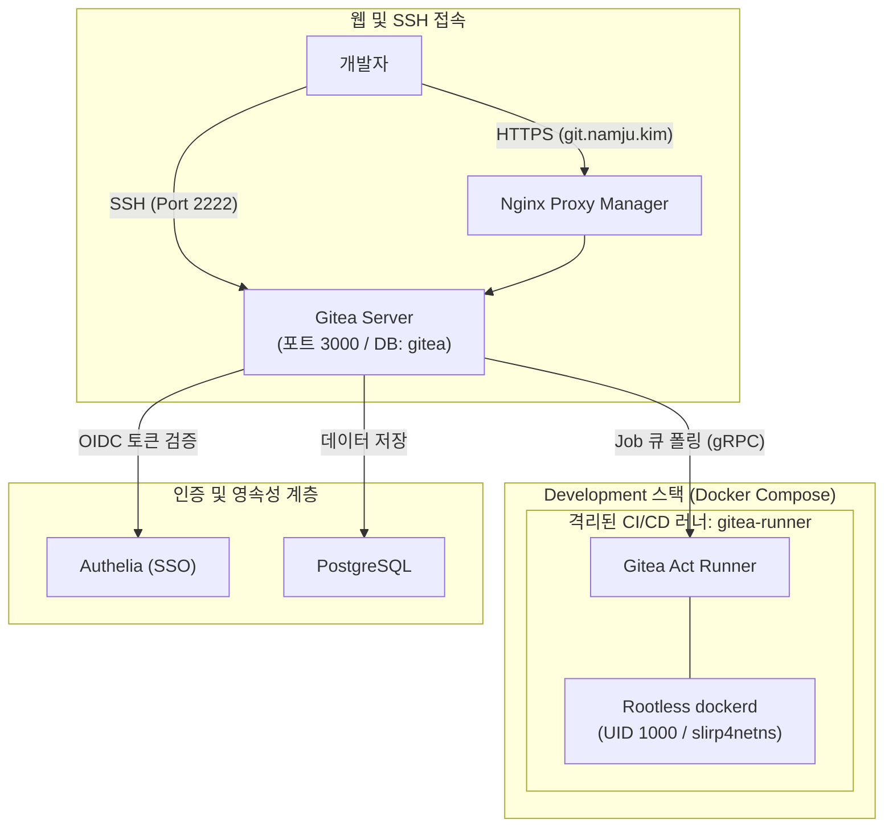

> GitLab의 무거운 리소스 부담을 덜어내고 100MB 내외의 초경량으로 구동되는 Gitea를 배포하며, 자체 패스워드 로그인을 전면 차단하고 Rootless Docker-in-Docker 러너를 통해 호스트 권한 탈취 위협 없는 안전한 프라이빗 CI/CD 파이프라인을 완성합니다.

---

## 1. 홈서버에 자체 Git & CI/CD 인프라가 필요한 이유

개인 프로젝트나 홈랩 인프라 코드를 관리할 때 GitHub Public/Private 저장소를 주로 활용하지만, 다음과 같은 시나리오에서는 자체 호스팅 Git 플랫폼이 필수적입니다:

- 홈랩 내부 접속용 시크릿 키나 사설 설정 파일의 안전한 로컬 보관
- 기가비트 사설망 기반의 초고속 Git Push/Pull 및 대용량 패키지 레지스트리 활용
- GitHub Actions의 분 단위 무료 사용량 제한 없는 무제한 자체 CI/CD 빌드

GitLab은 기능이 막강하지만 최소 4~8GB 이상의 메모리를 상시 점유하여 홈랩에 큰 부담이 됩니다. 반면 **Gitea**는 Go 언어로 작성되어 100MB 미만의 메모리로 동작하며, 최신 버전에서는 **GitHub Actions 워크플로우 문법(`.gitea/workflows/`)을 그대로 재사용할 수 있는 Gitea Actions**를 완벽하게 지원합니다.

---

## 2. 보안 아키텍처 및 Rootless 러너 격리 설계

일반적으로 CI/CD 러너에서 도커 빌드를 수행할 때 호스트의 도커 소켓(`/var/run/docker.sock`)을 마운트하거나 표준 `docker:dind`를 Privileged 모드로 띄우곤 합니다. 하지만 이는 워크플로우 스크립트에서 악의적인 명령어나 탈출 공격이 발생했을 때 **호스트 머신의 root 권한이 완전히 탈취되는 치명적인 위험**을 내포합니다.

홈랩 v2에서는 이 문제를 해결하기 위해 **루트리스(Rootless) DinD 러너**를 채택했습니다.



- **OIDC 로그인 강제**: Gitea 자체 로컬 회원가입 및 패스워드 로그인 폼을 완전히 비활성화(`ENABLE_PASSWORD_SIGNIN_FORM: false`)하여, 오직 Authelia의 Single Sign-On을 통해서만 접근하도록 강제합니다.
- **Rootless DinD Sandbox**: 컨테이너 내부의 `dockerd`가 비특권 사용자(UID 1000) 계정 네임스페이스에서 동작하므로, 워크플로우 내부에서 임의의 컨테이너를 생성하더라도 호스트 시스템 파일에는 접근할 수 없습니다.

---

## 3. Gitea & Runner Docker Compose 구성

`development/docker-compose.yaml` 전체 명세입니다.

```yaml
# development/docker-compose.yaml
name: development

services:
  gitea:
    image: gitea/gitea:latest
    container_name: gitea
    restart: unless-stopped
    environment:
      TZ: Asia/Seoul

      # PostgreSQL 데이터베이스 연동
      GITEA__database__DB_TYPE: postgres
      GITEA__database__HOST: postgres:5432
      GITEA__database__NAME: gitea
      GITEA__database__USER: gitea_user
      GITEA__database__PASSWD: ${GITEA_DB_PASSWORD:?required}
      GITEA__database__SSL_MODE: disable

      # 서버 및 URL 기본 설정
      GITEA__server__DOMAIN: git.namju.kim
      GITEA__server__ROOT_URL: https://git.namju.kim/
      GITEA__server__PROTOCOL: http
      GITEA__server__HTTP_PORT: 3000

      # Git SSH 포트 (호스트 충돌 방지를 위해 2222 사용)
      GITEA__server__SSH_DOMAIN: git.namju.kim
      GITEA__server__SSH_PORT: 2222
      GITEA__server__SSH_LISTEN_PORT: 2222

      # 사용자 등록 및 로그인 보안 통제
      GITEA__service__DISABLE_REGISTRATION: "false"
      GITEA__service__ALLOW_ONLY_EXTERNAL_REGISTRATION: "true"
      GITEA__service__SHOW_REGISTRATION_BUTTON: "false"
      GITEA__service__ENABLE_PASSWORD_SIGNIN_FORM: "false"
      GITEA__service__ENABLE_PASSKEY_AUTHENTICATION: "false"
      GITEA__service__REQUIRE_SIGNIN_VIEW: "true"

      # OIDC 자동 가입 매핑
      GITEA__oauth2_client__ENABLE_AUTO_REGISTRATION: "true"
      GITEA__oauth2_client__USERNAME: preferred_username

      # 패키지 레지스트리 및 Actions 활성화
      GITEA__packages__ENABLED: "true"
      GITEA__actions__ENABLED: "true"

    ports:
      - "${SERVER_IP:?required}:2222:2222"

    volumes:
      - gitea_data:/var/lib/gitea
      - gitea_config:/etc/gitea

    networks:
      - proxy_network
      - database_network
      - monitoring_network

  runner:
    image: gitea/runner:5-dind-rootless
    container_name: gitea-runner
    restart: unless-stopped
    privileged: true
    environment:
      TZ: Asia/Seoul
      GITEA_INSTANCE_URL: https://git.namju.kim
      GITEA_RUNNER_REGISTRATION_TOKEN: ${GITEA_RUNNER_TOKEN:?required}
      GITEA_RUNNER_NAME: homelab-runner
      GITEA_RUNNER_LABELS: "ubuntu-latest:docker://node:22-bookworm,docker:docker://docker:dind"
      CONFIG_FILE: /config.yaml
      DOCKERD_ROOTLESS_ROOTLESSKIT_NET: slirp4netns
      DOCKERD_ROOTLESS_ROOTLESSKIT_MTU: "65520"
    volumes:
      - runner_data:/data
      - runner_docker:/home/rootless/.local/share/docker
      - ./gitea/config.yaml:/config.yaml:ro
    networks:
      - proxy_network
      - monitoring_network

volumes:
  gitea_data:
  gitea_config:
  runner_data:
  runner_docker:

networks:
  proxy_network:
    external: true
  database_network:
    external: true
  monitoring_network:
    external: true
```

---

## 4. Authelia OIDC 인증 연동 및 가입 설정

Gitea 관리자 콘솔(`https://git.namju.kim/admin/auths`)에서 신규 OAuth2 인증 소스를 등록합니다.

- **인증 이름**: `Authelia`
- **클라이언트 ID**: `gitea`
- **클라이언트 시크릿**: Authelia 설정 시 생성한 비밀키
- **OpenID Connect Discovery URL**: `https://auth.namju.kim/.well-known/openid-configuration`

등록 후 사용자가 `https://git.namju.kim`에 접속하면 로컬 로그인 창 대신 **"Authelia로 로그인" 버튼 하나만 노출**되며, 클릭 시 Authelia SSO 인증을 거쳐 Gitea 계정이 즉시 자동 생성되고 로그인됩니다.

---

## 5. Actions Runner 등록 및 CI 파이프라인 검증

1. Gitea 관리자 페이지(`Site Administration` -> `Actions` -> `Runners`)에서 **Registration Token**을 복사합니다.
2. `development/.env`에 `GITEA_RUNNER_TOKEN=<토큰>`을 기입합니다.
3. 러너 컨테이너를 기동합니다:
   ```bash
   docker compose up -d runner
   ```

### 샘플 워크플로우 테스트 (`.gitea/workflows/build-test.yaml`)

저장소 루트에 워크플로우를 생성하여 Rootless 환경에서의 컨테이너 빌드를 검증합니다:

```yaml
name: Rootless Docker Build Test

on: [push]

jobs:
  test-build:
    runs-on: ubuntu-latest
    steps:
      - name: Checkout Code
        uses: actions/checkout@v4

      - name: Check User and Environment
        run: |
          whoami
          docker version
          id
```

Gitea Actions 탭에서 빌드가 성공적으로 실행되고, 호스트 시스템을 건드리지 않고도 온전한 컨테이너 기반 CI 파이프라인이 정상 완주되는 것을 확인할 수 있습니다.
