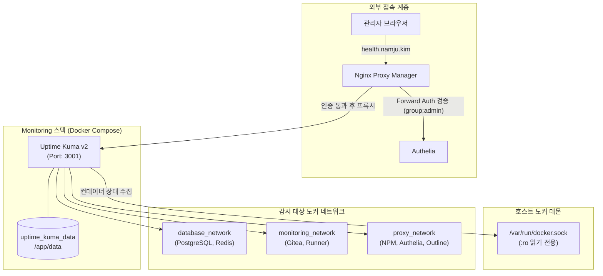

> 홈랩 v2에 배포된 데이터베이스, 중앙 인증, Git, 지식 관리 등 모든 서비스의 가동 상태를 실시간으로 감시하기 위해, Uptime Kuma v2를 배포하고 읽기 전용 도커 소켓 마운트와 Authelia Forward Auth를 결합한 안전한 모니터링 파이프라인을 구축합니다.

---

## 1. 홈랩 v2 관제탑으로서의 Uptime Kuma v2

홈랩 v2 아키텍처에서는 서비스 간 의존성이 높습니다:
- PostgreSQL이나 Redis가 다운되면 Authelia, Gitea, Outline이 연쇄적으로 인증 및 데이터 장애를 겪습니다.
- LLDAP이 멈추면 모든 SSO 로그인 시도가 차단됩니다.
- Nginx Proxy Manager의 SSL 갱신이 실패하면 외부 접속이 전면 중단됩니다.

이러한 서비스 장애를 0초에 가깝게 감지하려면 가벼우면서도 도커 컨테이너의 라이프사이클을 직접 감시할 수 있는 관제 도구가 필요합니다. **Uptime Kuma v2(`louislam/uptime-kuma:2`)**는 v1 대비 더욱 빨라진 내부 엔진과 향상된 알림 파이프라인, 세분화된 태그 및 상태 페이지 기능을 제공하여 100MB 안팎의 메모리로 홈서버 전체 인프라를 상시 감시하기에 최적입니다.

---

## 2. 모니터링 네트워크 토폴로지 및 소켓 보안 설계

모니터링 도구는 데이터베이스, 개발 도구, 게이트웨이와 모두 통신할 수 있어야 하므로 **멀티 네트워크(Multi-Network) 바인딩** 구조로 설계합니다.



- **도커 소켓 읽기 전용(`:ro`) 마운트**: Uptime Kuma 컨테이너에서 컨테이너 조회(`docker ps`, inspect) 권한만 허용하고, 악의적인 컨테이너 시작/중지/삭제 명령을 원천 차단합니다.
- **3중 도커 네트워크 연결**:
  - `proxy_network`: Nginx 프록시를 통해 웹 대시보드(`health.namju.kim`) 서비스.
  - `database_network`: PostgreSQL(5432)과 Redis(6379)의 TCP 포트 헬스체크 직접 수행.
  - `monitoring_network`: Gitea 및 CI/CD 러너 등 사설 네트워크 내부 서비스 상태 수집.

---

## 3. Uptime Kuma v2 Docker Compose 정의

`monitoring/docker-compose.yaml` 명세입니다.

```yaml
# monitoring/docker-compose.yaml
name: monitoring

services:
  uptime-kuma:
    image: louislam/uptime-kuma:2
    container_name: uptime-kuma
    restart: unless-stopped
    environment:
      TZ: Asia/Seoul
    volumes:
      - uptime_kuma_data:/app/data
      # 호스트 도커 소켓을 읽기 전용으로 마운트하여 컨테이너 상태 감시
      - /var/run/docker.sock:/var/run/docker.sock:ro
    networks:
      - proxy_network
      - monitoring_network
      - database_network

volumes:
  uptime_kuma_data:

networks:
  proxy_network:
    external: true
  monitoring_network:
    external: true
  database_network:
    external: true
```

---

## 4. Authelia Forward Auth를 통한 관제 대시보드 인가 보호

모니터링 시스템의 대시보드에는 내부 서버 IP, 실행 중인 포트, 가동 중인 컨테이너 이름 등 중요한 인프라 정보가 노출되므로 일반 사용자에게 열려 있어서는 안 됩니다.

앞서 3편에서 구성한 **Authelia Access Control 정책**에 `health.namju.kim`을 `group:admin`으로 등록해 두었습니다:

```yaml
# identity/authelia/configuration.yml (발췌)
access_control:
  default_policy: deny
  rules:
    - domain: health.namju.kim
      subject:
        - "group:admin"
      policy: one_factor
```

Nginx Proxy Manager에서 `health.namju.kim` 프록시 호스트를 생성하고, **Advanced** 탭에 Authelia 스니펫을 인클루드합니다:

```nginx
include /snippets/authelia-location.conf;
include /snippets/authelia-authrequest.conf;
```

이제 `health.namju.kim`으로 접근하는 모든 트래픽은 Authelia에서 `admin` 그룹 소속 여부를 1차 검증받으며, 비인가 사용자의 접근이 원천 차단됩니다.

---

## 5. 실무 모니터링 모니터(Monitor) 등록 가이드

Uptime Kuma v2 대시보드에서 등록해야 하는 홈랩 v2 핵심 모니터 목록입니다.

| 모니터 유형 | 대상 서비스 | 검사 방식 | 비고 |
| :--- | :--- | :--- | :--- |
| **Docker Container** | `postgres`, `redis`, `lldap`, `authelia`, `gitea`, `outline` | 도커 소켓 직접 조회 | 컨테이너 재시작 및 비정상 종료 즉시 감지 |
| **HTTP(s)** | `https://auth.namju.kim/api/health` | HTTP 응답 코드 (200 OK) | Authelia 헬스체크 API 감시 |
| **HTTP(s)** | `https://git.namju.kim/api/v1/version` | HTTP 응답 코드 (200 OK) | Gitea 웹 서비스 가동 상태 감시 |
| **HTTP(s)** | `https://outline.namju.kim` | HTTP 응답 코드 (200 OK) | Outline 위키 웹 응답 감시 |
| **TCP Port** | `postgres:5432`, `redis:6379` | TCP 소켓 핸드셰이크 | 사설망 내부 DB 포트 오픈 상태 감시 |
| **TCP Port** | `git.namju.kim:2222` | TCP 소켓 핸드셰이크 | Git SSH 포트 외부 바인딩 감시 |

### 텔레그램 / 디스코드 즉시 알림 설정
Settings -> Notification 메뉴에서 알림 봇 토큰과 채팅 ID를 등록하고 **Default enabled on all new monitors**를 체크하면, 어떤 컨테이너나 웹 엔드포인트가 다운되더라도 1~2초 이내에 모바일 푸시 알림을 수신할 수 있습니다.

---

## 6. 기동 및 통합 모니터링 검증

스택을 기동하고 네트워크 연결 상태를 확인합니다:

```bash
# 1. 모니터링 네트워크 생성 (미생성 시)
docker network create monitoring_network

# 2. Uptime Kuma 기동
docker compose up -d

# 3. 도커 네트워크 연결 확인
docker inspect uptime-kuma --format='{{range $net, $conf := .NetworkSettings.Networks}}{{$net}} {{end}}'
# 출력: proxy_network monitoring_network database_network
```

브라우저에서 `https://health.namju.kim`에 접속하여 Authelia 로그인 후 Uptime Kuma v2 대시보드가 정상 표시되고, 도커 소켓을 통해 홈랩의 모든 컨테이너 상태가 초록색(UP)으로 표시되는 것을 확인하면 홈랩 v2 인프라 전체 관제 체계가 완성됩니다.
