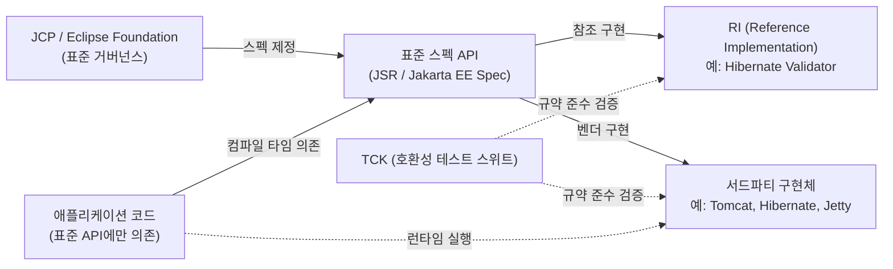
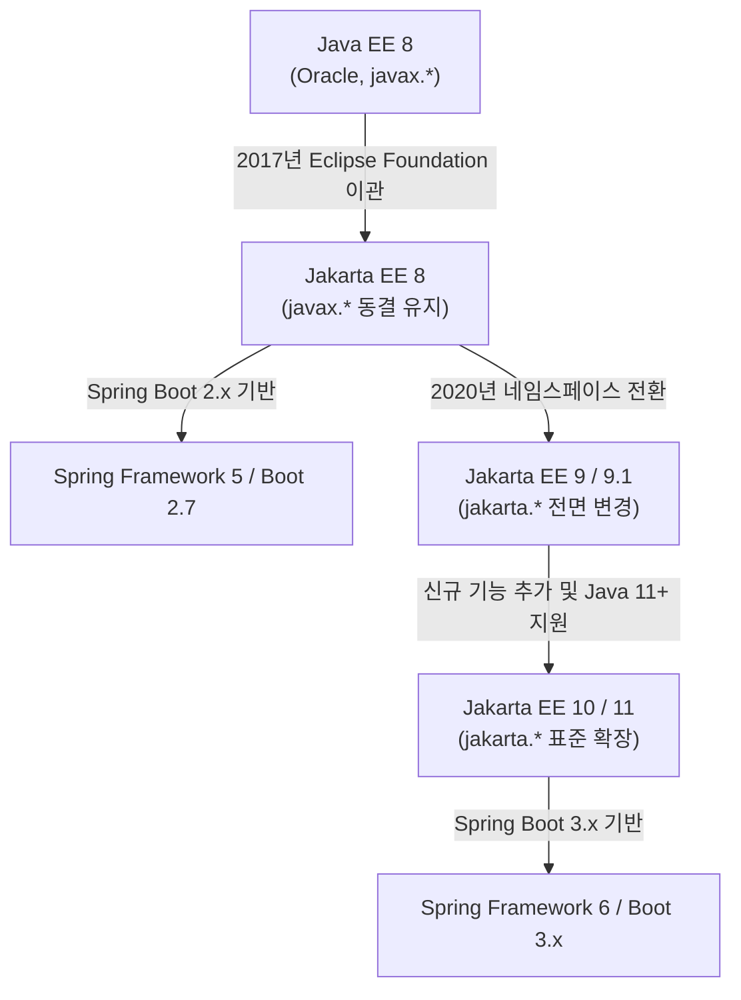

> 스프링 부트 기반 백엔드 개발에서 일상적으로 사용하는 `@Entity`, `@NotBlank`, `@PostConstruct`, `HttpServletRequest` 등은 스프링 고유의 기능이 아니라 자바 표준 스펙입니다. 이 글에서는 자바 표준을 정의하고 검증하는 체계(JCP, JSR, JEP, RI, TCK)를 살펴보고, `javax.*`에서 `jakarta.*`로 네임스페이스가 전환된 배경과 앞으로 다룰 자바 표준 스펙 시리즈의 전체 로드맵을 정리합니다.

> 본 시리즈는 Java 21 LTS 및 Spring Boot 3.4 ~ 4.x (Jakarta EE 10/11) 환경을 기준으로 작성되었습니다.
{: .prompt-info }

---

## 왜 자바 표준 스펙을 이해해야 하는가

실무에서 Spring Boot로 애플리케이션을 개발하다 보면 `org.springframework.*` 패키지와 `jakarta.*`(과거 `javax.*`) 패키지가 코드 곳곳에 섞여 있는 것을 볼 수 있습니다. 많은 개발자가 이 둘을 구분하지 않고 "스프링에서 제공하는 어노테이션"으로 통칭해 사용하곤 합니다.

하지만 표준 API와 특정 프레임워크 구현체의 경계를 명확히 이해하면 실무에서 다음과 같은 이점이 생깁니다.

- **구현체 교체 유연성**: Jakarta Servlet 표준 덕분에 애플리케이션 코드를 수정하지 않고도 내장 서버를 Tomcat에서 Jetty나 Undertow로 교체할 수 있습니다.
- **트러블슈팅 정확도 향상**: `@Valid`와 `@Validated`의 동작 차이, `jakarta.transaction.Transactional`과 Spring `@Transactional`의 차이처럼 미묘한 버그의 원인을 스펙 수준에서 빠르게 진단할 수 있습니다.
- **버전 업그레이드 대응**: Spring Boot 2.x에서 3.x로 마이그레이션할 때 발생한 대규모 패키지 변경(`javax` -> `jakarta`)의 근본 원인을 이해하고 의존성 충돌을 해결할 수 있습니다.

---

## 자바 표준을 만드는 5가지 핵심 개념

자바 생태계에서 표준은 단일 기업이 임의로 정하는 것이 아니라, 공식적인 제안과 검증 절차를 거쳐 확정됩니다. 자주 등장하는 5가지 용어를 정확히 구분해 둘 필요가 있습니다.

| 약어 | 정식 명칭 | 핵심 역할 | 대표 예시 |
| :--- | :--- | :--- | :--- |
| **JCP** | Java Community Process | 자바 표준 스펙을 제정하고 관리하는 공식 거버넌스 프로세스 | JCP Executive Committee |
| **JSR** | Java Specification Request | JCP를 통해 제안되고 확정되는 공식 기술 표준 문서(API 규약) | JSR-330(DI), JSR-380(Bean Validation) |
| **JEP** | JDK Enhancement Proposal | OpenJDK 자체의 언어 문법, JVM, 코어 라이브러리 개선 제안서 | JEP 444(Virtual Threads), JEP 395(Records) |
| **RI** | Reference Implementation | 특정 JSR 스펙을 실제로 구현해 동작을 증명하는 참조 구현체 | Hibernate Validator(JSR-380 RI), EclipseLink(JPA RI) |
| **TCK** | Technology Compatibility Kit | 특정 벤더 구현체가 스펙을 100% 준수하는지 검증하는 공식 테스트 스위트 | Jakarta EE Platform TCK |

### JSR과 JEP의 차이

실무에서 가장 자주 혼동되는 개념이 **JSR**과 **JEP**입니다.

- **JSR**은 주로 자바 플랫폼 버전 전체(Java SE 21 등)나 엔터프라이즈·라이브러리 영역의 **외부 표준 API 인터페이스**를 정의할 때 사용됩니다.
- **JEP**은 OpenJDK 커뮤니티 내부에서 **JDK 자체의 기능 개선**을 추적하기 위한 로드맵 문서입니다. Java 9 이후 6개월 단위 릴리즈 주기가 정착되면서, Record, Pattern Matching, Virtual Threads 같은 개별 기능은 JEP로 설계되고 최종적으로 해당 자바 버전의 통합 JSR에 포함됩니다.

### 스펙(API), 구현체(RI/Vendor), 검증(TCK)의 구조

자바 표준의 핵심 철학은 **"인터페이스(스펙)와 구현의 철저한 분리"**입니다. 애플리케이션 코드는 표준 인터페이스에만 의존하고, 실제 런타임 동작은 TCK 인증을 통과한 구현체가 담당합니다.



덕분에 개발자는 표준 API(`jakarta.persistence.*`, `jakarta.validation.*`)에 맞춰 코드를 작성해 두면, 런타임에 TCK를 통과한 원하는 구현체를 자유롭게 선택하거나 교체할 수 있습니다.

---

## Java EE에서 Jakarta EE로: `javax.*`에서 `jakarta.*` 전환 배경

Spring Boot 3.0이 출시되면서 자바 백엔드 생태계 전체가 `javax.*` 패키지를 `jakarta.*`로 일괄 변경하는 대규모 마이그레이션을 겪었습니다. 이 변화의 배경은 기술적 이유보다 **거버넌스와 상표권** 문제에서 시작되었습니다.

1. **Oracle의 Java EE 이관 (2017년)**: Oracle은 엔터프라이즈 자바 생태계의 빠른 발전을 위해 Java EE를 오픈소스 재단인 **Eclipse Foundation**으로 이관했습니다.
2. **네임스페이스와 상표권 제약**: 이관 과정에서 Oracle은 "Java" 상표권과 `javax.*` 패키지 네임스페이스에 대한 법적 권리를 유지했습니다. Eclipse Foundation은 기존 `javax.*` 패키지를 그대로 유지할 수는 있었지만, 해당 패키지 아래에 새로운 클래스나 메서드를 추가하거나 변경할 수 없었습니다.
3. **Jakarta EE 8 -> 9 빅뱅 전환 (2020년)**: Jakarta EE 8까지는 기존 호환성을 위해 `javax.*`를 동결 상태로 유지했습니다. 그러나 더 이상의 기능 진화가 불가능했기에, **Jakarta EE 9**에서 모든 엔터프라이즈 표준 패키지를 `jakarta.*`로 일괄 변경하는 결단을 내렸습니다.



### 실무 코드에서의 변화

Spring Boot 3.x 이상으로 전환하면 JPA, Validation, Servlet, Annotations 등 엔터프라이즈 관련 import 경로가 모두 `jakarta.*`로 변경됩니다.

```java
// src/main/java/com/example/standard/MemberEntity.java
package com.example.standard;

// Spring Boot 2.x (Java EE 8 / Jakarta EE 8)
// import javax.persistence.Entity;
// import javax.persistence.Id;
// import javax.validation.constraints.NotBlank;
// import javax.annotation.PostConstruct;

// Spring Boot 3.x+ (Jakarta EE 10)
import jakarta.annotation.PostConstruct;
import jakarta.persistence.Entity;
import jakarta.persistence.Id;
import jakarta.validation.constraints.NotBlank;

@Entity
public class MemberEntity {

    @Id
    private Long id;

    @NotBlank
    private String email;

    @PostConstruct
    public void init() {
        // 초기화 콜백
    }
}
```

> 주의: JDK 자체(Java SE)에 포함된 `javax.sql.DataSource`, `javax.crypto.*`, `javax.net.ssl.*`, `javax.xml.*` 같은 패키지는 Java EE가 아닌 **Java SE 표준 영역**입니다. 따라서 Jakarta EE 9+ 및 Spring Boot 3.x 환경에서도 여전히 `javax.*` 패키지를 그대로 사용합니다.
{: .prompt-warning }

### 마이그레이션 및 의존성 점검 설정

기존 프로젝트에 `javax.*` 기반의 서드파티 라이브러리가 남아 있으면 런타임에 `ClassNotFoundException`이나 어노테이션 미인식 문제가 발생할 수 있습니다. Gradle 환경에서는 의존성 트리를 점검하거나 OpenRewrite 플러그인을 활용해 `javax.*` -> `jakarta.*` 치환을 자동화할 수 있습니다.

```kotlin
// build.gradle.kts
plugins {
    java
    id("org.springframework.boot") version "3.4.0"
    id("io.spring.dependency-management") version "1.1.6"
    // 대규모 프로젝트의 javax -> jakarta 자동 마이그레이션 시 활용
    id("org.openrewrite.rewrite") version "6.26.0"
}

java {
    toolchain {
        languageVersion = JavaLanguageVersion.of(21)
    }
}

dependencies {
    implementation("org.springframework.boot:spring-boot-starter-web")
    implementation("org.springframework.boot:spring-boot-starter-data-jpa")
    implementation("org.springframework.boot:spring-boot-starter-validation")
    // OpenRewrite Jakarta EE 10 마이그레이션 레시피
    rewrite("org.openrewrite.recipe:rewrite-migrate-java:2.28.0")
}

rewrite {
    activeRecipe("org.openrewrite.java.migrate.jakarta.JavaxMigrationToJakarta")
}
```

---

## 자바 표준 스펙 시리즈 전체 로드맵 (12편)

이 시리즈에서는 백엔드 실무에서 Spring Boot와 함께 가장 밀접하게 다루는 핵심 자바 표준 스펙 12가지를 순차적으로 파헤칩니다. 각 스펙의 탄생 배경, 표준 API 구조, 그리고 Spring 구현체와의 접점을 코드 중심으로 정리합니다.

| 회차 | 표준 스펙 / 주제 | 다루는 핵심 내용 | 링크 |
| :---: | :--- | :--- | :--- |
| **1편** | JCP, JSR, JEP, Jakarta EE | 자바 표준 체계(RI, TCK) 및 `javax` -> `jakarta` 전환 배경 | 현재 글 |
| **2편** | JSR-330 (Jakarta DI) | `@Inject`, `@Named`, `Provider<T>`와 Spring `@Autowired` 비교 | [2편 보기](/posts/jsr-330-jakarta-inject-vs-spring-autowired/) |
| **3편** | JSR-250 (Jakarta Annotations) | `@PostConstruct`, `@PreDestroy`, `@Resource`와 빈 생명주기 | [3편 보기](/posts/jsr-250-jakarta-annotations-lifecycle/) |
| **4편** | JSR-303/380 (Jakarta Validation) | Bean Validation 구조, `@Valid` vs `@Validated`, 커스텀 제약 | [4편 보기](/posts/jsr-380-jakarta-bean-validation/) |
| **5편** | JSR-338 (JPA) & JSR-907 (JTA) | 영속성/트랜잭션 표준과 `jakarta` vs Spring `@Transactional` | [5편 보기](/posts/jsr-338-jpa-and-jsr-907-jta-transactions/) |
| **6편** | JSR-340/369 (Jakarta Servlet) | 서블릿 컨테이너 교체 원리 및 Filter vs Interceptor 비교 | [6편 보기](/posts/jsr-340-jakarta-servlet-filter-vs-interceptor/) |
| **7편** | JSR-107 (JCache) | 자바 표준 캐시 API와 Spring Cache 추상화 연동 | [7편 보기](/posts/jsr-107-jcache-spring-cache-abstraction/) |
| **8편** | JSR-310 (`java.time`) | 불변 날짜·시간 API 설계와 `Clock` 주입 기반 테스트 전략 | [8편 보기](/posts/jsr-310-java-time-api-and-clock-testing/) |
| **9편** | JSR-133 (Java Memory Model) | `volatile`, happens-before 규칙과 멀티스레드 가시성 | [9편 보기](/posts/jsr-133-java-memory-model-happens-before/) |
| **10편** | JSR-166 (`java.util.concurrent`) | `ExecutorService`, `CompletableFuture`, Flow API와 동시성 표준 | [10편 보기](/posts/jsr-166-java-util-concurrent-and-flow/) |
| **11편** | JSR-269 (Annotation Processing) | 컴파일 타임 코드 생성 표준과 MapStruct·Lombok 원리 비교 | [11편 보기](/posts/jsr-269-pluggable-annotation-processing/) |
| **12편** | JSR-305 -> JSpecify | 자바 Nullability 표준화 역사와 Spring 7·Kotlin 연동 | [12편 보기](/posts/jsr-305-to-jspecify-java-nullability/) |

---

## 정리

자바 생태계가 30년 가까이 엔터프라이즈 백엔드의 표준으로 자리 잡을 수 있었던 핵심 동력은 **표준 API(JSR/Jakarta EE)와 벤더 구현체의 분리**에 있습니다. JCP와 OpenJDK JEP의 역할, 그리고 `javax.*`에서 `jakarta.*`로의 전환 배경을 이해해 두면 개별 스펙과 프레임워크의 내부 구조가 훨씬 입체적으로 보입니다.
