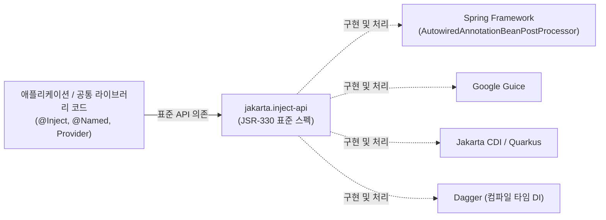
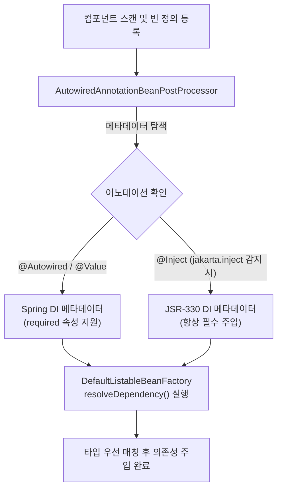

> Spring 환경에서는 의존성 주입(DI)을 위해 `@Autowired`를 주로 사용하지만, 자바 생태계에는 프레임워크에 종속되지 않는 표준 DI 스펙인 **JSR-330(Jakarta Dependency Injection)**이 존재합니다. 이 글에서는 JSR-330을 구성하는 6가지 핵심 요소를 살펴보고, Spring에서 이를 연동하는 방법과 `@Autowired`와의 동작 차이, 실무 선택 기준을 정리합니다.

> 본 글은 `jakarta.inject:jakarta.inject-api:2.0.1`과 Spring Framework 6.x(Spring Boot 3.4) 환경을 기준으로 작성되었습니다.
{: .prompt-info }

---

## JSR-330 (Jakarta Dependency Injection)이란

**JSR-330**은 2009년 Google Guice의 창시자 Bob Lee와 Spring Framework의 창시자 Rod Johnson이 공동으로 주도해 제정한 **자바 의존성 주입 표준 어노테이션 스펙**입니다. 현재는 Eclipse Foundation의 **Jakarta Dependency Injection**으로 계승되어 `jakarta.inject` 패키지에서 제공됩니다.

JSR-330의 설계 목표는 매우 간결합니다. 클래스가 어떤 의존성을 필요로 하는지 선언하는 **표준 어노테이션 세트**만 정의하고, 실제로 빈을 어떻게 스캔하고 생성하며 생명주기를 관리할지는 각 DI 컨테이너(Spring, Guice, CDI/Quarkus, Dagger 등)에 위임합니다.



---

## JSR-330의 6개 핵심 요소

`jakarta.inject` 패키지는 놀라울 정도로 작습니다. 단 5개의 어노테이션과 1개의 인터페이스가 스펙의 전부입니다.

| 구성 요소 | 유형 | 역할 설명 | Spring 대응 요소 |
| :--- | :---: | :--- | :--- |
| `@Inject` | Annotation | 생성자, 메서드, 필드에 의존성 주입 지점을 선언 | `@Autowired` |
| `@Named` | Annotation | 문자열 이름 기반의 한정자(Qualifier)이자 빈 이름 지정 | `@Qualifier` / `@Component` |
| `@Qualifier` | Annotation | 타입 안전한 커스텀 한정자 어노테이션을 정의하는 메타 어노테이션 | `@Qualifier` |
| `@Scope` | Annotation | 커스텀 스코프 어노테이션을 정의하는 메타 어노테이션 | `@Scope` |
| `@Singleton` | Annotation | 컨테이너 내에서 인스턴스를 하나만 유지하도록 지정 | `@Scope("singleton")` (기본값) |
| `Provider<T>` | Interface | 의존성 인스턴스를 지연 조회하거나 매번 새로 생성해 반환 | `ObjectProvider<T>` |

---

## Spring Boot에서 JSR-330 연동 및 코드 예제

Spring Framework는 클래스패스에 `jakarta.inject.Inject`가 존재하면 별도 설정 없이도 자동으로 JSR-330 어노테이션을 인식합니다. 단, `spring-boot-starter`에는 `jakarta.inject-api`가 기본 포함되어 있지 않으므로 Gradle에 의존성을 추가해야 합니다.

### 1. Gradle 의존성 추가

```kotlin
// build.gradle.kts
dependencies {
    implementation("org.springframework.boot:spring-boot-starter")
    // JSR-330 (Jakarta Dependency Injection 2.0) 표준 API
    implementation("jakarta.inject:jakarta.inject-api:2.0.1")
}
```

### 2. `@Inject`, `@Named`, 커스텀 `@Qualifier` 활용

동일한 타입의 빈이 여러 개 존재할 때 `@Named("이름")`을 사용하거나, `@Qualifier` 메타 어노테이션으로 타입 안전한 커스텀 어노테이션을 정의해 주입 대상을 명확히 지정할 수 있습니다.

```java
// src/main/java/com/example/di/PaymentGateway.java
package com.example.di;

public interface PaymentGateway {
    String pay(long amount);
}
```

```java
// src/main/java/com/example/di/CardPayment.java
package com.example.di;

import jakarta.inject.Qualifier;
import java.lang.annotation.Documented;
import java.lang.annotation.Retention;
import java.lang.annotation.RetentionPolicy;

@Qualifier
@Documented
@Retention(RetentionPolicy.RUNTIME)
public @interface CardPayment {
}
```

```java
// src/main/java/com/example/di/CardPaymentGateway.java
package com.example.di;

import jakarta.inject.Named;
import jakarta.inject.Singleton;

@Named("cardPaymentGateway") // Spring에서 @Component("cardPaymentGateway")처럼 빈 등록
@CardPayment
@Singleton
public class CardPaymentGateway implements PaymentGateway {
    @Override
    public String pay(long amount) {
        return "CARD:" + amount;
    }
}
```

```java
// src/main/java/com/example/di/OrderService.java
package com.example.di;

import jakarta.inject.Inject;
import jakarta.inject.Named;
import jakarta.inject.Provider;

@Named
public class OrderService {

    private final PaymentGateway paymentGateway;
    private final Provider<RequestTraceContext> traceContextProvider;

    @Inject
    public OrderService(
            @CardPayment PaymentGateway paymentGateway,
            Provider<RequestTraceContext> traceContextProvider
    ) {
        this.paymentGateway = paymentGateway;
        this.traceContextProvider = traceContextProvider;
    }

    public String processOrder(long amount) {
        // Provider.get() 호출 시점에 프로토타입 빈을 새로 조회
        RequestTraceContext trace = traceContextProvider.get();
        return "[" + trace.getTraceId() + "] " + paymentGateway.pay(amount);
    }
}
```

`Provider<T>`는 싱글톤 빈이 프로토타입(Prototype) 빈을 참조해야 하는 **스코프 불일치(Scope Mismatch)** 문제를 해결하거나, 비용이 큰 빈을 실제 필요한 시점에 **지연 조회(Lazy Lookup)**할 때 유용합니다.

---

## Spring 내부 처리 구조와 `@Autowired` vs `@Inject` 비교

Spring 내부에서 `@Inject`는 별도의 독자적인 엔진으로 동작하지 않습니다. Spring의 `AutowiredAnnotationBeanPostProcessor`가 빈 초기화 시점에 `@Autowired`, `@Value`, 그리고 클래스패스에 존재할 경우 `@Inject`까지 하나의 파이프라인으로 처리합니다.



내부 파이프라인은 같지만, API 설계 측면에서 몇 가지 중요한 차이가 존재합니다.

| 비교 항목 | Spring `@Autowired` | JSR-330 `@Inject` |
| :--- | :--- | :--- |
| **패키지** | `org.springframework.beans.factory.annotation` | `jakarta.inject` |
| **추가 의존성** | 불필요 (Spring Core 기본 포함) | `jakarta.inject:jakarta.inject-api` 필요 |
| **선택적 주입 (`required`)** | `@Autowired(required = false)` 지원 | 속성 없음 (`Optional<T>` 또는 `@Nullable` 사용) |
| **지연/다건 조회** | `ObjectProvider<T>` (`getIfAvailable`, `stream` 등 풍부) | `Provider<T>` (`get()` 메서드 1개만 제공) |
| **빈 등록 기본 스코프** | `@Component` 기본값이 싱글톤 | `@Named`만 붙이면 Spring 기본값(싱글톤), 타 컨테이너에서는 프로토타입일 수 있음 |
| **프레임워크 이식성** | Spring 전용 | Spring, Guice, Quarkus(CDI), Micronaut, Dagger 호환 |

### 선택적 의존성 주입과 `ObjectProvider<T>` 비교

`@Inject`에는 `required = false` 속성이 없기 때문에, 빈이 없을 수도 있는 선택적 의존성을 표현할 때는 `Optional<T>`이나 `@Nullable`을 조합해야 합니다. 또한 지연 조회가 필요할 때 Spring의 `ObjectProvider<T>`는 `Provider<T>`보다 훨씬 풍부한 편의 메서드를 제공합니다.

```java
// src/main/java/com/example/di/NotificationService.java
package com.example.di;

import jakarta.inject.Inject;
import org.springframework.beans.factory.ObjectProvider;
import org.springframework.lang.Nullable;
import org.springframework.stereotype.Service;

import java.util.Optional;

@Service
public class NotificationService {

    private final Optional<AuditLogger> auditLogger;
    private final ObjectProvider<MetricsClient> metricsProvider;

    // @Inject 환경에서 선택적 의존성은 Optional<T> 또는 @Nullable로 표현
    @Inject
    public NotificationService(
            Optional<AuditLogger> auditLogger,
            @Nullable ObjectProvider<MetricsClient> metricsProvider
    ) {
        this.auditLogger = auditLogger;
        this.metricsProvider = metricsProvider;
    }

    public void notifyEvent(String message) {
        auditLogger.ifPresent(logger -> logger.record(message));

        // ObjectProvider는 빈이 없을 때 예외 없이 안전하게 무시 가능
        // 반면 JSR-330 Provider.get()은 빈이 없으면 NoSuchBeanDefinitionException 발생
        if (metricsProvider != null) {
            metricsProvider.ifAvailable(client -> client.increment("notify.count"));
        }
    }
}
```

> 주의: JSR-330의 `@Singleton`은 Spring에서 기본적으로 싱글톤 스코프로 동작하지만, CDI나 Guice에서는 `@Named`만 선언하면 기본 스코프가 매번 새 인스턴스를 생성하는 프로토타입(Dependent)으로 동작합니다. 여러 컨테이너에서 공통으로 동작해야 하는 모듈이라면 `@Singleton`을 명시적으로 선언하는 것이 안전합니다.
{: .prompt-warning }

---

## 실무 선택 기준

실제 프로젝트에서 `@Inject`와 `@Autowired` 중 무엇을 선택해야 할지 고민된다면 다음 기준으로 판단하는 것이 명확합니다.

1. **일반적인 Spring Boot 백엔드 서비스**: **Spring 표준 방식**을 권장합니다.
   - Spring 4.3 이후 단일 생성자에서는 `@Autowired` 자체를 생략할 수 있어 코드가 훨씬 깔끔합니다.
   - `ObjectProvider<T>`, `@Qualifier`, `@Primary` 등 Spring 생태계의 풍부한 기능을 추가 의존성 없이 바로 활용할 수 있습니다.
2. **프레임워크에 독립적인 공용 SDK / 도메인 코어 라이브러리**: **JSR-330(`jakarta.inject-api`)**을 권장합니다.
   - 사내 공통 모듈이 Spring Boot 서비스뿐만 아니라 Quarkus나 Micronaut, 혹은 순수 Guice 기반 배치 잡에서도 사용된다면 `org.springframework.*` 의존성을 제거하고 `jakarta.inject`만 의존하는 편이 아키텍처적으로 깔끔합니다.

---

## 정리

JSR-330은 단 6개의 구성 요소만으로 자바 생태계 전반의 의존성 주입 표준을 정의합니다. Spring은 `AutowiredAnnotationBeanPostProcessor`를 통해 `@Inject`를 네이티브하게 지원하므로, 이식성이 중요한 공용 모듈에서는 `jakarta.inject`를, Spring 중심 애플리케이션에서는 생성자 주입 생략과 `ObjectProvider<T>`를 선택하는 전략이 실용적입니다.
