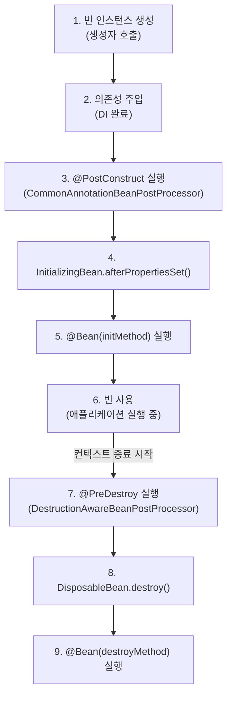
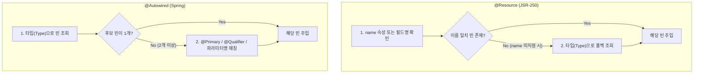

> Spring 애플리케이션에서 빈 생성 직후 캐시를 워밍업하거나 종료 시 커넥션을 정리할 때 `@PostConstruct`와 `@PreDestroy`를 자주 사용합니다. 이 어노테이션들은 Spring 고유 기능이 아니라 **JSR-250(Jakarta Annotations)** 표준 스펙입니다. 이 글에서는 `@PostConstruct`, `@PreDestroy`, `@Resource`의 동작 원리와 Spring 빈 생명주기 콜백 실행 순서, 그리고 `@Autowired`와의 주입 전략 차이를 정리합니다.

> 본 글은 Spring Boot 3.4(Jakarta Annotations 2.1 / `jakarta.annotation-api`) 환경을 기준으로 작성되었습니다. `spring-boot-starter`에 기본 포함되어 있으므로 별도 의존성 추가 없이 바로 사용할 수 있습니다.
{: .prompt-info }

---

## JSR-250 (Jakarta Annotations) 개요

**JSR-250(Common Annotations for the Java Platform)**은 Servlet, JPA, EJB 등 여러 자바 기술 스펙에서 중복으로 정의되던 공통 어노테이션을 하나의 표준 패키지로 통합하기 위해 만들어졌습니다. 현재는 **Jakarta Annotations**(`jakarta.annotation.*`)로 관리되고 있습니다.

Spring 개발자가 실무에서 가장 자주 접하는 JSR-250 핵심 어노테이션은 다음 3가지입니다.

- `@PostConstruct`: 의존성 주입이 완료된 직후 초기화 작업을 수행하는 메서드에 선언합니다.
- `@PreDestroy`: 컨테이너에서 빈이 제거되기 직전 리소스 정리 작업을 수행하는 메서드에 선언합니다.
- `@Resource`: 빈의 **이름(Name)을 우선**으로 의존성을 주입할 때 사용합니다.

Spring 내부에서는 `CommonAnnotationBeanPostProcessor`가 이 세 가지 어노테이션을 감지해 빈 생명주기 파이프라인에 연결합니다.

---

## `@PostConstruct`, `@PreDestroy`와 Spring 빈 생명주기 실행 순서

Spring은 빈의 초기화와 소멸 시점에 콜백을 실행하는 3가지 메커니즘을 제공합니다.

1. **JSR-250 표준 어노테이션**: `@PostConstruct`, `@PreDestroy`
2. **Spring 인터페이스 구현**: `InitializingBean.afterPropertiesSet()`, `DisposableBean.destroy()`
3. **자바 설정 메타데이터**: `@Bean(initMethod = "...", destroyMethod = "...")`

한 빈에 이 3가지가 모두 선언되어 있다면, Spring 컨테이너는 아래 흐름과 같이 엄격하게 정해진 순서대로 콜백을 호출합니다.



### 생명주기 실행 순서 검증 코드

실제 Spring Boot 환경에서 3가지 콜백의 호출 순서를 직접 확인할 수 있는 코드입니다.

```java
// src/main/java/com/example/lifecycle/LifecycleDemoBean.java
package com.example.lifecycle;

import jakarta.annotation.PostConstruct;
import jakarta.annotation.PreDestroy;
import org.slf4j.Logger;
import org.slf4j.LoggerFactory;
import org.springframework.beans.factory.DisposableBean;
import org.springframework.beans.factory.InitializingBean;

public class LifecycleDemoBean implements InitializingBean, DisposableBean {

    private static final Logger log = LoggerFactory.getLogger(LifecycleDemoBean.class);

    public LifecycleDemoBean() {
        log.info("[1] 생성자 호출");
    }

    @PostConstruct
    public void postConstruct() {
        log.info("[2] @PostConstruct 실행");
    }

    @Override
    public void afterPropertiesSet() {
        log.info("[3] InitializingBean.afterPropertiesSet() 실행");
    }

    public void customInit() {
        log.info("[4] @Bean(initMethod) 실행");
    }

    @PreDestroy
    public void preDestroy() {
        log.info("[5] @PreDestroy 실행");
    }

    @Override
    public void destroy() {
        log.info("[6] DisposableBean.destroy() 실행");
    }

    public void customDestroy() {
        log.info("[7] @Bean(destroyMethod) 실행");
    }
}
```

```java
// src/main/java/com/example/lifecycle/LifecycleConfig.java
package com.example.lifecycle;

import org.springframework.context.annotation.Bean;
import org.springframework.context.annotation.Configuration;

@Configuration
public class LifecycleConfig {

    @Bean(initMethod = "customInit", destroyMethod = "customDestroy")
    public LifecycleDemoBean lifecycleDemoBean() {
        return new LifecycleDemoBean();
    }
}
```

애플리케이션을 기동했다가 정상 종료(Graceful Shutdown)하면 콘솔에 `[1]`부터 `[7]`까지 순서대로 로그가 출력됩니다. 실무에서는 Spring 인터페이스에 결합되지 않고 코드가 간결한 **`@PostConstruct` / `@PreDestroy`를 기본으로 사용**하고, 외부 라이브러리 클래스처럼 소스를 직접 수정할 수 없을 때만 `@Bean(initMethod, destroyMethod)`를 사용합니다.

### `@PostConstruct` / `@PreDestroy` 사용 시 주의사항

> 주의: `@PostConstruct`는 `BeanPostProcessor.postProcessBeforeInitialization()` 단계에서 실행됩니다. Spring AOP 프록시(`@Transactional`, `@Cacheable`, `@Async` 등)는 그 이후인 `postProcessAfterInitialization()` 단계에서 생성되므로, **`@PostConstruct` 메서드 내부에서는 `@Transactional`이 적용되지 않습니다.**
{: .prompt-warning }

초기화 시점에 트랜잭션이나 AOP가 반드시 필요하다면 `ApplicationReadyEvent` 이벤트 리스너를 사용하는 것이 안전합니다.

```java
// src/main/java/com/example/lifecycle/CacheWarmupListener.java
package com.example.lifecycle;

import org.springframework.boot.context.event.ApplicationReadyEvent;
import org.springframework.context.event.EventListener;
import org.springframework.stereotype.Component;
import org.springframework.transaction.annotation.Transactional;

@Component
public class CacheWarmupListener {

    // 모든 빈 초기화와 AOP 프록시 생성이 완료된 뒤 실행됨
    @EventListener(ApplicationReadyEvent.class)
    @Transactional(readOnly = true)
    public void warmupCache() {
        // DB 조회 및 초기 캐시 적재 로직
    }
}
```

또한 `@Scope("prototype")`으로 등록된 빈은 스프링 컨테이너가 생성과 초기화(`@PostConstruct`)까지만 관여하고 이후 관리를 클라이언트에 넘기므로, 컨테이너가 종료될 때 **`@PreDestroy`가 호출되지 않는다**는 점도 기억해 두어야 합니다.

---

## `@Resource` vs `@Autowired` 주입 전략 비교

`@Resource` 역시 의존성 주입에 사용할 수 있지만, Spring의 `@Autowired`와 **빈을 탐색하는 우선순위**가 정반대입니다.

- **`@Resource`**: **이름(Name) 우선**으로 빈을 찾습니다. `name` 속성이 지정되어 있으면 해당 이름의 빈을 찾고, 생략되면 필드명이나 세터 메서드명을 빈 이름으로 간주합니다. 일치하는 이름의 빈이 없을 때만 타입(Type)으로 폴백(Fallback)합니다.
- **`@Autowired`**: **타입(Type) 우선**으로 빈을 찾습니다. 동일 타입의 빈이 2개 이상 존재할 때 `@Primary`, `@Qualifier`, 또는 필드/파라미터 이름으로 대상을 좁힙니다.



두 어노테이션의 구조적 차이를 표로 정리하면 다음과 같습니다.

| 비교 항목 | `@Resource` (JSR-250) | `@Autowired` (Spring) |
| :--- | :--- | :--- |
| **패키지** | `jakarta.annotation.Resource` | `org.springframework.beans.factory.annotation.Autowired` |
| **매칭 우선순위** | **이름(Name) 우선** -> 타입(Type) 폴백 | **타입(Type) 우선** -> `@Qualifier` / 이름 매칭 |
| **적용 가능 위치** | 필드, 세터 메서드 (**생성자 주입 불가**) | 생성자, 필드, 세터 메서드, 일반 메서드 |
| **처리 프로세서** | `CommonAnnotationBeanPostProcessor` | `AutowiredAnnotationBeanPostProcessor` |
| **선택적 주입** | 미지원 (빈이 없으면 예외 발생) | `required = false` 지원 |

### 동일 인터페이스 구현체 주입 비교 코드

`NotificationSender` 인터페이스를 구현한 빈이 `emailSender`와 `smsSender` 두 개 존재한다고 가정해 보겠습니다.

```java
// src/main/java/com/example/resource/NotificationSender.java
package com.example.resource;

public interface NotificationSender {
    void send(String target, String message);
}
```

```java
// src/main/java/com/example/resource/NotificationSenders.java
package com.example.resource;

import org.springframework.stereotype.Component;

@Component("emailSender")
class EmailSender implements NotificationSender {
    @Override
    public void send(String target, String message) {
        // 이메일 발송
    }
}

@Component("smsSender")
class SmsSender implements NotificationSender {
    @Override
    public void send(String target, String message) {
        // SMS 발송
    }
}
```

```java
// src/main/java/com/example/resource/AlertService.java
package com.example.resource;

import jakarta.annotation.Resource;
import org.springframework.beans.factory.annotation.Qualifier;
import org.springframework.stereotype.Service;

@Service
public class AlertService {

    // 1. @Resource: 이름("smsSender")을 우선으로 찾아 주입 (생성자 주입 불가)
    @Resource(name = "smsSender")
    private NotificationSender smsSender;

    // 2. 생성자 주입 + @Qualifier: final 불변성 및 순수 단위 테스트에 유리
    private final NotificationSender emailSender;

    public AlertService(@Qualifier("emailSender") NotificationSender emailSender) {
        this.emailSender = emailSender;
    }

    public void alertAll(String target, String message) {
        emailSender.send(target, message);
        smsSender.send(target, message);
    }
}
```

`@Resource`는 빈 이름이 명확할 때 간결하게 쓸 수 있지만, **생성자 주입을 지원하지 않는다는 치명적인 제약**이 있습니다. `final` 키워드를 통한 불변성 보장과 스프링 컨테이너 없이 실행하는 순수 단위 테스트의 편의성을 고려하면, 실무에서는 **생성자 주입 + `@Qualifier`** 조합을 우선하고, `@PostConstruct`와 `@PreDestroy`를 중심으로 JSR-250을 활용하는 것이 가장 균형 잡힌 선택입니다.

---

## 정리

JSR-250(Jakarta Annotations)은 Spring 빈 생명주기 관리의 표준 진입점 역할을 합니다. `@PostConstruct` -> `InitializingBean` -> `@Bean(initMethod)`로 이어지는 콜백 실행 순서와, `@PostConstruct`가 AOP 프록시 생성 이전에 실행된다는 점을 정확히 이해해 두면 초기화 관련 장애를 사전에 예방할 수 있습니다.

다음 글에서는 요청 DTO와 도메인 객체의 유효성 검증을 담당하는 **JSR-303/380(Jakarta Validation)** 스펙과 `@Valid`·`@Validated`의 차이를 살펴보겠습니다.

---

### 시리즈 네비게이션

- **이전 글**: [2편: JSR-330 (Jakarta Dependency Injection): @Inject와 Spring @Autowired 비교](/posts/jsr-330-jakarta-inject-vs-spring-autowired/)
- **다음 글**: [4편: JSR-303/380 (Jakarta Validation): Bean Validation 표준과 @Valid·@Validated 활용](/posts/jsr-380-jakarta-bean-validation/)
