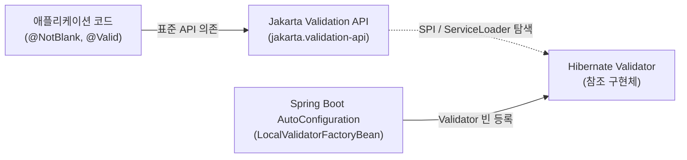
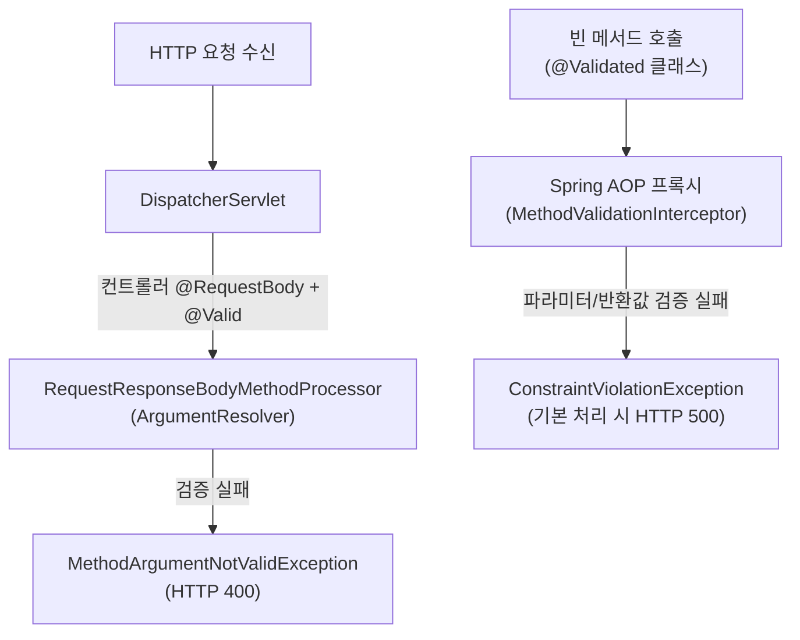

> Spring Boot에서 흔히 사용하는 `@NotBlank`, `@Email`, `@Valid`는 Spring 고유 기능이 아니라 자바 표준 Bean Validation 스펙입니다. 이 글에서는 JSR-303에서 Jakarta Validation 3.x까지의 진화 과정과 `@Valid`·`@Validated`의 내부 동작 차이, 그리고 실무용 커스텀 검증기 구현 방법을 정리합니다.

> 본 문서는 Spring Boot 3.x(Jakarta Validation 3.0 / Hibernate Validator 8.x) 환경을 기준으로 작성되었습니다.
{: .prompt-info }

## Bean Validation 표준의 진화와 구조

API 요청 파라미터를 검증할 때마다 컨트롤러나 서비스 내부에 `if (request.getName() == null || request.getName().isBlank())` 같은 조건문을 반복 작성하면 핵심 비즈니스 로직이 흐려집니다. 이를 선언적으로 해결하기 위해 자바 진영에서는 Bean Validation 표준을 정의해 왔습니다.

| 스펙 / 버전 | 패키지 | 주요 변화 |
| :--- | :--- | :--- |
| **JSR-303** (Bean Validation 1.0) | `javax.validation` | 자바 빈 프로퍼티 기반 제약 어노테이션 최초 표준화 |
| **JSR-349** (Bean Validation 1.1) | `javax.validation` | 메서드 파라미터 및 반환값 검증, CDI 통합 추가 |
| **JSR-380** (Bean Validation 2.0) | `javax.validation` | Java 8 `Optional`, `java.time`(`@Past`, `@Future`), 컨테이너 요소 제네릭 검증(`List<@NotBlank String>`) 지원 |
| **Jakarta Validation 3.0 / 3.1** | `jakarta.validation` | Eclipse Foundation 이관에 따른 패키지 전환, Spring Boot 3.x 기본 표준 |

중요한 점은 `jakarta.validation`이 **인터페이스와 어노테이션만 정의하는 명세(API)**라는 사실입니다. 실제 검증 엔진은 별도의 구현체가 담당하며, Spring Boot에서는 `spring-boot-starter-validation` 의존성을 추가하면 참조 구현체(RI)인 **Hibernate Validator**가 함께 포함됩니다.



애플리케이션 코드는 표준 인터페이스인 `jakarta.validation`에만 의존하므로, 구현체가 내부적으로 교체되더라도 도메인 DTO나 어노테이션 코드는 수정할 필요가 없습니다.

### Gradle 의존성 설정

Spring Boot 2.3 이후부터는 `spring-boot-starter-web`에 검증 스타터가 기본 포함되지 않으므로 명시적으로 추가해야 합니다.

```groovy
// build.gradle
dependencies {
    implementation 'org.springframework.boot:spring-boot-starter-web'
    // jakarta.validation-api + hibernate-validator 포함
    implementation 'org.springframework.boot:spring-boot-starter-validation'
}
```

---

## @Valid vs @Validated 동작 원리와 차이

실무에서 가장 자주 헷갈리는 부분이 표준 어노테이션인 `@Valid`(`jakarta.validation.Valid`)와 Spring이 제공하는 `@Validated`(`org.springframework.validation.annotation.Validated`)의 선택 기준입니다. 두 어노테이션은 검증을 수행하는 진입점과 발생하는 예외 타입이 다릅니다.



핵심 차이를 표로 정리하면 다음과 같습니다.

| 비교 항목 | `@Valid` (Jakarta 표준) | `@Validated` (Spring 전용) |
| :--- | :--- | :--- |
| **패키지** | `jakarta.validation.Valid` | `org.springframework.validation.annotation.Validated` |
| **주 동작 주체** | MVC `ArgumentResolver` (또는 Validator 재귀 탐색) | Spring AOP (`MethodValidationPostProcessor`) |
| **적용 가능 위치** | 메서드 파라미터, 필드, 생성자, 타입 사용처 | 클래스(타입), 메서드, 메서드 파라미터 |
| **중첩 객체(Nested) 검증** | **지원** (필드에 `@Valid` 선언 시 재귀 검증) | 미지원 (필드 단위 부착 불가) |
| **Validation Group** | 미지원 | **지원** (`@Validated(CreateGroup.class)`) |
| **검증 실패 예외** | `MethodArgumentNotValidException` (MVC 바인딩 시) | `ConstraintViolationException` (AOP 메서드 검증 시)<br/>※ 단, 컨트롤러 `@RequestBody`에 붙이면 `MethodArgumentNotValidException` 발생 |

> 주의: `@RestControllerAdvice`에서 `MethodArgumentNotValidException`만 처리하고 `ConstraintViolationException`을 누락하면, `@Validated`가 붙은 컨트롤러의 `@RequestParam`/`@PathVariable` 검증 실패 시 의도치 않게 500 에러가 응답될 수 있습니다. 두 예외를 모두 핸들러에 등록해 두는 것이 안전합니다.
{: .prompt-warning }

### 중첩 객체 검증과 Validation Group 활용

예를 들어 회의실 예약 API를 구현할 때, 생성 시에는 `reservationId`가 비어 있어야 하고 수정 시에는 필수여야 한다고 가정해 보겠습니다. 마커 인터페이스를 활용하면 하나의 DTO를 상황에 맞게 분기 검증할 수 있습니다.

```java
// src/main/java/com/example/reservation/dto/ReservationGroups.java
package com.example.reservation.dto;

public interface ReservationGroups {
    interface Create {}
    interface Update {}
}
```

```java
// src/main/java/com/example/reservation/dto/ReservationRequest.java
package com.example.reservation.dto;

import jakarta.validation.Valid;
import jakarta.validation.constraints.NotBlank;
import jakarta.validation.constraints.NotNull;
import jakarta.validation.constraints.Null;
import jakarta.validation.constraints.Positive;

public record ReservationRequest(
    @Null(groups = ReservationGroups.Create.class, message = "생성 시 ID는 비어 있어야 합니다.")
    @NotNull(groups = ReservationGroups.Update.class, message = "수정 시 ID는 필수입니다.")
    Long reservationId,

    @NotBlank(groups = {ReservationGroups.Create.class, ReservationGroups.Update.class})
    String roomCode,

    @Positive(groups = {ReservationGroups.Create.class, ReservationGroups.Update.class})
    int attendeeCount,

    @Valid // 중첩 객체 내부 필드까지 재귀적으로 검증하려면 반드시 @Valid를 사용합니다.
    @NotNull(groups = {ReservationGroups.Create.class, ReservationGroups.Update.class})
    HostInfo host
) {
    public record HostInfo(
        @NotBlank(groups = {ReservationGroups.Create.class, ReservationGroups.Update.class})
        String hostName
    ) {}
}
```

컨트롤러에서는 `@Validated`에 그룹 클래스를 전달해 원하는 제약만 활성화합니다.

```java
// src/main/java/com/example/reservation/controller/ReservationController.java
package com.example.reservation.controller;

import com.example.reservation.dto.ReservationGroups;
import com.example.reservation.dto.ReservationRequest;
import org.springframework.http.ResponseEntity;
import org.springframework.validation.annotation.Validated;
import org.springframework.web.bind.annotation.*;

@RestController
@RequestMapping("/api/reservations")
public class ReservationController {

    @PostMapping
    public ResponseEntity<String> create(
        @Validated(ReservationGroups.Create.class) @RequestBody ReservationRequest request
    ) {
        return ResponseEntity.ok("created: " + request.roomCode());
    }

    @PutMapping
    public ResponseEntity<String> update(
        @Validated(ReservationGroups.Update.class) @RequestBody ReservationRequest request
    ) {
        return ResponseEntity.ok("updated: " + request.reservationId());
    }
}
```

> 실무에서는 Validation Group이 복잡해지면 DTO 가독성이 급격히 떨어지므로, 요청 목적이 명확히 다른 경우에는 `CreateReservationRequest`와 `UpdateReservationRequest`처럼 별도 DTO로 분리하는 편을 권장합니다.
{: .prompt-tip }

---

## 커스텀 제약 어노테이션과 ConstraintValidator 구현

기본 제공 어노테이션만으로는 사내 규칙(예: 특정 접두사로 시작하는 회의실 코드, 허용된 도메인 이메일, 시작/종료 시각 선후 관계 등)을 표현하기 어렵습니다. 이때 Jakarta Validation 표준인 `@Constraint`와 `ConstraintValidator` 인터페이스를 구현하면 재사용 가능한 검증 어노테이션을 만들 수 있습니다.

### 1. 커스텀 어노테이션 정의

회의실 코드가 `ROOM-`으로 시작하고 뒤에 3자리 숫자가 오는지 검사하는 `@RoomCode` 어노테이션을 정의합니다. 표준 스펙상 `message`, `groups`, `payload` 세 가지 속성은 반드시 선언해야 합니다.

```java
// src/main/java/com/example/reservation/validation/RoomCode.java
package com.example.reservation.validation;

import jakarta.validation.Constraint;
import jakarta.validation.Payload;
import java.lang.annotation.*;

@Documented
@Constraint(validatedBy = RoomCodeValidator.class)
@Target({ElementType.FIELD, ElementType.PARAMETER})
@Retention(RetentionPolicy.RUNTIME)
public @interface RoomCode {

    String message() default "회의실 코드는 'ROOM-000' 형식이어야 합니다.";

    Class<?>[] groups() default {};

    Class<? extends Payload>[] payload() default {};
}
```

### 2. ConstraintValidator 구현

`ConstraintValidator<어노테이션 타입, 검증 대상 타입>`을 구현합니다. Bean Validation의 관례에 따라 `null` 값 허용 여부는 `@NotNull`에게 위임하고, 커스텀 검증기에서는 `value == null`일 때 `true`를 반환하도록 작성하는 것이 조합성 면에서 깔끔합니다.

```java
// src/main/java/com/example/reservation/validation/RoomCodeValidator.java
package com.example.reservation.validation;

import jakarta.validation.ConstraintValidator;
import jakarta.validation.ConstraintValidatorContext;
import java.util.regex.Pattern;

public class RoomCodeValidator implements ConstraintValidator<RoomCode, String> {

    private static final Pattern ROOM_CODE_PATTERN = Pattern.compile("^ROOM-\\d{3}$");

    @Override
    public boolean isValid(String value, ConstraintValidatorContext context) {
        if (value == null) {
            return true; // null 체크는 @NotNull / @NotBlank에 위임
        }
        return ROOM_CODE_PATTERN.matcher(value).matches();
    }
}
```

Spring 환경에서는 `LocalValidatorFactoryBean`이 `ConstraintValidator` 인스턴스를 생성할 때 Spring 빈 주입을 지원하므로, 필요하다면 생성자 주입으로 프로퍼티나 리포지토리를 받아 검증 로직에 활용할 수도 있습니다. 다만 DB 조회를 동반하는 무거운 검증은 테스트가 까다로워지고 트랜잭션 경계가 모호해질 수 있으므로, 커스텀 어노테이션은 가급적 순수한 형식·값 범위 검증에 집중하는 편이 유지보수에 유리합니다.

---

## 정리

- **Jakarta Validation(JSR-303/380)**은 검증 규칙을 선언적으로 표현하는 자바 표준 API이며, Spring Boot에서는 **Hibernate Validator**가 실제 검증을 수행합니다.
- 컨트롤러 요청 바디와 중첩 객체 검증에는 표준 `@Valid`를, 서비스 레이어 메서드 검증이나 그룹 검증이 필요할 때는 Spring `@Validated`를 사용합니다.
- 반복되는 도메인 형식 규칙은 `@Constraint`와 `ConstraintValidator`로 분리하면 컨트롤러와 서비스 코드를 깔끔하게 유지할 수 있습니다.
