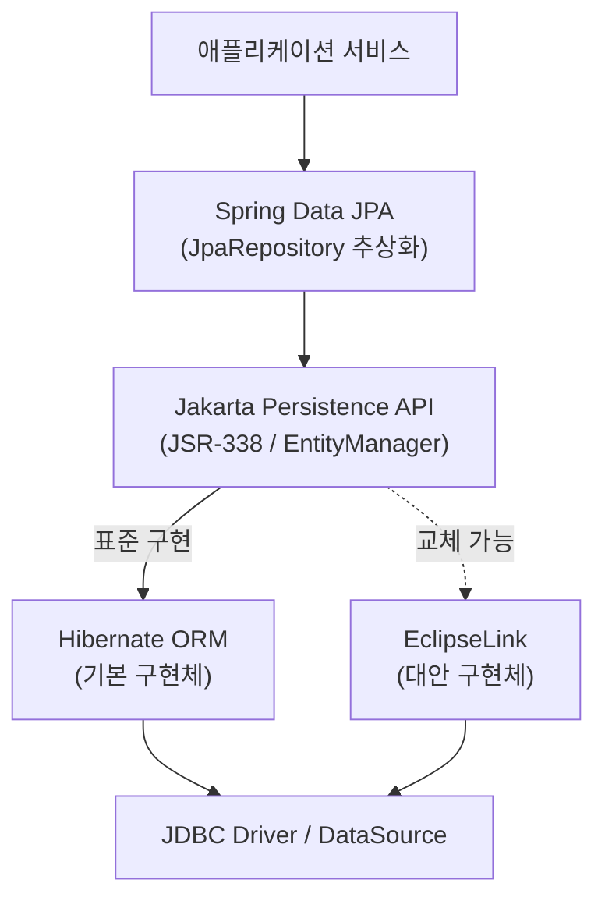
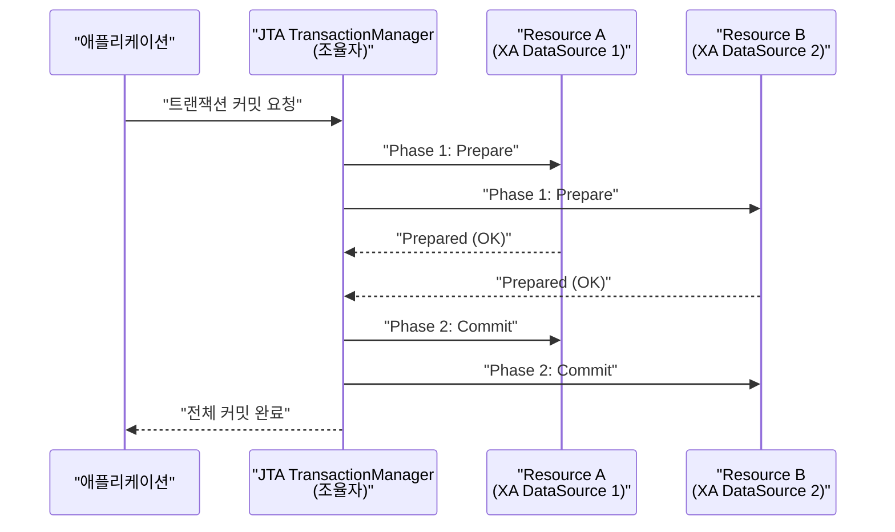

> Spring Data JPA를 사용하다 보면 JPA와 Hibernate, 그리고 `jakarta.transaction.Transactional`과 Spring `@Transactional`의 경계가 흐려지기 쉽습니다. 이 글에서는 JSR-338(JPA)과 JSR-907(JTA) 표준 스펙의 역할을 짚어보고, 두 `@Transactional` 어노테이션의 기능 차이와 실무 선택 기준을 정리합니다.

> 본 문서는 Spring Boot 3.x(Jakarta Persistence 3.1 / Hibernate ORM 6.x / Jakarta Transactions 2.0) 환경을 기준으로 작성되었습니다.
{: .prompt-info }

## JSR-338 (Jakarta Persistence / JPA): 표준 인터페이스와 구현체의 경계

JPA(Java/Jakarta Persistence API)는 JSR-220(JPA 1.0)에서 출발해 **JSR-338(JPA 2.1 / 2.2)**을 거쳐 현재의 **Jakarta Persistence 3.x**로 발전한 자바 진영의 ORM(Object-Relational Mapping) 표준 명세입니다. 흔히 JPA를 라이브러리라고 부르기도 하지만, 엄밀히는 `jakarta.persistence` 패키지에 정의된 **인터페이스와 어노테이션의 집합**입니다.

JPA 표준이 정의하는 핵심 축은 크게 세 가지입니다.

1. **엔티티 매핑 규약**: `@Entity`, `@Table`, `@Id`, `@ManyToOne` 등으로 자바 객체와 관계형 테이블 간의 매핑 규칙을 선언합니다.
2. **EntityManager와 영속성 컨텍스트(Persistence Context)**: 엔티티의 생명주기(비영속, 영속, 준영속, 삭제)를 관리하며 1차 캐시, 동일성 보장, 쓰기 지연, 변경 감지(Dirty Checking) 동작을 명세합니다.
3. **JPQL(Jakarta Persistence Query Language)**: 특정 벤더 SQL 방언에 종속되지 않도록 테이블이 아닌 엔티티 객체를 대상으로 작성하는 객체지향 쿼리 언어입니다.

이 표준 명세를 실제로 SQL로 번역하고 JDBC 커넥션을 다루는 역할을 **Hibernate ORM**, **EclipseLink** 같은 구현체가 수행하며, Spring Data JPA는 그 위에서 `JpaRepository` 추상화를 한 겹 더 얹어 보일러플레이트를 줄여 줍니다.



### 표준 API와 구현체 전용 기능 구분하기

실무에서는 가급적 `jakarta.persistence.*` 표준 어노테이션을 우선 사용하고, Hibernate 전용 기능(`@BatchSize`, `@SQLRestriction`, `@DynamicUpdate` 등)은 성능 최적화나 특수 요구사항이 명확할 때만 제한적으로 도입하는 것이 좋습니다.

```groovy
// build.gradle
dependencies {
    // jakarta.persistence-api + hibernate-core + spring-data-jpa 포함
    implementation 'org.springframework.boot:spring-boot-starter-data-jpa'
    runtimeOnly 'com.h2database:h2'
}
```

```java
// src/main/java/com/example/ledger/domain/Account.java
package com.example.ledger.domain;

import jakarta.persistence.*; // JSR-338 표준 패키지
import org.hibernate.annotations.DynamicUpdate; // Hibernate 구현체 전용 기능

@Entity
@Table(name = "accounts")
@DynamicUpdate // 변경된 컬럼만 UPDATE SQL에 포함 (구현체 종속)
public class Account {

    @Id
    @GeneratedValue(strategy = GenerationType.IDENTITY)
    private Long id;

    @Column(nullable = false, unique = true)
    private String accountNumber;

    @Column(nullable = false)
    private long balance;

    protected Account() {}

    public Account(String accountNumber, long balance) {
        this.accountNumber = accountNumber;
        this.balance = balance;
    }

    public void withdraw(long amount) {
        if (this.balance < amount) {
            throw new IllegalStateException("잔액이 부족합니다.");
        }
        this.balance -= amount;
    }
}
```

---

## JSR-907 (Jakarta Transactions / JTA): 분산 트랜잭션 표준

데이터베이스가 하나뿐인 환경에서는 단일 커넥션의 `commit` / `rollback`만으로 충분합니다. 이를 **로컬 리소스 트랜잭션(Resource-Local Transaction)**이라고 부르며, Spring에서는 `JpaTransactionManager`나 `DataSourceTransactionManager`가 이를 처리합니다.

반면 하나의 비즈니스 작업이 **서로 다른 두 개의 데이터베이스(예: 주문 DB와 정산 DB)** 또는 **DB와 메시지 브로커(JMS)**를 동시에 갱신해야 한다면 로컬 트랜잭션만으로는 원자성을 보장할 수 없습니다. 이때 등장하는 표준이 **JSR-907(JTA, Jakarta Transactions)**입니다.

JTA는 X/Open XA 프로토콜을 기반으로 **2단계 커밋(2PC, Two-Phase Commit)**을 조율하는 트랜잭션 매니저(`TransactionManager`, `UserTransaction`) 인터페이스를 정의합니다.



1. **Phase 1 (Prepare)**: 조율자(TransactionManager)가 참여하는 모든 XA 리소스에 커밋 가능 여부를 묻고, 각 리소스는 락을 유지한 채 준비 완료 상태를 응답합니다.
2. **Phase 2 (Commit / Rollback)**: 모든 리소스가 준비 완료를 응답하면 일괄 커밋을 지시하고, 하나라도 실패하면 전체 롤백을 지시합니다.

> 최근 마이크로서비스 아키텍처에서는 2PC의 락 점유 시간과 성능 병목 때문에 JTA(XA) 분산 트랜잭션을 직접 도입하기보다, 로컬 트랜잭션 + Outbox 패턴이나 Saga 패턴으로 최종 일관성(Eventual Consistency)을 맞추는 경우가 많습니다. 그럼에도 Spring의 `PlatformTransactionManager` 추상화가 `JtaTransactionManager`로 매끄럽게 교체될 수 있는 기반이 바로 JSR-907 표준입니다.
{: .prompt-info }

---

## jakarta.transaction.Transactional vs Spring @Transactional

IDE에서 `@Transactional`을 자동 완성하다 보면 아래 두 가지 패키지가 함께 나타납니다.

- `jakarta.transaction.Transactional` (JSR-907 / JTA 1.2+ 표준)
- `org.springframework.transaction.annotation.Transactional` (Spring 전용)

Spring은 표준 호환성을 위해 `jakarta.transaction.Transactional`도 인식하여 AOP 트랜잭션 프록시를 적용해 줍니다. 하지만 지원하는 세부 옵션에 분명한 차이가 있습니다.

| 비교 항목 | `jakarta.transaction.Transactional` (표준) | `org.springframework...Transactional` (Spring) |
| :--- | :--- | :--- |
| **패키지** | `jakarta.transaction.Transactional` | `org.springframework.transaction.annotation.Transactional` |
| **전파 속성(Propagation)** | `TxType` 열거형 (`REQUIRED`, `REQUIRES_NEW` 등 6종)<br/>※ `NESTED` 미지원 | `Propagation` 열거형 (`NESTED` 포함 7종) |
| **격리 수준(Isolation)** | **미지원** | **지원** (`READ_COMMITTED`, `REPEATABLE_READ` 등) |
| **읽기 전용(`readOnly`)** | **미지원** | **지원** (`readOnly = true`, Dirty Checking 생략 및 Read Replica 라우팅 활용) |
| **타임아웃(`timeout`)** | **미지원** | **지원** (초 단위 지정) |
| **롤백 규칙 속성명** | `rollbackOn` / `dontRollbackOn` | `rollbackFor` / `noRollbackFor` |
| **트랜잭션 매니저 지정** | 미지원 | **지원** (`value` / `transactionManager` 빈 이름 지정) |

### 코드 비교와 실무 선택 기준

두 어노테이션을 코드로 나란히 비교해 보면 차이를 직관적으로 확인할 수 있습니다.

```java
// src/main/java/com/example/ledger/service/AccountService.java
package com.example.ledger.service;

import com.example.ledger.domain.Account;
import com.example.ledger.repository.AccountRepository;
import org.springframework.stereotype.Service;
import org.springframework.transaction.annotation.Isolation;
import org.springframework.transaction.annotation.Transactional;

@Service
public class AccountService {

    private final AccountRepository accountRepository;

    public AccountService(AccountRepository accountRepository) {
        this.accountRepository = accountRepository;
    }

    // 1. Spring @Transactional: readOnly 최적화(플러시 생략, 읽기 DB 라우팅) 가능
    @Transactional(readOnly = true)
    public Account findAccount(Long id) {
        return accountRepository.findById(id)
            .orElseThrow(() -> new IllegalArgumentException("계좌를 찾을 수 없습니다."));
    }

    // 2. Spring @Transactional: 격리 수준, 타임아웃, 체크 예외 롤백 규칙 세밀하게 제어
    @Transactional(
        isolation = Isolation.READ_COMMITTED,
        timeout = 5,
        rollbackFor = Exception.class
    )
    public void withdraw(Long id, long amount) {
        Account account = findAccount(id);
        account.withdraw(amount);
    }

    // 3. Jakarta 표준 @Transactional 사용 예시 (비교용)
    @jakarta.transaction.Transactional(
        value = jakarta.transaction.Transactional.TxType.REQUIRES_NEW,
        rollbackOn = Exception.class
    )
    public void recordAuditLog(Long accountId) {
        // 별도 트랜잭션으로 감사 로그 기록
    }
}
```

그렇다면 실무에서는 어떤 어노테이션을 선택해야 할까요?

- **Spring 기반 프로젝트라면 `org.springframework.transaction.annotation.Transactional`을 기본으로 사용합니다.** 특히 JPA와 함께 사용할 때 `readOnly = true`는 Hibernate의 스냅샷 비교(Dirty Checking) 비용을 줄이고 읽기 전용 레플리카 라우팅의 기준이 되므로 실무 가치가 매우 큽니다.
- **프레임워크 비종속적인 공통 도메인 모듈**을 만들어 Quarkus, Jakarta EE(WildFly 등), Spring에서 함께 배포해야 하는 특수한 경우에만 `jakarta.transaction.Transactional`을 고려합니다.

> 주의: 한 프로젝트 안에서 두 `@Transactional` 어노테이션을 혼용하면 속성명(`rollbackOn` vs `rollbackFor`) 혼동과 `readOnly` 누락으로 이어지기 쉽습니다. 팀 내 ArchUnit 테스트나 Checkstyle 규칙으로 하나로 통일해 두는 편을 권장합니다.
{: .prompt-warning }

---

## 정리

- **JSR-338(JPA)**은 ORM과 영속성 컨텍스트의 표준 명세이며, Hibernate는 그 명세를 구현하는 엔진입니다.
- **JSR-907(JTA)**은 다중 리소스를 2PC(XA)로 묶는 분산 트랜잭션 표준이며, Spring의 트랜잭션 추상화 아래에서 로컬·분산 트랜잭션을 동일한 프로그래밍 모델로 다룰 수 있게 해 줍니다.
- Spring 환경에서는 `readOnly`, `isolation`, `timeout`, `NESTED` 전파를 지원하는 **Spring `@Transactional`**을 일관되게 사용하는 것이 실무적으로 유리합니다.
