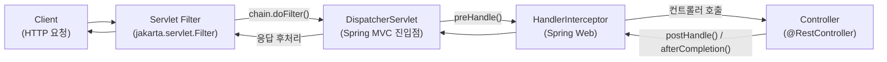

> Spring Boot에서 내장 웹 서버를 Tomcat에서 Jetty나 Undertow로 바꿔도 컨트롤러 코드를 한 줄도 고치지 않아도 되는 이유는 Jakarta Servlet 표준 덕분입니다. 이 글에서는 JSR-340/369(Jakarta Servlet 6.x)의 표준화 구조와 요청 처리 파이프라인을 살펴보고, `jakarta.servlet.Filter`와 Spring `HandlerInterceptor`의 차이 및 `OncePerRequestFilter` 실무 패턴을 정리합니다.

> 본 문서는 Spring Boot 3.x(Jakarta Servlet 6.0 / Spring Framework 6.x) 환경을 기준으로 작성되었습니다.
{: .prompt-info }

## JSR-340/369 (Jakarta Servlet): 서블릿 컨테이너 교체 가능한 아키텍처

자바 웹 애플리케이션이 HTTP 요청을 받아 응답을 내려주기까지의 저수준 계약(소켓 수신, HTTP 파싱, 스레드 풀, 세션, 요청/응답 객체)은 **Servlet 표준 스펙**으로 정의되어 있습니다.

- **JSR-340 (Servlet 3.1)**: Non-blocking I/O, HTTP 프로토콜 업그레이드 지원
- **JSR-369 (Servlet 4.0)**: HTTP/2 서버 푸시 및 스트림 우선순위 지원
- **Jakarta Servlet 6.0 / 6.1**: `jakarta.servlet` 패키지 전환 및 최신 HTTP 규약 반영 (Spring Boot 3.x 기본 스펙)

Spring MVC의 핵심 진입점인 `DispatcherServlet` 역시 결국 표준 추상 클래스인 `jakarta.servlet.http.HttpServlet`을 상속한 하나의 서블릿입니다. 따라서 `HttpServletRequest`와 `HttpServletResponse` 인터페이스만 준수하면 아래쪽의 서블릿 컨테이너를 **Tomcat**, **Jetty**, **Undertow** 중 무엇으로 교체하더라도 애플리케이션 코드는 동일하게 동작합니다.

```groovy
// build.gradle - Tomcat 대신 Jetty로 서블릿 컨테이너 교체 예시
dependencies {
    implementation('org.springframework.boot:spring-boot-starter-web') {
        exclude group: 'org.springframework.boot', module: 'spring-boot-starter-tomcat'
    }
    implementation 'org.springframework.boot:spring-boot-starter-jetty'
}
```

---

## HTTP 요청 처리 파이프라인: Filter에서 Controller까지

클라이언트 요청이 서버에 도착해 응답으로 돌아가는 전체 흐름에서 **Servlet Filter**는 서블릿 컨테이너(Tomcat 등) 영역에, **HandlerInterceptor**는 Spring MVC의 `DispatcherServlet` 내부 영역에 위치합니다.



이 위치 차이 때문에 두 컴포넌트가 다룰 수 있는 정보의 범위와 예외 처리 방식이 완전히 달라집니다.

| 비교 항목 | `jakarta.servlet.Filter` | Spring `HandlerInterceptor` |
| :--- | :--- | :--- |
| **소속 및 표준** | Jakarta Servlet 표준 (`jakarta.servlet`) | Spring MVC 전용 (`org.springframework.web.servlet`) |
| **실행 위치** | `DispatcherServlet` 앞/뒤 (서블릿 컨테이너 영역) | `DispatcherServlet` 내부, 컨트롤러 호출 앞/뒤 |
| **요청/응답 조작** | `HttpServletRequestWrapper` / `ResponseWrapper`로 **객체 자체 교체 가능** | 전달받은 객체 조회 중심 (래퍼 교체 불가) |
| **핸들러 메타데이터** | 매핑될 컨트롤러 메서드 정보 알 수 없음 | `Object handler`(`HandlerMethod`)로 **메서드·어노테이션 정보 접근 가능** |
| **예외 처리** | `@RestControllerAdvice` **미적용** (서블릿 컨테이너 에러 페이지 또는 별도 예외 처리 필요) | `@RestControllerAdvice` / `@ExceptionHandler` **적용됨** |
| **주요 실무 용도** | 인코딩, CORS, 요청/응답 로깅, MDC 추적 ID 발급, Spring Security 필터 체인 | 컨트롤러 커스텀 어노테이션 검사, 핸들러 단위 인가/감사, 모델 공통 속성 주입 |

> 주의: Filter 내부에서 던진 예외는 `DispatcherServlet` 바깥에서 발생하므로 `@RestControllerAdvice`가 가로채지 못합니다. 인증 실패나 요청 차단 응답을 JSON으로 내려야 한다면 Filter에서 직접 `response.setStatus(...)`와 응답 바디를 작성하거나, `HandlerExceptionResolver` 빈을 주입해 예외 처리를 위임해야 합니다.
{: .prompt-warning }

---

## 실무 활용 1: OncePerRequestFilter로 요청 추적 ID(MDC) 관리하기

서블릿 스펙상 `RequestDispatcher.forward()`나 `error` 디스패치가 일어나면 일반 `jakarta.servlet.Filter`는 하나의 HTTP 요청에 대해 여러 번 호출될 수 있습니다. Spring이 제공하는 `OncePerRequestFilter`를 상속하면 요청당 정확히 한 번만 실행되도록 보장해 줍니다.

아래는 모든 API 요청에 고유한 `X-Request-Id`를 발급해 SLF4J `MDC`에 넣고 응답 헤더로 돌려주는 실무 필터 예제입니다.

```java
// src/main/java/com/example/web/filter/RequestTraceFilter.java
package com.example.web.filter;

import jakarta.servlet.FilterChain;
import jakarta.servlet.ServletException;
import jakarta.servlet.http.HttpServletRequest;
import jakarta.servlet.http.HttpServletResponse;
import java.io.IOException;
import java.util.UUID;
import org.slf4j.MDC;
import org.springframework.core.Ordered;
import org.springframework.core.annotation.Order;
import org.springframework.stereotype.Component;
import org.springframework.web.filter.OncePerRequestFilter;

@Component
@Order(Ordered.HIGHEST_PRECEDENCE)
public class RequestTraceFilter extends OncePerRequestFilter {

    private static final String TRACE_HEADER = "X-Request-Id";
    private static final String MDC_KEY = "requestId";

    @Override
    protected void doFilterInternal(
        HttpServletRequest request,
        HttpServletResponse response,
        FilterChain filterChain
    ) throws ServletException, IOException {
        String requestId = request.getHeader(TRACE_HEADER);
        if (requestId == null || requestId.isBlank()) {
            requestId = UUID.randomUUID().toString();
        }

        MDC.put(MDC_KEY, requestId);
        response.setHeader(TRACE_HEADER, requestId);
        try {
            filterChain.doFilter(request, response);
        } finally {
            // 스레드 풀 재사용 시 이전 요청의 MDC가 오염되지 않도록 반드시 정리합니다.
            MDC.remove(MDC_KEY);
        }
    }
}
```

## 실무 활용 2: HandlerInterceptor로 커스텀 어노테이션 기반 접근 제어하기

반면 특정 컨트롤러 메서드에 붙은 커스텀 어노테이션(`@AdminOnly` 등)을 확인하고 실패 시 `@RestControllerAdvice`의 공통 에러 응답 포맷을 그대로 활용하고 싶다면 `HandlerInterceptor`가 적합합니다.

```java
// src/main/java/com/example/web/interceptor/AdminOnly.java
package com.example.web.interceptor;

import java.lang.annotation.*;

@Target({ElementType.METHOD, ElementType.TYPE})
@Retention(RetentionPolicy.RUNTIME)
public @interface AdminOnly {}
```

```java
// src/main/java/com/example/web/interceptor/AdminAccessInterceptor.java
package com.example.web.interceptor;

import jakarta.servlet.http.HttpServletRequest;
import jakarta.servlet.http.HttpServletResponse;
import org.springframework.stereotype.Component;
import org.springframework.web.method.HandlerMethod;
import org.springframework.web.servlet.HandlerInterceptor;

@Component
public class AdminAccessInterceptor implements HandlerInterceptor {

    @Override
    public boolean preHandle(
        HttpServletRequest request,
        HttpServletResponse response,
        Object handler
    ) {
        if (!(handler instanceof HandlerMethod handlerMethod)) {
            return true;
        }

        boolean requiresAdmin = handlerMethod.hasMethodAnnotation(AdminOnly.class)
            || handlerMethod.getBeanType().isAnnotationPresent(AdminOnly.class);

        if (requiresAdmin && !"ADMIN".equals(request.getHeader("X-User-Role"))) {
            // DispatcherServlet 내부이므로 @RestControllerAdvice에서 일관된 JSON 에러로 변환 가능
            throw new IllegalStateException("관리자 권한이 필요합니다.");
        }
        return true;
    }
}
```

인터셉터는 빈으로 등록만 해서는 동작하지 않으므로 `WebMvcConfigurer`에 명시적으로 경로를 연결해야 합니다.

```java
// src/main/java/com/example/web/config/WebMvcConfig.java
package com.example.web.config;

import com.example.web.interceptor.AdminAccessInterceptor;
import org.springframework.context.annotation.Configuration;
import org.springframework.web.servlet.config.annotation.InterceptorRegistry;
import org.springframework.web.servlet.config.annotation.WebMvcConfigurer;

@Configuration
public class WebMvcConfig implements WebMvcConfigurer {

    private final AdminAccessInterceptor adminAccessInterceptor;

    public WebMvcConfig(AdminAccessInterceptor adminAccessInterceptor) {
        this.adminAccessInterceptor = adminAccessInterceptor;
    }

    @Override
    public void addInterceptors(InterceptorRegistry registry) {
        registry.addInterceptor(adminAccessInterceptor)
            .addPathPatterns("/api/**")
            .excludePathPatterns("/api/health", "/api/public/**");
    }
}
```

> 요약하면, **Spring MVC와 무관하게 모든 HTTP 요청을 전역적으로 감싸야 하는 작업**(보안 필터, CORS, MDC 로깅, 요청/응답 바디 래핑)은 `Filter`로, **특정 컨트롤러 메서드나 어노테이션 맥락이 필요하고 `@RestControllerAdvice` 예외 처리를 활용해야 하는 작업**은 `HandlerInterceptor`로 분리하는 것이 깔끔합니다.
{: .prompt-tip }

---

## 정리

- **Jakarta Servlet(JSR-340/369)**은 자바 웹 컨테이너의 표준 명세이며, `DispatcherServlet`도 이 표준 위에서 동작하기 때문에 Tomcat·Jetty·Undertow 교체가 가능합니다.
- `Filter`는 `DispatcherServlet` 바깥(서블릿 컨테이너)에서, `HandlerInterceptor`는 안쪽(Spring MVC)에서 실행되며 이에 따라 예외 처리와 핸들러 메타데이터 접근 여부가 달라집니다.
- 서블릿 필터를 구현할 때는 중복 실행을 막아 주는 `OncePerRequestFilter`를 활용하고, `MDC` 같은 ThreadLocal 자원은 `finally` 블록에서 반드시 정리합니다.
