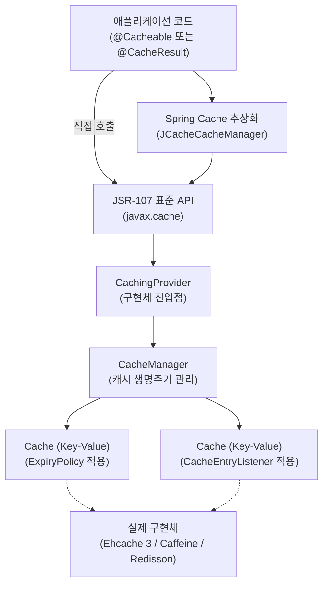

> 자바 생태계의 표준 캐시 스펙인 JSR-107(JCache)의 핵심 컴포넌트와 어노테이션을 살펴보고, Spring Cache 추상화와 Ehcache 3·Caffeine·Redisson 등 실제 구현체를 연동하는 방법과 선택 기준을 정리합니다.

## 왜 자바 표준 캐시 API가 필요했을까

백엔드 애플리케이션에서 데이터베이스 부하를 줄이고 응답 속도를 개선하기 위해 캐시(Cache)를 도입하는 것은 자연스러운 선택입니다. 하지만 로컬 캐시로 Ehcache나 Caffeine을 사용하다가 분산 환경으로 확장하면서 Redis나 Hazelcast로 전환하려고 하면, 벤더마다 API와 설정 방식이 제각각이어서 비즈니스 코드까지 수정해야 하는 문제가 생깁니다.

JDBC가 데이터베이스 접근 방식을, JPA가 ORM을 표준화했듯이 **JSR-107(JCache, `javax.cache`)**은 자바 애플리케이션이 특정 캐시 구현체에 종속되지 않도록 캐시 생성·조회·만료·이벤트 리스너 등의 동작을 표준화한 스펙입니다. 2001년에 처음 제안된 뒤 오랜 논의 끝에 2014년에 최종 확정되었으며, 현재 Ehcache 3, Caffeine, Hazelcast, Infinispan, Redisson 등 주요 캐시 라이브러리가 JSR-107 구현체(Provider)를 제공합니다.

> JSR-107은 Jakarta EE 네임스페이스 전환 대상에 포함되지 않았기 때문에 Spring Boot 3.x 및 Java 17/21 환경에서도 여전히 `javax.cache.*` 패키지를 사용합니다.
{: .prompt-info }

---

## JSR-107 핵심 컴포넌트 구조

JCache API는 크게 네 가지 계층적 컴포넌트와 만료 정책(`ExpiryPolicy`)을 중심으로 동작합니다.



각 인터페이스의 역할은 다음과 같습니다.

1. **`CachingProvider`**: 클래스패스에 등록된 JCache 구현체(SPI)를 탐색하고 `CacheManager`를 생성·관리하는 최상위 진입점입니다. `Caching.getCachingProvider()`로 가져옵니다.
2. **`CacheManager`**: 여러 개의 `Cache` 인스턴스를 이름으로 생성, 조회, 제거하는 컨테이너입니다. 애플리케이션 종료 시 자원을 정리하는 생명주기 관리 책임을 가집니다.
3. **`Cache<K, V>`**: 실제 키-값 쌍을 보관하는 저장소입니다. `java.util.Map`과 유사하지만 분산 환경과 직렬화를 고려해 설계되었으며, `get`, `put`, `remove`, `invoke`(원자적 엔트리 프로세서) 등의 연산을 제공합니다.
4. **`ExpiryPolicy`**: 캐시 엔트리의 만료 시간(TTL)을 결정하는 정책입니다. 생성 시점 기준(`CreatedExpiryPolicy`), 마지막 수정 시점 기준(`ModifiedExpiryPolicy`), 마지막 접근 시점 기준(`AccessedExpiryPolicy`), 영구 보관(`EternalExpiryPolicy`) 등을 선택할 수 있습니다.

---

## JCache 표준 어노테이션 vs Spring Cache 어노테이션

Spring Framework는 자체 캐시 추상화(`org.springframework.cache.annotation`)와 함께 JSR-107 표준 어노테이션(`javax.cache.annotation`)도 1급 시민으로 지원합니다. `@EnableCaching`을 선언하면 두 종류의 어노테이션을 모두 프록시 기반으로 처리할 수 있습니다.

| 기능 | Spring Cache 어노테이션 | JSR-107 (JCache) 어노테이션 | 주요 차이점 |
| :--- | :--- | :--- | :--- |
| **조회 및 저장** | `@Cacheable` | `@CacheResult` | Spring은 `condition`, `unless` SpEL 지원 / JCache는 `exceptionCacheName` 지원 |
| **강제 갱신** | `@CachePut` | `@CachePut` | JCache는 저장할 값 파라미터에 `@CacheValue` 명시 필요 |
| **단건 삭제** | `@CacheEvict` | `@CacheRemove` | JCache는 `evictFor`로 특정 예외 발생 시 삭제 제어 가능 |
| **전체 삭제** | `@CacheEvict(allEntries = true)` | `@CacheRemoveAll` | JCache는 별도 어노테이션으로 명확히 분리 |
| **공통 설정** | `@CacheConfig` | `@CacheDefaults` | 클래스 레벨에서 기본 캐시 이름, 키 생성기 지정 |
| **키 지정** | `key = "#id"` (SpEL) | `@CacheKey` | Spring은 SpEL 표현식, JCache는 파라미터 어노테이션 방식 |

> 하나의 메서드에 Spring Cache 어노테이션과 JSR-107 어노테이션을 혼용하는 것은 권장하지 않습니다. 팀 내에서 한 가지 스타일로 통일해야 프록시 동작을 예측하기 쉽습니다.
{: .prompt-warning }

---

## Spring Boot + JCache 구현체 연동 실습

실무에서 가장 많이 사용하는 패턴은 **Spring Boot의 `spring-boot-starter-cache` 위에 JSR-107 API와 구현체(Caffeine 또는 Ehcache 3)를 연결하는 방식**입니다.

### 1. Gradle 의존성 설정

Caffeine의 JCache 어댑터(`jcache` 모듈)를 사용하는 예시입니다. Ehcache 3나 Redisson으로 교체하고 싶다면 구현체 의존성만 변경하면 됩니다.

```kotlin
// build.gradle.kts
dependencies {
    implementation("org.springframework.boot:spring-boot-starter-web")
    implementation("org.springframework.boot:spring-boot-starter-cache")

    // JSR-107 (JCache) 표준 API
    implementation("javax.cache:cache-api:1.1.1")

    // 구현체 선택 1: Caffeine JCache 모듈
    implementation("com.github.ben-manes.caffeine:jcache:3.1.8")

    // 구현체 선택 2: Ehcache 3를 사용할 경우 (Jakarta 환경용 classifier 지정)
    // implementation("org.ehcache:ehcache:3.10.8:jakarta")

    // 구현체 선택 3: 분산 캐시로 Redisson JCache를 사용할 경우
    // implementation("org.redisson:redisson-spring-boot-starter:3.37.0")
}
```

### 2. application.yml 설정

클래스패스에 여러 JCache 구현체가 공존할 수 있으므로 `spring.cache.type`과 `provider`를 명시적으로 지정하는 편이 안전합니다.

```yaml
# src/main/resources/application.yml
spring:
  cache:
    type: jcache
    jcache:
      provider: com.github.benmanes.caffeine.jcache.spi.CaffeineCachingProvider
```

### 3. JCacheManagerCustomizer로 캐시 및 ExpiryPolicy 정의

Spring Boot는 `JCacheManagerCustomizer` 빈을 감지해 `javax.cache.CacheManager` 초기화 시점에 프로그래밍 방식으로 캐시를 등록해 줍니다.

```java
// src/main/java/com/example/cache/config/JCacheConfig.java
package com.example.cache.config;

import java.util.concurrent.TimeUnit;
import javax.cache.configuration.MutableConfiguration;
import javax.cache.expiry.CreatedExpiryPolicy;
import javax.cache.expiry.Duration;
import org.springframework.boot.autoconfigure.cache.JCacheManagerCustomizer;
import org.springframework.cache.annotation.EnableCaching;
import org.springframework.context.annotation.Bean;
import org.springframework.context.annotation.Configuration;

@Configuration
@EnableCaching
public class JCacheConfig {

    public static final String PRODUCT_CACHE = "products";

    @Bean
    public JCacheManagerCustomizer cacheManagerCustomizer() {
        return cacheManager -> {
            MutableConfiguration<Object, Object> config = new MutableConfiguration<>()
                .setExpiryPolicyFactory(
                    CreatedExpiryPolicy.factoryOf(new Duration(TimeUnit.MINUTES, 10))
                )
                .setStoreByValue(false) // 로컬 캐시에서는 참조 저장으로 직렬화 비용 절감
                .setStatisticsEnabled(true); // JMX/Actuator 메트릭 수집 활성화

            if (cacheManager.getCache(PRODUCT_CACHE) == null) {
                cacheManager.createCache(PRODUCT_CACHE, config);
            }
        };
    }
}
```

`setStoreByValue(false)` 옵션은 로컬 인메모리 캐시에서 중요합니다. JSR-107의 기본값은 `true`(값 복사·직렬화)인데, 로컬 캐시에서 불변 객체를 저장할 때 `false`로 설정하면 불필요한 직렬화 오버헤드를 줄일 수 있습니다. 단, 분산 캐시(Redis 등)로 전환할 때는 직렬화가 필요하므로 `true`를 유지해야 합니다.

### 4. 서비스 계층 적용 예시

아래처럼 JSR-107 표준 어노테이션을 직접 사용하거나, 동일한 `JCacheCacheManager` 위에서 Spring의 `@Cacheable`을 사용할 수 있습니다.

```java
// src/main/java/com/example/cache/service/ProductService.java
package com.example.cache.service;

import com.example.cache.config.JCacheConfig;
import com.example.cache.domain.Product;
import com.example.cache.repository.ProductRepository;
import javax.cache.annotation.CacheDefaults;
import javax.cache.annotation.CacheKey;
import javax.cache.annotation.CachePut;
import javax.cache.annotation.CacheRemove;
import javax.cache.annotation.CacheResult;
import javax.cache.annotation.CacheValue;
import org.springframework.stereotype.Service;

@Service
@CacheDefaults(cacheName = JCacheConfig.PRODUCT_CACHE)
public class ProductService {

    private final ProductRepository productRepository;

    public ProductService(ProductRepository productRepository) {
        this.productRepository = productRepository;
    }

    @CacheResult
    public Product findById(@CacheKey Long productId) {
        return productRepository.findById(productId)
            .orElseThrow(() -> new IllegalArgumentException("상품을 찾을 수 없습니다: " + productId));
    }

    @CachePut
    public void updateCache(@CacheKey Long productId, @CacheValue Product updated) {
        productRepository.save(updated);
    }

    @CacheRemove
    public void deleteProduct(@CacheKey Long productId) {
        productRepository.deleteById(productId);
    }
}
```

---

## 실무에서 Spring Cache vs JCache 선택 기준

실제 백엔드 프로젝트에서는 어떤 기준을 두고 선택하는 것이 좋을까요? 경험상 아래 세 가지 기준으로 나누어 판단하면 명확합니다.

1. **Spring 생태계 중심의 일반적인 웹 서비스라면 Spring Cache 어노테이션(`@Cacheable`) 우선**
   - `condition`, `unless`, `sync = true`(캐시 스탬피드 방지용 스레드 동기화), 유연한 SpEL 키 표현식 등 실무에 꼭 필요한 기능이 Spring Cache 쪽에 훨씬 풍부합니다.
   - 특히 `sync = true` 옵션은 JSR-107 표준 어노테이션에는 없는 기능입니다.
2. **프레임워크 비종속성 또는 표준 설정 모델(`ExpiryPolicy`, JMX 통계)이 중요하다면 JCache 도입**
   - Spring 외의 프레임워크(Quarkus, Micronaut, Jakarta EE)와 도메인 모듈을 공유하거나, Hibernate 2차 캐시(`hibernate-jcache`)와 동일한 JCache 프로바이더를 공유해야 할 때 JSR-107이 유리합니다.
3. **가장 현실적인 절충안: Spring 어노테이션 + JCache 구현체 조합**
   - 비즈니스 코드에는 표현력이 뛰어난 `@Cacheable` / `@CacheEvict`를 사용하고, 하부 캐시 관리자는 `JCacheCacheManager`를 통해 표준화된 `ExpiryPolicy`와 JMX 통계를 관리하는 구성도 자주 활용됩니다.

---

## 정리

JSR-107(JCache)은 벤더마다 달랐던 캐시 API를 `CachingProvider` → `CacheManager` → `Cache` 계층으로 표준화한 스펙입니다. Spring 환경에서는 자체 캐시 추상화가 워낙 강력하기 때문에 어노테이션까지 JSR-107로 통일할 필요는 없지만, Hibernate 2차 캐시 연동이나 캐시 벤더 교체 가능성을 열어두고 싶을 때 JCache의 구조와 `ExpiryPolicy`, `StoreByValue` 옵션을 정확히 이해해 두면 큰 도움이 됩니다.
