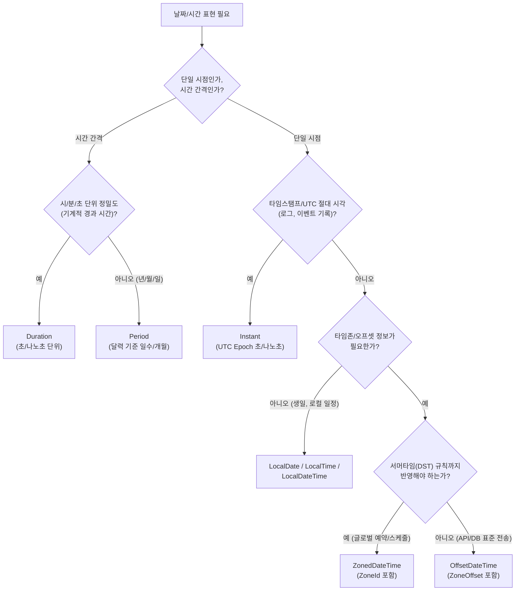
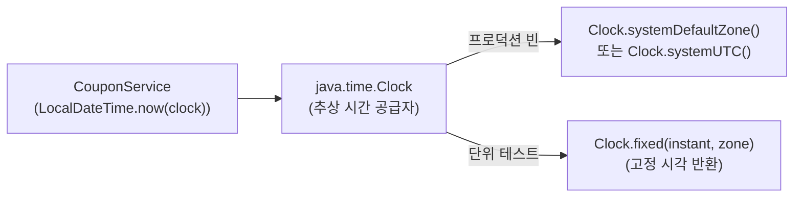

> 기존 `java.util.Date`와 `Calendar`가 가진 구조적 결함을 해결하기 위해 Java 8에 도입된 JSR-310(`java.time`)의 불변 설계 원칙을 살펴보고, 타입 선택 기준과 `Clock` 빈 주입을 활용한 결정론적 테스트 전략을 정리합니다.

## 기존 `Date`·`Calendar`·`SimpleDateFormat`의 한계

Java 8 이전의 날짜·시간 API는 실무에서 버그를 유발하는 대표적인 원인이었습니다. 대표적인 문제는 네 가지로 요약할 수 있습니다.

1. **가변성(Mutability)**: `Date`와 `Calendar`는 내부 상태를 변경할 수 있는 가변 객체입니다. 엔티티나 DTO에서 `Date` 필드를 그대로 반환하면 호출자가 `setTime()`으로 값을 변조할 수 있어 매번 방어적 복사가 필요했습니다.
2. **직관적이지 않은 API 설계**: `Calendar.JANUARY`가 `0`부터 시작하는 0-based 월 체계 때문에 `new GregorianCalendar(2026, 11, 8)`은 11월이 아니라 12월을 의미합니다. `Date`는 클래스 이름과 달리 실제로는 타임존 정보 없는 Epoch 밀리초 래퍼입니다.
3. **스레드 비안전성(Thread-Unsafe)**: `SimpleDateFormat`은 내부적으로 가변 `Calendar` 필드를 공유합니다. 성능 때문에 `static final` 상수로 선언해 여러 스레드에서 동시에 `parse()`나 `format()`을 호출하면 전혀 엉뚱한 날짜가 반환되거나 `NumberFormatException`이 발생합니다.
4. **타임존과 서머타임(DST) 처리의 혼란**: 윤년, 오프셋 변경, 서머타임 전환 같은 복잡한 달력 규칙을 안전하게 다루기 어려웠습니다.

이 문제를 해결하기 위해 Joda-Time의 설계자인 Stephen Colebourne이 주도하여 만든 표준 스펙이 바로 **JSR-310(`java.time`)**입니다.

---

## JSR-310의 핵심 설계 원칙: 불변 값 객체와 역할 분리

JSR-310은 모든 핵심 날짜·시간 클래스를 **불변(Immutable) 값 객체**로 설계했습니다. `plusDays(1)`이나 `withHour(0)` 같은 연산을 호출해도 기존 객체는 변하지 않고 항상 새 인스턴스를 반환합니다. 덕분에 멀티스레드 환경에서 동기화 없이 안전하게 공유할 수 있으며, `DateTimeFormatter` 역시 완전한 Thread-Safe 객체로 상수 재사용이 가능합니다.

또한 JSR-310은 **기계 시간(Machine Time)**과 **사람 시간(Human Time)**, 그리고 **시간 간격(Duration/Period)**을 명확히 분리합니다.



### 주요 타입 선택 가이드

| 타입 | 포함 정보 | 주요 용도 및 실무 권장 사례 |
| :--- | :--- | :--- |
| **`Instant`** | UTC 기준 Epoch 초·나노초 | 감사 로그(`createdAt`), 이벤트 발생 시각, 시스템 간 타임스탬프 비교 |
| **`LocalDateTime`** | 날짜 + 시각 (타임존 없음) | 타임존이 고정된 단일 리전 서비스, 생일·기념일 등 지역 무관 일정 |
| **`OffsetDateTime`** | 날짜 + 시각 + UTC 오프셋(`+09:00`) | REST API JSON 직렬화(ISO-8601), PostgreSQL `TIMESTAMPTZ` 매핑 |
| **`ZonedDateTime`** | 날짜 + 시각 + `ZoneId`(`Asia/Seoul`) | 서머타임이 존재하는 글로벌 사용자의 예약·반복 알람 계산 |
| **`Duration`** | 초·나노초 기반 시간 양 | API 타임아웃, 캐시 TTL, 배치 실행 소요 시간 측정 |
| **`Period`** | 년·월·일 기반 달력 간격 | 구독 만료일(`+1개월`), 나이 계산, 휴가 일수 계산 |

> 글로벌 서비스를 고려한다면 데이터베이스의 생성·수정 시각은 `Instant` 또는 `OffsetDateTime`으로 저장하고, 사용자에게 보여줄 때만 해당 사용자의 `ZoneId`로 변환(`atZone(zoneId)`)하는 방식이 안전합니다.
{: .prompt-tip }

---

## `Clock` 빈 주입을 활용한 결정론적 단위 테스트 전략

실무에서 `java.time`을 쓸 때 가장 흔히 저지르는 실수는 도메인 로직 내부에서 `LocalDateTime.now()`를 직접 호출하는 것입니다. 현재 시각은 테스트를 실행할 때마다 매번 달라지므로, **쿠폰 만료 경계값(만료 1초 전 vs 만료 직후)**이나 **자정 기준 일일 정산 로직**을 안정적으로 검증하기 어렵습니다.

JSR-310은 이 문제를 해결하기 위해 시간의 원천을 추상화한 **`java.time.Clock`** 클래스를 표준으로 제공합니다.



### 1. Spring 환경에서 `Clock` 빈 등록

애플리케이션 설정 클래스에 기본 `Clock` 빈을 등록해 두고, 시간이 필요한 서비스나 도메인 컴포넌트에 생성자 주입으로 전달합니다.

```java
// src/main/java/com/example/time/config/TimeConfig.java
package com.example.time.config;

import java.time.Clock;
import java.time.ZoneId;
import org.springframework.context.annotation.Bean;
import org.springframework.context.annotation.Configuration;

@Configuration
public class TimeConfig {

    @Bean
    public Clock clock() {
        return Clock.system(ZoneId.of("Asia/Seoul"));
    }
}
```

### 2. `Clock`을 주입받는 비즈니스 로직 구현

`LocalDateTime.now()` 대신 반드시 `LocalDateTime.now(clock)`을 호출합니다.

```java
// src/main/java/com/example/time/service/CouponService.java
package com.example.time.service;

import java.time.Clock;
import java.time.LocalDateTime;
import org.springframework.stereotype.Service;

@Service
public class CouponService {

    private final Clock clock;

    public CouponService(Clock clock) {
        this.clock = clock;
    }

    public boolean isUsable(LocalDateTime expiredAt) {
        LocalDateTime now = LocalDateTime.now(clock);
        return !now.isAfter(expiredAt);
    }
}
```

### 3. `Clock.fixed()`를 활용한 JUnit 5 경계값 단위 테스트

테스트 코드에서는 Spring 컨텍스트를 띄울 필요조차 없이 `Clock.fixed(...)`로 원하는 시각을 정확히 고정해 경계 조건을 검증할 수 있습니다.

```java
// src/test/java/com/example/time/service/CouponServiceTest.java
package com.example.time.service;

import static org.assertj.core.api.Assertions.assertThat;

import java.time.Clock;
import java.time.Instant;
import java.time.LocalDateTime;
import java.time.ZoneId;
import org.junit.jupiter.api.DisplayName;
import org.junit.jupiter.api.Test;

class CouponServiceTest {

    private static final ZoneId SEOUL = ZoneId.of("Asia/Seoul");

    @Test
    @DisplayName("만료 시각과 정확히 일치하는 시점에는 쿠폰을 사용할 수 있다")
    void usableAtExactExpirationTime() {
        // 2026-11-08 23:59:59 KST (UTC+9 -> 14:59:59Z)
        Clock fixedClock = Clock.fixed(Instant.parse("2026-11-08T14:59:59Z"), SEOUL);
        CouponService couponService = new CouponService(fixedClock);
        LocalDateTime expiredAt = LocalDateTime.of(2026, 11, 8, 23, 59, 59);

        assertThat(couponService.isUsable(expiredAt)).isTrue();
    }

    @Test
    @DisplayName("만료 시각이 1초라도 지나면 쿠폰을 사용할 수 없다")
    void expiredOneSecondAfterExpirationTime() {
        // 2026-11-09 00:00:00 KST (UTC+9 -> 15:00:00Z)
        Clock fixedClock = Clock.fixed(Instant.parse("2026-11-08T15:00:00Z"), SEOUL);
        CouponService couponService = new CouponService(fixedClock);
        LocalDateTime expiredAt = LocalDateTime.of(2026, 11, 8, 23, 59, 59);

        assertThat(couponService.isUsable(expiredAt)).isFalse();
    }
}
```

시간의 경과를 테스트해야 한다면 `Clock.offset(fixedClock, Duration.ofHours(1))`를 사용해 기준 시각에서 특정 시간만큼 흐른 뒤의 상태를 깔끔하게 시뮬레이션할 수도 있습니다.

---

## 정리

JSR-310(`java.time`)은 단순히 편리한 날짜 유틸리티가 아니라, **불변성**, **타입 시스템을 통한 타임존 의도 표현**, 그리고 **`Clock`을 통한 테스트 가능성**을 모두 갖춘 표준 설계입니다. 실무에서 `LocalDateTime.now()` 호출을 습관적으로 작성하기 전에, 이 값이 타임존이 필요한지(`Instant`/`OffsetDateTime`/`ZonedDateTime`)와 `Clock` 주입으로 테스트 가능하게 분리할 수 있는지 한 번 더 점검하는 습관이 버그를 크게 줄여 줍니다.
