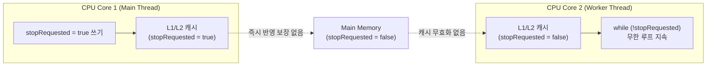
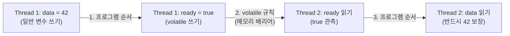

> 멀티스레드 환경에서 CPU 캐시와 명령어 재배치로 인해 발생하는 가시성(Visibility) 버그의 원인을 살펴보고, 이를 해결하는 JSR-133 Java Memory Model(JMM)의 `happens-before` 규칙과 `volatile`·`synchronized`·`final`의 메모리 보장 원리를 정리합니다.

## 멀티스레드 환경에서 발생하는 가시성 버그

아래 코드를 실행하면 1초 뒤에 `worker` 스레드가 종료될 것처럼 보입니다. 하지만 실제 JVM(특히 서버 모드 JIT 컴파일러 환경)에서 실행해 보면 프로그램이 끝나지 않고 무한 루프에 빠지는 현상을 겪게 됩니다.

```java
// src/main/java/com/example/jmm/VisibilityBugExample.java
package com.example.jmm;

public class VisibilityBugExample {

    private static boolean stopRequested = false;

    public static void main(String[] args) throws InterruptedException {
        Thread worker = new Thread(() -> {
            long count = 0;
            while (!stopRequested) {
                count++;
            }
            System.out.println("작업 종료: " + count);
        });

        worker.start();
        Thread.sleep(1000);
        stopRequested = true; // 메인 스레드가 값을 변경했지만 worker가 보지 못함
        System.out.println("중단 요청 완료");
    }
}
```

이 버그가 발생하는 원인은 크게 두 가지입니다.

1. **CPU 코어별 L1/L2 캐시 불일치**: 현대 멀티코어 CPU는 메인 메모리(RAM) 접근 비용을 줄이기 위해 각 코어 내부의 L1/L2 캐시에 값을 보관합니다. 메인 스레드가 `stopRequested = true`를 기록해도 그 값이 즉시 메인 메모리로 플러시되거나 다른 코어의 캐시에 반영된다는 보장이 없습니다.
2. **JIT 컴파일러 및 CPU 명령어 재배치(Reordering)**: `worker` 스레드 내부에서는 `stopRequested`를 수정하는 코드가 없으므로, JIT 컴파일러는 `while (!stopRequested)`를 `if (!stopRequested) { while (true) { count++; } }` 형태로 끌어올리는(Hoisting) 최적화를 수행할 수 있습니다.



---

## JSR-133 (Java Memory Model)과 `happens-before` 규칙

Java 1.0 시절의 초기 메모리 모델은 `volatile`과 `final`의 보장이 불완전했고, Double-Checked Locking 같은 관용 패턴조차 깨지는 결함이 있었습니다. 이를 전면 개정한 스펙이 Java 5에 도입된 **JSR-133(Java Memory Model and Thread Specification Revision)**입니다.

JSR-133의 핵심은 개발자가 CPU 아키텍처별 캐시 일관성 프로토콜을 직접 신경 쓰지 않고도 추론할 수 있도록 **메모리 가시성과 실행 순서를 보장하는 계약인 `happens-before` 관계**를 정의한 것입니다.

> 동작 A가 동작 B보다 `happens-before` 관계에 있다면, **A에서 수행한 모든 메모리 쓰기 결과는 B를 실행하는 스레드에게 반드시 가시적(Visible)**이며, A의 효과가 B보다 먼저 일어난 것처럼 관측됩니다.
{: .prompt-info }

### 주요 `happens-before` 6가지 규칙

1. **프로그램 순서 규칙 (Program Order Rule)**: 단일 스레드 내에서 코드 상 앞에 있는 동작은 뒤에 있는 동작보다 `happens-before`입니다. (단, 결과에 영향이 없는 범위 내에서 재배치는 허용)
2. **모니터 락 규칙 (Monitor Lock Rule)**: 어떤 락에 대한 `unlock`(`synchronized` 블록 종료)은 이후 동일한 락에 대한 `lock`(`synchronized` 블록 진입)보다 `happens-before`입니다.
3. **`volatile` 변수 규칙**: `volatile` 필드에 대한 쓰기(Write)는 이후 동일한 `volatile` 필드에 대한 모든 읽기(Read)보다 `happens-before`입니다.
4. **스레드 시작 규칙**: `thread.start()` 호출은 새로 시작된 스레드 내부의 모든 동작보다 `happens-before`입니다.
5. **스레드 종료 규칙**: 스레드 내부의 모든 동작은 다른 스레드가 `thread.join()`에서 정상 반환되는 시점보다 `happens-before`입니다.
6. **전이성 (Transitivity)**: A가 B보다 `happens-before`이고, B가 C보다 `happens-before`이면, A는 C보다 `happens-before`입니다.



위 다이어그램에서 `data`는 `volatile`이 아니지만, 전이성 덕분에 `data = 42`가 `ready = true`보다 먼저 실행되고 `ready`의 쓰기-읽기 사이에 `happens-before`가 성립하므로, Thread 2는 `data`가 반드시 `42`임을 보장받습니다.

---

## `volatile` vs `synchronized` vs `Atomic*` 비교

앞선 예제의 `stopRequested`에 `volatile` 키워드를 붙이면 가시성 문제는 즉시 해결됩니다. 하지만 `volatile`이 모든 동시성 문제를 해결해 주지는 않습니다.

| 구분 | 가시성 보장 | 명령어 재배치 방지 | 복합 연산 원자성(Atomicity) | 주요 용도 |
| :--- | :---: | :---: | :---: | :--- |
| **`volatile`** | O | O | **X** | 상태 플래그, 단일 쓰기·다중 읽기 참조 발행 |
| **`synchronized`** | O | O | **O** | 여러 변수를 함께 갱신하는 임계 영역 보호 |
| **`AtomicInteger` 등** | O | O | **O** (CAS 기반) | 락 없는(Lock-free) 카운터, 상태 전이 |

`volatile int count = 0;`에 대해 여러 스레드가 `count++`를 실행하면 여전히 값이 유실됩니다. `count++`는 **읽기(Read) → 증가(Modify) → 쓰기(Write)**의 3단계 복합 연산이기 때문입니다. 이처럼 읽기-수정-쓰기가 원자적이어야 할 때는 `AtomicInteger.incrementAndGet()`이나 `synchronized`를 사용해야 합니다.

---

## `final` 필드의 안전 공개와 Double-Checked Locking

JSR-133에서 실무적으로 매우 중요한 두 가지 보장을 더 살펴보겠습니다.

### 1. `final` 필드의 안전 공개(Safe Publication)

JSR-133은 생성자가 정상적으로 완료된 객체의 `final` 필드에 대해 **Freeze 시맨틱**을 보장합니다. 생성자 내부에서 `this` 참조가 외부로 유출되지 않는 한, 다른 스레드가 해당 객체의 참조를 동기화 없이 읽더라도 `final` 필드가 초기화된 값을 반드시 올바르게 관측합니다. 불변 객체(Immutable Object)가 멀티스레드 환경에서 안전한 핵심 근거입니다.

### 2. Double-Checked Locking (DCL) 패턴과 `volatile`

지연 초기화 싱글톤을 구현할 때 자주 쓰이는 DCL 패턴에서도 `volatile`은 필수입니다.

```java
// src/main/java/com/example/jmm/LazySingleton.java
package com.example.jmm;

public class LazySingleton {

    // volatile이 없으면 명령어 재배치로 인해 초기화가 끝나지 않은 객체가 노출될 수 있음
    private static volatile LazySingleton instance;

    private final String configValue;

    private LazySingleton() {
        this.configValue = "loaded-config";
    }

    public static LazySingleton getInstance() {
        LazySingleton localRef = instance; // volatile 읽기 횟수 최소화
        if (localRef == null) {
            synchronized (LazySingleton.class) {
                localRef = instance;
                if (localRef == null) {
                    localRef = new LazySingleton();
                    instance = localRef;
                }
            }
        }
        return localRef;
    }

    public String getConfigValue() {
        return configValue;
    }
}
```

`instance = new LazySingleton();`은 바이트코드/기계어 수준에서 **(1) 메모리 할당 → (2) 생성자 실행 → (3) `instance` 변수에 참조 대입**의 3단계로 실행됩니다. 만약 `instance`에 `volatile`이 없다면 컴파일러나 CPU가 (2)와 (3)을 재배치할 수 있고, 그 순간 다른 스레드가 첫 번째 `if (localRef == null)`을 통과해 아직 생성자가 끝나지 않은 불완전한 객체를 참조하는 치명적인 버그가 발생합니다. `volatile`은 메모리 배리어(Memory Barrier)를 삽입해 이 재배치를 차단합니다.

> 단순한 지연 초기화 싱글톤이 목적이라면 DCL 대신 JVM 클래스 로딩 시점의 동시성 보장을 활용하는 `private static class Holder` 패턴(Initialization-on-demand holder)을 사용하는 편이 더 간결하고 안전합니다.
{: .prompt-tip }

---

## 정리

JSR-133(Java Memory Model)은 멀티코어 CPU와 컴파일러 최적화 사이에서 멀티스레드 프로그램이 예측 가능하게 동작하도록 정의한 표준 계약입니다. 실무에서 동시성 코드를 작성할 때는 "단순히 락을 걸었는가"보다 **두 스레드 사이에 명확한 `happens-before` 경로가 존재하는지**, 그리고 상태 공유가 불가피하다면 `final` 불변 객체나 `Atomic*`·`volatile` 중 어떤 도구가 알맞은지 구분하는 것이 중요합니다.
