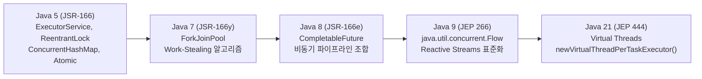
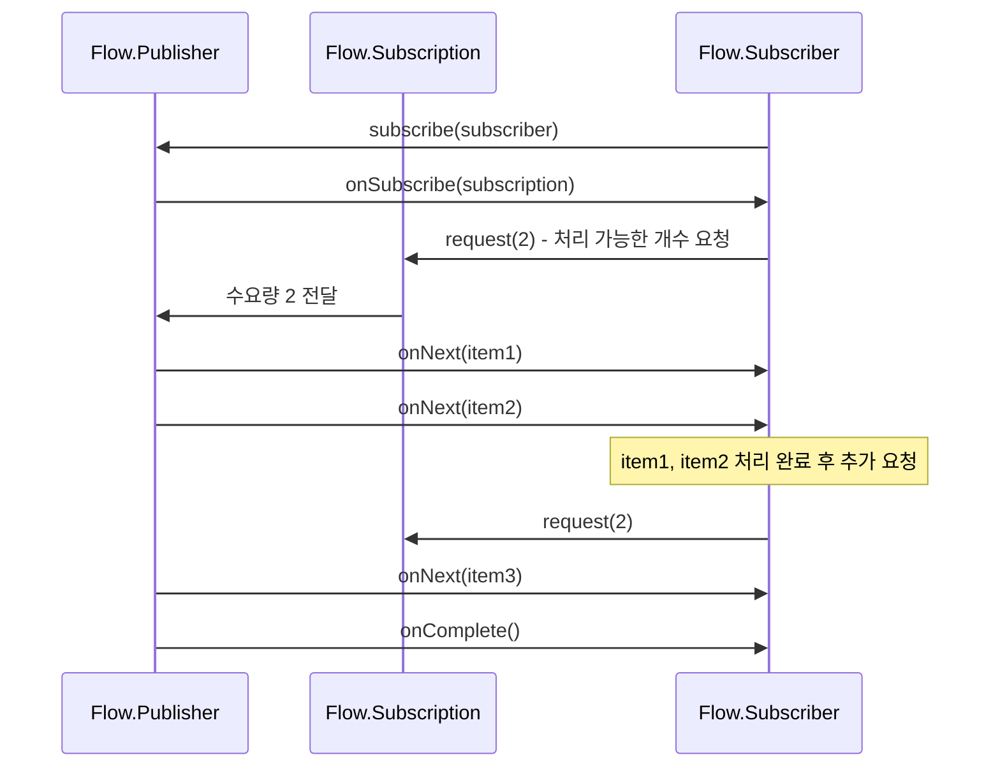

> 자바 동시성 프로그래밍의 실질적 표준인 **JSR-166(`java.util.concurrent`)**이 Java 5부터 Java 21 Virtual Threads까지 어떻게 진화해 왔는지 살펴보고, `CompletableFuture` 비동기 조합과 Java 9 `Flow` API의 배압(Backpressure) 구조를 실무 관점에서 정리합니다.

지난 9편에서 다룬 JSR-133(Java Memory Model)이 멀티스레드 환경의 **가시성과 실행 순서에 대한 저수준 규칙**이었다면, **JSR-166**은 그 규칙 위에 올라가는 **고수준 동시성 표준 라이브러리(`java.util.concurrent`)**입니다. Doug Lea가 주도한 JSR-166은 Java 5에서 처음 도입된 이후, 단일 스펙에 머무르지 않고 JSR-166y, JSR-166e, JEP 266 등을 거치며 현대 자바 동시성 모델의 근간을 이루고 있습니다.

---

## JSR-166의 진화 흐름: Java 5에서 Java 21까지

초기 자바에서 멀티스레드 코드를 작성하려면 `Thread`를 직접 생성하고 `synchronized`, `wait()`, `notify()`를 조합해야 했습니다. 이 방식은 스레드 생성 비용이 크고, 데드락이나 스레드 기아(Starvation) 같은 버그를 피하기 어려웠습니다. JSR-166은 **작업(Task)의 정의와 실행(Execution)의 분리**를 핵심 철학으로 삼아, 자바 버전이 올라갈 때마다 동시성 패러다임을 단계적으로 확장해 왔습니다.



각 세대별 핵심 구성 요소와 실무적 의미는 다음과 같습니다.

| 버전 | 스펙 / JEP | 핵심 API | 실무적 의의 |
| :--- | :--- | :--- | :--- |
| **Java 5** | JSR-166 | `ExecutorService`, `ConcurrentHashMap`, `ReentrantLock`, `BlockingQueue` | 스레드 풀 관리 표준화 및 Lock-Free / 세분화된 락 기반 자료구조 제공 |
| **Java 7** | JSR-166y | `ForkJoinPool`, `RecursiveTask` | CPU 집약적 작업을 분할 정복하고 유휴 스레드가 작업을 훔쳐오는 Work-Stealing 도입 |
| **Java 8** | JSR-166e | `CompletableFuture`, `StampedLock` | 콜백 지옥 없이 논블로킹 비동기 작업을 선언적으로 조합(`thenApply`, `thenCombine`) |
| **Java 9** | JEP 266 | `java.util.concurrent.Flow` | Reactive Streams 명세를 JDK 표준 인터페이스로 편입하여 배압(Backpressure) 프로토콜 통일 |
| **Java 21** | JEP 444 | `Executors.newVirtualThreadPerTaskExecutor()` | 기존 `ExecutorService` 추상화를 유지한 채 경량 가상 스레드로 I/O 동시성 확장 |

> Java 21의 Virtual Threads가 기존 생태계에 자연스럽게 녹아들 수 있었던 이유는, Java 5에서 설계된 `ExecutorService`라는 추상화 계층이 작업 제출과 스레드 구현을 깔끔하게 분리해 두었기 때문입니다.
{: .prompt-info }

---

## CompletableFuture를 활용한 실무 비동기 조합

Java 5의 `Future`는 결과를 얻기 위해 `get()`을 호출하면 스레드가 블로킹되고, 여러 비동기 작업을 연결하거나 예외를 우아하게 처리하기 어려웠습니다. Java 8에서 추가된 `CompletableFuture`는 `Future`와 `CompletionStage`를 함께 구현하여 비동기 파이프라인을 구성할 수 있게 해줍니다.

실무에서 주문 상세 화면을 구성할 때 **상품 정보 조회**, **재고 조회**, **회원 등급 조회**를 병렬로 호출하고 결과를 조합하는 예제는 다음과 같습니다.

```java
// src/main/java/com/example/order/OrderAggregationService.java
package com.example.order;

import java.util.concurrent.CompletableFuture;
import java.util.concurrent.ExecutorService;
import java.util.concurrent.Executors;
import java.util.concurrent.TimeUnit;

public class OrderAggregationService implements AutoCloseable {

    // I/O 바운드 작업은 ForkJoinPool.commonPool() 대신 전용 Executor를 분리합니다.
    // Java 21+ 환경에서는 Virtual Thread Executor를 그대로 교체 적용할 수 있습니다.
    private final ExecutorService ioExecutor = Executors.newVirtualThreadPerTaskExecutor();

    public OrderSummary loadOrderSummary(String userId, String productId) {
        CompletableFuture<ProductInfo> productFuture = CompletableFuture
                .supplyAsync(() -> fetchProduct(productId), ioExecutor)
                .orTimeout(2, TimeUnit.SECONDS);

        CompletableFuture<Integer> stockFuture = CompletableFuture
                .supplyAsync(() -> fetchStock(productId), ioExecutor)
                .orTimeout(2, TimeUnit.SECONDS)
                .exceptionally(ex -> 0); // 재고 조회 실패 시 안전한 기본값으로 폴백

        CompletableFuture<String> gradeFuture = CompletableFuture
                .supplyAsync(() -> fetchMemberGrade(userId), ioExecutor)
                .orTimeout(2, TimeUnit.SECONDS)
                .exceptionally(ex -> "STANDARD");

        return productFuture
                .thenCombine(stockFuture, (product, stock) -> new PartialOrder(product, stock))
                .thenCombine(gradeFuture, (partial, grade) ->
                        new OrderSummary(partial.product().name(), partial.stock(), grade))
                .join();
    }

    private ProductInfo fetchProduct(String productId) {
        return new ProductInfo(productId, "Mechanical Keyboard");
    }

    private int fetchStock(String productId) {
        return 42;
    }

    private String fetchMemberGrade(String userId) {
        return "VIP";
    }

    @Override
    public void close() {
        ioExecutor.close();
    }

    public record ProductInfo(String id, String name) {}
    private record PartialOrder(ProductInfo product, int stock) {}
    public record OrderSummary(String productName, int availableStock, String memberGrade) {}
}
```

### 실무에서 주의할 점

- **공용 풀(`ForkJoinPool.commonPool()`) 격리**: `supplyAsync(supplier)`처럼 `Executor`를 생략하면 CPU 코어 수 기반의 `commonPool`을 사용합니다. 여기에 외부 HTTP 호출이나 DB 조회 같은 블로킹 I/O를 넣으면 애플리케이션 전체의 병렬 스트림과 비동기 작업이 함께 지연됩니다. 반드시 전용 `ExecutorService`를 전달해야 합니다.
- **타임아웃 명시**: Java 9에서 추가된 `orTimeout()`이나 `completeOnTimeout()`을 지정하지 않으면 외부 장애 시 스레드와 메모리가 무한 대기 상태에 빠질 수 있습니다.

---

## Java 9 Flow API와 Reactive Streams 배압(Backpressure) 구조

비동기 스트림 환경에서 생산자(Publisher)가 소비자(Subscriber)의 처리 속도보다 빠르게 데이터를 밀어 넣으면 메모리 고갈(OOM)이 발생합니다. 이를 해결하기 위해 등장한 **Reactive Streams** 명세가 Java 9(JEP 266)에서 `java.util.concurrent.Flow` 클래스 내부의 4가지 표준 인터페이스로 편입되었습니다.

- `Flow.Publisher<T>`: 데이터를 발행하는 생산자
- `Flow.Subscriber<T>`: 데이터를 수신하는 소비자
- `Flow.Subscription`: 생산자와 소비자 사이의 연결 고리이자, **소비자가 처리 가능한 개수(`request(n)`)를 요청하는 배압 제어 채널**
- `Flow.Processor<T, R>`: `Subscriber`와 `Publisher`를 동시에 구현하는 중간 변환기

핵심은 **Push-Pull 하이브리드 모델**입니다. 생산자가 데이터를 일방적으로 밀어 넣는 대신, 소비자가 `Subscription.request(n)`으로 요청한 개수만큼만 발행합니다.



실제 프로젝트에서는 `Flow` 인터페이스를 직접 구현하기보다 **Project Reactor(Spring WebFlux)**, **RxJava**, **Mutiny** 같은 구현체를 사용합니다. JDK가 제공하는 `SubmissionPublisher`를 활용하면 간단한 테스트나 내부 이벤트 파이프라인을 별도 라이브러리 없이 구현할 수 있습니다.

```java
// src/main/java/com/example/flow/BackpressureDemo.java
package com.example.flow;

import java.util.concurrent.Flow;
import java.util.concurrent.SubmissionPublisher;

public class BackpressureDemo {

    public static void main(String[] args) throws InterruptedException {
        try (SubmissionPublisher<String> publisher = new SubmissionPublisher<>()) {
            publisher.subscribe(new BoundedSubscriber(2));

            for (int i = 1; i <= 5; i++) {
                publisher.submit("event-" + i);
            }
        }
        Thread.sleep(200);
    }

    static class BoundedSubscriber implements Flow.Subscriber<String> {
        private final int batchSize;
        private Flow.Subscription subscription;
        private int processedInBatch = 0;

        BoundedSubscriber(int batchSize) {
            this.batchSize = batchSize;
        }

        @Override
        public void onSubscribe(Flow.Subscription subscription) {
            this.subscription = subscription;
            // 초기 수요량만큼만 요청합니다.
            this.subscription.request(batchSize);
        }

        @Override
        public void onNext(String item) {
            System.out.println("수신 처리: " + item);
            processedInBatch++;
            if (processedInBatch == batchSize) {
                processedInBatch = 0;
                subscription.request(batchSize); // 배치 처리 완료 후 다음 배치 요청
            }
        }

        @Override
        public void onError(Throwable throwable) {
            throwable.printStackTrace();
        }

        @Override
        public void onComplete() {
            System.out.println("스트림 수신 완료");
        }
    }
}
```

> Project Reactor 3.x와 Spring WebFlux는 `org.reactivestreams.*` 인터페이스를 기반으로 하지만, `JdkFlowAdapter`를 통해 `java.util.concurrent.Flow`와 1:1 상호 변환을 지원합니다. Java 11의 `java.net.http.HttpClient` 역시 요청/응답 본문 스트리밍에 `Flow.Publisher`와 `Flow.Subscriber`를 표준으로 채택했습니다.
{: .prompt-tip }

---

## 정리

JSR-166은 단순히 몇 개의 유틸리티 클래스를 추가한 스펙이 아닙니다. `ExecutorService`로 실행 모델을 추상화하고, `ForkJoinPool`과 `CompletableFuture`로 병렬·비동기 조합을 정립했으며, `Flow` API로 리액티브 배압의 표준 계약을 마련했습니다. 덕분에 Java 21의 Virtual Threads 시대에도 기존 `java.util.concurrent` API를 그대로 유지하면서 동시성 처리량을 끌어올릴 수 있게 되었습니다.

다음 편에서는 컴파일 타임에 어노테이션을 해석해 코드를 생성하는 표준 스펙인 **JSR-269(Pluggable Annotation Processing API)**와 MapStruct·Lombok의 내부 동작 차이를 살펴봅니다.

---

### 시리즈 네비게이션

- **이전 글**: [9편. JSR-133 (Java Memory Model): 가시성과 Happens-Before 규칙](/posts/jsr-133-java-memory-model-happens-before/)
- **다음 글**: [11편. JSR-269 (Annotation Processing): 컴파일 타임 코드 생성 표준과 Lombok·MapStruct 원리](/posts/jsr-269-pluggable-annotation-processing/)
