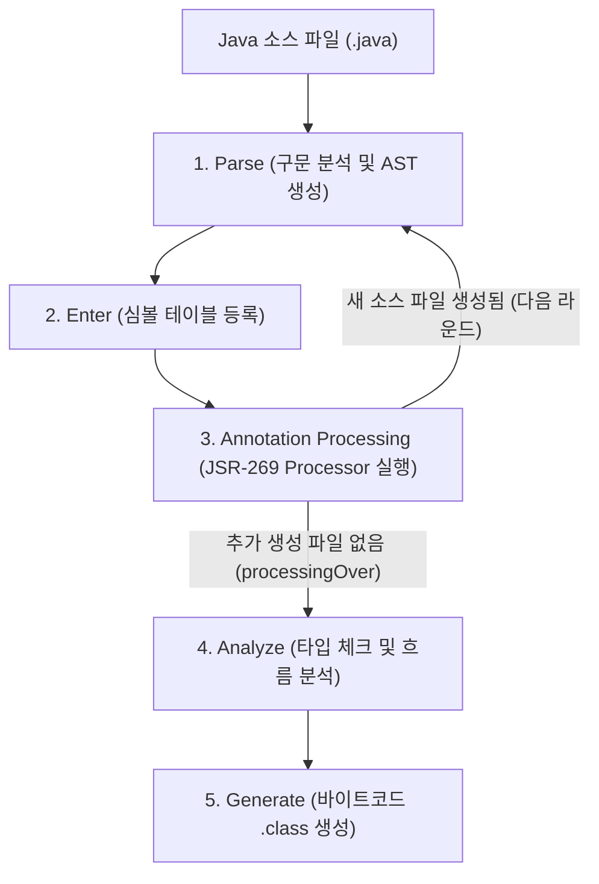
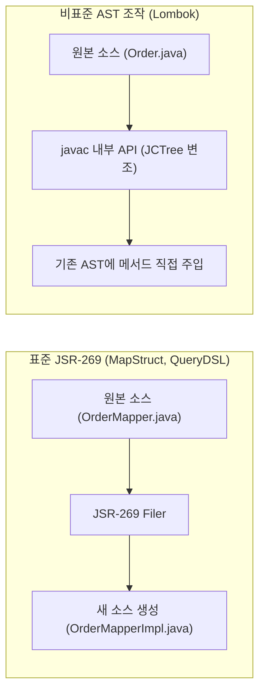

> 자바 컴파일러(`javac`)에 플러그인 형태로 참여해 컴파일 타임에 소스코드를 생성하는 표준 스펙 **JSR-269(Pluggable Annotation Processing API)**의 동작 라운드를 살펴보고, MapStruct·QueryDSL의 표준 방식과 Lombok의 비표준 AST 조작 방식의 차이를 정리합니다.

실무에서 Spring Boot 프로젝트를 구성하다 보면 **Lombok**, **MapStruct**, **QueryDSL** 같은 라이브러리를 자연스럽게 사용합니다. 이들은 모두 런타임 리플렉션 비용 없이 컴파일 시점에 보일러플레이트 코드를 없애 준다는 공통점이 있습니다. 하지만 내부를 들여다보면 **JSR-269 표준을 그대로 따르는 도구**와 **컴파일러 내부 구현을 직접 건드리는 도구**로 명확히 나뉩니다.

---

## JSR-269와 javac 컴파일 라운드 구조

Java 6에서 표준으로 편입된 **JSR-269**는 크게 두 가지 패키지로 구성됩니다.

- `javax.annotation.processing`: 프로세서 생명주기(`Processor`, `AbstractProcessor`), 라운드 정보(`RoundEnvironment`), 파일 생성 도구(`Filer`), 컴파일 메시지 출력(`Messager`)
- `javax.lang.model`: 소스코드의 클래스, 메서드, 필드를 읽기 전용으로 탐색하기 위한 타입 모델(`Elements`, `Types`, `Element`)

중요한 점은 `javac`가 Annotation Processor를 **단 한 번만 호출하는 것이 아니라 라운드(Round) 단위로 반복 실행**한다는 것입니다. 어떤 프로세서가 새로운 `.java` 파일을 생성하면, `javac`는 생성된 파일까지 다시 파싱한 뒤 다음 라운드를 수행합니다.



이 구조 덕분에 한 프로세서가 생성한 코드에 붙은 어노테이션을 다른 프로세서가 다음 라운드에서 이어받아 처리할 수도 있습니다.

> JSR-269 표준 API는 기존 소스코드를 **읽기 전용(Read-Only)**으로만 탐색하고, 새로운 파일(`Filer.createSourceFile`)을 생성하는 것만 허용합니다. 기존 클래스의 AST를 직접 수정하는 API는 표준에 존재하지 않습니다.
{: .prompt-info }

---

## 커스텀 Annotation Processor 구현 예제

JSR-269의 동작 원리를 체감하기 위해, 특정 어노테이션이 붙은 클래스에 대해 간단한 메타데이터 헬퍼 클래스를 생성하는 최소한의 프로세서를 작성해 보겠습니다.

### Step 1. 어노테이션 정의

컴파일 타임에만 필요하므로 `@Retention(RetentionPolicy.SOURCE)`로 지정합니다.

```java
// processor/src/main/java/com/example/apt/GenerateMetadata.java
package com.example.apt;

import java.lang.annotation.ElementType;
import java.lang.annotation.Retention;
import java.lang.annotation.RetentionPolicy;
import java.lang.annotation.Target;

@Target(ElementType.TYPE)
@Retention(RetentionPolicy.SOURCE)
public @interface GenerateMetadata {
}
```

### Step 2. AbstractProcessor 구현

`AbstractProcessor`를 상속받고, `RoundEnvironment`에서 대상 요소를 조회한 뒤 `Filer`로 새 자바 소스 파일을 생성합니다.

```java
// processor/src/main/java/com/example/apt/MetadataProcessor.java
package com.example.apt;

import java.io.IOException;
import java.io.Writer;
import java.util.Set;
import javax.annotation.processing.AbstractProcessor;
import javax.annotation.processing.Filer;
import javax.annotation.processing.Messager;
import javax.annotation.processing.RoundEnvironment;
import javax.annotation.processing.SupportedAnnotationTypes;
import javax.annotation.processing.SupportedSourceVersion;
import javax.lang.model.SourceVersion;
import javax.lang.model.element.Element;
import javax.lang.model.element.ElementKind;
import javax.lang.model.element.TypeElement;
import javax.tools.Diagnostic;
import javax.tools.JavaFileObject;

@SupportedAnnotationTypes("com.example.apt.GenerateMetadata")
@SupportedSourceVersion(SourceVersion.RELEASE_21)
public class MetadataProcessor extends AbstractProcessor {

    @Override
    public boolean process(Set<? extends TypeElement> annotations, RoundEnvironment roundEnv) {
        Filer filer = processingEnv.getFiler();
        Messager messager = processingEnv.getMessager();

        for (Element element : roundEnv.getElementsAnnotatedWith(GenerateMetadata.class)) {
            if (element.getKind() != ElementKind.CLASS) {
                messager.printMessage(
                        Diagnostic.Kind.ERROR,
                        "@GenerateMetadata는 클래스에만 선언할 수 있습니다.",
                        element
                );
                continue;
            }

            TypeElement typeElement = (TypeElement) element;
            String packageName = processingEnv.getElementUtils()
                    .getPackageOf(typeElement)
                    .getQualifiedName()
                    .toString();
            String className = typeElement.getSimpleName().toString();
            String generatedClassName = className + "Metadata";

            try {
                JavaFileObject file = filer.createSourceFile(packageName + "." + generatedClassName, typeElement);
                try (Writer writer = file.openWriter()) {
                    writer.write("package " + packageName + ";\n\n");
                    writer.write("public final class " + generatedClassName + " {\n");
                    writer.write("    public static final String TARGET = \"" + className + "\";\n");
                    writer.write("}\n");
                }
            } catch (IOException e) {
                messager.printMessage(Diagnostic.Kind.ERROR, "코드 생성 실패: " + e.getMessage(), element);
            }
        }
        return true;
    }
}
```

### Step 3. SPI 등록 및 Gradle 설정

`javac`가 프로세서를 자동으로 탐색하려면 Java SPI(Service Provider Interface) 규칙에 따라 아래 파일을 리소스 경로에 등록해야 합니다. (실무에서는 Google의 `@AutoService(Processor.class)`를 사용해 이 파일을 자동 생성하기도 합니다.)

```text
// processor/src/main/resources/META-INF/services/javax.annotation.processing.Processor
com.example.apt.MetadataProcessor
```

사용 측 모듈의 `build.gradle.kts`에서는 `annotationProcessor` 구성으로 프로세서를 연결합니다.

```kotlin
// app/build.gradle.kts
dependencies {
    compileOnly(project(":processor"))
    annotationProcessor(project(":processor"))
}
```

---

## 표준 방식(MapStruct·QueryDSL) vs 비표준 방식(Lombok)

JSR-269는 "기존 클래스를 수정하지 말고 새 클래스를 생성하라"는 원칙을 가집니다. **MapStruct**(`OrderMapperImpl.java` 생성)와 **QueryDSL**(`QOrder.java` 생성)은 이 원칙을 충실히 따릅니다.

반면 **Lombok**은 `@Getter`, `@Builder`를 붙인 **기존 클래스 자체에 메서드를 추가**해야 하므로 JSR-269 표준 API만으로는 구현할 수 없습니다. 그래서 Lombok은 JSR-269 진입점(`Processor.process`)을 통해 컴파일러에 올라탄 뒤, `javac` 내부 비공개 API(`com.sun.tools.javac.tree.JCTree`)에 접근해 메모리 상의 AST(Abstract Syntax Tree)를 직접 변조합니다.



두 방식의 차이를 유지보수와 JDK 업그레이드 관점에서 정리하면 다음과 같습니다.

| 비교 항목 | 표준 JSR-269 (MapStruct, QueryDSL) | 비표준 AST 조작 (Lombok) |
| :--- | :--- | :--- |
| **동작 방식** | `Filer`로 새로운 `.java` 파일 생성 | `javac` 내부 `JCTree` AST 직접 수정 |
| **결과물 확인** | `build/generated/sources/annotationProcessor/`에서 원본 코드 확인 가능 | 생성된 소스 파일 없음 (디컴파일 필요) |
| **IDE 호환성** | 표준 빌드 출력 디렉토리 인식만으로 동작 | 별도 IDE 플러그인(IntelliJ Lombok Plugin 등) 필수 |
| **JDK 업그레이드 리스크** | 표준 API만 사용하므로 JDK 버전 상승에 매우 안정적 | `javac` 내부 구조 변경 시 Lombok 버전 호환성 이슈 발생 |
| **Java 23+ 환경 영향** | `javac`의 `-proc:full` 등 표준 옵션으로 제어 | JDK 내부 모듈 캡슐화 강화 및 컴파일러 내부 변경에 지속 대응 필요 |

> 실무에서 JDK 17에서 JDK 21, 25로 메이저 업그레이드를 진행할 때 가장 먼저 빌드가 깨지는 원인 중 하나가 Lombok 버전 불일치입니다. 또한 Lombok과 MapStruct를 함께 쓸 때는 Lombok이 AST에 getter/setter를 주입한 뒤 MapStruct가 이를 읽어야 하므로 `lombok-mapstruct-binding` 의존성을 `annotationProcessor`에 추가해야 합니다.
{: .prompt-warning }

---

## 정리

JSR-269는 런타임 리플렉션의 오버헤드와 타입 안전성 부재를 컴파일 타임으로 끌어올린 핵심 표준입니다. MapStruct나 QueryDSL처럼 표준 `Filer`를 통해 생성된 코드는 디버깅이 쉽고 JDK 업그레이드에도 강합니다. 반면 Lombok은 뛰어난 생산성을 제공하지만 비표준 내부 API에 의존한다는 트레이드오프를 이해하고 사용하는 것이 중요합니다. Java 16 이후 도입된 `record`나 Kotlin의 `data class`가 확산되면서, 단순 DTO 영역에서는 Lombok 의존도를 점진적으로 줄여나가는 흐름도 함께 나타나고 있습니다.
