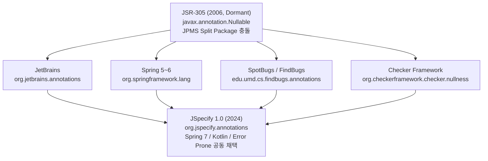

> 자바 Nullability 표준화를 시도했으나 휴면 상태가 된 **JSR-305**의 한계와 Java 9+ Split Package 문제를 짚어보고, Spring Framework 7과 Kotlin 생태계가 차세대 표준으로 채택한 **JSpecify**의 설계와 실무 적용 방법을 정리합니다.

자바 개발자라면 누구나 한 번쯤 `NullPointerException(NPE)`을 마주합니다. 언어 문법 차원에서 Nullable 타입(`String?`)을 구분하는 Kotlin과 달리, 자바는 어노테이션과 정적 분석 도구(IDE, NullAway, Error Prone 등)를 통해 Null 안전성을 보완해 왔습니다. 하지만 어떤 `@Nullable`을 import 해야 하는지는 오랫동안 자바 생태계의 대표적인 혼란거리였습니다.

---

## JSR-305의 휴면(Dormant)과 Java 9+ Split Package 문제

2006년 제안된 **JSR-305(Annotations for Software Defect Detection)**는 `javax.annotation.Nullable`, `javax.annotation.Nonnull` 같은 표준 어노테이션을 정의하려던 시도였습니다. 하지만 다음과 같은 구조적 문제로 인해 최종 승인(Final Release)에 이르지 못한 채 **휴면(Dormant)** 상태가 되었습니다.

1. **명세의 모호함**: 제네릭 타입 인자(`List<@Nullable String>`)나 배열 요소의 Nullability를 표현하는 규칙이 정의되지 않았습니다. (JSR-305가 제안된 시점은 `ElementType.TYPE_USE`가 도입된 Java 8 이전이었습니다.)
2. **JPMS(Java 9+) Split Package 충돌**: JSR-305 구현체(`com.google.code.findbugs:jsr305`)가 `javax.annotation` 패키지를 사용하는데, 이 패키지는 JDK의 `java.xml.ws.annotation` 및 Jakarta 이전 `javax.annotation-api`와 겹칩니다. Java 9 모듈 시스템(JPMS)에서는 서로 다른 두 모듈이 같은 패키지를 소유하는 **Split Package**를 금지하기 때문에 컴파일·실행 충돌이 발생합니다.

결국 JSR-305가 표준 자리를 비워둔 사이, 각 프레임워크와 도구가 자체 Nullability 어노테이션을 만들어 쓰면서 생태계가 심각하게 파편화되었습니다.



---

## 차세대 표준: JSpecify (`org.jspecify.annotations`)

파편화를 끝내기 위해 Google, JetBrains, Broadcom(Spring), Meta, Oracle 등 주요 벤더가 모여 만든 컨소시엄 표준이 **JSpecify**입니다. JSpecify 1.0은 2024년 정식 릴리즈되었으며, 기존 어노테이션들이 놓쳤던 핵심 문제를 깔끔하게 해결합니다.

### JSpecify의 4가지 핵심 어노테이션

| 어노테이션 | 적용 대상 | 역할 |
| :--- | :--- | :--- |
| `@NullMarked` | 패키지(`package-info.java`), 클래스, 메서드 | 해당 범위 내 **모든 타입을 기본적으로 Non-Null**로 선언 |
| `@Nullable` | `TYPE_USE` (변수, 반환값, 제네릭 타입 인자 등) | 해당 타입이 `null`일 수 있음을 명시 |
| `@NonNull` | `TYPE_USE` | `@NullUnmarked` 영역이나 제네릭 경계에서 명시적으로 Non-Null 지정 |
| `@NullUnmarked` | 클래스, 메서드 | `@NullMarked` 범위 안에서 레거시 코드 등 특정 구간만 기본 규칙 해제 |

기존 방식과 가장 크게 달라진 점은 **`@NullMarked` 기반의 Non-Null 기본값 철학**과 **`TYPE_USE` 기반 제네릭 지원**입니다. 모든 파라미터에 `@NonNull`을 도배할 필요 없이, 패키지 단위로 `@NullMarked`를 선언하고 정말 `null`이 허용되는 지점에만 `@Nullable`을 붙이면 됩니다.

```java
// 제네릭 타입 인자까지 정밀하게 구분할 수 있습니다.
List<@Nullable String> listWithNullableElements; // 리스트는 Non-Null, 원소는 Nullable
@Nullable List<String> nullableList;             // 리스트 자체는 Nullable, 원소는 Non-Null
```

---

## Spring Framework 7 / Spring Boot 4 및 Kotlin 연동 예제

**Spring Framework 7(Spring Boot 4 기반)**부터는 기존의 `org.springframework.lang.Nullable`과 `@NonNullApi`가 Deprecated되고, **JSpecify가 스프링 공식 Nullability 표준**으로 전면 채택되었습니다. Kotlin 컴파일러 역시 JSpecify 어노테이션을 네이티브로 해석하여 자바 API 호출 시 플랫폼 타입(`String!`)을 없애고 정확한 Null 안전성을 강제합니다.

### Step 1. Gradle 의존성 추가

```kotlin
// build.gradle.kts
dependencies {
    // 런타임 클래스패스 충돌 없이 컴파일 및 정적 분석 시 사용합니다.
    implementation("org.jspecify:jspecify:1.0.0")
}
```

### Step 2. 패키지 단위 `@NullMarked` 선언

`package-info.java`에 `@NullMarked`를 선언하면 해당 패키지의 모든 클래스에 Non-Null 기본 규칙이 적용됩니다.

```java
// src/main/java/com/example/member/package-info.java
@NullMarked
package com.example.member;

import org.jspecify.annotations.NullMarked;
```

### Step 3. Java 서비스 코드 작성

```java
// src/main/java/com/example/member/MemberRepository.java
package com.example.member;

import java.util.List;
import org.jspecify.annotations.Nullable;

public interface MemberRepository {

    // @NullMarked 적용: id와 반환값 모두 Non-Null
    Member getById(String id);

    // 존재하지 않을 수 있는 조회 결과에만 @Nullable 명시
    @Nullable Member findByEmail(String email);

    // 리스트 자체는 Non-Null이지만, 내부 닉네임 원소는 null일 수 있음
    List<@Nullable String> findNicknamesByTeam(String teamId);
}
```

### Step 4. Kotlin 코드에서 Java API 호출

Kotlin 컴파일러는 JSpecify의 `@NullMarked`와 `@Nullable`을 인식해 정확한 Kotlin 타입으로 매핑합니다.

```kotlin
// src/main/kotlin/com/example/member/MemberService.kt
package com.example.member

class MemberService(
    private val memberRepository: MemberRepository
) {
    fun resolveDisplayName(email: String): String {
        // MemberRepository.findByEmail()의 반환 타입은 Member? 로 추론됩니다.
        val member: Member? = memberRepository.findByEmail(email)
        return member?.name ?: "Guest"
    }

    fun collectValidNicknames(teamId: String): List<String> {
        // 반환 타입이 List<String?> 로 추론되므로 filterNotNull() 처리가 자연스럽게 강제됩니다.
        val nicknames: List<String?> = memberRepository.findNicknamesByTeam(teamId)
        return nicknames.filterNotNull()
    }
}
```

> Kotlin 2.1+ 환경에서는 JSpecify 어노테이션이 기본적으로 엄격 모드(Strict Mode)로 동작하여, `@NullMarked`가 선언된 자바 메서드에 `null`을 넘기면 컴파일 에러로 즉시 차단됩니다. Java 전용 프로젝트에서도 Uber의 **NullAway**나 **Error Prone**을 Gradle에 연결하면 빌드 타임에 동일한 수준의 Null 검증을 자동화할 수 있습니다.
{: .prompt-tip }

---

## 시리즈를 마치며

지금까지 12편에 걸쳐 자바 생태계를 지탱하는 표준 스펙의 흐름을 함께 살펴보았습니다.

- **표준 거버넌스(1편)**: JCP, JSR, JEP, 그리고 Jakarta EE로의 전환
- **엔터프라이즈 핵심 스펙(2~8편)**: DI(JSR-330), Bean Validation(JSR-380), Servlet, JPA, JTA, Caching(JSR-107), Date & Time(JSR-310)
- **언어·동시성·컴파일러·타입 안전성(9~12편)**: JMM(JSR-133), `java.util.concurrent` & Flow(JSR-166), Annotation Processing(JSR-269), 그리고 JSR-305에서 JSpecify로 이어지는 Nullability 표준화

프레임워크는 시대에 따라 바뀌지만, 그 바닥에 깔린 **표준 스펙의 설계 의도와 제약 조건**을 이해하고 있으면 새로운 기술이나 메이저 버전 업그레이드를 마주했을 때 훨씬 단단하게 대응할 수 있습니다. 이 시리즈가 실무에서 마주하는 자바와 스프링의 동작 원리를 깊이 이해하는 데 작은 이정표가 되기를 바랍니다.

---

### 시리즈 네비게이션

- **이전 글**: [11편. JSR-269 (Annotation Processing): 컴파일 타임 코드 생성 표준과 Lombok·MapStruct 원리](/posts/jsr-269-pluggable-annotation-processing/)
- **처음으로**: [1편. JCP, JSR, JEP, 그리고 Jakarta EE: 자바 표준 스펙 생태계 한눈에 이해하기](/posts/jcp-jsr-jep-jakarta-ee-overview/)
