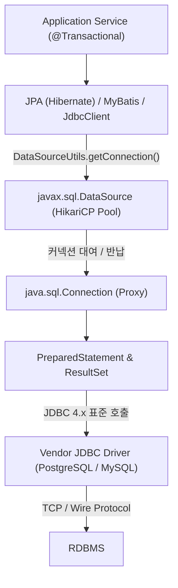
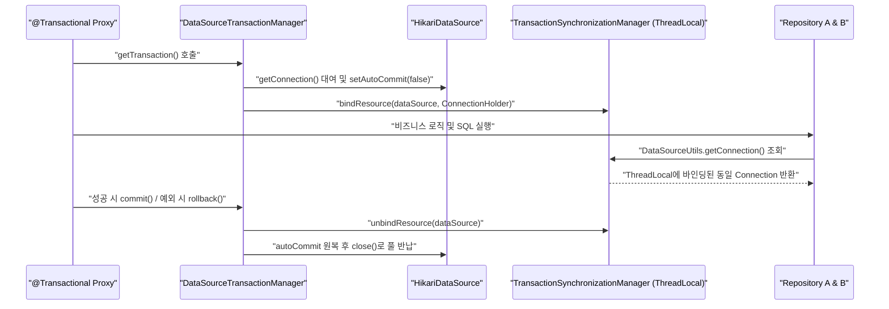

> JPA·MyBatis·HikariCP의 최하단 표준인 **JSR-221(JDBC 4.x)**의 계층 구조, `ServiceLoader` 기반 드라이버 자동 로딩, `DataSource` 커넥션 풀과 `ThreadLocal` 기반 트랜잭션 경계 원리를 정리합니다.

> 본 문서는 **Java 21 / JDBC 4.3 / HikariCP 6.x / Spring Framework 6.x** 기준으로 작성되었습니다.
{: .prompt-info }

실무에서는 Spring Data JPA나 MyBatis 같은 고수준 추상화를 주로 쓰기 때문에 JDBC API를 직접 다룰 일이 적습니다. 하지만 커넥션 풀 고갈, 대용량 조회 OOM, 롤백 누락 같은 운영 장애의 근본 원인은 결국 최하단 **JDBC** 계층에서 발생합니다.

---

## JSR-221(JDBC 4.x) 표준과 영속성 계층 구조

**JSR-221(JDBC 4.x)**은 특정 DB 벤더 프로토콜에 종속되지 않도록 `java.sql`·`javax.sql` 표준 인터페이스를 정의하고, 각 벤더가 드라이버 구현체를 제공하는 브리지(Bridge) 구조입니다.

JDBC를 직접 쓰면 SQL 문자열과 `ResultSet` 매핑, 체크 예외(`SQLException`) 보일러플레이트가 늘어나 실무에서는 생산성을 위해 JPA·MyBatis를 선택하는 트레이드오프를 택합니다. 다만 어떤 영속성 프레임워크를 쓰더라도 실제 DB 통신은 모두 `DataSource`와 JDBC 드라이버를 통과합니다.

| 인터페이스 | 패키지 | 핵심 역할 |
| :--- | :--- | :--- |
| `Driver` | `java.sql` | 벤더별 프로토콜로 물리 `Connection`을 생성하는 진입점 |
| `DataSource` | `javax.sql` | 커넥션 팩토리 표준 (HikariCP 등 커넥션 풀 구현 대상) |
| `Connection` | `java.sql` | DB 세션 유지, `autoCommit` 제어 및 `commit`/`rollback` 경계 관리 |
| `PreparedStatement` | `java.sql` | 파라미터 바인딩(`?`) 기반 SQL 실행, 인젝션 방어 및 실행 계획 캐싱 |
| `ResultSet` | `java.sql` | 조회 결과 행(Row)을 커서 단위로 순회하며 자바 타입으로 변환 |



---

## Class.forName()이 사라진 이유: SPI와 ServiceLoader 로딩

JDBC 3.0 이전에는 `Class.forName("com.mysql.cj.jdbc.Driver")`로 드라이버 클래스를 강제 로딩해야 `static` 블록에서 `DriverManager.registerDriver()`가 실행되었습니다.

**JSR-221(JDBC 4.0)**부터는 표준 **SPI(`java.util.ServiceLoader`)** 기반 자동 로딩이 도입되어 `Class.forName()`이 사라졌습니다. 내부 동작 순서는 다음과 같습니다.

1. 최초 `DriverManager.getConnection()` 호출 시 `DriverManager.ensureDriversInitialized()`가 실행됩니다.
2. `ServiceLoader.load(Driver.class)`가 클래스패스 내 모든 JAR의 `META-INF/services/java.sql.Driver` 파일을 스캔합니다.
3. 명시된 구현체 클래스를 인스턴스화하면서 드라이버의 `static` 초기화 블록이 `DriverManager.registerDriver()`를 자동 호출합니다.

```text
# postgresql-42.7.x.jar 내부 경로
# META-INF/services/java.sql.Driver
org.postgresql.Driver
```

덕분에 드라이버 의존성만 추가하면 코드 수정 없이 자동 등록되며, JAR가 누락된 경우에만 `No suitable driver found` 예외가 발생합니다.

---

## DriverManager vs DataSource와 트랜잭션 경계 원리

운영 서버에서 `DriverManager` 대신 **HikariCP(`DataSource`)**를 써야 하는 이유는 커넥션 생성 비용과 동시성 제어 때문입니다.

| 비교 항목 | `java.sql.DriverManager` | `javax.sql.DataSource` (HikariCP) |
| :--- | :--- | :--- |
| 커넥션 생성 | 매 호출마다 TCP 핸드셰이크 + DB 인증 수행 | 풀에 미리 생성된 커넥션 즉시 대여·반납 |
| 동시 트래픽 제어 | 요청 급증 시 DB 커넥션 수 폭증 | `maximumPoolSize`로 DB 부하 제한 |
| 리소스·테스트 | 정적 메서드 기반, 누수 감지·DI 어려움 | 인터페이스 주입, `keepalive`·누수 감지 내장 |

JDBC 커넥션의 기본값은 `autoCommit = true`여서 SQL 1건마다 즉시 커밋됩니다. 여러 SQL을 원자적으로 묶으려면 `connection.setAutoCommit(false)`로 전환한 뒤 성공 시 `commit()`, 예외 시 `rollback()`을 호출해야 합니다.

Spring의 `@Transactional`은 **`DataSourceTransactionManager`**와 **`TransactionSynchronizationManager`**의 **`ThreadLocal` 바인딩**으로 이 경계를 추상화합니다.



같은 스레드에서 실행되는 여러 Repository는 `DataSourceUtils.getConnection(dataSource)`를 통해 새 커넥션을 열지 않고 `ThreadLocal`에 묶인 **동일한 `Connection`**을 재사용합니다. 종료 시 `close()`는 물리 연결을 끊지 않고 HikariCP 프록시가 커넥션을 풀로 반납하는 역할을 합니다.

---

## 복붙 가능한 최소 재현 코드: HikariCP와 트랜잭션 경계

외부 DB 없이 즉시 실행할 수 있는 **HikariCP + H2** 조합의 계좌 이체 롤백 검증 예제입니다.

```kotlin
// build.gradle.kts
plugins {
    java
}

dependencies {
    implementation("com.zaxxer:HikariCP:6.2.1")
    runtimeOnly("com.h2database:h2:2.3.232")
    testImplementation("org.junit.jupiter:junit-jupiter:5.11.4")
}

tasks.test {
    useJUnitPlatform()
}
```

```java
// src/main/java/com/example/jdbc/AccountTransferService.java
package com.example.jdbc;

import javax.sql.DataSource;
import java.sql.Connection;
import java.sql.PreparedStatement;
import java.sql.ResultSet;
import java.sql.SQLException;

public class AccountTransferService {

    private final DataSource dataSource;

    public AccountTransferService(DataSource dataSource) {
        this.dataSource = dataSource;
    }

    public void transfer(long fromId, long toId, long amount) throws SQLException {
        try (Connection conn = dataSource.getConnection()) {
            boolean previousAutoCommit = conn.getAutoCommit();
            conn.setAutoCommit(false);

            try {
                withdraw(conn, fromId, amount);
                deposit(conn, toId, amount);
                conn.commit();
            } catch (Exception e) {
                conn.rollback();
                throw e;
            } finally {
                conn.setAutoCommit(previousAutoCommit);
            }
        }
    }

    private void withdraw(Connection conn, long accountId, long amount) throws SQLException {
        String sql = "UPDATE accounts SET balance = balance - ? WHERE id = ? AND balance >= ?";
        try (PreparedStatement ps = conn.prepareStatement(sql)) {
            ps.setLong(1, amount);
            ps.setLong(2, accountId);
            ps.setLong(3, amount);
            if (ps.executeUpdate() != 1) {
                throw new IllegalStateException("잔액 부족 또는 계좌 없음: id=" + accountId);
            }
        }
    }

    private void deposit(Connection conn, long accountId, long amount) throws SQLException {
        String sql = "UPDATE accounts SET balance = balance + ? WHERE id = ?";
        try (PreparedStatement ps = conn.prepareStatement(sql)) {
            ps.setLong(1, amount);
            ps.setLong(2, accountId);
            if (ps.executeUpdate() != 1) {
                throw new IllegalStateException("입금 대상 계좌 없음: id=" + accountId);
            }
        }
    }

    public long getBalance(long accountId) throws SQLException {
        String sql = "SELECT balance FROM accounts WHERE id = ?";
        try (Connection conn = dataSource.getConnection();
             PreparedStatement ps = conn.prepareStatement(sql)) {
            ps.setLong(1, accountId);
            try (ResultSet rs = ps.executeQuery()) {
                if (!rs.next()) {
                    throw new IllegalArgumentException("계좌 없음: id=" + accountId);
                }
                return rs.getLong("balance");
            }
        }
    }
}
```

```java
// src/test/java/com/example/jdbc/AccountTransferServiceTest.java
package com.example.jdbc;

import com.zaxxer.hikari.HikariConfig;
import com.zaxxer.hikari.HikariDataSource;
import org.junit.jupiter.api.AfterEach;
import org.junit.jupiter.api.BeforeEach;
import org.junit.jupiter.api.Test;

import java.sql.Connection;
import java.sql.Statement;

import static org.junit.jupiter.api.Assertions.assertEquals;
import static org.junit.jupiter.api.Assertions.assertThrows;

class AccountTransferServiceTest {

    private HikariDataSource dataSource;
    private AccountTransferService service;

    @BeforeEach
    void setUp() throws Exception {
        HikariConfig config = new HikariConfig();
        config.setJdbcUrl("jdbc:h2:mem:jdbc_test;DB_CLOSE_DELAY=-1");
        config.setUsername("sa");
        config.setPassword("");
        config.setMaximumPoolSize(4);
        config.setLeakDetectionThreshold(3_000);

        dataSource = new HikariDataSource(config);
        service = new AccountTransferService(dataSource);

        try (Connection conn = dataSource.getConnection();
             Statement stmt = conn.createStatement()) {
            stmt.execute("DROP TABLE IF EXISTS accounts");
            stmt.execute("CREATE TABLE accounts (id BIGINT PRIMARY KEY, balance BIGINT NOT NULL)");
            stmt.execute("INSERT INTO accounts VALUES (1, 10000), (2, 5000)");
        }
    }

    @AfterEach
    void tearDown() {
        dataSource.close();
    }

    @Test
    void 입금_계좌가_없으면_출금까지_전체_롤백된다() throws Exception {
        assertThrows(IllegalStateException.class, () -> service.transfer(1L, 999L, 3_000L));
        assertEquals(10_000L, service.getBalance(1L));
    }
}
```

---

## 실무 운영 함정 (Edge Case) 3가지

1. **커넥션 누수 (`try-with-resources` 누락)**: `Connection`, `PreparedStatement`, `ResultSet` 중 하나라도 닫지 않으면 풀 반납이 누락되어 `Connection is not available, request timed out` 장애로 이어집니다. 스테이징·운영 환경에 `leak-detection-threshold: 5000`을 설정해 두면 미반납 커넥션의 대여 스택 트레이스를 즉시 추적할 수 있습니다.
2. **`fetchSize` 미설정으로 인한 대용량 조회 OOM**: PostgreSQL 드라이버는 기본 `fetchSize=0`일 때 전체 결과를 힙 메모리에 한 번에 적재하므로, 대용량 배치에서는 반드시 `setAutoCommit(false)`와 `setFetchSize(1000)`을 함께 지정해야 합니다. MySQL은 `setFetchSize(Integer.MIN_VALUE)` 스트리밍 또는 URL 옵션 `useCursorFetch=true`와 양수 `fetchSize` 조합이 필요합니다.
3. **긴 트랜잭션과 외부 I/O로 인한 풀 고갈**: `@Transactional` 범위 안에서 외부 결제 PG API나 슬랙 알림을 호출하면 응답 대기 시간 동안 DB 커넥션이 점유됩니다.

> API 서버에서는 Spring Boot 기본값인 `spring.jpa.open-in-view: true`를 반드시 `false`로 끄고, 외부 네트워크 호출을 트랜잭션 경계 밖으로 분리해야 커넥션 풀 고갈을 막을 수 있습니다.
{: .prompt-warning }

---

## 참고 자료




