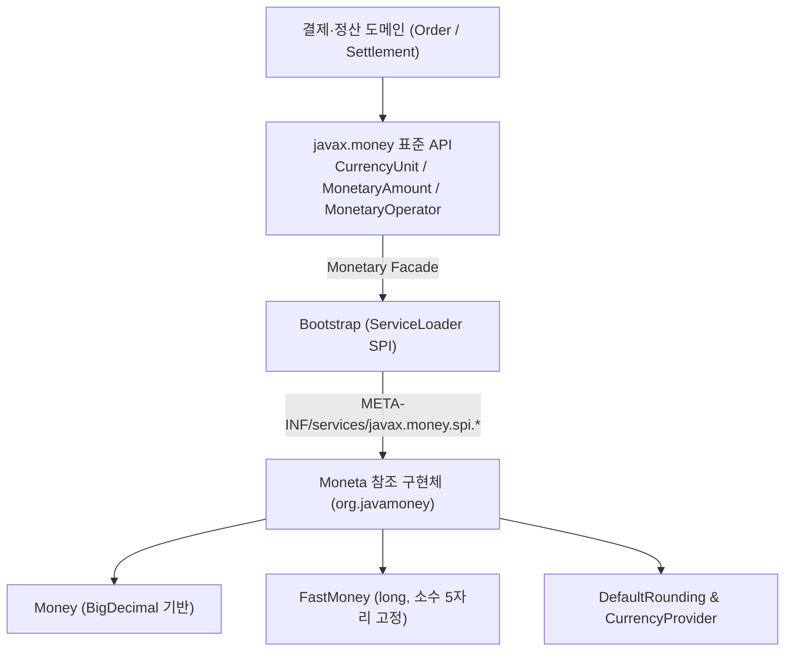

> 결제·정산 도메인에서 `double`이나 `BigDecimal`만 단독으로 사용할 때 발생하는 통화 혼용과 반올림 파편화 문제를 짚어보고, 자바 화폐 표준 **JSR-354(Money & Currency API)**와 참조 구현체 **Moneta**의 구조 및 실무 적용법을 정리합니다.

> 본 문서는 **Java 21 / JSR-354 (`javax.money:money-api:1.1`) / Moneta (`org.javamoney:moneta:1.4.4`)** 기준으로 작성되었습니다.
{: .prompt-info }

금융·커머스 백엔드에서 1원 단위의 정산 오차나 이종 통화 합산은 곧바로 회계 불일치와 금전 손실로 이어집니다. 자바 생태계는 금액과 통화를 안전하게 모델링하기 위해 **JSR-354(Money and Currency API)** 표준을 제공합니다.

---

## double과 BigDecimal 단독 사용의 한계

`double`·`float`는 IEEE 754 이진 부동소수점 한계로 `0.1 + 0.2 == 0.30000000000000004` 오차가 발생해 금액 연산에 쓸 수 없습니다. 실무에서는 주로 `BigDecimal`을 쓰지만, 단독 사용 시에도 두 가지 구조적 한계가 남습니다.

1. **통화 단위 누락으로 인한 오합산**: `BigDecimal`은 순수 숫자이므로 원화 `10,000`과 달러 `10`을 `krw.add(usd)`로 더해도 예외 없이 `10010`을 반환합니다.
2. **반올림 정책 파편화**: KRW(소수 0자리), USD(2자리), KWD(3자리)처럼 통화별 자릿수가 다른데도 `setScale(2, RoundingMode.HALF_UP)` 코드가 서비스 곳곳에 흩어져 정산 불일치를 유발합니다.

트레이드오프도 분명합니다. **단일 통화(KRW 전용)**만 다루는 단순 서비스라면 `long`을 감싼 자체 값 객체(`record Won(long value)`)가 의존성 없이 훨씬 간결합니다. 반면 다중 통화 결제, 환전, 통화별 소수점·수수료 정책이 필요하다면 JSR-354가 강력한 타입 안전성을 제공합니다.

| 비교 항목 | `double` / `float` | `BigDecimal` 단독 | `JSR-354 (MonetaryAmount)` |
| :--- | :--- | :--- | :--- |
| 10진 정밀도 | 부동소수점 오차 발생 | 정확한 10진 연산 | 정확한 10진 연산 |
| 통화 단위 결합 | 없음 | 별도 필드 관리 필요 | **`CurrencyUnit` 필수 결합** |
| 이종 통화 방어 | 불가 | 불가 (KRW + USD 합산) | **런타임 `MonetaryException` 차단** |
| 반올림·수수료 | 직접 구현 | `setScale` 파편화 | `MonetaryRounding` / `MonetaryOperator` 표준화 |

---

## JSR-354 핵심 인터페이스와 Moneta 아키텍처

**JSR-354**는 `java.time`(JSR-310)과 같은 불변(Immutable) 값 객체 철학을 따르지만 JDK 기본 모듈이 아니므로 표준 API(`javax.money:money-api`)와 참조 구현체 **Moneta(`org.javamoney:moneta`)**를 함께 의존성에 추가합니다.

내부적으로는 자바 표준 **SPI(`ServiceLoader`)**로 동작합니다. `Monetary.getCurrency("KRW")`나 `Monetary.getDefaultRounding()`을 호출하면 `Monetary` 파사드가 `Bootstrap`을 통해 클래스패스의 `META-INF/services/javax.money.spi.*`를 스캔하고 Moneta 구현체에 위임합니다.

| 핵심 인터페이스 | 역할 | 주요 구현체 (Moneta) |
| :--- | :--- | :--- |
| `CurrencyUnit` | ISO-4217 통화 코드 및 기본 소수 자릿수 표현 | `JDKCurrencyAdapter` |
| `MonetaryAmount` | 금액과 통화를 결합한 불변 값 객체 | `Money` (`BigDecimal`), `FastMoney` (`long`) |
| `MonetaryRounding` | 통화 규격·커스텀 정책 기반 반올림 연산 | `DefaultRounding` |
| `MonetaryOperator` | `MonetaryAmount -> MonetaryAmount` 변환 함수 | 수수료·할인·부가세 커스텀 정책 |



---

## 실무 예제: 통화 불일치 방어와 커스텀 수수료 연산

Gradle에 Moneta를 추가하고, 통화 불일치 시 `MonetaryException` 방어, `Monetary.getDefaultRounding()`, 커스텀 PG 수수료 `MonetaryOperator`를 검증하는 최소 재현 코드입니다.

```kotlin
// build.gradle.kts
plugins {
    java
}

dependencies {
    implementation("javax.money:money-api:1.1")
    implementation("org.javamoney:moneta:1.4.4")
    testImplementation("org.junit.jupiter:junit-jupiter:5.11.4")
}

tasks.test {
    useJUnitPlatform()
}
```

```java
// src/main/java/com/example/money/PaymentSettlementCalculator.java
package com.example.money;

import org.javamoney.moneta.Money;

import javax.money.CurrencyUnit;
import javax.money.Monetary;
import javax.money.MonetaryAmount;
import javax.money.MonetaryOperator;
import javax.money.MonetaryRounding;
import java.math.BigDecimal;
import java.math.RoundingMode;

public class PaymentSettlementCalculator {

    private static final BigDecimal PG_FEE_RATE = new BigDecimal("0.033"); // 3.3%

    public static final MonetaryOperator PG_FEE_OPERATOR = amount -> {
        MonetaryRounding defaultRounding = Monetary.getDefaultRounding();
        return amount.multiply(PG_FEE_RATE).with(defaultRounding);
    };

    public static final MonetaryOperator TRUNCATE_TO_UNIT = amount -> {
        CurrencyUnit currency = amount.getCurrency();
        int fractionDigits = Math.max(currency.getDefaultFractionDigits(), 0);
        BigDecimal scaled = amount.getNumber()
                .numberValueExact(BigDecimal.class)
                .setScale(fractionDigits, RoundingMode.DOWN);
        return Money.of(scaled, currency);
    };

    public MonetaryAmount calculateNetSettlement(MonetaryAmount grossAmount) {
        MonetaryAmount fee = grossAmount.with(PG_FEE_OPERATOR);
        return grossAmount.subtract(fee).with(TRUNCATE_TO_UNIT);
    }
}
```

```java
// src/test/java/com/example/money/PaymentSettlementCalculatorTest.java
package com.example.money;

import org.javamoney.moneta.Money;
import org.junit.jupiter.api.Test;

import javax.money.MonetaryAmount;
import javax.money.MonetaryException;
import java.math.BigDecimal;

import static org.junit.jupiter.api.Assertions.assertThrows;
import static org.junit.jupiter.api.Assertions.assertTrue;

class PaymentSettlementCalculatorTest {

    private final PaymentSettlementCalculator calculator = new PaymentSettlementCalculator();

    @Test
    void 서로_다른_통화를_더하면_MonetaryException이_발생한다() {
        MonetaryAmount krw = Money.of(10_000, "KRW");
        MonetaryAmount usd = Money.of(new BigDecimal("10.00"), "USD");

        assertThrows(MonetaryException.class, () -> krw.add(usd));
    }

    @Test
    void 통화별_소수점에_맞춰_수수료와_정산금을_계산한다() {
        // KRW(0자리): 10,000 * 3.3% = 330 -> 정산금 9,670원
        MonetaryAmount krwNet = calculator.calculateNetSettlement(Money.of(10_000, "KRW"));
        assertTrue(krwNet.isEqualTo(Money.of(9_670, "KRW")));

        // USD(2자리): 100.00 * 3.3% = 3.30 -> 정산금 96.70달러
        MonetaryAmount usdNet = calculator.calculateNetSettlement(Money.of(new BigDecimal("100.00"), "USD"));
        assertTrue(usdNet.isEqualTo(Money.of(new BigDecimal("96.70"), "USD")));
    }
}
```

`amount.with(PG_FEE_OPERATOR)` 패턴으로 수수료·할인·세금 정책을 캡슐화하면 서비스 레이어 전반의 반올림 규칙을 한곳에서 통제할 수 있습니다.

---

## Money vs FastMoney 선택 기준

Moneta의 두 대표 구현체는 내부 자료구조와 정밀도 제약이 뚜렷하게 다릅니다.

| 비교 항목 | `org.javamoney.moneta.Money` | `org.javamoney.moneta.FastMoney` |
| :--- | :--- | :--- |
| 내부 저장 타입 | `BigDecimal` | `long` (고정 소수점 5자리) |
| 표현 범위·정밀도 | 임의 정밀도 (무제한) | 약 `±92조`, **소수 5자리 초과 시 `ArithmeticException`** |
| 연산 성능 | `BigDecimal` 할당 비용 존재 | 매우 빠름 (정수 연산) |
| 권장 사용처 | 일반 결제, 정산, 환율, 세금 계산 | 초당 수만 건 시세·호가 집계 |

환율이나 비율 곱셈은 소수점 5자리를 쉽게 넘어가므로 **일반 결제·정산 도메인에서는 `Money`를 기본 선택**하고, `FastMoney`는 프로파일링으로 병목이 확인된 대량 집계 경로에만 제한 적용하는 것이 안전합니다.

---

## 실무 운영 함정 (Edge Case): JPA·Jackson과 비교 연산

1. **JPA 매핑**: `AttributeConverter<MonetaryAmount, String>`으로 `"KRW 10000"` 단일 문자열 컬럼에 저장하면 DB에서 `SUM()`이나 범위 검색(`WHERE amount >= 10000`)이 불가능해집니다. 실무에서는 금액(`DECIMAL`)과 통화(`VARCHAR(3)`)를 두 컬럼으로 분리하는 `@Embeddable` 래퍼나 Hibernate `CompositeUserType`을 권장합니다.

```java
// src/main/java/com/example/money/MoneyEmbeddable.java
package com.example.money;

import jakarta.persistence.Column;
import jakarta.persistence.Embeddable;
import org.javamoney.moneta.Money;

import javax.money.MonetaryAmount;
import java.math.BigDecimal;

@Embeddable
public class MoneyEmbeddable {

    @Column(name = "amount", precision = 19, scale = 4, nullable = false)
    private BigDecimal amount;

    @Column(name = "currency", length = 3, nullable = false)
    private String currency;

    protected MoneyEmbeddable() {}

    public static MoneyEmbeddable from(MonetaryAmount money) {
        MoneyEmbeddable embeddable = new MoneyEmbeddable();
        embeddable.amount = money.getNumber().numberValueExact(BigDecimal.class);
        embeddable.currency = money.getCurrency().getCurrencyCode();
        return embeddable;
    }

    public MonetaryAmount toMonetaryAmount() {
        return Money.of(this.amount, this.currency);
    }
}
```

2. **Jackson 직렬화**: 기본 `ObjectMapper`로 직렬화하면 내부 메타데이터가 노출되거나 역직렬화에 실패합니다. `org.zalando:jackson-datatype-money` 모듈이나 커스텀 `JsonSerializer`/`JsonDeserializer`를 등록해 `{"amount": 10000, "currency": "KRW"}` 스키마로 고정해야 합니다.
3. **`equals()` 대신 `isEqualTo()` 사용**:

> `Money.of(100, "USD").equals(FastMoney.of(100, "USD"))`는 구현체 클래스 차이로 `false`를 반환하며, `MonetaryContext`가 달라도 `equals()`가 `false`가 될 수 있습니다. 순수 금액·통화 비교에는 반드시 `isEqualTo()`를 사용해야 합니다.
{: .prompt-warning }

---

## 참고 자료




