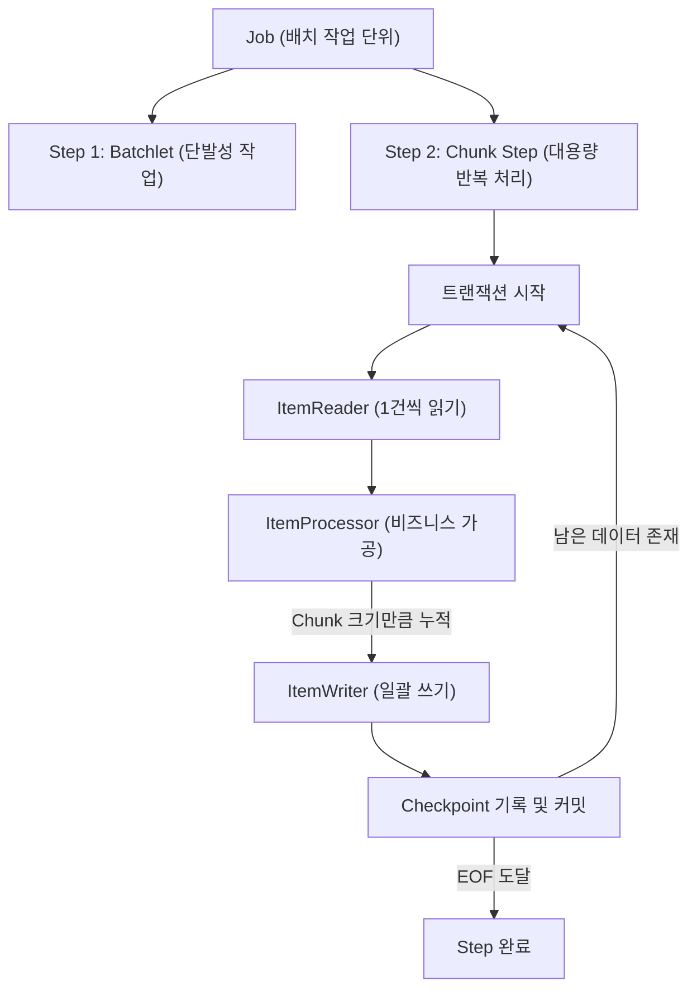

> 대용량 정산과 데이터 마이그레이션을 다루는 배치 처리의 자바 표준 스펙인 JSR-352(Jakarta Batch)의 청크 실행 모델을 정리합니다. Spring Batch 5.x와의 아키텍처 비교, 체크포인트 기반 재시작 원리, 실무 운영 함정까지 함께 살펴봅니다.

> 본 문서는 Jakarta Batch 2.1, Spring Batch 5.x, Java 21 환경을 기준으로 작성되었습니다.
{: .prompt-info }

## JSR-352 도입 배경과 배치 아키텍처

수십만 건의 정산 집계나 대량 데이터 적재를 단순 `for` 루프나 `@Scheduled` 메서드로 구현하면 트랜잭션 경계, 메모리 점유, 중간 실패 시 재실행(Restartability) 처리가 금세 복잡해집니다.

Spring Batch는 이러한 엔터프라이즈 배치 문제를 `Job`–`Step`–`Chunk` 구조로 정립했습니다. 이후 자바 진영에서도 벤더 중립적인 표준 배치 API의 필요성이 커지면서, 이미 실무에서 검증된 Spring Batch의 아키텍처를 흡수해 Java EE 7에 **JSR-352**를 도입했고 현재는 **Jakarta Batch** 스펙으로 이어지고 있습니다.

JSR-352의 배치 실행 모델은 **Chunk 지향 처리**와 **Batchlet 처리** 두 가지로 나뉩니다.



- **Chunk 모델 (`ItemReader` → `ItemProcessor` → `ItemWriter`)**: 대용량 레코드를 일정 개수씩 묶어 하나의 트랜잭션으로 처리합니다. 메모리 사용량을 일정하게 유지하면서 커밋 횟수를 줄여 처리량을 확보합니다.
- **Batchlet 모델 (Spring Batch의 `Tasklet`)**: 임시 파일 정리, 단일 SQL 프로시저 호출 등 반복이 불필요한 단발성 작업에 적합합니다. 대용량 루프를 Batchlet 안에 직접 넣으면 체크포인트와 부분 재시작 이점을 잃게 됩니다.

## JSR-352 표준 인터페이스와 Spring Batch 5.x 비교

두 스펙은 개념적 뿌리가 같지만 API와 설정 방식이 다릅니다. 특히 **Spring Batch 5.0부터는 기존 4.x까지 제공하던 JSR-352 구현체 지원이 제거**되었으며, Java Config 기반의 `JobBuilder`·`StepBuilder` API로 단일화되었습니다.

| 구분 | JSR-352 (Jakarta Batch 2.1) | Spring Batch 5.x |
| :--- | :--- | :--- |
| 핵심 패키지 | `jakarta.batch.api.*` | `org.springframework.batch.core.*` |
| Job 정의 방식 | XML 기반 JSL (`META-INF/batch-jobs/*.xml`) | Java Config (`JobBuilder`, `StepBuilder`) |
| 단발성 작업 | `Batchlet` | `Tasklet` |
| 실행 주체 | `JobOperator` | `JobLauncher` + `JobRepository` |
| DI 컨테이너 | Jakarta CDI (`@Named`, `@Inject`) | Spring IoC (`@Bean`) |
| 대표 구현체 | JBeret (WildFly), Open Liberty | Spring Batch |

Jakarta Batch에서는 `jakarta.batch.api.chunk` 인터페이스를 구현하고 XML(JSL)로 스텝을 조립합니다.

```java
// src/main/java/com/example/batch/jakarta/OrderItemProcessor.java
package com.example.batch.jakarta;

import jakarta.batch.api.chunk.ItemProcessor;
import jakarta.enterprise.context.Dependent;
import jakarta.inject.Named;

@Dependent
@Named("orderItemProcessor")
public class OrderItemProcessor implements ItemProcessor {

    @Override
    public Object processItem(Object item) {
        OrderRecord record = (OrderRecord) item;
        if (record.amount() <= 0) {
            return null; // null 반환 시 Writer 전달에서 제외
        }
        return new Settlement(record.orderId(), record.amount());
    }
}
```

Spring Batch 5.x에서는 제네릭 기반 `ItemReader<I>`, `ItemProcessor<I, O>`, `ItemWriter<O>`를 사용하며, `JobRepository`와 `PlatformTransactionManager`를 명시적으로 주입합니다.

```kotlin
// build.gradle.kts
dependencies {
    implementation("org.springframework.boot:spring-boot-starter-batch")
    implementation("org.springframework.boot:spring-boot-starter-data-jpa")
    runtimeOnly("com.h2database:h2")
}
```

```java
// src/main/java/com/example/batch/spring/SettlementJobConfig.java
package com.example.batch.spring;

import org.springframework.batch.core.Job;
import org.springframework.batch.core.Step;
import org.springframework.batch.core.job.builder.JobBuilder;
import org.springframework.batch.core.repository.JobRepository;
import org.springframework.batch.core.step.builder.StepBuilder;
import org.springframework.batch.item.ItemProcessor;
import org.springframework.batch.item.ItemReader;
import org.springframework.batch.item.ItemWriter;
import org.springframework.context.annotation.Bean;
import org.springframework.context.annotation.Configuration;
import org.springframework.transaction.PlatformTransactionManager;

@Configuration
public class SettlementJobConfig {

    @Bean
    public Job settlementJob(JobRepository jobRepository, Step settlementStep) {
        return new JobBuilder("settlementJob", jobRepository)
                .start(settlementStep)
                .build();
    }

    @Bean
    public Step settlementStep(
            JobRepository jobRepository,
            PlatformTransactionManager transactionManager,
            ItemReader<OrderEntity> orderItemReader,
            ItemProcessor<OrderEntity, SettlementEntity> settlementProcessor,
            ItemWriter<SettlementEntity> settlementWriter
    ) {
        return new StepBuilder("settlementStep", jobRepository)
                .<OrderEntity, SettlementEntity>chunk(500, transactionManager)
                .reader(orderItemReader)
                .processor(settlementProcessor)
                .writer(settlementWriter)
                .faultTolerant()
                .skip(IllegalArgumentException.class)
                .skipLimit(100)
                .build();
    }
}
```

Spring Boot 3.x 이상에서는 `@EnableBatchProcessing`을 선언하면 자동 구성(`BatchAutoConfiguration`)이 꺼지므로, 별도 커스터마이징이 없다면 어노테이션을 생략하는 편이 안전합니다.

## 내부 동작 원리: 체크포인트와 메타데이터 테이블

배치 프레임워크의 핵심은 **체크포인트(Checkpoint)와 재시작(Restartability)**입니다. JSR-352의 `ItemReader.checkpointInfo()`와 Spring Batch의 `ItemStream.update(ExecutionContext)`는 마지막으로 커밋된 위치를 저장소에 기록합니다.

Spring Batch 내부에서는 `ChunkOrientedTasklet`이 `RepeatTemplate` 트랜잭션 경계 안에서 청크를 처리하고, 커밋 직전에 `JobRepository`가 메타데이터 테이블을 갱신합니다.


- **`BATCH_JOB_INSTANCE`**: `Job` 이름과 식별 `JobParameters` 조합을 기록해 이미 완료된 작업의 중복 실행을 막습니다.
- **`BATCH_JOB_EXECUTION`**: 실제 실행 이력입니다. `FAILED` 후 재실행하면 같은 `JobInstance` 아래 새 실행 행이 추가됩니다.
- **`BATCH_STEP_EXECUTION` & `CONTEXT`**: 스텝의 처리 건수와 `ItemStream`이 기록한 체크포인트(페이지 번호·파일 오프셋)를 저장합니다. 장애 후 동일 파라미터로 재실행하면 `ItemStream.open()`이 직전 컨텍스트를 복원해 실패 지점부터 이어서 처리합니다.

## 실무 운영 함정과 트레이드오프

### 1. Chunk 크기 설정 트레이드오프

청크 크기가 너무 작으면(예: 10~50) 커밋과 메타데이터 갱신 I/O가 병목이 됩니다. 반대로 너무 크면(예: 10,000 이상) 힙 메모리와 DB Undo Log 점유가 커지고, 예외 발생 시 롤백 범위가 넓어집니다. 실무에서는 **500~1,000건**에서 시작해 프로파일링하며 조정하는 편이 안전합니다.

### 2. JPA 영속성 컨텍스트 누적과 페이징 밀림

`JpaPagingItemReader`는 페이지 조회마다 `flush`/`clear`를 수행하지만, `Processor`나 `Writer`에서 별도 Repository로 연관 엔티티를 대량 조회·수정하면 1차 캐시에 객체가 누적되어 OOM과 Dirty Checking 지연이 발생합니다. 대량 쓰기에는 `JdbcBatchItemWriter`를 조합하는 것이 유리합니다.

또한 `WHERE status = 'PENDING'` 조건으로 페이징 조회하면서 `Writer`에서 상태를 `'DONE'`으로 바꾸면, 다음 `OFFSET` 조회 시 행이 밀려 절반의 데이터가 누락됩니다(Pagination Skip).

> 조회 조건 컬럼을 `Writer`에서 수정해야 한다면 `OFFSET` 페이징 대신 `WHERE id > :lastId ORDER BY id ASC` 형태의 **Keyset 페이징**이나 `JdbcCursorItemReader`를 사용해야 합니다.
{: .prompt-warning }

### 3. Skip·Retry 정책 누락으로 인한 전체 롤백

`faultTolerant()` 설정이 없으면 수십만 건 중 단 1건의 포맷 오류나 일시적 타임아웃만으로 스텝 전체가 `FAILED` 처리됩니다. 일시적 장애는 `retry()`, 데이터 결함은 `skip()`과 `SkipListener`로 격리해야 합니다. 다만 `Writer`에서 Skip 예외가 발생하면 청크를 롤백한 뒤 **1건씩 개별 트랜잭션으로 재처리(스캔 모드)**하므로, 유효성 검증은 가능한 `Processor`에서 끝내는 편이 성능상 유리합니다.

## 실무 선택 기준과 정리

WildFly(JBeret)나 Open Liberty 같은 Jakarta EE 표준 서버에서 CDI 기반 이식성이 필요하다면 **JSR-352(Jakarta Batch)**가 적합합니다. 반면 Spring Boot 기반 서비스나 독립 배치 워커를 운영한다면 풍부한 내장 `ItemReader`/`ItemWriter`와 Java Config 타입 안전성을 제공하는 **Spring Batch 5.x**가 사실상 표준 선택지입니다.

### 참고 자료



