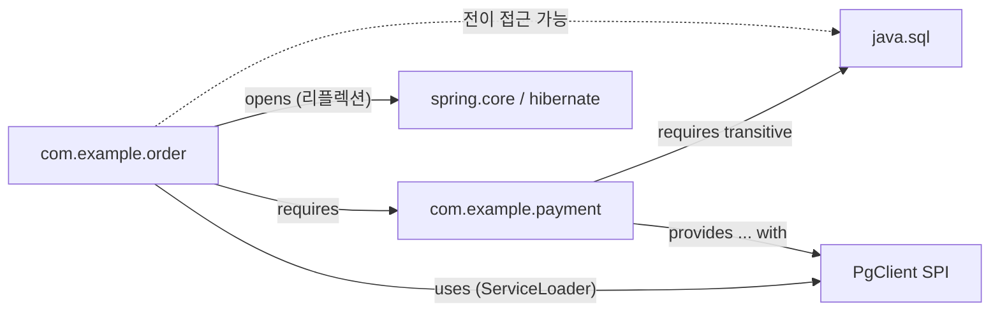
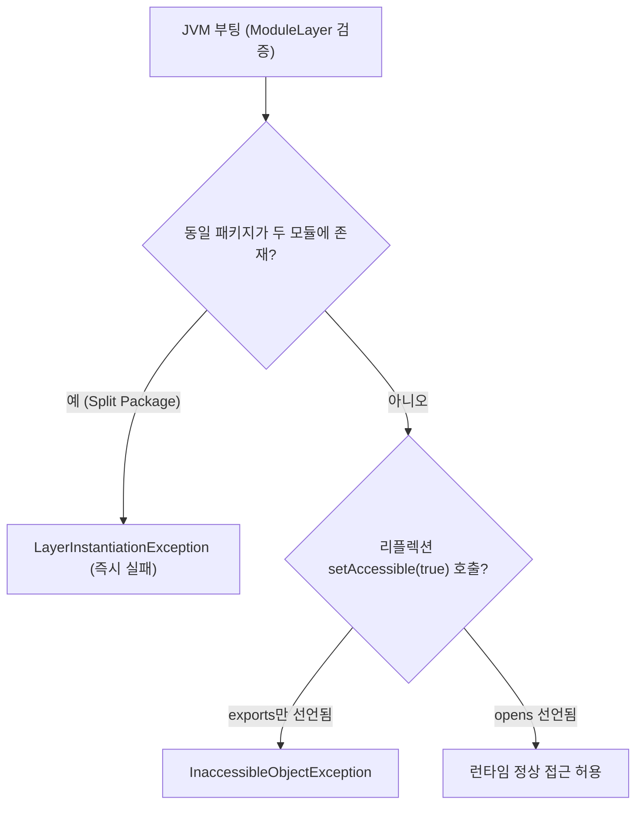

> Java 9에서 도입된 JSR-376(JPMS)의 설계 의도와 `module-info.java` 지시자를 정리합니다. Split Package 충돌과 리플렉션(`opens`) 원리를 짚고, `jdeps`와 `jlink`로 Docker 자바 런타임 이미지를 경량화하는 방법을 살펴봅니다.

> 본 문서는 Java 21 LTS, Spring Boot 3.x, Docker 멀티스테이지 빌드 환경을 기준으로 작성되었습니다.
{: .prompt-info }

## JPMS 도입 배경: 클래스패스 지옥과 강한 캡슐화

Java 8까지의 평면적인 클래스패스(Classpath) 모델은 대규모 시스템에서 세 가지 한계를 드러냈습니다.

- **JAR Hell**: 의존성 누락이 컴파일 시점이 아닌 런타임 `NoClassDefFoundError`로 뒤늦게 발생하고, 동일 클래스가 여러 JAR에 공존하면 클래스패스 순서에 따라 임의 로드(Shadowing)됩니다.
- **취약한 캡슐화**: `public` 클래스라면 라이브러리 내부 패키지나 `sun.misc.Unsafe` 같은 JDK 내부 API도 외부에서 자유롭게 접근할 수 있어 업그레이드 호환성을 깨뜨렸습니다.
- **모놀리식 JDK (`rt.jar`)**: 단순 API 서버에도 Swing·AWT·CORBA가 모두 포함된 거대한 런타임 전체를 배포해야 했습니다.

Project Jigsaw(JSR-376)는 **신뢰할 수 있는 구성(Reliable Configuration)**, **강한 캡슐화**, 그리고 **JDK 자체의 모듈화(`java.base`, `java.sql`, `java.net.http` 등)**로 이를 해결했습니다. 다만 일반 Spring Boot 애플리케이션 코드까지 전부 `module-info.java`로 전환할 필요는 없습니다. 실무에서는 라이브러리 설계와 `jlink` 기반 런타임 경량화 영역에서 JPMS의 가치가 가장 크게 드러납니다.

## `module-info.java` 핵심 지시자와 모듈 그래프

모듈은 패키지들의 상위 단위이며, 루트의 `module-info.java`에 의존성과 공개 범위를 선언합니다.

| 지시자 | 역할 | 적용 시점 |
| :--- | :--- | :--- |
| `requires` | 대상 모듈에 대한 의존성 선언 | 컴파일 + 런타임 |
| `requires transitive` | 의존 모듈의 공개 타입을 호출 측에도 전이 노출 | 컴파일 + 런타임 |
| `exports` | 지정 패키지의 `public` 타입 공개 (`to`로 제한 가능) | 컴파일 + 런타임 |
| `opens` | 런타임 심층 리플렉션(`setAccessible(true)`) 허용 | 런타임 전용 |
| `uses` / `provides ... with` | `ServiceLoader` 기반 구현체 느슨한 결합 | 컴파일 + 런타임 |

```java
// payment-module/src/main/java/module-info.java
module com.example.payment {
    requires transitive java.sql; // 반환 타입에 java.sql.Timestamp 등이 노출될 때
    exports com.example.payment.api;
    provides com.example.payment.spi.PgClient
        with com.example.payment.internal.TossPgClient;
}
```

```java
// order-module/src/main/java/module-info.java
module com.example.order {
    requires com.example.payment;
    requires spring.context;

    exports com.example.order.service;
    // Spring·Hibernate의 private 필드 주입과 프록시 생성을 위한 개방
    opens com.example.order.domain to spring.core, org.hibernate.orm.core;
    uses com.example.payment.spi.PgClient;
}
```



`requires transitive`는 공개 메서드 시그니처에 외부 모듈 타입이 직접 노출될 때만 제한적으로 사용해야 불필요한 의존성 전파를 막을 수 있습니다.

## 내부 동작 원리: Split Package 충돌과 리플렉션(`opens`)

모듈패스(`--module-path`)로 JVM이 기동할 때 `ModuleLayer`와 `Configuration`은 `main()` 실행 전에 전체 모듈 그래프를 검증합니다. 의존 모듈 누락이나 순환 참조가 있으면 즉시 부팅을 중단합니다.

이 과정에서 자주 발생하는 문제가 **Split Package(분할 패키지)** 충돌입니다. 서로 다른 두 Named Module이 동일한 패키지 이름(예: `com.example.common`)을 포함하면, 설령 해당 패키지를 `exports`하지 않더라도 소유권 모호성을 막기 위해 부팅 시 `LayerInstantiationException`으로 즉시 실패합니다.



리플렉션 접근 제어 역시 구분됩니다. `exports`는 일반 `public` API 호출만 허용하고 `Field.setAccessible(true)` 같은 심층 리플렉션은 차단합니다. Spring의 필드 주입, Jackson 직렬화, Hibernate 엔티티 프록시 생성은 심층 리플렉션에 의존하므로 대상 패키지에 `opens`를 명시해야 `InaccessibleObjectException`을 피할 수 있습니다.

## `jdeps`와 `jlink`를 활용한 Docker 커스텀 JRE 경량화

앱 코드에 `module-info.java`가 없더라도, **`jdeps`**로 필요한 JDK 모듈만 추출하고 **`jlink`**로 최소 커스텀 JRE를 조립해 Docker 이미지를 대폭 줄일 수 있습니다. Spring Boot 3.x의 Fat JAR는 중첩 JAR(`BOOT-INF/lib/*.jar`) 구조이므로 압축 해제 후 `jdeps`를 실행해야 정확합니다.

```dockerfile
# Dockerfile (Java 21 + Spring Boot 3.x jlink 멀티스테이지 빌드)
FROM eclipse-temurin:21-jdk-jammy AS builder
WORKDIR /workspace

COPY build/libs/app.jar app.jar

# 1. Spring Boot Fat JAR 압축 해제
RUN mkdir -p unpacked && (cd unpacked && jar -xf ../app.jar)

# 2. jdeps로 필요한 JDK 모듈 목록 추출
RUN jdeps --ignore-missing-deps -q \
    --recursive \
    --multi-release 21 \
    --print-module-deps \
    --class-path 'unpacked/BOOT-INF/lib/*' \
    app.jar > deps.info

# 3. jlink로 최소 커스텀 JRE 생성 (TLS용 jdk.crypto.ec 명시 추가)
RUN jlink \
    --add-modules "$(cat deps.info),jdk.crypto.ec" \
    --strip-debug \
    --no-man-pages \
    --no-header-files \
    --compress=zip-6 \
    --output /custom-jre

# 4. 슬림 베이스 이미지에 커스텀 JRE와 앱만 복사
FROM debian:bookworm-slim
ENV JAVA_HOME=/opt/java/openjdk
ENV PATH="${JAVA_HOME}/bin:${PATH}"

COPY --from=builder /custom-jre "${JAVA_HOME}"
COPY --from=builder /workspace/app.jar /app/app.jar

WORKDIR /app
EXPOSE 8080
ENTRYPOINT ["java", "-jar", "/app/app.jar"]
```

| 베이스 구성 | 대략적인 이미지 크기 | 특징 |
| :--- | :--- | :--- |
| `eclipse-temurin:21-jdk-jammy` | 약 430 MB | 컴파일러·도구 전체 포함 (운영 비권장) |
| `eclipse-temurin:21-jre-jammy` | 약 270 MB | 전체 표준 JDK 모듈 포함 |
| `debian:bookworm-slim` + `jlink` JRE | **약 120~140 MB** | 필요 모듈만 포함, 보안 공격 표면 최소화 |

## 실무 운영 함정과 주의사항

### 1. Automatic Module 이름 추론 위험

`module-info.java`가 없는 JAR를 모듈패스에 올리면 JVM이 파일명(`foo-bar-1.2.3.jar` → `foo.bar`)으로 모듈 이름을 자동 추론합니다. 추후 라이브러리가 정식 모듈 이름을 바꾸면 의존 빌드가 깨지므로, 배포용 라이브러리라면 `MANIFEST.MF`에 `Automatic-Module-Name`이라도 고정해 두어야 합니다.

### 2. `--add-opens` 옵션 남발

Java 17/21 업그레이드 중 `InaccessibleObjectException`을 임시로 우회하려고 `--add-opens java.base/java.lang=ALL-UNNAMED` 같은 옵션을 계속 추가하면 캡슐화가 무력화되고 차기 LTS 업그레이드 시 호환성 부채로 돌아옵니다. 문제가 되는 구형 라이브러리를 업그레이드해 옵션을 제거하는 편이 정석입니다.

### 3. `jdeps` 정적 분석이 놓치는 동적 모듈

`jdeps`는 정적 참조만 분석하므로 런타임에 동적 로드되는 `jdk.crypto.ec`(HTTPS/TLS), `jdk.charsets`(비표준 인코딩), `java.instrument`(APM 에이전트), `jdk.management`(JMX) 모듈이 누락될 수 있습니다.

> `jlink` 커스텀 JRE를 도입했다면 스테이징 환경에서 외부 HTTPS 호출, DB 커넥션, 한글 인코딩, APM 에이전트 연동까지 통합 테스트로 누락 모듈 여부를 반드시 검증해야 합니다.
{: .prompt-warning }

### 참고 자료



