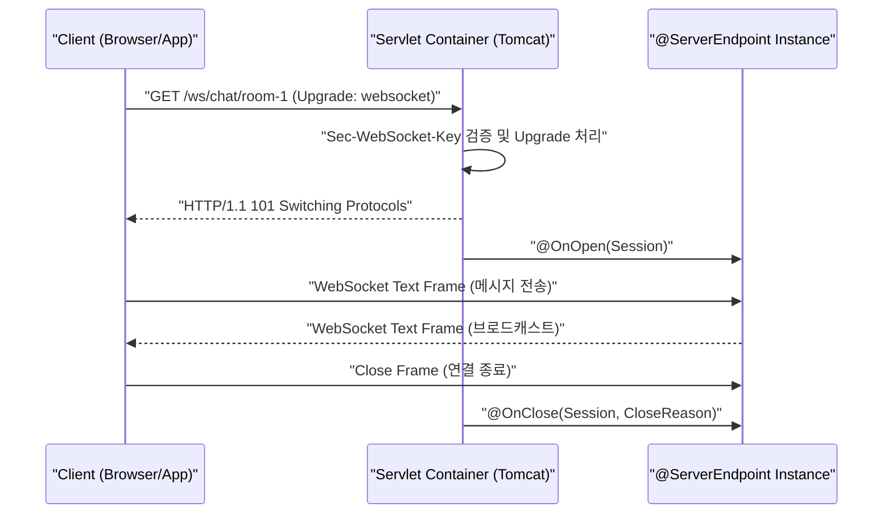
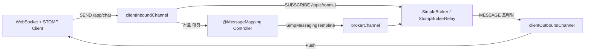

> 자바 표준 WebSocket API인 JSR-356(Jakarta WebSocket)의 HTTP Upgrade 내부 동작 원리와 `@ServerEndpoint` 구현을 살펴보고, Spring WebSocket + STOMP 아키텍처와의 차이 및 운영 함정을 정리합니다.

> 본 문서는 Java 21, Jakarta WebSocket 2.1(Jakarta EE 10), Spring Boot 3.4 환경을 기준으로 작성되었습니다.
{: .prompt-info }

## JSR-356의 등장 배경과 HTTP Upgrade 동작 원리

채팅, 실시간 호가창, 알림 피드처럼 서버가 먼저 데이터를 밀어 넣어야(Server Push) 하는 서비스는 요청-응답 기반의 HTTP와 맞지 않습니다. Polling이나 Long Polling은 매 요청마다 HTTP 헤더 오버헤드와 커넥션 관리 비용이 누적됩니다.

RFC 6455로 WebSocket이 표준화된 뒤, 자바 진영은 Tomcat·Jetty·Undertow마다 달랐던 API를 통합하기 위해 **JSR-356(Java API for WebSocket)**을 제정했습니다. Jakarta EE 전환 이후에는 `jakarta.websocket` 패키지의 **Jakarta WebSocket** 스펙으로 이어지고 있습니다.

WebSocket 연결은 일반 HTTP/1.1 요청으로 시작합니다. 클라이언트가 `Upgrade: websocket`, `Connection: Upgrade` 헤더를 보내면 서버가 검증 후 `101 Switching Protocols`로 응답하며, 기존 TCP 소켓을 전이중(Full-Duplex) 프레임 통신으로 전환합니다.



내부적으로 Tomcat 같은 서블릿 컨테이너는 기동 시 `ServletContainerInitializer` 구현체(`WsSci`)로 `@ServerEndpoint`를 스캔해 `WsServerContainer`에 등록합니다. 업그레이드 요청이 들어오면 `WsFilter`가 `HttpServletRequest.upgrade(WsHttpUpgradeHandler.class)`를 호출해 소켓 제어권을 서블릿 파이프라인에서 WebSocket 프레임 처리기로 넘깁니다.

## Jakarta WebSocket 표준 API 구현 예제

Spring Boot에서 표준 `@ServerEndpoint`를 구동하려면 `spring-boot-starter-websocket` 의존성을 추가하고 `ServerEndpointExporter` 빈을 등록합니다.

```kotlin
// build.gradle.kts
dependencies {
    implementation("org.springframework.boot:spring-boot-starter-websocket")
}
```

```java
// src/main/java/com/example/ws/ChatServerEndpoint.java
package com.example.ws;

import jakarta.websocket.CloseReason;
import jakarta.websocket.OnClose;
import jakarta.websocket.OnError;
import jakarta.websocket.OnMessage;
import jakarta.websocket.OnOpen;
import jakarta.websocket.Session;
import jakarta.websocket.server.PathParam;
import jakarta.websocket.server.ServerEndpoint;
import java.util.Set;
import java.util.concurrent.ConcurrentHashMap;
import org.slf4j.Logger;
import org.slf4j.LoggerFactory;
import org.springframework.stereotype.Component;

@Component
@ServerEndpoint("/ws/chat/{roomId}")
public class ChatServerEndpoint {

    private static final Logger log = LoggerFactory.getLogger(ChatServerEndpoint.class);
    private static final ConcurrentHashMap<String, Set<Session>> ROOMS = new ConcurrentHashMap<>();

    @OnOpen
    public void onOpen(Session session, @PathParam("roomId") String roomId) {
        ROOMS.computeIfAbsent(roomId, key -> ConcurrentHashMap.newKeySet()).add(session);
        log.info("Connected: roomId={}, sessionId={}", roomId, session.getId());
    }

    @OnMessage
    public void onMessage(String message, Session sender, @PathParam("roomId") String roomId) {
        for (Session target : ROOMS.getOrDefault(roomId, Set.of())) {
            if (target.isOpen()) {
                target.getAsyncRemote().sendText(message);
            }
        }
    }

    @OnClose
    public void onClose(Session session, @PathParam("roomId") String roomId, CloseReason reason) {
        Set<Session> sessions = ROOMS.get(roomId);
        if (sessions != null) {
            sessions.remove(session);
        }
    }

    @OnError
    public void onError(Session session, Throwable throwable) {
        log.error("WebSocket error: sessionId={}", session.getId(), throwable);
    }
}
```

```java
// src/main/java/com/example/ws/StandardWebSocketConfig.java
package com.example.ws;

import org.springframework.context.annotation.Bean;
import org.springframework.context.annotation.Configuration;
import org.springframework.web.socket.server.standard.ServerEndpointExporter;

@Configuration
public class StandardWebSocketConfig {

    @Bean
    public ServerEndpointExporter serverEndpointExporter() {
        return new ServerEndpointExporter();
    }
}
```

주의할 점은 Jakarta WebSocket 컨테이너가 **클라이언트 연결마다 `@ServerEndpoint` 인스턴스를 새로 생성**한다는 것입니다. `@Component`를 붙여도 Spring 싱글톤 빈이 직접 호출되지 않으므로 `ROOMS`를 `static`으로 선언했습니다. Spring DI가 필요하다면 `ServerEndpointConfig.Configurator`를 커스터마이징하거나 Spring WebSocket을 쓰는 편이 낫습니다.

## 순수 JSR-356 vs Spring WebSocket과 STOMP 아키텍처 비교

JSR-356과 Spring의 `TextWebSocketHandler`는 단순 프레임 전송 계층만 제공합니다. 구독(Pub/Sub), 목적지 라우팅, 인증 헤더 전파 규약이 없어 기능이 커지면 자체 JSON 프로토콜을 재발명하게 됩니다.

**STOMP(Simple Text Oriented Messaging Protocol)**는 WebSocket 위에 `CONNECT`, `SUBSCRIBE`, `SEND`, `MESSAGE` 프레임 규약을 얹어 이 문제를 해결합니다. Spring은 STOMP 메시지를 내부 `MessageChannel`로 흘려보내 `@MessageMapping` 컨트롤러와 메시지 브로커로 라우팅합니다.



| 비교 항목 | JSR-356 (`@ServerEndpoint`) | Spring `TextWebSocketHandler` | Spring WebSocket + STOMP |
| :--- | :--- | :--- | :--- |
| **추상화 수준** | 저수준 프레임 송수신 | 저수준 프레임 + Spring 통합 | 고수준 Pub/Sub 메시징 |
| **라우팅·구독** | 직접 구현 | 직접 구현 | `/app`, `/topic`, `/queue` 자동 라우팅 |
| **DI 및 생명주기** | 연결당 인스턴스 생성 | Spring 싱글톤 빈 | Spring 싱글톤 빈 + `@MessageMapping` |
| **보안·외부 브로커** | 수동 구현 | `HandshakeInterceptor` | Spring Security + `StompBrokerRelay` |
| **적합한 사용처** | 바이너리 스트리밍, 초경량 규약 | 단순 단방향 푸시 | 채팅, 실시간 협업, 다중 토픽 알림 |

```java
// src/main/java/com/example/ws/StompWebSocketConfig.java
package com.example.ws;

import org.springframework.context.annotation.Configuration;
import org.springframework.messaging.simp.config.MessageBrokerRegistry;
import org.springframework.web.socket.config.annotation.EnableWebSocketMessageBroker;
import org.springframework.web.socket.config.annotation.StompEndpointRegistry;
import org.springframework.web.socket.config.annotation.WebSocketMessageBrokerConfigurer;

@Configuration
@EnableWebSocketMessageBroker
public class StompWebSocketConfig implements WebSocketMessageBrokerConfigurer {

    @Override
    public void registerStompEndpoints(StompEndpointRegistry registry) {
        registry.addEndpoint("/ws-stomp")
                .setAllowedOriginPatterns("https://app.example.com");
    }

    @Override
    public void configureMessageBroker(MessageBrokerRegistry registry) {
        registry.setApplicationDestinationPrefixes("/app");
        registry.enableSimpleBroker("/topic", "/queue");
    }
}
```

```java
// src/main/java/com/example/ws/ChatStompController.java
package com.example.ws;

import org.springframework.messaging.handler.annotation.DestinationVariable;
import org.springframework.messaging.handler.annotation.MessageMapping;
import org.springframework.messaging.handler.annotation.SendTo;
import org.springframework.stereotype.Controller;

@Controller
public class ChatStompController {

    public record ChatMessage(String sender, String content) {}

    @MessageMapping("/chat/{roomId}")
    @SendTo("/topic/chat.{roomId}")
    public ChatMessage broadcast(@DestinationVariable String roomId, ChatMessage message) {
        return message;
    }
}
```

다만 초당 수천 건의 바이너리 패킷을 처리하는 게임·오디오 스트리밍처럼 STOMP 텍스트 헤더 오버헤드가 부담스러운 도메인이라면 순수 WebSocket을 선택해야 합니다.

## 프로덕션 운영 시 자주 겪는 함정 (Edge Cases)

### 1. 다중 인스턴스 Scale-out 시 인메모리 세션·SimpleBroker 단절

`ConcurrentHashMap`이나 `enableSimpleBroker()`는 단일 JVM 메모리에만 구독 상태를 유지합니다. 서버를 2대 이상으로 늘리면 서버 A에서 발행한 메시지가 서버 B에 연결된 클라이언트에게 도달하지 않습니다. 수평 확장이 필요하다면 `enableStompBrokerRelay()`로 RabbitMQ·ActiveMQ 같은 외부 브로커를 연동하거나, Redis Pub/Sub을 백플레인으로 두어 모든 인스턴스에 이벤트를 전파해야 합니다.

### 2. 리버스 프록시(Nginx) Upgrade 헤더 누락과 Idle 타임아웃

Nginx는 기본 HTTP/1.0 업스트림 통신을 사용하며 hop-by-hop 헤더인 `Upgrade`와 `Connection`을 전달하지 않습니다. 아래 설정을 누락하면 핸드셰이크가 `400 Bad Request`로 실패하거나 60초 뒤 연결이 끊어집니다.

```nginx
location /ws-stomp {
    proxy_pass http://backend_upstream;
    proxy_http_version 1.1;
    proxy_set_header Upgrade $http_upgrade;
    proxy_set_header Connection "upgrade";
    proxy_set_header Host $host;
    proxy_read_timeout 3600s;
    proxy_send_timeout 3600s;
}
```

타임아웃 연장 외에도 STOMP Heartbeat(`setHeartbeatValue`)나 Ping/Pong 프레임을 설정해야 방화벽·ALB의 유휴 연결 차단을 방지할 수 있습니다.

### 3. `Session.getBasicRemote()` 동시 전송 시 `IllegalStateException`

JSR-356 `Session`의 동기 전송(`getBasicRemote().sendText()`)은 스레드 안전하지 않습니다. 여러 스레드가 동일 세션에 동시에 쓰면 아래 예외가 발생합니다.

```text
java.lang.IllegalStateException: The remote endpoint was in state [TEXT_FULL_WRITING] which is an invalid state for called method
```

순수 JSR-356에서는 세션 단위 락이나 전송 큐로 직렬화해야 하며, Spring `TextWebSocketHandler`에서는 `ConcurrentWebSocketSessionDecorator`로 감싸 `sendTimeLimit`과 `bufferSizeLimit`을 함께 제어하는 것이 안전합니다.

> 느린 클라이언트로 인한 메모리 누적을 막기 위해 `ConcurrentWebSocketSessionDecorator`의 버퍼 크기와 전송 타임아웃은 반드시 보수적으로 제한해야 합니다.
{: .prompt-warning }

## 정리 및 참고 자료

JSR-356은 서블릿 컨테이너 위에서 전이중 통신을 수행하는 표준 기반을, Spring STOMP는 라우팅·구독·외부 브로커 연동이라는 메시징 계층을 제공합니다. 바이너리·초저지연 요구사항에는 저수준 WebSocket을, 채팅·알림 등 다중 토픽 서비스에는 Spring STOMP와 외부 브로커 조합을 권장합니다.




