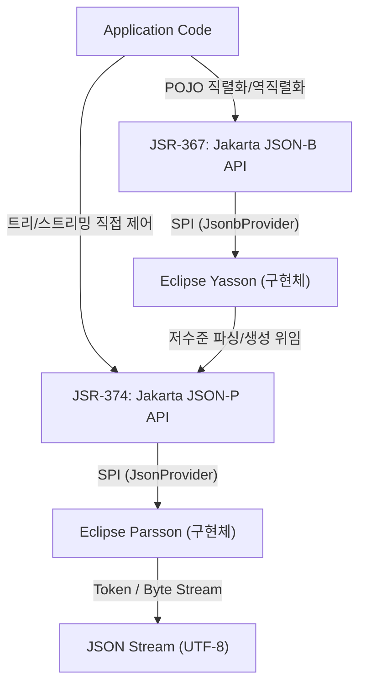

> 자바 공식 JSON 표준인 JSR-374(JSON-P)와 JSR-367(JSON-B)의 계층 구조와 사용법을 살펴보고, 실무 특히 Spring Boot 생태계에서 Jackson이 사실상 표준(De facto)으로 자리 잡은 트레이드오프를 정리합니다.

> 본 문서는 Java 21, Jakarta JSON-B 3.0(Eclipse Yasson 3.0.4), Jakarta JSON-P 2.1(Eclipse Parsson 1.1.7), Jackson 2.18 환경을 기준으로 작성되었습니다.
{: .prompt-info }

## 자바 공식 JSON 표준의 이원화: JSR-374(JSON-P)와 JSR-367(JSON-B)

자바 표준 스펙은 과거 XML의 JAXP(저수준 파싱)와 JAXB(객체 바인딩)를 분리했던 설계를 JSON에도 그대로 적용했습니다.

- **JSR-374 (Jakarta JSON Processing, JSON-P)**: JSON 문서를 저수준에서 파싱·생성합니다. 트리 기반 Object Model(`JsonObject`, `JsonArray`)과 이벤트 기반 Streaming Model(`JsonParser`, `JsonGenerator`)을 제공합니다.
- **JSR-367 (Jakarta JSON Binding, JSON-B)**: JSON과 자바 객체(POJO, Record) 간의 자동 직렬화·역직렬화를 담당하는 고수준 표준입니다.

내부적으로 `JsonbBuilder.create()`를 호출하면 `ServiceLoader`가 클래스패스에서 `jakarta.json.bind.spi.JsonbProvider` 구현체(**Eclipse Yasson**)를 탐색합니다. Yasson은 클래스의 필드·어댑터 메타데이터를 캐싱하고, 실제 JSON 토큰 입출력은 하위 JSON-P 구현체(**Eclipse Parsson**)에 위임하는 2단 SPI 구조로 동작합니다.



## JSON-P와 JSON-B 최소 재현 코드

표준 API와 참조 구현체(Yasson, Parsson)를 의존성으로 추가하면 별도 컨테이너 없이 바로 실행할 수 있습니다.

```kotlin
// build.gradle.kts
dependencies {
    implementation("jakarta.json.bind:jakarta.json.bind-api:3.0.1")
    runtimeOnly("org.eclipse:yasson:3.0.4")
    implementation("jakarta.json:jakarta.json-api:2.1.3")
    runtimeOnly("org.eclipse.parsson:parsson:1.1.7")
}
```

**JSON-P**는 스키마가 유동적인 문서를 다루거나, 대용량 JSON을 메모리에 전부 올리지 않고 스트리밍으로 추출할 때 유용합니다.

```java
// src/main/java/com/example/json/JsonpExample.java
package com.example.json;

import jakarta.json.Json;
import jakarta.json.JsonObject;
import jakarta.json.stream.JsonParser;
import java.io.StringReader;

public class JsonpExample {

    public static void main(String[] args) {
        JsonObject payload = Json.createObjectBuilder()
                .add("orderId", "ORD-2026-001")
                .add("amount", 45000)
                .build();

        try (JsonParser parser = Json.createParser(new StringReader(payload.toString()))) {
            while (parser.hasNext()) {
                JsonParser.Event event = parser.next();
                if (event == JsonParser.Event.KEY_NAME && "amount".equals(parser.getString())) {
                    parser.next();
                    System.out.println("Parsed amount = " + parser.getInt());
                }
            }
        }
    }
}
```

일반적인 DTO 매핑에는 **JSON-B**를 사용하며, JSON-B 3.0부터는 Java `record`도 표준으로 지원합니다.

```java
// src/main/java/com/example/json/JsonbExample.java
package com.example.json;

import jakarta.json.bind.Jsonb;
import jakarta.json.bind.JsonbBuilder;
import jakarta.json.bind.JsonbConfig;
import jakarta.json.bind.annotation.JsonbDateFormat;
import jakarta.json.bind.annotation.JsonbProperty;
import jakarta.json.bind.annotation.JsonbTransient;
import java.time.LocalDateTime;

public class JsonbExample {

    public record OrderDto(
            @JsonbProperty("order_id") String orderId,
            int amount,
            @JsonbDateFormat("yyyy-MM-dd'T'HH:mm:ss") LocalDateTime createdAt,
            @JsonbTransient String internalMemo
    ) {}

    public static void main(String[] args) throws Exception {
        JsonbConfig config = new JsonbConfig().withFormatting(true);
        try (Jsonb jsonb = JsonbBuilder.create(config)) {
            OrderDto order = new OrderDto("ORD-100", 32000, LocalDateTime.now(), "secret");
            String json = jsonb.toJson(order);
            OrderDto restored = jsonb.fromJson(json, OrderDto.class);
            System.out.println("Restored = " + restored.orderId());
        }
    }
}
```

## JSON-B(Yasson) vs Jackson 상세 비교

동일한 DTO를 Jackson으로 다루면 `ObjectMapper`와 `@JsonProperty`, `@JsonIgnore`, `@JsonFormat`을 사용합니다.

```java
// src/main/java/com/example/json/JacksonExample.java
package com.example.json;

import com.fasterxml.jackson.annotation.JsonFormat;
import com.fasterxml.jackson.annotation.JsonIgnore;
import com.fasterxml.jackson.annotation.JsonProperty;
import com.fasterxml.jackson.databind.ObjectMapper;
import com.fasterxml.jackson.datatype.jsr310.JavaTimeModule;
import java.time.LocalDateTime;

public class JacksonExample {

    public record OrderDto(
            @JsonProperty("order_id") String orderId,
            int amount,
            @JsonFormat(pattern = "yyyy-MM-dd'T'HH:mm:ss") LocalDateTime createdAt,
            @JsonIgnore String internalMemo
    ) {}

    public static void main(String[] args) throws Exception {
        ObjectMapper mapper = new ObjectMapper().registerModule(new JavaTimeModule());
        OrderDto order = new OrderDto("ORD-100", 32000, LocalDateTime.now(), "secret");
        String json = mapper.writeValueAsString(order);
        OrderDto restored = mapper.readValue(json, OrderDto.class);
        System.out.println("Restored = " + restored.orderId());
    }
}
```

| 비교 항목 | JSON-B (Yasson) + JSON-P (Parsson) | Jackson (`jackson-databind` + `jackson-core`) |
| :--- | :--- | :--- |
| **표준 여부** | Jakarta EE 공식 표준 (JSR-367 / JSR-374) | 사실상 표준 (De facto Standard) |
| **핵심 진입점** | `Jsonb` / `JsonParser` | `ObjectMapper` / `JsonParser` |
| **다형성 지원** | 3.0부터 `@JsonbTypeInfo` (기능 제한적) | `@JsonTypeInfo`, `@JsonSubTypes` 등 완비 |
| **Kotlin 지원** | 공식 모듈 부재 (`@JsonbCreator` 수동 지정) | `jackson-module-kotlin`으로 `data class` 완벽 지원 |
| **포맷 확장성** | JSON 전용 | YAML, CBOR, Smile, XML, Protobuf 통합 지원 |
| **커스터마이징** | `JsonbAdapter`, `JsonbSerializer` | `JsonView`, `MixIn`, 세밀한 Feature 플래그 |
| **Spring Boot 통합** | 수동 구성 필요 | `spring-boot-starter-json` 기본 자동 구성 |

## 왜 실무에서는 공식 표준보다 Jackson이 사실상 표준이 되었는가

JPA나 Bean Validation과 달리 JSON 영역에서 공식 표준이 주류가 되지 못한 데에는 두 가지 명확한 이유가 있습니다.

첫째, **표준화 시점이 늦었습니다**. JSON-B는 Java EE 8(2017년)에야 등장했고, 그사이 Jackson이 Spring MVC(`MappingJackson2HttpMessageConverter`)의 기본 직렬화 엔진으로 10년 가까이 생태계를 선점했습니다.

둘째, **복잡한 도메인 모델과 모듈 생태계 격차**입니다. 권한별 필드 노출(`@JsonView`), 외부 클래스 직렬화 제어(`MixIn`), sealed 계층 다형성, Kotlin `data class`의 non-null 및 기본 파라미터 처리는 Jackson 모듈 생태계에서 훨씬 성숙하게 지원됩니다.

그렇다고 JSON-B가 무의미한 것은 아닙니다. Jakarta EE / MicroProfile 표준 준수가 필수이거나, Quarkus(`quarkus-rest-jsonb`)처럼 빌드 타임 메타데이터 생성으로 GraalVM Native Image 크기를 줄여야 하는 환경에서는 JSON-B가 깔끔한 대안이 됩니다. 반면 Spring Boot나 Kotlin 백엔드에서는 Jackson을 유지하는 편이 호환성 측면에서 압도적으로 유리합니다.

## 실무 운영 함정 (Edge Cases)과 정리

### 1. `Jsonb` 인스턴스 매 요청 생성 시 리소스 누수

`Jsonb`는 `AutoCloseable`을 구현하며 내부에 클래스 메타데이터 캐시와 버퍼 풀을 유지합니다. 요청마다 `JsonbBuilder.create()`를 호출하고 닫지 않으면 리플렉션 재분석 비용과 리소스 누수가 누적됩니다. `Jsonb`는 스레드 안전하므로 Jackson `ObjectMapper`와 마찬가지로 **싱글톤으로 공유**하고 애플리케이션 종료 시 `close()`를 호출해야 합니다.

### 2. 불변 객체·Kotlin `data class`의 기본 생성자 호환성

JSON-B는 기본적으로 public 기본 생성자와 getter/setter 규약에 의존합니다. Java `record`는 3.0부터 지원되지만 일반 불변 객체나 Kotlin `data class`는 기본 생성자가 없으면 아래 예외가 발생합니다.

```text
jakarta.json.bind.JsonbException: Can't create instance of a class: class com.example.Order, No default constructor found.
```

이를 해결하려면 생성자에 `@JsonbCreator`와 모든 파라미터에 `@JsonbProperty`를 붙여야 하며, Kotlin 환경에서는 보일러플레이트가 크게 늘어납니다.

### 3. `LocalDateTime` 직렬화 포맷 불일치

JSON-B는 `java.time`을 ISO-8601 문자열로 기본 직렬화하지만, 순수 Jackson `ObjectMapper`를 직접 생성(`new ObjectMapper()`)하면 `JavaTimeModule` 누락으로 예외가 나거나 `WRITE_DATES_AS_TIMESTAMPS` 기본값(`true`) 때문에 배열(`[2026,11,18,9,0]`)로 출력됩니다.

> Spring Boot 자동 구성 `ObjectMapper`는 타임스탬프 배열 출력을 꺼주지만, 테스트나 유틸에서 `new ObjectMapper()`를 직접 만들 때는 `disable(SerializationFeature.WRITE_DATES_AS_TIMESTAMPS)`를 반드시 명시해야 합니다.
{: .prompt-warning }

정리하면, JSR-374(JSON-P)와 JSR-367(JSON-B)은 자바 공식 JSON 계층 표준으로서 의미가 분명하지만, 실무에서는 사용 중인 런타임(Spring Boot vs Jakarta EE/Quarkus)과 언어(Kotlin 지원 여부)에 맞춰 Jackson과의 트레이드오프를 판단하는 것이 합리적입니다.




