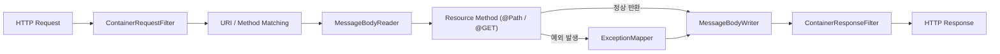

> 자바 표준 REST API 스펙인 JSR-370(JAX-RS / Jakarta RESTful Web Services)의 내부 파이프라인과 핵심 어노테이션 구조를 살펴보고, Spring MVC와의 차이·선택 기준·운영 함정을 정리합니다.

> 본 문서는 Java 21, Jakarta RESTful Web Services 3.1(Jakarta EE 10 / Quarkus REST), Spring Boot 3.4(Spring MVC 6.2) 환경을 기준으로 작성되었습니다.
{: .prompt-info }

## JSR-370(JAX-RS)의 탄생 배경과 아키텍처

자바 웹 초기에는 `HttpServlet`의 `doGet`/`doPost`에서 URL을 직접 파싱하거나 무거운 SOAP(JAX-WS)을 써야 했습니다. REST 스타일이 확산되면서 어노테이션으로 HTTP 리소스를 선언적으로 매핑하기 위해 **JAX-RS(JSR-311 → JSR-339 → JSR-370)** 표준이 등장했고, 현재는 `jakarta.ws.rs` 패키지의 **Jakarta RESTful Web Services**로 이어지고 있습니다.

JAX-RS는 표준 인터페이스만 정의하고 런타임은 구현체에 위임합니다. WildFly·Quarkus의 **RESTEasy(Quarkus REST)**, GlassFish·Dropwizard의 **Eclipse Jersey**, 그리고 **Apache CXF**가 대표적입니다.

내부 파이프라인을 보면, 요청이 들어오면 `ContainerRequestFilter`가 인증·로깅을 수행한 뒤 URI 매칭으로 리소스 메서드를 찾습니다. 요청 본문은 `MessageBodyReader`가 역직렬화하고, 메서드 반환값은 `MessageBodyWriter`가 직렬화해 `ContainerResponseFilter`를 거쳐 응답합니다. 예외 발생 시에는 `ExceptionMapper`가 HTTP `Response`로 변환합니다.



## JAX-RS vs Spring MVC 핵심 구성 요소 및 코드 비교

두 스펙은 어노테이션 기반 라우팅이라는 겉모습은 닮았지만, 빈 생명주기·필터·예외 처리 추상화가 다릅니다.

| 비교 항목 | JAX-RS (Jakarta REST) | Spring MVC |
| :--- | :--- | :--- |
| **표준 여부** | Jakarta EE 공식 표준 (JSR-370 계승) | Spring 독자 모델 |
| **대표 구현체** | RESTEasy (Quarkus), Jersey, CXF | `DispatcherServlet` (`spring-webmvc`) |
| **리소스 선언** | `@Path("/api/orders")` | `@RestController` + `@RequestMapping` |
| **HTTP 메서드** | `@GET`, `@POST`, `@PUT`, `@DELETE` | `@GetMapping`, `@PostMapping` 등 |
| **미디어 타입** | `@Produces`, `@Consumes` | `produces`, `consumes` 속성 |
| **응답 래퍼** | `jakarta.ws.rs.core.Response` | `ResponseEntity<T>` |
| **직렬화 SPI** | `MessageBodyReader` / `Writer` | `HttpMessageConverter` |
| **필터·인터셉터** | `ContainerRequestFilter` / `ResponseFilter` | `HandlerInterceptor` / Servlet `Filter` |
| **전역 예외 처리** | `@Provider` + `ExceptionMapper<T>` | `@RestControllerAdvice` + `@ExceptionHandler` |
| **기본 생명주기** | **Per-Request** (요청마다 새 인스턴스) | **Singleton** (애플리케이션당 1개) |

동일한 주문 API를 **JAX-RS**로 구현한 코드입니다.

```java
// src/main/java/com/example/jaxrs/OrderResource.java
package com.example.jaxrs;

import jakarta.ws.rs.Consumes;
import jakarta.ws.rs.GET;
import jakarta.ws.rs.POST;
import jakarta.ws.rs.Path;
import jakarta.ws.rs.PathParam;
import jakarta.ws.rs.Produces;
import jakarta.ws.rs.core.MediaType;
import jakarta.ws.rs.core.Response;
import java.net.URI;

@Path("/api/orders")
@Produces(MediaType.APPLICATION_JSON)
@Consumes(MediaType.APPLICATION_JSON)
public class OrderResource {

    public record OrderRequest(String itemId, int quantity) {}
    public record OrderResponse(String orderId, String itemId, int quantity) {}

    @GET
    @Path("/{orderId}")
    public Response getOrder(@PathParam("orderId") String orderId) {
        if ("unknown".equals(orderId)) {
            throw new OrderNotFoundException(orderId);
        }
        return Response.ok(new OrderResponse(orderId, "ITEM-1", 2)).build();
    }

    @POST
    public Response createOrder(OrderRequest request) {
        String newId = "ORD-2026";
        return Response.created(URI.create("/api/orders/" + newId))
                .entity(new OrderResponse(newId, request.itemId(), request.quantity()))
                .build();
    }
}
```

```java
// src/main/java/com/example/jaxrs/OrderProviders.java
package com.example.jaxrs;

import jakarta.ws.rs.container.ContainerRequestContext;
import jakarta.ws.rs.container.ContainerRequestFilter;
import jakarta.ws.rs.core.MediaType;
import jakarta.ws.rs.core.Response;
import jakarta.ws.rs.ext.ExceptionMapper;
import jakarta.ws.rs.ext.Provider;
import java.util.Map;
import org.slf4j.Logger;
import org.slf4j.LoggerFactory;

@Provider
class OrderExceptionMapper implements ExceptionMapper<OrderNotFoundException> {

    @Override
    public Response toResponse(OrderNotFoundException ex) {
        return Response.status(Response.Status.NOT_FOUND)
                .type(MediaType.APPLICATION_JSON)
                .entity(Map.of("error", "ORDER_NOT_FOUND", "orderId", ex.getOrderId()))
                .build();
    }
}

@Provider
class RequestLoggingFilter implements ContainerRequestFilter {

    private static final Logger log = LoggerFactory.getLogger(RequestLoggingFilter.class);

    @Override
    public void filter(ContainerRequestContext ctx) {
        log.info("JAX-RS Request: {} {}", ctx.getMethod(), ctx.getUriInfo().getPath());
    }
}
```

동일 기능을 **Spring MVC**로 구현하면 다음과 같습니다.

```java
// src/main/java/com/example/mvc/OrderController.java
package com.example.mvc;

import java.net.URI;
import java.util.Map;
import org.springframework.http.HttpStatus;
import org.springframework.http.ResponseEntity;
import org.springframework.web.bind.annotation.ExceptionHandler;
import org.springframework.web.bind.annotation.GetMapping;
import org.springframework.web.bind.annotation.PathVariable;
import org.springframework.web.bind.annotation.PostMapping;
import org.springframework.web.bind.annotation.RequestBody;
import org.springframework.web.bind.annotation.RequestMapping;
import org.springframework.web.bind.annotation.RestController;
import org.springframework.web.bind.annotation.RestControllerAdvice;

@RestController
@RequestMapping("/api/orders")
public class OrderController {

    public record OrderRequest(String itemId, int quantity) {}
    public record OrderResponse(String orderId, String itemId, int quantity) {}

    @GetMapping("/{orderId}")
    public ResponseEntity<OrderResponse> getOrder(@PathVariable String orderId) {
        if ("unknown".equals(orderId)) {
            throw new OrderNotFoundException(orderId);
        }
        return ResponseEntity.ok(new OrderResponse(orderId, "ITEM-1", 2));
    }

    @PostMapping
    public ResponseEntity<OrderResponse> createOrder(@RequestBody OrderRequest request) {
        String newId = "ORD-2026";
        return ResponseEntity.created(URI.create("/api/orders/" + newId))
                .body(new OrderResponse(newId, request.itemId(), request.quantity()));
    }
}

@RestControllerAdvice
class OrderExceptionHandler {

    @ExceptionHandler(OrderNotFoundException.class)
    public ResponseEntity<Map<String, String>> handleNotFound(OrderNotFoundException ex) {
        return ResponseEntity.status(HttpStatus.NOT_FOUND)
                .body(Map.of("error", "ORDER_NOT_FOUND", "orderId", ex.getOrderId()));
    }
}
```

## 실무 선택 기준: Spring Boot 생태계 vs Quarkus·Jakarta EE

기능 자체의 우열보다 **런타임 생태계**가 선택을 좌우합니다.

- **Spring MVC**: Spring Boot, Spring Security, Spring Data, `@WebMvcTest` 등 통합 생태계를 활용하는 팀에 가장 합리적입니다. Spring Boot 위에 `spring-boot-starter-jersey`를 굳이 얹으면 Actuator·Security·테스트 슬라이스 통합 이점이 줄어드므로 레거시 이관 목적이 아니라면 비권장입니다.
- **JAX-RS (Quarkus / Jakarta EE)**: 빠른 콜드 스타트와 저메모리가 중요한 서버리스·컨테이너 환경(Quarkus + GraalVM Native Image), 또는 벤더 중립적인 Jakarta EE / MicroProfile 표준 준수가 필요한 환경에서 강점을 발휘합니다. 특히 `quarkus-rest`는 어노테이션을 컴파일 타임에 분석해 Vert.x 논블로킹 라우터에 직접 연결합니다.

## 프로덕션 운영 시 자주 겪는 함정 (Edge Cases)

### 1. 리소스 클래스의 기본 생명주기 차이 (Per-Request vs Singleton)

Spring `@RestController`는 싱글톤이지만, **순수 JAX-RS 리소스 클래스는 요청마다 새 인스턴스를 만드는 Per-Request가 기본값**입니다. 인스턴스 필드에 캐시나 카운터를 두면 요청마다 초기화되며, 반대로 Quarkus(CDI)에서는 싱글톤으로 동작할 수도 있습니다. 리소스 클래스는 항상 무상태(Stateless)로 작성하고 `@RequestScoped`·`@ApplicationScoped`를 명시하는 것이 안전합니다.

### 2. `ExceptionMapper` 우선순위와 `WebApplicationException` 덮어쓰기

JAX-RS는 예외 상속 계층에서 가장 구체적인 `ExceptionMapper`를 선택합니다. `ExceptionMapper<Throwable>`을 등록하면 `NotFoundException`(404)이나 `NotAllowedException`(405) 같은 프레임워크 `WebApplicationException`까지 가로채 모두 500으로 덮어써 버립니다.

```java
@Provider
public class GlobalExceptionMapper implements ExceptionMapper<Throwable> {

    @Override
    public Response toResponse(Throwable ex) {
        if (ex instanceof WebApplicationException webEx) {
            return webEx.getResponse();
        }
        return Response.status(Response.Status.INTERNAL_SERVER_ERROR)
                .type(MediaType.APPLICATION_JSON)
                .entity(Map.of("error", "INTERNAL_SERVER_ERROR"))
                .build();
    }
}
```

### 3. 미디어 타입 협상(`Accept` / `Content-Type`)과 `MessageBodyWriter` 누락

`@Produces(MediaType.APPLICATION_JSON)` 엔드포인트에 `Accept: text/plain`을 보내면 `406 Not Acceptable`, `@Consumes` 불일치 시 `415 Unsupported Media Type`이 반환됩니다. 또한 JSON-B나 Jackson 프로바이더 의존성이 빠지면 직렬화 시점에 아래 500 에러가 발생합니다.

```text
org.glassfish.jersey.message.internal.MessageBodyProviderNotFoundException:
MessageBodyWriter not found for media type=application/json, type=class com.example.OrderResponse
```

> 신규 JAX-RS 서비스에서는 통합 테스트에 JSON 직렬화·역직렬화뿐 아니라 잘못된 `Accept`/`Content-Type` 헤더의 406/415 응답 검증도 함께 포함해야 합니다.
{: .prompt-warning }

## 정리 및 참고 자료

JSR-370을 계승한 Jakarta REST(JAX-RS)는 벤더 중립적인 선언적 REST 표준입니다. Spring Boot 환경에서는 Spring MVC가 압도적인 생산성을 제공하지만, Quarkus·Jakarta EE 생태계를 다루거나 표준 웹 파이프라인 구조를 이해하려면 JAX-RS의 Provider 체인과 생명주기 모델을 정확히 파악해 두어야 합니다.




