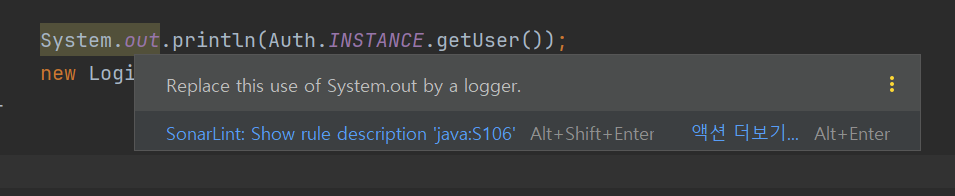
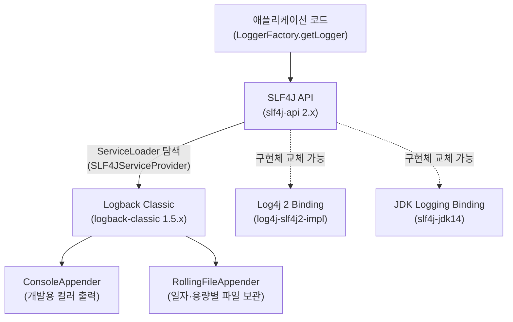
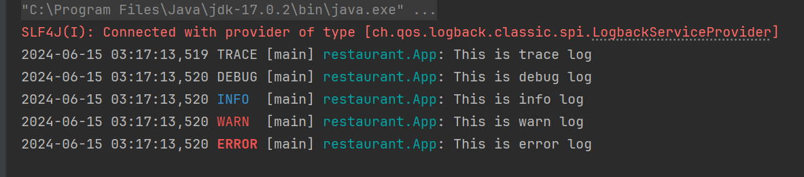

> 기존 Java Swing 프로젝트 전반에 흩어져 있던 `System.out.println()` 호출을 **SLF4J 2.x**와 **Logback** 기반 로깅 체계로 전환하는 과정을 정리합니다. 단순 의존성 추가를 넘어 SLF4J의 파사드·SPI 바인딩 원리, `logback.xml` 콘솔 색상 및 파일 롤링 설정, 그리고 실무에서 자주 겪는 로깅 함정까지 함께 다룹니다.

---

## `System.out.println()`을 제거해야 하는 이유

기존 Java Swing 프로젝트를 리팩토링하면서 가장 먼저 눈에 띈 부분은 디버깅과 상태 출력을 위해 코드 곳곳에 남아 있던 `System.out.println()`이었습니다.



로컬에서 잠깐 값을 확인할 때는 간편하지만, 실제 애플리케이션에서 `System.out.println()`을 로깅 용도로 유지하면 다음과 같은 구조적 문제가 발생합니다.

1. **`synchronized` 락 경합과 I/O 블로킹**: `System.out`은 `PrintStream` 인스턴스이며, `println()` 내부 구현은 `synchronized (this)` 블록으로 감싸져 있습니다. Swing의 EDT(Event Dispatch Thread)와 백그라운드 워커 스레드가 동시에 로그를 출력하면 스레드 경합과 표준 출력 I/O 대기로 UI 응답성이 떨어질 수 있습니다.
2. **로그 레벨 제어 불가**: 개발 환경에서만 보고 싶은 상세 추적 로그와 운영 환경에서 반드시 남겨야 하는 오류 로그를 구분해 켜고 끌 수 없습니다.
3. **출력 대상(Appender)과 포맷 확장 불가**: 타임스탬프, 스레드명, 클래스명을 일관되게 붙이거나 날짜·용량별로 로그 파일을 자동 회전(Rolling)하는 기능을 직접 구현해야 합니다.

이 문제를 해결하기 위해 로깅 추상화 계층인 **SLF4J**와 기본 구현체인 **Logback**을 도입했습니다.

---

## SLF4J 파사드 구조와 2.x 바인딩 원리

**SLF4J(Simple Logging Facade for Java)**는 직접 로그를 출력하는 엔진이 아니라, 애플리케이션 코드와 실제 로깅 구현체(Logback, Log4j 2, JUL 등) 사이를 분리하는 **파사드(Facade) 인터페이스**입니다. 애플리케이션은 `org.slf4j.Logger`에만 의존하므로, 추후 Logback에서 Log4j 2로 구현체를 교체하더라도 비즈니스 코드는 한 줄도 수정할 필요가 없습니다.

### SLF4J 2.x의 `ServiceLoader` 기반 바인딩

SLF4J 1.7까지는 클래스패스에서 `org.slf4j.impl.StaticLoggerBinder` 클래스를 정적으로 찾는 방식을 썼습니다. 반면 **SLF4J 2.0+**부터는 Java 표준 SPI 메커니즘인 **`java.util.ServiceLoader`**로 전환되어, 구현체 JAR 내부의 `META-INF/services/org.slf4j.spi.SLF4JServiceProvider` 파일을 읽어 바인딩합니다.



### SLF4J 5단계 로깅 레벨

| 레벨 | 우선순위 | 권장 사용 기준 |
| :--- | :---: | :--- |
| `TRACE` | 1 (가장 상세) | 메서드 진입/종료, 반복문 내부 변수 등 극도로 세밀한 추적 |
| `DEBUG` | 2 | 개발·디버깅 시 분기 흐름, 요청 파라미터, 쿼리 확인 |
| `INFO` | 3 | 애플리케이션 기동·종료, 주요 상태 전이 등 정상 운영 이벤트 |
| `WARN` | 4 | 즉시 장애는 아니지만 재시도 발생, 구버전 설정 등 주의가 필요한 상황 |
| `ERROR` | 5 (가장 심각) | 예외 발생, 외부 연동 실패 등 즉각 확인이 필요한 오류 |

---

## 의존성 추가 및 Logger 작성

### 1. Maven / Gradle 의존성 설정

`logback-classic`은 내부적으로 호환되는 `logback-core`와 `slf4j-api`를 전이 의존성으로 포함합니다. 따라서 불안정한 alpha 버전을 별도로 고정하기보다 **`logback-classic` 안정 버전 하나만 선언**하는 편이 버전 충돌을 예방할 수 있습니다.

```xml
<!-- pom.xml -->
<dependency>
    <groupId>ch.qos.logback</groupId>
    <artifactId>logback-classic</artifactId>
    <version>1.5.12</version>
</dependency>
```

Gradle(Kotlin DSL) 환경이라면 다음과 같이 선언합니다.

```kotlin
// build.gradle.kts
dependencies {
    implementation("ch.qos.logback:logback-classic:1.5.12")
}
```

### 2. `LoggerFactory`와 `{}` 파라미터 바인딩

`LoggerFactory.getLogger()`로 클래스별 로거를 생성하고, 문자열 결합(`+`) 대신 `{}` 플레이스홀더를 사용합니다.

```java
// src/main/java/com/example/swing/MainFrame.java
package com.example.swing;

import org.slf4j.Logger;
import org.slf4j.LoggerFactory;

public class MainFrame {

    private static final Logger log = LoggerFactory.getLogger(MainFrame.class);

    public void loadUserProfile(String userId) {
        log.info("사용자 프로필 로딩을 시작합니다. userId={}", userId);
        log.debug("UI 스레드 여부 확인: isEDT={}", javax.swing.SwingUtilities.isEventDispatchThread());
    }
}
```

Lombok을 사용하는 프로젝트라면 `@Slf4j` 어노테이션을 붙여 보일러플레이트 선언을 생략할 수 있습니다. 컴파일 시점에 위와 동일한 `private static final Logger log` 필드가 생성됩니다.

```java
// src/main/java/com/example/swing/OrderPanel.java
package com.example.swing;

import lombok.extern.slf4j.Slf4j;

@Slf4j
public class OrderPanel {

    public void submitOrder(String orderId, int amount) {
        // SLF4J 2.x Fluent API: 구조화 키-값 로깅 및 지연 평가 지원
        log.atInfo()
            .addKeyValue("orderId", orderId)
            .addKeyValue("amount", amount)
            .log("주문 요청을 전송했습니다.");
    }
}
```

실행 시 콘솔에는 타임스탬프, 스레드명, 로그 레벨, 로거명이 구조화되어 출력됩니다.

```text
03:01:10.885 [main] INFO  com.example.swing.MainFrame - 사용자 프로필 로딩을 시작합니다. userId=cmsong111
```

---

## `logback.xml` 색상 출력 및 파일 롤링 설정

Spring Boot와 달리 순수 Java Swing 프로젝트에서는 기본 콘솔 로그가 단색으로 출력되며 파일 저장도 활성화되지 않습니다. `src/main/resources/logback.xml`을 추가하면 콘솔 가독성과 파일 보관을 함께 구성할 수 있습니다.

```xml
<!-- src/main/resources/logback.xml -->
<?xml version="1.0" encoding="UTF-8"?>
<configuration>
    <property name="LOG_DIR" value="./logs" />
    <property name="CONSOLE_PATTERN"
              value="%d{yyyy-MM-dd HH:mm:ss.SSS} %highlight(%-5level) [%thread] %cyan(%logger{20}) - %msg%n" />
    <property name="FILE_PATTERN"
              value="%d{yyyy-MM-dd HH:mm:ss.SSS} %-5level [%thread] %logger{36} - %msg%n" />

    <!-- 개발 확인용 컬러 콘솔 Appender -->
    <appender name="CONSOLE" class="ch.qos.logback.core.ConsoleAppender">
        <encoder>
            <pattern>${CONSOLE_PATTERN}</pattern>
        </encoder>
    </appender>

    <!-- 일자 및 용량 기반 롤링 파일 Appender -->
    <appender name="FILE" class="ch.qos.logback.core.rolling.RollingFileAppender">
        <file>${LOG_DIR}/app.log</file>
        <rollingPolicy class="ch.qos.logback.core.rolling.SizeAndTimeBasedRollingPolicy">
            <fileNamePattern>${LOG_DIR}/app.%d{yyyy-MM-dd}.%i.log.gz</fileNamePattern>
            <maxFileSize>20MB</maxFileSize>
            <maxHistory>14</maxHistory>
            <totalSizeCap>500MB</totalSizeCap>
        </rollingPolicy>
        <encoder>
            <pattern>${FILE_PATTERN}</pattern>
        </encoder>
    </appender>

    <!-- 내 프로젝트 패키지만 DEBUG, 외부 라이브러리는 INFO 유지 -->
    <logger name="com.example.swing" level="DEBUG" />

    <root level="INFO">
        <appender-ref ref="CONSOLE" />
        <appender-ref ref="FILE" />
    </root>
</configuration>
```

- `%highlight(%-5level)`: `ERROR`(빨강), `WARN`(노랑), `INFO`(파랑) 등 레벨별 색상을 적용합니다.
- `%cyan(%logger{20})`: 로거 이름을 축약해 시안(cyan) 색상으로 강조합니다.
- `SizeAndTimeBasedRollingPolicy`: 파일이 20MB를 넘거나 날짜가 바뀌면 `.gz`로 자동 압축 보관하고, 전체 용량이 500MB를 넘지 않도록 오래된 로그를 정리합니다.

실제로 5단계 로그 레벨을 모두 출력해 보면 레벨별 색상이 명확하게 구분되는 것을 확인할 수 있습니다.



---

## 실무 도입 시 주의사항

### 1. 문자열 결합(`+`) 대신 `{}`와 지연 평가 사용
- `log.debug("payload=" + heavyObject.toJson())`처럼 `+` 연산이나 비용이 큰 메서드를 인자로 직접 넘기면, 현재 로그 레벨이 `INFO`여도 **메서드 호출과 문자열 결합 비용이 그대로 발생**합니다.
- 단순 값은 `{}` 플레이스홀더를 사용하고, 직렬화 등 비용이 큰 계산이 필요하면 SLF4J 2.x의 `log.atDebug().addArgument(() -> heavyObject.toJson()).log("payload={}")`처럼 람다(`Supplier`)로 지연 평가해야 합니다.

### 2. `<root level="TRACE">` 전역 설정 금지
- `<root level="TRACE">`를 전역으로 켜 두면 프로젝트 코드뿐 아니라 Retrofit, OkHttp, Netty 같은 외부 라이브러리의 패킷·내부 상태 로그까지 폭주해 디스크와 CPU를 빠르게 소모합니다.
- 위 `logback.xml` 예시처럼 `<root level="INFO">`를 기본으로 두고, **내 애플리케이션 패키지(`<logger name="com.example.swing" level="DEBUG" />`)만 선택적으로 낮추는 것**이 안전합니다.

### 3. 다중 SLF4J 바인딩 충돌 해결
- 외부 라이브러리가 `slf4j-simple`이나 `slf4j-reload4j` 같은 다른 구현체를 전이 의존성으로 끌어오면 기동 시 `SLF4J: Class path contains multiple SLF4J providers` 경고가 출력되며 의도하지 않은 바인딩이 선택될 수 있습니다.
- 이 경우 의존성 트리(`mvn dependency:tree` 또는 `./gradlew dependencies`)로 충돌 JAR를 찾아 `<exclusions>` / `exclude`로 제거해 단일 구현체(`logback-classic`)만 남겨야 합니다.

---

## 정리

`System.out.println()`을 SLF4J와 Logback으로 교체하면서 얻은 핵심 변화는 다음과 같습니다.

- **코드와 구현체 분리**: SLF4J 2.x 파사드(`ServiceLoader` SPI)를 통해 로깅 구현체 교체에 유연한 구조를 확보했습니다.
- **환경별 로그 제어**: `<root>`와 패키지별 레벨 분리, 컬러 콘솔 패턴, `SizeAndTimeBasedRollingPolicy`로 개발 가독성과 운영 안정성을 동시에 챙겼습니다.
- **성능 및 장애 예방**: `{}` 파라미터 바인딩과 지연 평가로 불필요한 문자열 생성을 막고, 단일 바인딩 유지로 클래스패스 충돌을 예방할 수 있습니다.
