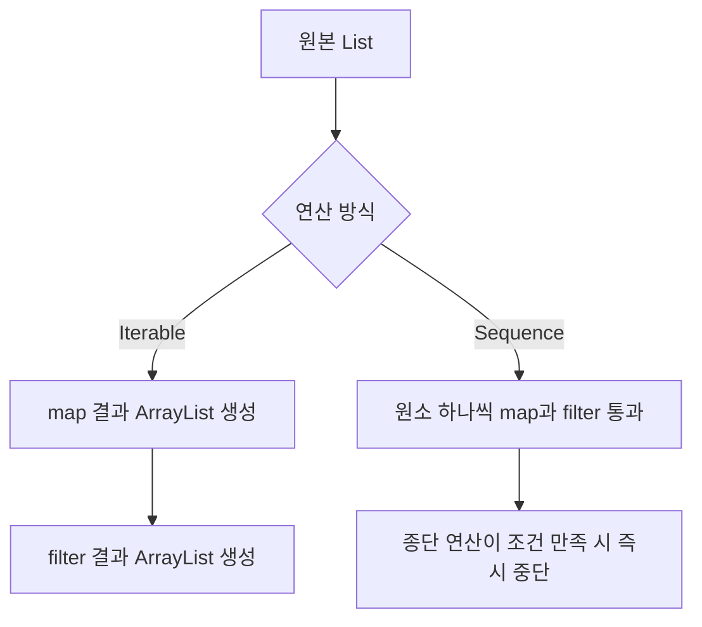

> 알고리즘 스터디에서 "컬렉션 체이닝에는 `asSequence()`를 붙여야 빠르다"는 말을 듣고, 정말 그런지 JMH로 직접 재 보았습니다. 컬렉션 크기와 파이프라인 형태별 실행 시간·할당량, 그리고 `inline`·`reified`가 바이트코드에서 무엇을 바꾸는지 정리합니다.

> 기준 환경: **Kotlin 1.9.0, JDK 17(Temurin 17.0.16, Gradle 툴체인), Gradle 8.2.1, me.champeau.jmh 0.7.1, JMH 1.36**. 개인 PC(12코어, 32GB RAM, Windows + Docker Desktop/WSL2)에서 fork 2회, 워밍업 1초×3, 측정 1초×5로 3번 반복한 중앙값입니다. 측정 중 CPU 사용률이 0~85%로 출렁였으므로 절대값보다 **비율**로 읽어 주세요.
{: .prompt-info }

## 배경

과제 코드에서 `map { }.filter { }.first { }` 같은 체이닝을 자주 썼습니다. "원소가 많으면 Sequence, 작으면 Iterable"이라는 말은 많았지만 기준 숫자는 없어서, 크기 100·1만·100만 개의 `List<Int>`에 세 가지 파이프라인을 돌려 비교했습니다.

## 동작 원리

**Iterable**은 단계마다 결과를 즉시(eager) 만듭니다. `map`과 `filter`가 각각 새 `ArrayList`를 만들고, 대신 두 함수 모두 `inline`이라 람다가 호출 지점에 펼쳐집니다.

**Sequence**는 지연(lazy) 평가입니다. `Sequence.map`은 `inline`이 아니며 람다를 필드로 가진 `TransformingSequence`를 반환할 뿐입니다. 종단 연산이 이터레이터를 당기면 원소 하나씩 `map → filter → 종단 연산`을 통과합니다.



그래서 중간 리스트가 없어 **할당이 줄고**, `first`처럼 멈출 수 있는 연산은 **뒤쪽 원소를 처리하지 않습니다**. 반대로 이터레이터 체인과 `Function1.invoke` 호출 비용이 붙습니다.

## 벤치마크 코드

```kotlin
// build.gradle.kts
plugins {
    kotlin("jvm") version "1.9.0"
    id("me.champeau.jmh") version "0.7.1"
}

repositories { mavenCentral() }

kotlin { jvmToolchain(17) }

jmh {
    jmhVersion.set("1.36")
    fork.set(2)
    warmupIterations.set(3)
    warmup.set("1s")
    iterations.set(5)
    timeOnIteration.set("1s")
    benchmarkMode.set(listOf("avgt"))
    profilers.set(listOf("gc"))
    resultFormat.set("JSON")
}
```

```kotlin
// src/jmh/kotlin/bench/PipelineBenchmark.kt
package bench

import java.util.concurrent.TimeUnit
import org.openjdk.jmh.annotations.Benchmark
import org.openjdk.jmh.annotations.OutputTimeUnit
import org.openjdk.jmh.annotations.Param
import org.openjdk.jmh.annotations.Scope
import org.openjdk.jmh.annotations.Setup
import org.openjdk.jmh.annotations.State

@State(Scope.Benchmark)
@OutputTimeUnit(TimeUnit.MICROSECONDS)
open class PipelineBenchmark {
    @Param("100", "10000", "1000000")
    var size: Int = 0

    private lateinit var data: List<Int>

    @Setup
    fun setup() {
        data = List(size) { it }
    }

    @Benchmark
    fun fullIterable(): Int = data.map { it * 2 }.filter { it % 3 == 0 }.sum()

    @Benchmark
    fun fullSequence(): Int = data.asSequence().map { it * 2 }.filter { it % 3 == 0 }.sum()

    @Benchmark
    fun toListIterable(): List<Int> = data.map { it * 2 }.filter { it % 3 == 0 }

    @Benchmark
    fun toListSequence(): List<Int> = data.asSequence().map { it * 2 }.filter { it % 3 == 0 }.toList()

    // 조건을 만족하는 첫 원소가 리스트 중간(size/2 근처)에 있다
    @Benchmark
    fun firstIterable(): Int = data.map { it * 2 }.filter { it % 3 == 0 }.first { it > size }

    @Benchmark
    fun firstSequence(): Int = data.asSequence().map { it * 2 }.filter { it % 3 == 0 }.first { it > size }
}
```

JMH가 상속하므로 클래스는 `open`이어야 하며 `./gradlew jmh`로 실행합니다.

## 측정 결과

3회 중앙값이며, 할당량은 `-prof gc`의 `gc.alloc.rate.norm`으로 매번 거의 같았습니다.

| 파이프라인 | 크기 | Iterable | Sequence | Iterable ÷ Sequence | 할당 (Iterable → Sequence) |
| :--- | ---: | ---: | ---: | ---: | :--- |
| map·filter·sum | 100 | 0.657µs | 0.292µs | 2.2배 | 1,648B → 672B |
| map·filter·sum | 1만 | 50.5µs | 29.4µs | 1.7배 | 249KB → 159KB |
| map·filter·sum | 100만 | 10.44ms | 5.95ms | 1.8배 | 24.3MB → 16.0MB |
| map·filter·toList | 100 | 0.560µs | 0.379µs | 1.5배 | 1,648B → 1,304B |
| map·filter·toList | 1만 | 45.0µs | 43.4µs | 1.0배 | 249KB → 209KB |
| map·filter·toList | 100만 | 8.52ms | 6.92ms | 1.2배 | 24.3MB → 20.3MB |
| map·filter·first | 100 | 0.467µs | 0.170µs | 2.7배 | 1,648B → 108~120B |
| map·filter·first | 1만 | 45.8µs | 15.8µs | 2.9배 | 249KB → 79KB |
| map·filter·first | 100만 | 10.76ms | 1.83ms | 5.9배 | 24.3MB → 8.0MB |

```json
{
  "type": "bar",
  "data": {
    "labels": ["map·filter·sum", "map·filter·toList", "map·filter·first"],
    "datasets": [
      { "label": "Iterable (ms)", "data": [10.44, 8.52, 10.76], "backgroundColor": "#7aa2f7" },
      { "label": "Sequence (ms)", "data": [5.95, 6.92, 1.83], "backgroundColor": "#9ece6a" }
    ]
  },
  "options": {
    "plugins": { "title": { "display": true, "text": "원소 100만 개 List<Int> 파이프라인 실행 시간 (3회 중앙값)" } },
    "scales": { "y": { "beginAtZero": true, "title": { "display": true, "text": "ms/op" } } }
  }
}
```
{: .chart-js }

예상과 다른 점이 두 가지 있었습니다. 원소 100개에서도 Sequence가 빨랐는데, 이 파이프라인에서는 중간 `ArrayList` 두 개의 비용이 이터레이터 비용보다 컸습니다. 또 `toList()`로 모으면 이점이 1.0~1.5배로 줄었습니다. 최종 리스트는 어차피 만들어야 하고, Sequence는 최종 크기를 몰라 배열 확장 복사가 생기기 때문입니다.

100만 개 Sequence에서도 16MB가 할당된 것은 `map { it * 2 }` 결과가 127을 넘을 때마다 새 `Integer`(16바이트)로 박싱되기 때문입니다. `first`의 8.0MB는 중간 지점까지 약 50만 개를 처리하고 멈췄다는 뜻입니다. 일부 칸은 실행 내 오차가 ±30%를 넘어 1.0배처럼 작은 차이는 "비슷하다"로만 해석했습니다.

## inline과 reified 바이트코드

`inline`이 무엇을 없애는지 `javap -c -p`로 확인했습니다.

```kotlin
// src/main/kotlin/inl/Inline.kt
package inl

inline fun <reified T> List<Any>.countOf(): Int {
    var count = 0
    for (e in this) if (e is T) count++
    return count
}

fun countStrings(xs: List<Any>): Int = xs.countOf<String>()

fun applyTwice(x: Int, f: (Int) -> Int): Int = f(f(x))

inline fun applyTwiceInline(x: Int, f: (Int) -> Int): Int = f(f(x))

fun callNonInline(base: Int): Int = applyTwice(3) { it + base }

fun callInline(base: Int): Int = applyTwiceInline(3) { it + base }
```

```text
public static final int countStrings(java.util.List<? extends java.lang.Object>);
      41: instanceof    #51                 // class java/lang/String

public static final int callNonInline(int);
       1: new           #85                 // class inl/InlineKt$callNonInline$1
       6: invokespecial #89                 // Method inl/InlineKt$callNonInline$1."<init>":(I)V
      12: invokestatic  #91                 // Method applyTwice:(ILkotlin/jvm/functions/Function1;)I

public static final int callInline(int);
       9: iload_3
      10: iload_0
      11: iadd
      16: iload_3
      17: iload_0
      18: iadd
```

`callNonInline`은 `base`를 캡처한 람다 클래스 `InlineKt$callNonInline$1`을 매번 `new`로 만들고, 그 `invoke`는 결과를 `Integer.valueOf`로 박싱합니다. `callInline`에는 `iadd` 두 번만 남았습니다. `reified`는 호출 지점에 `instanceof String`을 직접 넣고, `countOf` 본문 자체에는 `reifiedOperationMarker`와 `instanceof Object` 자리표시자만 남아 Java에서 의미 있게 호출할 수 없습니다.

같은 람다의 런타임 비용은 JIT 상황에 따라 달랐습니다.

| 방식 | 시간 | 할당 |
| :--- | ---: | ---: |
| Kotlin `inline` | 0.29ns/op | 0B/op |
| 일반 고차 함수, JIT 인라이닝 허용 | 0.24ns/op | 0B/op |
| 일반 고차 함수, `-XX:CompileCommand=dontinline` | 2.83ns/op | 24B/op |

JIT가 `applyTwice`를 인라이닝하면 탈출 분석으로 람다 할당까지 사라져 Kotlin `inline`과 차이가 없었습니다. 인라이닝을 막으면 호출마다 24바이트 람다 객체가 생기고 약 10배 느려졌습니다. 호출 지점이 메가모픽하거나 메서드가 커서 JIT가 인라이닝을 포기할 때입니다.

## 선택 기준

| 상황 | 선택 | 근거 |
| :--- | :--- | :--- |
| `first`·`find`·`take`처럼 중간에 멈추는 연산 | Sequence | 100만 개에서 5.9배, 할당 1/3 |
| 단계가 2개 이상인 전체 순회 후 집계 | Sequence | 1.7~2.2배, 중간 리스트 없음 |
| 최종 결과를 리스트로 모음 | 어느 쪽이든 | 1.0~1.5배, 차이 작음 |
| 단계 하나 (`map`만) | Iterable | 지연 평가 이점 없음 |
| 정렬·`groupBy`·`distinct`가 끼는 경우 | Iterable 검토 | Sequence도 내부에서 전체를 버퍼링 |

**Sequence를 쓰지 말아야 하는 경우**도 있습니다. `sorted()`는 Sequence에서도 전체를 모아 정렬하므로 지연 평가 이점이 사라집니다. 같은 Sequence를 두 번 순회하면 파이프라인이 다시 실행되고, 시드 없는 `generateSequence { }`는 두 번째 순회에서 `IllegalStateException`이 납니다. 원시값 성능이 중요하다면 박싱을 없애는 `IntArray`와 `for` 루프를 먼저 검토합니다.

## 정리

> 주의: Kotlin 벤치마크에 붙인 `@CompilerControl(DONT_INLINE)`은 이 구성(JMH 1.36 reflection 생성기)에서 무시되었습니다. `CLASS` 보존 어노테이션이라 리플렉션으로 읽히지 않아 `META-INF/CompilerHints`에 항목이 없었고, asm 생성기는 Java 17 클래스 파일(major 61)을 읽지 못해 실패했습니다. 처음에는 이를 모른 채 0.2ns라는 비현실적인 값을 얻었고, `-XX:CompileCommand=dontinline,...`을 `jvmArgsAppend`로 넘겨 다시 측정했습니다.
{: .prompt-warning }

- [ ] 중간에 멈추는 연산이 있는 체이닝부터 `asSequence()` 적용을 검토했는가?
- [ ] 결과를 `toList()`로 모으는 파이프라인이라면 측정 없이 Sequence로 바꾸지 않았는가?
- [ ] `sorted`·`groupBy`가 끼어 있거나 같은 Sequence를 여러 번 순회하지 않는가?
- [ ] 고차 함수 유틸리티에 `inline`을 붙일 때 람다를 저장·전달하는 파라미터는 `noinline`으로 구분했는가?
- [ ] JMH 결과가 ns 미만이거나 할당 0B라면 JIT가 코드를 지운 것은 아닌지 먼저 의심했는가?
