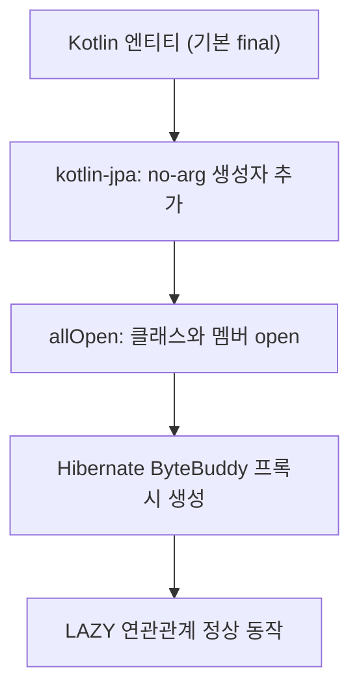

> 스터디 토이 프로젝트에서 Kotlin `data class`로 JPA 엔티티를 만들었다가 지연 로딩이 동작하지 않고 `toString()`에서 `StackOverflowError`가 나는 문제를 겪었습니다. 원인이 된 Kotlin의 `final` 기본값과 `data class`의 자동 생성 메서드를 짚고, all-open·no-arg 플러그인 설정과 엔티티 작성 기준을 정리합니다.

> 본 문서는 **Spring Boot 3.1.4, Kotlin 1.9.10, Hibernate ORM 6.2, Java 17** 환경을 기준으로 작성되었습니다.
{: .prompt-info }

## 문제 상황

학교 스터디에서 게시판 API를 Kotlin으로 옮기면서 엔티티를 가장 Kotlin다워 보이는 `data class`로 선언했습니다. 처음에는 잘 동작하는 듯했지만 세 가지 이상 증상이 연달아 나타났습니다.

1. `@ManyToOne(fetch = FetchType.LAZY)`로 선언한 `Post.member`가 조회 시점에 항상 함께 로딩되었습니다.
2. 디버깅용 로그에 `post.toString()`을 찍자 `Post → Member → posts → Post`로 순환 호출되며 `StackOverflowError`가 발생했습니다.
3. 영속화 전에 `HashSet`에 넣어 둔 엔티티를 저장 후 다시 찾으면 `contains()`가 `false`를 반환했습니다.

애플리케이션 시작 로그에는 `HHH000305: Could not create proxy factory` 경고가 남아 있었는데, 처음에는 무심코 지나쳤던 이 한 줄이 1번 증상의 원인이었습니다.

## 원인 분석

Kotlin 클래스와 멤버는 **기본적으로 `final`**입니다. Hibernate는 지연 로딩을 위해 엔티티를 상속한 프록시 클래스를 ByteBuddy로 런타임에 생성하는데, 클래스가 `final`이면 상속 자체가 불가능합니다. 프록시를 만들지 못한 Hibernate는 경고를 남기고 연관 엔티티를 즉시 로딩으로 처리합니다. 클래스만 열어도 부족하며, 프록시가 가로채야 하는 getter 역시 `open`이어야 합니다.

`data class`는 주 생성자의 모든 프로퍼티로 `equals()`·`hashCode()`·`toString()`을 생성합니다. 엔티티에서는 이 동작이 그대로 함정이 됩니다.

- **`toString()`**: 양방향 연관관계를 따라가며 무한 재귀에 빠지고, 지연 로딩 필드를 건드려 의도치 않은 쿼리나 `LazyInitializationException`을 일으킵니다.
- **`hashCode()`**: 저장 전 `id = null`이던 값이 저장 후 채워지면 해시값이 바뀌어 `HashSet`·`HashMap`에서 엔티티를 찾지 못합니다.
- **`equals()`**: 프록시 객체는 실제 클래스의 하위 타입이라 `javaClass` 비교가 실패합니다.

마지막으로 JPA 명세는 엔티티에 **인자 없는 생성자**를 요구하지만, 주 생성자에 필수 값을 받는 Kotlin 클래스에는 그런 생성자가 없습니다.



## 해결 방법: 플러그인 설정

`kotlin("plugin.spring")`은 all-open 플러그인의 프리셋으로 `@Component`, `@Transactional`, `@Async` 등 스프링 어노테이션이 붙은 클래스만 엽니다. `@Entity`는 이 목록에 없으므로 `allOpen` 블록에 직접 추가해야 합니다. `kotlin("plugin.jpa")`는 no-arg 플러그인의 프리셋으로 `@Entity`, `@Embeddable`, `@MappedSuperclass`에 인자 없는 생성자를 만들어 줍니다.

```kotlin
// build.gradle.kts
plugins {
    id("org.springframework.boot") version "3.1.4"
    id("io.spring.dependency-management") version "1.1.3"
    kotlin("jvm") version "1.9.10"
    kotlin("plugin.spring") version "1.9.10"
    kotlin("plugin.jpa") version "1.9.10"
}

dependencies {
    implementation("org.springframework.boot:spring-boot-starter-data-jpa")
    implementation("org.jetbrains.kotlin:kotlin-reflect")
    runtimeOnly("com.h2database:h2")
}

allOpen {
    annotation("jakarta.persistence.Entity")
    annotation("jakarta.persistence.MappedSuperclass")
    annotation("jakarta.persistence.Embeddable")
}
```

no-arg 플러그인이 만드는 생성자는 **합성(synthetic) 생성자**라 Kotlin·Java 코드에서는 호출할 수 없고 리플렉션으로만 쓰입니다. 또한 이 생성자는 프로퍼티 초기화 식을 실행하지 않으므로, Hibernate가 DB 값을 채우기 전까지 non-null 프로퍼티가 실제로는 `null`일 수 있다는 점을 기억해야 합니다.

## 엔티티 작성 기준

플러그인 설정 이후 엔티티는 일반 `class`로 작성하고, 아래 세 가지 기준을 지켰습니다.

- **ID는 `Long? = null`**: Kotlin의 non-null `Long`은 바이트코드에서 원시 `long`이 됩니다. Spring Data JPA는 원시 타입 ID가 `0`이면 신규로 판단하므로 `Long = 0`도 동작하지만, "아직 저장되지 않음"을 타입으로 드러내는 `null`이 의도를 더 명확히 표현합니다.
- **상태는 `var` + `protected set`**: 외부에서 값을 바꾸지 못하게 막고 변경은 도메인 메서드로만 허용합니다. all-open으로 프로퍼티가 `open`이 되면 `private set`은 컴파일 오류가 나므로 `protected set`을 사용합니다.
- **`equals()`·`hashCode()`는 ID 기준으로 직접 구현**: 프록시를 고려해 `Hibernate.getClass()`로 실제 클래스를 비교하고, `hashCode()`는 클래스 기준 상수로 고정합니다.

```kotlin
// src/main/kotlin/com/example/board/member/Member.kt
package com.example.board.member

import jakarta.persistence.Column
import jakarta.persistence.Entity
import jakarta.persistence.GeneratedValue
import jakarta.persistence.GenerationType
import jakarta.persistence.Id
import jakarta.persistence.Table
import org.hibernate.Hibernate

@Entity
@Table(name = "member")
class Member(
    name: String,
    email: String,
) {
    @Id
    @GeneratedValue(strategy = GenerationType.IDENTITY)
    var id: Long? = null
        protected set

    @Column(nullable = false, length = 50)
    var name: String = name
        protected set

    @Column(nullable = false, unique = true)
    var email: String = email
        protected set

    fun rename(newName: String) {
        require(newName.isNotBlank()) { "이름은 비어 있을 수 없습니다." }
        this.name = newName
    }

    override fun equals(other: Any?): Boolean {
        if (this === other) return true
        if (other == null || Hibernate.getClass(this) != Hibernate.getClass(other)) return false
        other as Member
        return id != null && id == other.id
    }

    override fun hashCode(): Int = Hibernate.getClass(this).hashCode()

    override fun toString(): String = "Member(id=$id, name=$name)"
}
```

```kotlin
// src/main/kotlin/com/example/board/post/Post.kt
package com.example.board.post

import com.example.board.member.Member
import jakarta.persistence.Entity
import jakarta.persistence.FetchType
import jakarta.persistence.GeneratedValue
import jakarta.persistence.GenerationType
import jakarta.persistence.Id
import jakarta.persistence.JoinColumn
import jakarta.persistence.ManyToOne

@Entity
class Post(
    title: String,
    @ManyToOne(fetch = FetchType.LAZY, optional = false)
    @JoinColumn(name = "member_id")
    val member: Member,
) {
    @Id
    @GeneratedValue(strategy = GenerationType.IDENTITY)
    var id: Long? = null
        protected set

    var title: String = title
        protected set

    override fun toString(): String = "Post(id=$id, title=$title)"
}
```

`toString()`에는 연관 엔티티를 넣지 않아 순환 호출과 지연 로딩 초기화를 원천 차단했습니다. 수정 후 `HHH000305` 경고가 사라졌고, `post.member.javaClass`를 출력하면 `Member$HibernateProxy$...` 형태의 프록시 클래스가 확인되었습니다.

## 선택 기준과 쓰지 말아야 할 때

| 선택지 | 엔티티 적합도 | 이유 |
| :--- | :--- | :--- |
| `data class` 엔티티 | 부적합 | final, 전체 필드 `equals`·`toString`, `copy()`로 영속성 컨텍스트 밖 객체 생성 |
| 일반 `class` + allOpen | 적합 | 프록시 생성 가능, 메서드를 직접 통제 |
| `val` 프로퍼티 | 생성 후 불변 값 | 연관관계 주인, 생성 시각처럼 바뀌지 않는 필드 |
| `var` + `protected set` | 변경 가능한 상태 | 도메인 메서드로만 변경하도록 캡슐화 |

`data class`를 아예 쓰지 말라는 뜻은 아닙니다. 요청·응답 DTO, 조회 전용 Projection, 값 비교가 본질인 `@Embeddable` 밸류 타입에는 여전히 잘 맞습니다. 반대로 **식별자로 동일성을 판단하는 엔티티, 지연 로딩 연관관계가 있는 클래스, 영속성 컨텍스트가 상태를 추적하는 객체**에는 쓰지 않는 것이 안전합니다.

> 주의: all-open 설정에 `@Entity`만 넣고 `@MappedSuperclass`를 빠뜨리면 `BaseTimeEntity` 같은 공통 상위 클래스의 프로퍼티는 여전히 `final`로 남아 프록시가 getter를 가로채지 못합니다. 또한 no-arg 생성자는 초기화 식과 `init` 블록을 실행하지 않으므로, `init`에 넣은 검증 로직은 DB에서 조회한 엔티티에는 적용되지 않는다는 점도 고려해야 합니다.
{: .prompt-warning }

## 정리

- [ ] `plugin.spring`, `plugin.jpa`를 적용하고 `allOpen`에 `Entity`·`MappedSuperclass`·`Embeddable`을 등록했는가?
- [ ] 시작 로그에 `HHH000305` 경고가 남아 있지 않은가?
- [ ] 엔티티를 `data class` 대신 일반 `class`로 선언했는가?
- [ ] `equals()`·`hashCode()`를 ID와 `Hibernate.getClass()` 기준으로 구현하고, `toString()`에서 연관관계를 제외했는가?
- [ ] ID는 `Long? = null`, 변경 가능한 상태는 `protected set`으로 캡슐화했는가?
