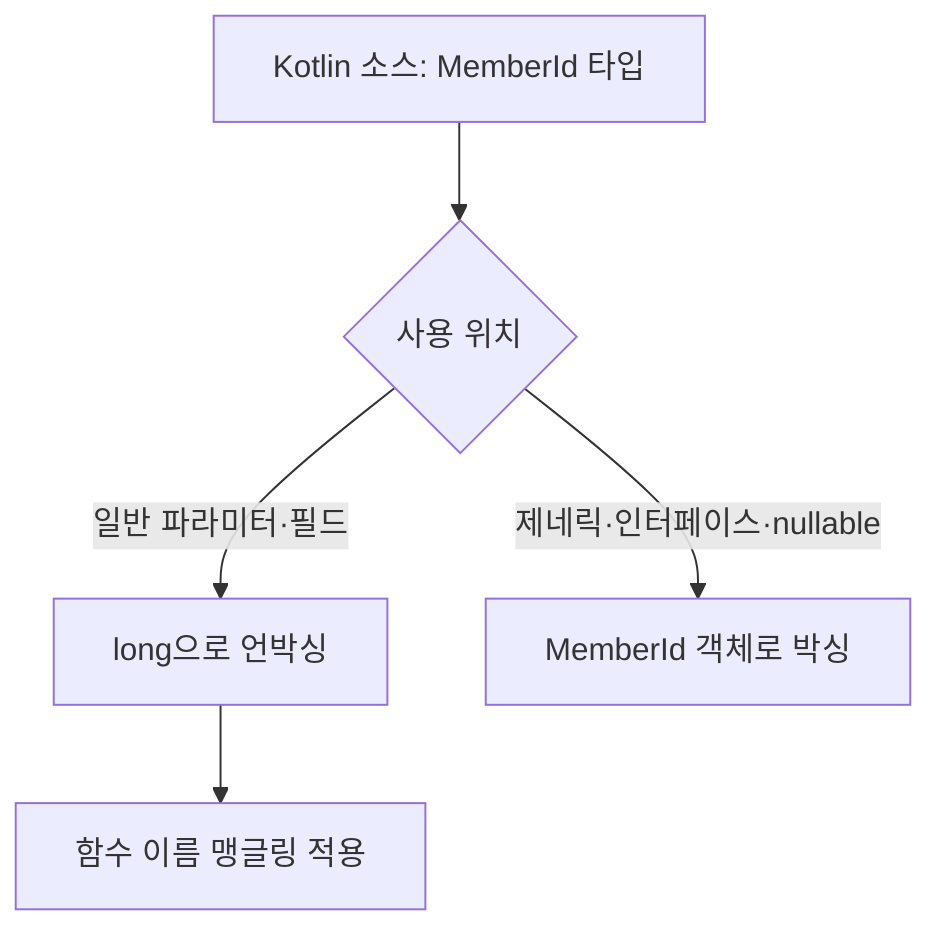

> 원시 타입 `Long`·`String`이 서로 뒤바뀌어 들어가는 버그와, 예외로만 표현하던 비즈니스 실패를 정리하기 위해 Kotlin `value class`와 `sealed interface`를 도입했습니다. 두 기능의 컴파일 결과와 박싱 규칙, `Result`와의 선택 기준, 스프링 경계에서 겪은 주의점을 정리합니다.

> 본 문서는 **Kotlin 1.9.10, Spring Boot 3.1.4, jackson-module-kotlin 2.15 (Boot 관리 버전), Java 17** 환경을 기준으로 작성되었습니다.
{: .prompt-info }

## 배경

스터디 토이 프로젝트의 수강 신청 기능에서 `enroll(memberId: Long, courseId: Long)`의 인자 순서를 바꿔 호출하는 실수를 했습니다. 두 값 모두 `Long`이라 컴파일러는 아무 경고도 하지 않았고, 테스트 데이터의 ID가 우연히 겹쳐 한참 뒤에야 발견했습니다.

실패 표현도 문제였습니다. "정원 초과", "이미 신청함", "신청 기간 아님"을 모두 `IllegalStateException`으로 던지자, 호출하는 쪽에서는 어떤 실패가 가능한지 시그니처만 보고는 알 수 없었습니다. 컨트롤러는 메시지 문자열을 파싱해 HTTP 상태 코드를 정하는 지경이었습니다.

[Kotlin JPA 엔티티 설계 글](/posts/kotlin-jpa-entity-design-allopen-noarg/)에서 엔티티를 일반 `class`로 정리했다면, 이번에는 엔티티 안팎을 오가는 **값과 결과의 타입**을 다듬는 작업입니다.

## value class 동작 원리와 박싱 규칙

`@JvmInline value class MemberId(val value: Long)`는 컴파일 시점에는 별도 타입으로 검사되지만, 바이트코드에서는 가능한 한 내부의 `long`으로 대체됩니다. 래퍼 객체 할당 없이 타입 안전성만 얻는 셈입니다.

다만 항상 언박싱되는 것은 아닙니다. 공식 문서 기준으로 아래 경우에는 **래퍼 객체로 박싱**됩니다.

- 제네릭 타입 인자로 쓰일 때 (`List<MemberId>`, `Map<MemberId, Course>`)
- 구현한 인터페이스 타입으로 다뤄질 때
- `Long`처럼 원시 타입을 감싼 value class를 nullable(`MemberId?`)로 쓸 때

또 하나 알아야 할 점은 **이름 맹글링(mangling)**입니다. `fun enroll(memberId: MemberId, courseId: CourseId)`와 `fun enroll(memberId: Long, courseId: Long)`이 바이트코드에서 같은 시그니처가 되는 충돌을 막기 위해, value class를 파라미터로 받는 함수는 `enroll-AbC12de` 같은 해시 접미사가 붙은 이름으로 컴파일됩니다. Java 코드나 리플렉션 기반 프레임워크가 이 메서드를 원래 이름으로 찾으면 실패하는 이유입니다.



## sealed interface로 실패 결과 모델링

실패 유형은 `sealed interface`로 닫힌 계층을 만들었습니다. 같은 모듈·패키지 안에서만 하위 타입을 정의할 수 있으므로, `when`에서 모든 경우를 다뤘는지 컴파일러가 검사합니다. Kotlin 1.7부터는 sealed 타입에 대한 `when` **문(statement)**도 빠진 분기가 있으면 컴파일 오류가 되어, 새 실패 유형을 추가하면 처리하지 않은 모든 지점이 빌드에서 드러납니다.

```kotlin
// src/main/kotlin/com/example/course/domain/EnrollmentResult.kt
package com.example.course.domain

@JvmInline
value class MemberId(val value: Long) {
    init {
        require(value > 0) { "MemberId는 양수여야 합니다: $value" }
    }
}

@JvmInline
value class CourseId(val value: Long)

sealed interface EnrollmentResult {
    data class Success(val enrollmentId: Long) : EnrollmentResult

    sealed interface Failure : EnrollmentResult {
        data class CapacityExceeded(val capacity: Int) : Failure
        data class AlreadyEnrolled(val memberId: MemberId) : Failure
        data object OutOfPeriod : Failure
    }
}
```

```kotlin
// src/main/kotlin/com/example/course/application/EnrollmentService.kt
package com.example.course.application

import com.example.course.domain.CourseId
import com.example.course.domain.EnrollmentResult
import com.example.course.domain.EnrollmentResult.Failure
import com.example.course.domain.MemberId

class EnrollmentService(
    private val enrolledMembers: MutableSet<Long> = mutableSetOf(),
    private val capacity: Int = 30,
    private val isOpen: () -> Boolean = { true },
) {
    fun enroll(memberId: MemberId, courseId: CourseId): EnrollmentResult = when {
        !isOpen() -> Failure.OutOfPeriod
        memberId.value in enrolledMembers -> Failure.AlreadyEnrolled(memberId)
        enrolledMembers.size >= capacity -> Failure.CapacityExceeded(capacity)
        else -> {
            enrolledMembers += memberId.value
            EnrollmentResult.Success(enrollmentId = courseId.value * 1_000 + enrolledMembers.size)
        }
    }
}

fun EnrollmentResult.toHttpStatus(): Int = when (this) {
    is EnrollmentResult.Success -> 201
    is Failure.CapacityExceeded -> 409
    is Failure.AlreadyEnrolled -> 409
    Failure.OutOfPeriod -> 400
}
```

`data object`는 Kotlin 1.9.0에서 안정화된 기능으로, 싱글턴 실패 유형의 `toString()`이 `OutOfPeriod`처럼 깔끔하게 출력됩니다. 이제 `enroll(courseId, memberId)`처럼 순서를 바꾸면 타입 불일치로 컴파일되지 않습니다.

## Result, sealed, 예외 비교와 선택 기준

| 방식 | 실패 타입 표현 | 컴파일러 검사 | 적합한 상황 |
| :--- | :--- | :--- | :--- |
| 예외 (`throw`) | 시그니처에 드러나지 않음 | 없음 | 복구 불가능한 오류, 프로그래밍 실수 |
| `kotlin.Result<T>` | `Throwable`로 고정 | 성공·실패 2분기만 | 외부 호출 실패를 잠시 감쌀 때 |
| `sealed interface` | 유형별 데이터 클래스 | `when` 전수 검사 | 호출자가 분기해야 하는 비즈니스 실패 |

`Result`는 실패를 `Throwable`로만 담을 수 있어 "정원 초과 시 현재 정원"처럼 실패별 데이터를 타입 안전하게 전달하기 어렵습니다. 또한 `runCatching`은 모든 `Throwable`을 잡기 때문에 코루틴의 `CancellationException`까지 삼켜 취소 전파를 끊을 수 있습니다.

**언제 쓰지 말아야 하는가**도 분명히 정했습니다. DB 연결 실패나 널 참조처럼 호출자가 분기해서 복구할 수 없는 오류까지 sealed 결과로 감싸면 모든 호출 지점에 의미 없는 분기만 늘어납니다. 이런 오류는 예외로 두고 `@RestControllerAdvice`에서 일괄 처리합니다. value class 역시 검증 규칙도 의미도 없는 단순 숫자까지 감싸면 변환 코드만 늘어나므로, **서로 섞이면 안 되는 식별자와 검증 규칙이 있는 값**에만 적용했습니다.

## Spring·Jackson 경계에서의 주의점

도메인 내부에서는 만족스러웠지만, 프레임워크와 맞닿는 경계에서는 몇 가지 제약을 만났습니다. 그래서 컨트롤러 파라미터·요청 DTO·JPA 엔티티 필드는 원시 타입으로 두고, 애플리케이션 서비스 진입 시점에 `MemberId(request.memberId)`로 변환하는 방식으로 정리했습니다.

> 주의: value class를 파라미터로 받는 메서드는 이름이 맹글링되므로 Spring Framework 6.0 기준 컨트롤러 핸들러, `@Transactional` 프록시, Java로 작성된 라이브러리 콜백에 직접 노출하면 리플렉션 호출이 기대대로 동작하지 않을 수 있습니다. Jackson 역시 jackson-module-kotlin 버전에 따라 value class와 sealed 계층의 직렬화 형태가 달라지므로, 응답 DTO에 그대로 노출하기 전에 JSON 형태를 테스트로 고정해 두는 것이 안전합니다. sealed 계층을 JSON으로 주고받아야 한다면 `@JsonTypeInfo`로 판별자 필드를 명시해야 역직렬화 시 하위 타입을 결정할 수 있습니다.
{: .prompt-warning }

Java에서 호출해야 하는 함수라면 `@JvmName("enrollByIds")`로 맹글링된 이름 대신 고정된 이름을 지정할 수 있습니다. 다만 같은 시그니처 충돌 가능성을 직접 관리해야 하므로 꼭 필요한 경계 함수에만 사용했습니다.

## 정리

- [ ] 서로 섞이면 안 되는 식별자(`MemberId`, `CourseId`)에만 `@JvmInline value class`를 적용했는가?
- [ ] 컬렉션·nullable·인터페이스 사용으로 박싱이 빈번한 경로를 성능 민감 구간에서 피했는가?
- [ ] 호출자가 분기해야 하는 비즈니스 실패는 `sealed interface`로, 복구 불가능한 오류는 예외로 구분했는가?
- [ ] `when`에서 `else` 분기 없이 전수 검사를 활용하고 있는가?
- [ ] 컨트롤러·DTO·엔티티 경계에서는 원시 타입으로 변환하고, JSON 형태를 테스트로 고정했는가?
