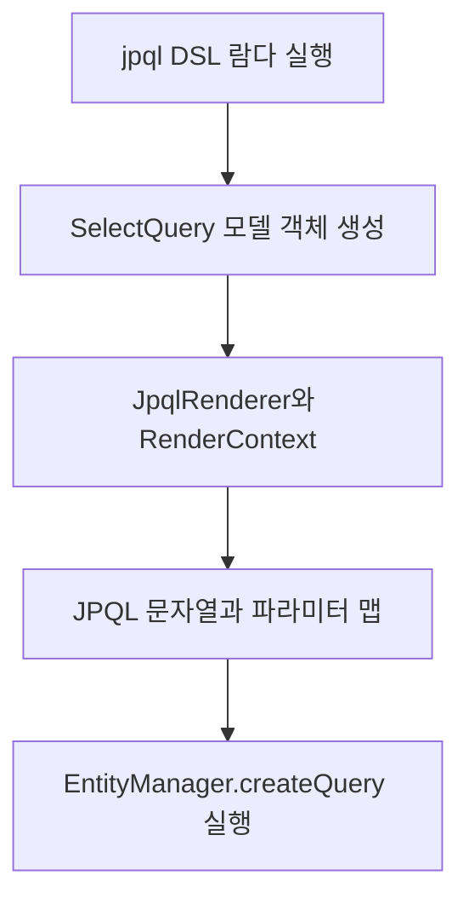

> 도서 검색 API의 동적 조건 쿼리를 문자열 JPQL과 QueryDSL 사이에서 고민하다가, 코드 생성 없이 Kotlin 프로퍼티 참조로 타입 안전한 JPQL을 만드는 Kotlin JDSL 3.x를 도입했습니다. 설정부터 동적 쿼리 작성, 내부 렌더링 흐름, 사용하지 않는 것이 나은 경우까지 정리합니다.

> 본 문서는 **Kotlin JDSL 3.3.1, Spring Boot 3.2.2, Kotlin 1.9.22, Hibernate ORM 6.4, Java 17** 환경을 기준으로 작성되었습니다. Kotlin JDSL 3.0.0은 2023년 10월에 출시되었으며, 2.x와는 패키지와 API가 완전히 다릅니다.
{: .prompt-info }

## 도입 배경

학기 프로젝트로 만든 도서 대여 서비스에 제목, 저자명, 최소 가격, 출간일 조건을 조합하는 검색 API가 필요했습니다. 조건은 모두 선택 값이라 경우의 수만큼 Spring Data 메서드 이름을 만들 수는 없었습니다.

처음에는 `StringBuilder`로 JPQL을 이어 붙였는데, 필드명을 바꾸자 컴파일은 통과하고 런타임에 쿼리 문법 오류가 났습니다. 다음 후보였던 QueryDSL은 Q클래스 생성을 위해 kapt를 설정해야 했습니다. 그런데 Kotlin 공식 문서는 kapt를 유지보수 모드로 안내하고 있고, 빌드 시간이 늘어나는 점도 부담이었습니다. 그래서 별도 코드 생성 없이 `Book::title` 같은 프로퍼티 참조를 그대로 쓰는 Kotlin JDSL을 선택했습니다.

| 방식 | 타입 안전성 | 코드 생성 | Kotlin 친화도 | 적합한 상황 |
| :--- | :--- | :--- | :--- | :--- |
| 문자열 JPQL | 없음 | 불필요 | 보통 | 고정된 단순 쿼리 |
| JPA Criteria API | 메타모델 사용 시 높음 | 메타모델 생성 필요 | 낮음 (장황함) | 표준 API만 허용되는 환경 |
| QueryDSL | 높음 | Q클래스 (kapt) | 보통 | 이미 QueryDSL 자산이 많은 Java 혼용 프로젝트 |
| Kotlin JDSL 3.x | 높음 | 불필요 | 높음 | Kotlin 단일 언어 프로젝트의 동적 조건 쿼리 |

## 프로젝트 설정

Spring Data JPA와 함께 쓰려면 DSL, 렌더러, 스프링 지원 모듈 세 가지를 추가합니다. 엔티티는 [Kotlin JPA 엔티티 설계 글](/posts/kotlin-jpa-entity-design-allopen-noarg/)에서 정리한 것처럼 all-open·no-arg 플러그인이 적용된 일반 `class`를 전제로 합니다.

```kotlin
// build.gradle.kts (dependencies 발췌)
dependencies {
    implementation("org.springframework.boot:spring-boot-starter-data-jpa")
    implementation("com.linecorp.kotlin-jdsl:jpql-dsl:3.3.1")
    implementation("com.linecorp.kotlin-jdsl:jpql-render:3.3.1")
    implementation("com.linecorp.kotlin-jdsl:spring-data-jpa-support:3.3.1")
}
```

`spring-data-jpa-support`의 자동 설정이 렌더링에 필요한 `JpqlRenderContext`를 빈으로 등록하고, 리포지토리가 `KotlinJdslJpqlExecutor`를 상속하면 구현체를 프래그먼트로 연결해 줍니다.

## 동적 검색 쿼리 구현

핵심은 `whereAnd()`가 `null` 조건을 무시한다는 점입니다. 검색 조건 값이 있을 때만 `?.let`으로 Predicate를 만들고, 없으면 `null`을 넘기면 됩니다.

```kotlin
// src/main/kotlin/com/example/library/book/BookRepository.kt
package com.example.library.book

import com.linecorp.kotlinjdsl.support.spring.data.jpa.repository.KotlinJdslJpqlExecutor
import org.springframework.data.jpa.repository.JpaRepository

interface BookRepository : JpaRepository<Book, Long>, KotlinJdslJpqlExecutor
```

```kotlin
// src/main/kotlin/com/example/library/book/BookSearchService.kt
package com.example.library.book

import java.time.LocalDate
import org.springframework.data.domain.Page
import org.springframework.data.domain.Pageable
import org.springframework.stereotype.Service
import org.springframework.transaction.annotation.Transactional

data class BookSearchCondition(
    val title: String? = null,
    val authorName: String? = null,
    val minPrice: Int? = null,
    val publishedFrom: LocalDate? = null,
)

@Service
@Transactional(readOnly = true)
class BookSearchService(
    private val bookRepository: BookRepository,
) {
    fun search(condition: BookSearchCondition, pageable: Pageable): Page<Book> =
        bookRepository.findPage(pageable) {
            select(
                entity(Book::class),
            ).from(
                entity(Book::class),
            ).whereAnd(
                condition.title?.takeIf { it.isNotBlank() }?.let { path(Book::title).like("%$it%") },
                condition.authorName?.let { path(Book::author)(Author::name).eq(it) },
                condition.minPrice?.let { path(Book::price).ge(it) },
                condition.publishedFrom?.let { path(Book::publishedAt).ge(it) },
            ).orderBy(
                path(Book::id).desc(),
            )
        }.map { requireNotNull(it) }
}
```

`path(Book::author)(Author::name)`는 연관 엔티티의 프로퍼티로 경로를 이어 가는 문법으로, JPQL의 `Book.author.name`에 대응합니다. `findPage()`는 `Page<T?>`를 반환하므로 `map`으로 non-null 타입으로 바꿔 서비스 시그니처를 깔끔하게 유지했습니다. 엔티티의 프로퍼티 이름을 바꾸면 IDE 리팩터링이 쿼리까지 함께 바꾸고, 타입이 다른 값을 비교하면 컴파일 단계에서 오류가 납니다.

## 내부 동작: JPQL 렌더링 흐름

Kotlin JDSL 2.x는 JPA Criteria API 위에서 동작했지만, 3.x는 DSL로 만든 쿼리 모델을 **JPQL 문자열로 렌더링**하는 방식으로 바뀌었습니다. 그래서 Hibernate뿐 아니라 EclipseLink 등 JPQL을 받는 구현체라면 동일하게 동작합니다.



DSL 람다는 `select`, `from`, `where` 같은 요소를 불변 모델 객체로 쌓기만 합니다. 이후 `JpqlRenderer`가 `JpqlRenderContext`에 등록된 요소별 Serializer를 순회하며 `SELECT Book FROM Book AS Book WHERE Book.title LIKE :param1`과 비슷한 형태의 문자열과 바인딩 파라미터를 만듭니다. 사용자 입력은 문자열에 직접 이어 붙지 않고 이름 기반 파라미터로 바인딩되므로 JPQL 인젝션 걱정도 덜 수 있습니다. `findPage()`는 결과 조회 외에 전체 건수를 구하는 count 쿼리도 추가로 실행하므로, 실행 로그에서 쿼리가 두 번 나가는 것이 정상입니다. 무한 스크롤처럼 전체 건수가 필요 없다면 `findSlice()`로 count 쿼리를 생략할 수 있습니다.

## 주의할 점과 쓰지 말아야 할 때

> 주의: `whereAnd()`에 전달한 조건이 모두 `null`이면 조건은 `1 = 1`로 해석되어 전체 테이블을 조회합니다. 검색 API라면 최소 한 개 조건을 요구하거나 기간 기본값을 두어야 합니다. 또한 `like`에 사용자 입력을 그대로 넣으면 입력에 포함된 `%`, `_`가 와일드카드로 동작하므로 `escape` 인자로 이스케이프 문자를 지정해야 합니다. 컬렉션 연관관계를 fetch join한 상태로 `findPage()`를 쓰면 Hibernate가 `firstResult/maxResults specified with collection fetch; applying in memory` 경고와 함께 메모리에서 페이징하므로 피해야 합니다.
{: .prompt-warning }

Kotlin JDSL이 항상 정답은 아닙니다. 조건이 고정된 단순 조회는 Spring Data 메서드 이름이나 `@Query`가 더 읽기 쉽습니다. 윈도 함수, CTE, DB 전용 함수가 필요한 통계성 쿼리는 JPQL 표현 범위를 넘으므로 네이티브 SQL이나 jOOQ 같은 SQL 중심 도구가 적합합니다. Java 모듈과 쿼리 코드를 공유해야 하는 프로젝트라면 Kotlin 전용 DSL보다 QueryDSL이 협업에 유리할 수 있습니다.

## 정리

- [ ] `jpql-dsl`, `jpql-render`, `spring-data-jpa-support` 버전을 동일하게 맞췄는가?
- [ ] 선택 검색 조건은 `?.let`으로 `null`을 넘겨 `whereAnd()`가 무시하도록 작성했는가?
- [ ] 모든 조건이 비어 있을 때 전체 조회가 되지 않도록 방어 로직을 두었는가?
- [ ] `like` 검색에 사용자 입력 이스케이프를 적용했는가?
- [ ] 통계·윈도 함수처럼 JPQL 범위를 넘는 쿼리는 네이티브 SQL로 분리했는가?
