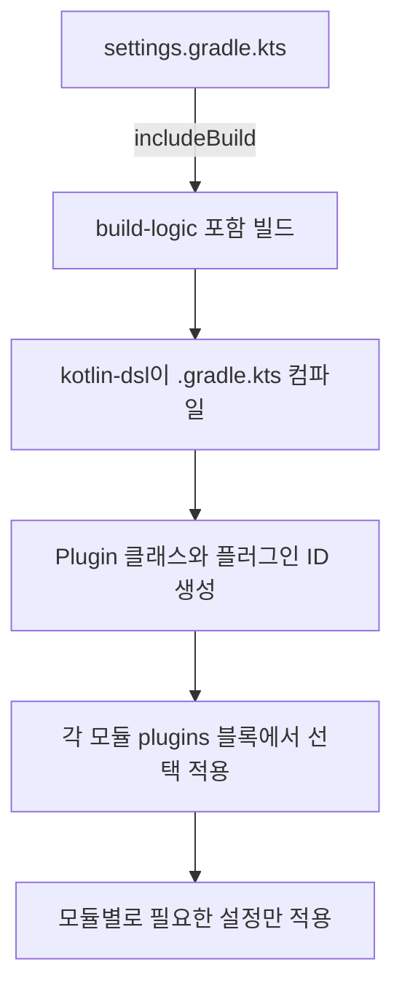

> 스터디 토이 프로젝트를 4개 모듈로 나누며 루트 `subprojects {}`로 설정을 공유했다가 빌드 실패와 의존성 오염을 겪었습니다. `build-logic` 포함 빌드로 옮긴 구조와 설정 캐시·빌드 캐시 조합별 빌드 시간 측정 결과를 정리합니다.

> 기준 환경: **Gradle 8.7(Wrapper), Kotlin 1.9.23, Spring Boot 3.2.4, io.spring.dependency-management 1.1.4, Java 17(Temurin 17.0.16)**. 측정은 개인 PC(12코어, 32GB RAM, Windows + Docker Desktop/WSL2)에서 데몬을 띄운 상태로 `./gradlew --offline`의 벽시계 시간을 재고, 시나리오마다 첫 실행을 버린 뒤 3~5회의 중앙값을 사용했습니다.
{: .prompt-info }

## 도입 배경

처음에는 루트 `build.gradle.kts`의 `subprojects {}` 안에서 Kotlin·Spring·JPA·Spring Boot 플러그인을 일괄 적용했습니다. 모듈별 빌드 파일에는 `dependencies {}`만 남아 깔끔해 보였습니다.

```kotlin
// build.gradle.kts (루트, 기존 방식)
subprojects {
    apply(plugin = "org.jetbrains.kotlin.jvm")
    apply(plugin = "org.jetbrains.kotlin.plugin.spring")
    apply(plugin = "org.jetbrains.kotlin.plugin.jpa")
    apply(plugin = "org.springframework.boot")
    apply(plugin = "io.spring.dependency-management")

    dependencies {
        "testImplementation"("org.springframework.boot:spring-boot-starter-test")
    }
}
```

문제는 "모든 모듈이 같은 설정을 받는다"는 점이었습니다. `./gradlew build`는 실행 파일이 없는 `application` 모듈에서 바로 실패했습니다.

```text
> Task :application:bootJar FAILED
Execution failed for task ':application:bootJar'.
> Error while evaluating property 'mainClass' of task ':application:bootJar'.
   > Main class name has not been configured and it could not be resolved from classpath build\classes\kotlin\main
```

모듈마다 `bootJar`를 끄면 되지만 예외 목록만 늘어납니다. 더 신경 쓰였던 것은 순수 Kotlin으로 두고 싶던 `domain` 모듈이었습니다. `./gradlew :domain:dependencies --configuration testRuntimeClasspath`로 세어 보니 고유 항목이 **73개**였고, Spring 컨텍스트·AssertJ·Mockito가 모두 들어와 있었습니다. 같은 모듈을 컨벤션 플러그인으로 옮긴 뒤에는 `kotlin-stdlib`과 `annotations` **2개**만 남았습니다.

## build-logic 동작 원리

`build-logic`은 `settings.gradle.kts`의 `pluginManagement { includeBuild("build-logic") }`로 연결되는 **포함 빌드**입니다. 그 안의 `src/main/kotlin/club.spring-library.gradle.kts` 같은 파일을 `kotlin-dsl` 플러그인이 **프리컴파일드 스크립트 플러그인**으로 컴파일하고, 파일 이름에서 `.gradle.kts`를 뗀 `club.spring-library`가 플러그인 ID가 됩니다. 내부적으로 스크립트마다 `Plugin<Project>` 구현 클래스와 디스크립터가 생성되어 바이너리 플러그인처럼 해석됩니다.



핵심 차이는 방향입니다. `subprojects {}`는 루트가 자식 프로젝트에 설정을 "밀어 넣고", 컨벤션 플러그인은 각 모듈이 `plugins {}`로 "가져다 씁니다". Gradle 8.7의 인큐베이팅 기능인 Isolated Projects(`-Dorg.gradle.unsafe.isolated-projects=true`)를 켜 보면 이 차이가 그대로 드러납니다. 기존 방식은 `Cannot access project ':api' from project ':'`를 포함해 문제 40건(고유 4건)으로 실패했고, 컨벤션 플러그인 구성은 그대로 통과했습니다.

## 프로젝트 설정

```toml
# gradle/libs.versions.toml
[versions]
kotlin = "1.9.23"
spring-boot = "3.2.4"
spring-dependency-management = "1.1.4"

[libraries]
kotlin-gradle-plugin = { module = "org.jetbrains.kotlin:kotlin-gradle-plugin", version.ref = "kotlin" }
kotlin-allopen = { module = "org.jetbrains.kotlin:kotlin-allopen", version.ref = "kotlin" }
kotlin-noarg = { module = "org.jetbrains.kotlin:kotlin-noarg", version.ref = "kotlin" }
spring-boot-gradle-plugin = { module = "org.springframework.boot:spring-boot-gradle-plugin", version.ref = "spring-boot" }
spring-dependency-management-plugin = { module = "io.spring.gradle:dependency-management-plugin", version.ref = "spring-dependency-management" }
spring-boot-starter = { module = "org.springframework.boot:spring-boot-starter" }
spring-boot-starter-web = { module = "org.springframework.boot:spring-boot-starter-web" }
spring-boot-starter-data-jpa = { module = "org.springframework.boot:spring-boot-starter-data-jpa" }
spring-boot-starter-test = { module = "org.springframework.boot:spring-boot-starter-test" }
jackson-module-kotlin = { module = "com.fasterxml.jackson.module:jackson-module-kotlin" }
kotlin-reflect = { module = "org.jetbrains.kotlin:kotlin-reflect" }
h2 = { module = "com.h2database:h2" }
```

```kotlin
// settings.gradle.kts
pluginManagement {
    includeBuild("build-logic")
}

dependencyResolutionManagement {
    repositoriesMode.set(RepositoriesMode.FAIL_ON_PROJECT_REPOS)
    repositories { mavenCentral() }
}

rootProject.name = "club"
include("domain", "application", "infra", "api")
```

```kotlin
// build-logic/settings.gradle.kts
dependencyResolutionManagement {
    repositories {
        gradlePluginPortal()
        mavenCentral()
    }
    versionCatalogs {
        create("libs") { from(files("../gradle/libs.versions.toml")) }
    }
}

rootProject.name = "build-logic"
```

```kotlin
// build-logic/build.gradle.kts
plugins {
    `kotlin-dsl`
}

dependencies {
    implementation(libs.kotlin.gradle.plugin)
    implementation(libs.kotlin.allopen)
    implementation(libs.kotlin.noarg)
    implementation(libs.spring.boot.gradle.plugin)
    implementation(libs.spring.dependency.management.plugin)
    // 프리컴파일드 스크립트에서 libs 카탈로그 타입 접근용 (gradle/gradle#15383 우회)
    implementation(files(libs.javaClass.superclass.protectionDomain.codeSource.location))
}
```

컨벤션은 `club.kotlin-common`(툴체인·JUnit) → `club.spring-library`(BOM·테스트 의존성) → `club.spring-boot-app`(Boot 플러그인) 순으로 쌓았습니다.

```kotlin
// build-logic/src/main/kotlin/club.kotlin-common.gradle.kts
plugins {
    id("org.jetbrains.kotlin.jvm")
}

kotlin {
    jvmToolchain(17)
    compilerOptions {
        freeCompilerArgs.add("-Xjsr305=strict")
    }
}

tasks.withType<Test>().configureEach {
    useJUnitPlatform()
}
```

```kotlin
// build-logic/src/main/kotlin/club.spring-library.gradle.kts
import org.springframework.boot.gradle.plugin.SpringBootPlugin

plugins {
    id("club.kotlin-common")
    id("org.jetbrains.kotlin.plugin.spring")
    id("io.spring.dependency-management")
}

dependencyManagement {
    imports { mavenBom(SpringBootPlugin.BOM_COORDINATES) }
}

val libs = the<org.gradle.accessors.dm.LibrariesForLibs>()

dependencies {
    "testImplementation"(libs.spring.boot.starter.test)
}
```

```kotlin
// build-logic/src/main/kotlin/club.spring-boot-app.gradle.kts
plugins {
    id("club.spring-library")
    id("org.springframework.boot")
}
```

JPA 엔티티의 `open`·기본 생성자 처리는 `infra` 모듈만 필요하므로 별도 컨벤션으로 분리했습니다. allopen·noarg 플러그인이 왜 필요한지는 [Kotlin JPA 엔티티 설계 글](/posts/kotlin-jpa-entity-design-allopen-noarg/)에 정리해 두었습니다.

```kotlin
// build-logic/src/main/kotlin/club.jpa.gradle.kts
plugins {
    id("club.spring-library")
    id("org.jetbrains.kotlin.plugin.jpa")
}

allOpen {
    annotation("jakarta.persistence.Entity")
    annotation("jakarta.persistence.MappedSuperclass")
    annotation("jakarta.persistence.Embeddable")
}
```

```kotlin
// api/build.gradle.kts
plugins {
    id("club.spring-boot-app")
}

dependencies {
    implementation(project(":domain"))
    implementation(project(":application"))
    runtimeOnly(project(":infra")) // api 코드가 JPA 타입을 직접 참조하지 못하게
    implementation(libs.spring.boot.starter.web)
    implementation(libs.jackson.module.kotlin)
    implementation(libs.kotlin.reflect)
    runtimeOnly(libs.h2)
}
```

```yaml
# api/src/main/resources/application.yml
spring:
  datasource:
    url: jdbc:h2:mem:club
  jpa:
    open-in-view: false
```

`domain`은 `club.kotlin-common`, `application`은 `club.spring-library`, `infra`는 `club.jpa`만 적용합니다. 처음에는 `api`에 `@EnableJpaRepositories`를 붙였는데, `infra`가 Spring Data JPA를 `implementation`으로 선언해 `api` 컴파일 클래스패스에 노출되지 않으므로 `Unresolved reference: EnableJpaRepositories`로 막혔습니다. JPA 설정을 `infra`의 `@Configuration`으로 옮긴 뒤 `api`는 `infra`를 `runtimeOnly`로만 의존합니다.

## 빌드 시간 측정

| 시나리오 (`build`) | 설정 캐시 꺼짐 | 설정 캐시 켜짐 |
| :--- | :--- | :--- |
| clean 후 빌드, 빌드 캐시 없음 | 5,812ms (5,775~5,971) | - |
| clean 후 빌드, 빌드 캐시 적중 | 1,757ms (1,737~1,847) | 1,101ms (1,078~1,175) |
| 변경 없음 (no-op) | 1,202ms (1,166~1,306) | 766ms (764~784) |
| `application` 비 ABI 변경 | 5,693ms (5,166~7,108) | 4,615ms (4,480~4,694) |
| `domain` ABI 변경 | 5,662ms (5,538~6,377) | 4,892ms (4,864~5,575) |

```json
{
  "type": "bar",
  "data": {
    "labels": ["clean, 캐시 없음", "clean, 빌드 캐시", "no-op", "application 비ABI 변경", "domain ABI 변경"],
    "datasets": [
      { "label": "설정 캐시 꺼짐 (ms)", "data": [5812, 1757, 1202, 5693, 5662], "backgroundColor": "#7aa2f7" },
      { "label": "설정 캐시 켜짐 (ms)", "data": [null, 1101, 766, 4615, 4892], "backgroundColor": "#9ece6a" }
    ]
  },
  "options": {
    "plugins": { "title": { "display": true, "text": "4모듈 build 소요 시간 중앙값 (Gradle 8.7)" } },
    "scales": { "y": { "beginAtZero": true, "title": { "display": true, "text": "ms" } } }
  }
}
```
{: .chart-js }

가장 큰 차이는 빌드 캐시였습니다. clean 빌드에서 8개 태스크가 `FROM-CACHE`로 복원되어 5.8초가 1.8초로 줄었습니다. 설정 캐시는 실행마다 0.4~1.1초를 줄였고, `build-logic` 태스크 9개의 최신 여부 확인을 건너뛰어 태스크 수가 29개에서 19개로 줄었습니다.

증분 빌드는 기대보다 덜 줄었습니다. 비 ABI 변경이어도 `application:test`와 `api:test`(`@SpringBootTest`)가 다시 실행되어 4~5초 대부분이 테스트 시간이었고, ABI 변경은 `domain`·`infra` 컴파일이 더해질 뿐이었습니다. `help` 실행 시간은 기존 방식 730ms, 컨벤션 방식 840ms로 오히려 포함 빌드 확인 비용만큼 느렸고, 설정 캐시를 켜면 669ms와 694ms로 비슷해졌습니다. 이 규모에서 컨벤션 플러그인의 이득은 속도보다 **설정의 정확성과 격리**입니다.

## 선택 기준과 주의사항

| 상황 | 권장 방식 |
| :--- | :--- |
| 모듈 2~3개, 설정이 동일 | 단일 모듈 유지 또는 루트 공통 설정 |
| 모듈 역할이 다름 (라이브러리·실행·JPA) | `build-logic` 컨벤션 플러그인 |
| 여러 저장소에서 같은 규칙 공유 | 컨벤션 플러그인을 별도 저장소로 발행 |
| 버전만 공유하고 싶음 | `libs.versions.toml` 버전 카탈로그 |

**쓰지 말아야 하는 경우**도 있습니다. 단일 모듈 프로젝트에서는 `kotlin-dsl` 컴파일과 포함 빌드 확인 비용만 늘어납니다. 컨벤션을 "플러그인 하나에 설정 한 줄" 수준으로 쪼개면 설정 출처를 추적하기 오히려 어렵습니다.

> 주의: 프리컴파일드 스크립트 플러그인 안에서는 `libs` 타입 안전 접근자가 생성되지 않습니다. 위 예제의 `files(libs.javaClass.superclass...)` 의존성은 Gradle 이슈 #15383의 비공식 우회 방법이라 Gradle을 올릴 때마다 동작을 다시 확인해야 합니다. Isolated Projects도 Gradle 8.7에서는 인큐베이팅 기능이므로 호환성 점검용으로만 켰습니다.
{: .prompt-warning }

## 정리

- [ ] 실행 모듈에만 `org.springframework.boot` 플러그인이 적용되어 `bootJar` 실패가 없는가?
- [ ] `domain` 모듈의 `testRuntimeClasspath`에 Spring 의존성이 섞이지 않았는가?
- [ ] 버전은 `libs.versions.toml` 한 곳에서만 관리하고, `build-logic`도 같은 카탈로그를 읽는가?
- [ ] `gradle.properties`에 빌드 캐시·설정 캐시를 켜고 문제 리포트가 비어 있는가?
- [ ] 루트 빌드 파일에 `subprojects {}`·`allprojects {}`가 남아 있지 않은가?
