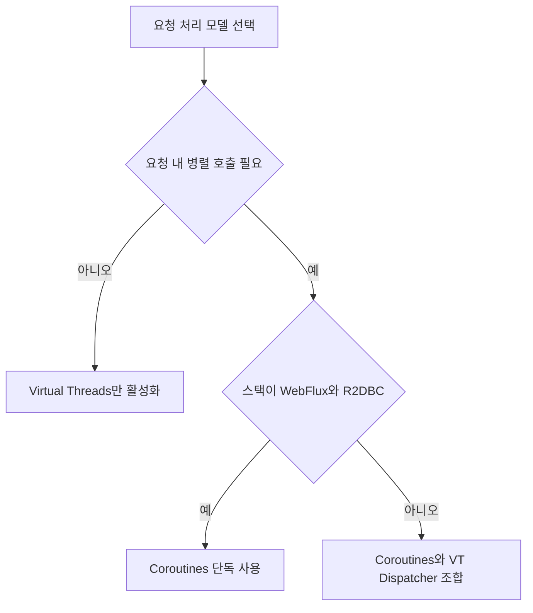

> 동아리 일정 관리 서비스의 대시보드 API를 개선하면서 Kotlin Coroutines와 Java 21 Virtual Threads 중 무엇을 써야 할지 고민했습니다. 두 기술이 스레드를 비우는 방식의 차이와 Spring MVC·블로킹 JDBC 환경에서의 함정, 최종적으로 둘을 조합한 기준을 정리합니다.

> 본 문서는 **Spring Boot 3.4.1, Java 21, Kotlin 2.1.0, kotlinx.coroutines 1.9.0** 환경을 기준으로 작성되었습니다. Spring Boot 3.4가 관리하는 kotlinx.coroutines 버전은 1.8.1이므로 `extra["kotlin-coroutines.version"] = "1.9.0"`으로 직접 올려 사용했습니다.
{: .prompt-info }

## 배경

동아리 프로젝트의 대시보드 API는 회원 프로필(JPA), 공지 목록(외부 게시판 API), 일정(Google Calendar 연동 서버) 세 군데를 순서대로 호출했습니다. 각각 100~300ms가 걸려 응답이 600ms를 넘었고, 행사 신청 기간에 동시 접속이 몰리면 Tomcat 스레드 풀이 대기 요청으로 가득 찼습니다.

해결 방향은 두 가지였습니다. 하나는 `spring.threads.virtual.enabled=true`로 요청 스레드를 Virtual Thread로 바꿔 대기 중인 스레드 비용을 줄이는 것이고, 다른 하나는 Coroutines의 `async`로 세 호출을 병렬화하는 것입니다. 처음에는 둘 중 하나만 고르면 된다고 생각했지만, 두 기술이 해결하는 문제가 다르다는 것을 알고 나서 조합하는 쪽으로 정리했습니다.

## 동작 원리 비교

**Coroutines**는 컴파일러 수준의 기술입니다. `suspend` 함수는 마지막 파라미터로 `Continuation`을 받는 형태로 변환되고, 함수 본문은 중단 지점마다 `label`이 붙은 상태 머신이 됩니다. `delay()`나 `await()` 같은 중단 함수가 `COROUTINE_SUSPENDED`를 반환하면 현재 스레드를 반납하고, 지역 변수는 힙의 Continuation 객체에 보관됩니다. 즉 **`suspend` 지점에서만** 스레드를 비울 수 있으며, JDBC 호출처럼 일반 블로킹 함수를 만나면 스레드를 그대로 붙잡습니다.

**Virtual Threads**는 JVM 런타임 수준의 기술입니다. 소켓 I/O나 `LockSupport.park()` 같은 JDK 블로킹 지점에서 JVM이 스택을 힙으로 옮기고 Carrier Thread에서 내려옵니다. 기존 블로킹 코드를 수정 없이 그대로 쓸 수 있다는 것이 가장 큰 장점이며, 자세한 스케줄링 구조와 Pinning 진단은 [Java 21 Virtual Threads 내부 스케줄링 글](/posts/java-21-virtual-threads-carrier-pinning-guide/)에 정리해 두었습니다.

정리하면 Virtual Threads는 "기다리는 스레드를 싸게" 만들고, Coroutines는 "여러 작업의 시작·취소·실패를 구조적으로 묶는" 도구입니다. Java 21의 `StructuredTaskScope`는 아직 프리뷰 API라 동아리 프로젝트에 도입하기 부담스러웠고, 병렬 호출의 구조적 동시성은 Coroutines의 `coroutineScope`가 맡도록 했습니다.

## 비교와 선택 기준

| 기준 | Coroutines | Virtual Threads | 조합 (Coroutines + VT Dispatcher) |
| :--- | :--- | :--- | :--- |
| 동작 계층 | 컴파일러·라이브러리 | JVM 런타임 | 둘 다 |
| 블로킹 JDBC 호출 | 스레드 점유 (`Dispatchers.IO` 필요) | 자동 unmount | VT에서 실행해 자동 unmount |
| 병렬 호출·취소 전파 | `async`·`coroutineScope`로 구조화 | 직접 Executor·Future 관리 | Coroutines가 담당 |
| 코드 변경 범위 | `suspend` 전파 필요 | 설정 한 줄 | 병렬 구간만 `suspend` |
| ThreadLocal·MDC | 명시적 컨텍스트 요소 필요 | 스레드 단위로 유지 | 명시적 컨텍스트 요소 필요 |



**언제 쓰지 말아야 하는가**도 분명합니다. 병렬 호출이 없는 단순 CRUD API에 Coroutines를 도입하면 `suspend`가 서비스·리포지토리 계층으로 번지기만 하고 이득이 없으므로 Virtual Threads 설정만으로 충분합니다. 반대로 이미지 리사이징 같은 CPU 집약 작업은 두 기술 모두 처리량을 늘려 주지 못하며, 코어 수에 맞춘 `Dispatchers.Default`나 별도 고정 풀이 적합합니다. 외부 API가 초당 호출 수를 제한한다면 Virtual Threads로 동시성을 무한히 늘리는 것이 오히려 장애 원인이 되므로 `Semaphore`로 상한을 두어야 합니다.

## Spring MVC에서 두 기술 조합하기

Spring MVC는 `kotlinx-coroutines-reactor`가 클래스패스에 있으면 `suspend` 컨트롤러 메서드를 Reactor `Mono`로 감싸 Servlet 비동기 요청으로 처리합니다. 병렬 구간의 블로킹 호출은 Virtual Thread 기반 Dispatcher에서 실행해 `Dispatchers.IO`의 기본 상한(64개 또는 코어 수 중 큰 값)에 걸리지 않도록 했습니다.

```kotlin
// build.gradle.kts (발췌)
extra["kotlin-coroutines.version"] = "1.9.0"

dependencies {
    implementation("org.springframework.boot:spring-boot-starter-web")
    implementation("org.springframework.boot:spring-boot-starter-data-jpa")
    implementation("org.jetbrains.kotlinx:kotlinx-coroutines-core")
    implementation("org.jetbrains.kotlinx:kotlinx-coroutines-reactor")
    implementation("org.jetbrains.kotlinx:kotlinx-coroutines-slf4j")
}
```

```kotlin
// src/main/kotlin/com/example/club/dashboard/DashboardService.kt
package com.example.club.dashboard

import java.util.concurrent.Executors
import kotlinx.coroutines.ExecutorCoroutineDispatcher
import kotlinx.coroutines.async
import kotlinx.coroutines.asCoroutineDispatcher
import kotlinx.coroutines.slf4j.MDCContext
import kotlinx.coroutines.withContext
import kotlinx.coroutines.withTimeout
import org.springframework.beans.factory.DisposableBean
import org.springframework.stereotype.Service
import org.springframework.web.client.RestClient
import org.springframework.web.client.body

data class Dashboard(val profile: MemberProfile, val notices: List<String>, val schedules: List<String>)

@Service
class DashboardService(
    private val memberQueryService: MemberQueryService,
    restClientBuilder: RestClient.Builder,
) : DisposableBean {
    private val restClient = restClientBuilder.baseUrl("https://club-api.example.com").build()
    private val vtDispatcher: ExecutorCoroutineDispatcher =
        Executors.newVirtualThreadPerTaskExecutor().asCoroutineDispatcher()

    suspend fun load(memberId: Long): Dashboard = withTimeout(2_000) {
        withContext(MDCContext()) {
            val profile = async(vtDispatcher) { memberQueryService.findProfile(memberId) }
            val notices = async(vtDispatcher) { fetchList("/notices") }
            val schedules = async(vtDispatcher) { fetchList("/members/$memberId/schedules") }
            Dashboard(profile.await(), notices.await(), schedules.await())
        }
    }

    private fun fetchList(uri: String): List<String> =
        restClient.get().uri(uri).retrieve().body<List<String>>().orEmpty()

    override fun destroy() = vtDispatcher.close()
}
```

```kotlin
// src/main/kotlin/com/example/club/dashboard/DashboardController.kt
package com.example.club.dashboard

import org.springframework.web.bind.annotation.GetMapping
import org.springframework.web.bind.annotation.PathVariable
import org.springframework.web.bind.annotation.RestController

@RestController
class DashboardController(private val dashboardService: DashboardService) {
    @GetMapping("/api/members/{memberId}/dashboard")
    suspend fun dashboard(@PathVariable memberId: Long): Dashboard = dashboardService.load(memberId)
}
```

```kotlin
// src/main/kotlin/com/example/club/dashboard/MemberQueryService.kt
package com.example.club.dashboard

import org.springframework.stereotype.Service
import org.springframework.transaction.annotation.Transactional

data class MemberProfile(val id: Long, val name: String)

@Service
class MemberQueryService(private val memberRepository: MemberRepository) {
    @Transactional(readOnly = true)
    fun findProfile(memberId: Long): MemberProfile {
        val member = memberRepository.findById(memberId).orElseThrow()
        return MemberProfile(requireNotNull(member.id), member.name)
    }
}
```

`MemberQueryService.findProfile()`은 `suspend`가 아닌 일반 블로킹 함수로 남겨 두었습니다. 세 작업은 `withContext` 블록이 만든 스코프의 자식이므로, 하나가 실패하거나 2초 제한을 넘기면 나머지 작업도 함께 취소됩니다. 적용 후 대시보드 응답은 가장 느린 호출 시간에 가까운 300ms대로 줄었습니다.

## 운영 함정 및 정리

> 주의: JPA 트랜잭션과 `EntityManager`는 ThreadLocal에 묶여 있어, `suspend` 함수에 `@Transactional`을 붙이고 내부에서 Dispatcher를 바꾸면 트랜잭션 경계가 기대대로 유지되지 않습니다. 트랜잭션은 블로킹 함수 하나에 완결시키고 그 함수를 통째로 Dispatcher에서 호출해야 합니다. MDC 역시 ThreadLocal이라 `MDCContext()` 없이 Dispatcher를 바꾸면 요청 ID가 로그에서 사라지며, 다른 ThreadLocal 값은 `ThreadLocal.asContextElement()`로 전달해야 합니다. 마지막으로 Java 21에서는 `synchronized` 블록 안의 블로킹 I/O가 Carrier Thread를 고정(Pinning)하므로, 오래된 JDBC 드라이버나 커넥션 풀 버전은 `-Djdk.tracePinnedThreads=full`로 먼저 확인해야 합니다.
{: .prompt-warning }

Kotlin 쪽에서는 `synchronized` 블록 안에서 `delay()` 같은 중단 함수를 호출하면 컴파일 오류가 나므로 코루틴 코드 자체가 Pinning을 만들 일은 적습니다. 문제는 대부분 코루틴이 호출하는 Java 라이브러리 내부에서 발생합니다.

- [ ] 병렬 호출이 없는 API는 `spring.threads.virtual.enabled=true`만으로 충분한지 먼저 검토했는가?
- [ ] 병렬 구간은 `coroutineScope`·`withContext` 안의 `async`로 묶어 실패·타임아웃 시 함께 취소되는가?
- [ ] 블로킹 JDBC·HTTP 호출을 `Dispatchers.Default`가 아닌 VT Dispatcher 또는 `Dispatchers.IO`에서 실행하는가?
- [ ] `@Transactional`은 블로킹 함수에 두고 Dispatcher 전환을 트랜잭션 경계 밖에서 하는가?
- [ ] `MDCContext()`로 요청 ID가 로그에 유지되는지, Pinning 이벤트가 없는지 확인했는가?
