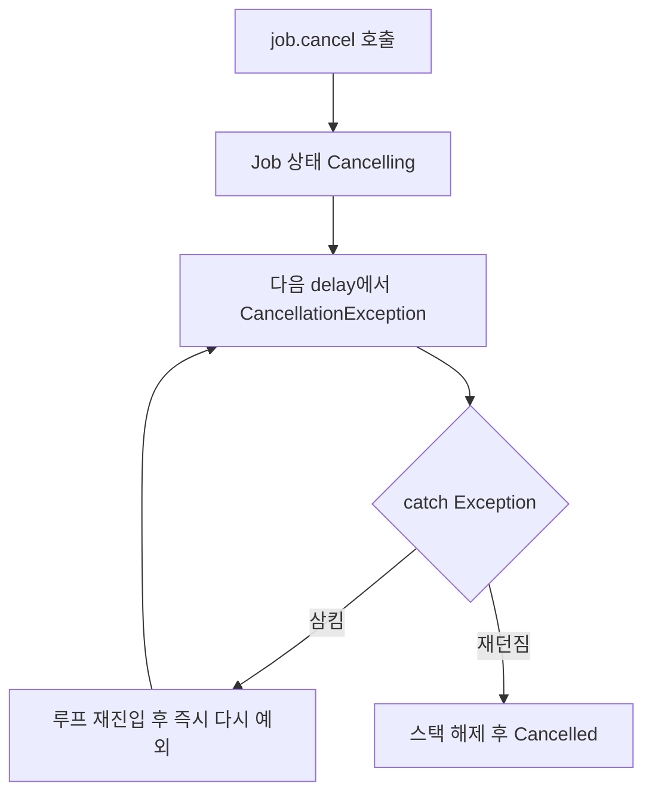
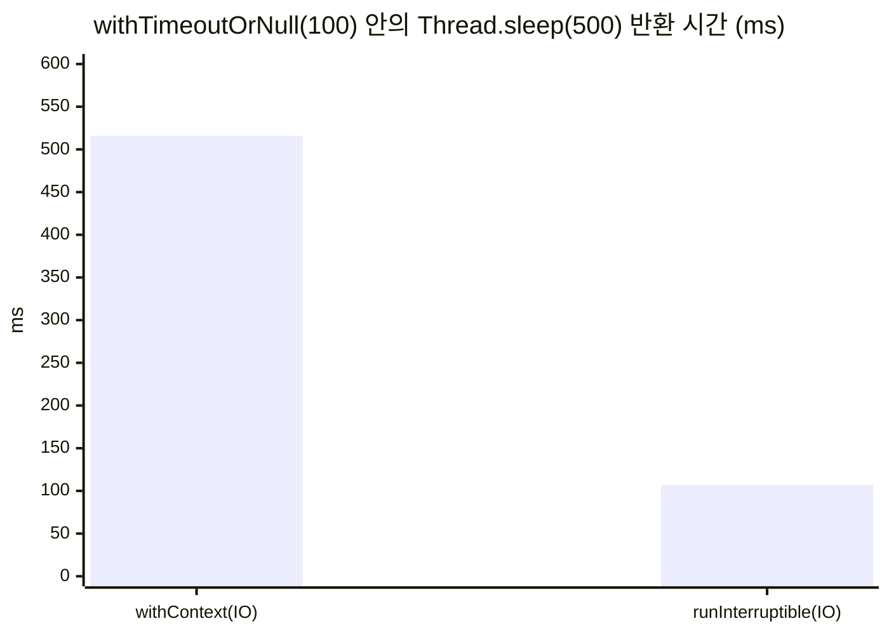

> 동아리 공지 동기화 워커가 애플리케이션을 내린 뒤에도 로그를 남기고, 취소한 작업이 CPU 한 코어를 붙잡는 일을 겪었습니다. 원인은 모두 `CancellationException`을 일반 예외처럼 다룬 코드였습니다. 다섯 가지 함정을 테스트로 재현해 측정한 결과와 처리 기준을 정리합니다.

> 기준 환경: **Kotlin 2.1.0, kotlinx.coroutines 1.10.1, Spring Boot 3.4.2, Java 21, Gradle 8.12.1**. Spring Boot 3.4.2 BOM이 관리하는 kotlinx.coroutines는 1.8.1이라 `extra["kotlin-coroutines.version"] = "1.10.1"`로 올렸습니다. 측정은 개인 PC(12코어, 32GB RAM, Windows + Docker Desktop/WSL2)에서 `./gradlew test`를 3회 반복해 로컬에서 재현했습니다.
{: .prompt-info }

## 문제 상황

동아리 서비스의 공지 동기화 코루틴 워커는 네트워크 오류에도 죽지 않도록 폴링 루프 안을 `try { ... } catch (e: Exception)`으로 감쌌습니다. 그런데 배포 중 컨텍스트가 내려간 뒤에도 "폴링 실패" 로그가 계속 찍혔고, 테스트에서 `job.cancel()`을 호출한 뒤 `join()`이 끝나지 않았습니다.

[Coroutines와 Virtual Threads 선택 기준 글](/posts/kotlin-coroutines-vs-virtual-threads/)에서 "`coroutineScope`로 묶으면 실패·타임아웃 시 함께 취소된다"고 정리했는데, 그 전제는 **취소 신호가 코드 중간에서 사라지지 않는다**는 것이었습니다. 이번 글은 그 전제가 깨지는 지점을 다룹니다.

## 원인 분석

코루틴 취소는 협력적(cooperative)입니다. `job.cancel()`은 Job 상태를 Cancelling으로 바꿀 뿐이고, 실제로 멈추는 것은 코루틴이 다음 중단 지점(`delay`, `await`, `yield` 등)에서 `CancellationException`을 받아 스택을 풀 때입니다. 이 예외는 `IllegalStateException`의 하위 타입이라 `catch (e: Exception)`에 그대로 잡힙니다.

잡힌 뒤가 문제입니다. Job은 이미 취소 상태라 루프가 다시 `delay()`를 호출하면 **즉시** 같은 예외가 나고, `delay`·예외 생성·catch를 반복하는 바쁜 루프가 됩니다. 자식이 끝나지 않으니 `join()`도 돌아오지 않습니다.



`withTimeout`도 같은 계열입니다. 시간 초과 시 던지는 `TimeoutCancellationException`은 `CancellationException`의 하위 타입이고, 부모 코루틴은 이를 **실패가 아닌 정상 취소**로 간주합니다.

## 재현과 측정 결과

20ms마다 폴링하는 루프를 200ms 돌린 뒤 취소하고, 1초 동안 `join()`을 기다렸습니다.

```kotlin
// src/test/kotlin/com/example/club/worker/CancellationSwallowTest.kt (발췌)
val job: Job = scope.launch {
    while (!stopFlag.get()) {
        try {
            pollOnce(polls) // delay(20) 후 카운트 증가
        } catch (e: Exception) { // CancellationException까지 잡힌다
            failures.incrementAndGet()
        }
    }
}
delay(200)
job.cancel()
val joined = withTimeoutOrNull(1_000) { job.join(); true } ?: false
```

```text
[RESULT] swallow: pollsBeforeCancel=6, joined=false, waitedMs=1007, swallowedAfterCancel=566187, pollsAfterCancel=1, isActive=false, isCancelled=true
[RESULT] ensureActive: cancelAndJoinUs=755, swallowed=0
[LOG] 실패 타입=JobCancellationException
[RESULT] runCatching: saved=[기본 공지], jobCancelled=true
[RESULT] afterClose(1s): global +16 ticks, scoped +0 ticks, ctx.isActive=false
```

3회 반복한 결과는 다음과 같습니다.

| 시나리오 | 측정 결과 (3회) |
| :--- | :--- |
| `catch (e: Exception)` 후 취소 | 1초 동안 join 미완료, catch 블록 실행 45만~57만 회 |
| catch 블록에서 `ensureActive()` | `cancelAndJoin` 0.76~0.84ms, 삼킨 횟수 0 |
| `runCatching` + `getOrElse` | `JobCancellationException`을 실패로 받아 기본값 저장 실행 |
| `GlobalScope.launch` 워커 | 컨텍스트 종료 후 1초간 16회 더 실행 |
| 빈이 소유한 스코프 + `@PreDestroy` 취소 | 종료 후 0회 |

`isActive=false`, `isCancelled=true`인데도 코드는 계속 돌았습니다. 상태가 바뀌는 것과 코드가 멈추는 것은 별개입니다. `CancellationException`을 별도 catch로 재던지는 버전도 삼킨 횟수 0으로 끝났지만, 첫 테스트라 초기화 비용이 섞인 18.8~20.4ms여서 시간은 비교하지 않았습니다.

실패 전파와 타임아웃은 100ms에 실패하는 자식 1개와 300ms짜리 자식 2개로 확인했습니다.

| 구성 | 소요 시간 (3회) | 결과 |
| :--- | :--- | :--- |
| `coroutineScope` + `launch` | 105~118ms | 형제 2개가 104~117ms에 취소, 예외가 호출자로 전파 |
| `supervisorScope` + `launch` | 303~305ms | 형제 2개 완료, 실패는 `CoroutineExceptionHandler`로 전달 |
| `supervisorScope` + `async` | 303~318ms | `[notice-ok, fallback(profile 실패)]` |
| `withTimeout(100)` | - | `TimeoutCancellationException` 발생, 최상위 `launch`에서는 핸들러에 보고되지 않음 |
| `withTimeoutOrNull(100)` | - | `null` 반환 |



마지막 측정이 의외였습니다. 100ms 타임아웃을 걸어도 `withContext(Dispatchers.IO)` 안의 `Thread.sleep`은 중단 지점이 없어 515~517ms 뒤에야 `null`이 돌아왔고, `runInterruptible`로 감싸야 인터럽트로 106~108ms에 끝났습니다.

## 선택 기준

| 상황 | 선택 | 이유 |
| :--- | :--- | :--- |
| 하나라도 실패하면 전체가 무의미한 병렬 조회 | `coroutineScope` + `async` | 형제를 즉시 취소하고 예외 전파 |
| 독립 작업 여러 개, 일부 실패 허용 | `supervisorScope` + 각 자식 예외 처리 | 실패가 형제로 번지지 않음 |
| 시간 초과를 "값 없음"으로 처리 | `withTimeoutOrNull` | 예외 흐름 없이 `null` 분기 |
| 시간 초과를 호출자에게 알려야 함 | `withTimeout` 후 비즈니스 예외로 변환 | 최상위 `launch`에서 조용히 사라지는 것 방지 |
| 블로킹 I/O에 타임아웃 | `runInterruptible` | 인터럽트로 스레드를 실제로 깨움 |

**쓰지 말아야 하는 경우**도 분명합니다. `supervisorScope`는 실패를 "격리"할 뿐 처리하지 않으므로, `launch` 자식의 예외를 핸들러 없이 두면 기본 핸들러가 스택 트레이스만 찍고 끝납니다. 하나의 응답을 만드는 병렬 조회처럼 결과가 모두 필요하다면 `coroutineScope`가 맞습니다. `GlobalScope`는 애플리케이션 수명과 같은 작업이라도 쓰지 않는 편이 낫습니다. 종료 시점을 잡을 손잡이가 없어 위 측정처럼 컨텍스트가 닫힌 뒤에도 돌아갑니다.

## 해결 방법

예외를 `Result`로 다루고 싶다면 취소만 다시 던지는 함수를 따로 둡니다.

```kotlin
// src/main/kotlin/com/example/club/support/RunSuspendCatching.kt
package com.example.club.support

import kotlin.coroutines.cancellation.CancellationException

suspend inline fun <T> runSuspendCatching(block: () -> T): Result<T> =
    try {
        Result.success(block())
    } catch (e: CancellationException) {
        throw e
    } catch (e: Exception) {
        Result.failure(e)
    }
```

워커는 빈이 스코프를 소유하고 컨텍스트 종료 시 취소합니다.

```kotlin
// src/main/kotlin/com/example/club/worker/ScopedNoticeSync.kt
package com.example.club.worker

import jakarta.annotation.PreDestroy
import kotlinx.coroutines.CoroutineName
import kotlinx.coroutines.CoroutineScope
import kotlinx.coroutines.Dispatchers
import kotlinx.coroutines.SupervisorJob
import kotlinx.coroutines.cancel
import kotlinx.coroutines.delay
import kotlinx.coroutines.ensureActive
import kotlinx.coroutines.isActive
import kotlinx.coroutines.launch
import org.slf4j.LoggerFactory
import org.springframework.boot.context.event.ApplicationReadyEvent
import org.springframework.context.event.EventListener
import org.springframework.stereotype.Component

@Component
class ScopedNoticeSync(private val noticeClient: NoticeClient) {
    private val log = LoggerFactory.getLogger(javaClass)
    private val scope = CoroutineScope(SupervisorJob() + Dispatchers.Default + CoroutineName("notice-sync"))

    @EventListener(ApplicationReadyEvent::class)
    fun start() {
        scope.launch {
            while (isActive) {
                try {
                    noticeClient.sync()
                } catch (e: Exception) {
                    ensureActive() // 취소 상태면 여기서 루프를 빠져나간다
                    log.warn("공지 동기화 실패, 다음 주기에 재시도", e)
                }
                delay(60_000)
            }
        }
    }

    @PreDestroy
    fun stop() = scope.cancel("application context closed")
}

interface NoticeClient {
    suspend fun sync()
}
```

```kotlin
// build.gradle.kts (발췌)
extra["kotlin-coroutines.version"] = "1.10.1"

dependencies {
    implementation("org.springframework.boot:spring-boot-starter")
    implementation("org.jetbrains.kotlinx:kotlinx-coroutines-core")
    testImplementation("org.springframework.boot:spring-boot-starter-test")
}
```

```yaml
# src/main/resources/application.yml
spring:
  lifecycle:
    timeout-per-shutdown-phase: 10s
```

> 주의: 테스트를 `fun test() = runBlocking { ... assertThat(x).isZero() }`로 쓰면 마지막 식 타입이 반환 타입이 되어 JUnit이 테스트로 인식하지 않습니다. 실제로 재현 테스트 12개 중 3개가 경고 없이 빠졌고, `fun test(): Unit = runBlocking { }`로 고친 뒤 실행됐습니다. 또한 `finally` 블록에서 정리용 중단 함수를 호출해야 한다면 `withContext(NonCancellable)`로 감싸야 취소 중에도 실행됩니다.
{: .prompt-warning }

## 정리

취소는 예외 형태의 **제어 신호**입니다. 일반 예외처럼 삼키면 "부모가 끝나면 자식도 끝난다"는 구조적 동시성의 약속이 깨집니다.

- [ ] 코루틴 안의 `catch (e: Exception)`·`catch (e: Throwable)`마다 `CancellationException`을 재던지거나 `ensureActive()`를 호출하는가?
- [ ] 중단 함수를 감싼 `runCatching`을 취소를 재던지는 함수로 바꿨는가?
- [ ] 결과가 모두 필요한 병렬 작업은 `coroutineScope`, 독립 작업은 `supervisorScope`와 자식별 예외 처리로 나눴는가?
- [ ] `withTimeout` 예외가 최상위 `launch`에서 조용히 사라지지 않는지, 블로킹 호출은 `runInterruptible`로 감쌌는지 확인했는가?
- [ ] `GlobalScope` 대신 빈이 소유한 스코프를 `@PreDestroy`에서 취소하는가?
