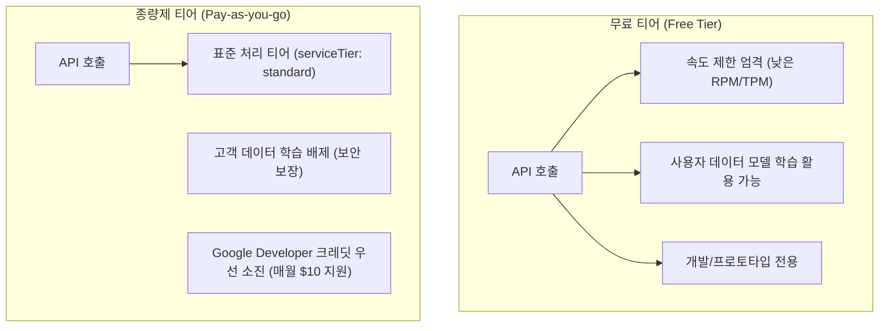

> Google AI Studio에서 Gemini API 키를 발급받는 기본 절차부터, Google One AI Premium(Gemini Pro) 구독 시 제공되는 **Google Developer Program 매월 $10(약 ₩15,348) 프로모션 크레딧**을 수령하여 유료 API(Pay-as-you-go)를 사실상 무료로 운용하는 실전 연동 팁을 정리합니다. 무료 티어(Free Tier)의 데이터 학습 정책과 속도 제한을 회피하고, 프로덕션 수준의 종량제 인프라를 구축하는 과정을 다룹니다.

---

## 무료 티어(Free Tier)의 한계와 유료 전환의 필요성

Google AI Studio는 별도의 신용카드 등록 없이도 무료 API 키를 발급받아 Gemini 모델을 즉시 테스트할 수 있는 훌륭한 개발 환경을 제공합니다. 그러나 백엔드 서비스를 구축하거나 실무 프로덕션 연동을 준비할 때는 무료 티어의 치명적인 제약 조건을 반드시 고려해야 합니다.

### 1. 사용자 데이터의 모델 학습 활용 (Data Privacy)

Google AI Studio 공식 이용 약관에 따르면, **무료 티어로 전송된 프롬프트와 응답 데이터는 구글의 모델 개선 및 검토자의 품질 평가 목적으로 수집·학습에 활용될 수 있습니다.** 

반면 결제 계정(Billing Account)이 연결된 종량제(Pay-as-you-go) 프로젝트에서는 고객 데이터가 구글 모델 학습에 일절 반영되지 않으며, 전송 데이터의 비공개 보안이 엄격하게 보장됩니다.

### 2. 분당 요청 수(RPM/TPM) 및 서비스 티어 차이

무료 티어는 분당 요청 수(RPM)와 분당 토큰 수(TPM)가 엄격하게 제한되어 실시간 스트리밍 채팅이나 대량 배치 처리 시 `429 Too Many Requests` 에러가 빈번하게 발생합니다. 또한 호출 메타데이터의 `serviceTier`가 제한되지만, 결제 계정 연결 시 정식 `standard` 티어로 처리되어 안정적인 레이턴시를 보장받습니다.



---

## Gemini Pro(Google One AI Premium) 구독자의 숨은 혜택: 매월 $10 크레딧

개인적으로 ChatGPT Plus나 Gemini Advanced를 구독 중인 개발자라면 높은 확률로 **Google One AI Premium(Gemini Pro)** 요금제를 이용하고 계실 것입니다. 구글은 이 요금제 구독자에게 [Google Developer Program](https://developers.google.com) 멤버십과 함께 **매달 $10(원화 약 ₩15,348) 상당의 Google Cloud 및 GenAI 프로모션 크레딧**을 무상 지급합니다.

### 혜택 수령 경로

1. 브라우저에서 Google One AI Premium을 구독 중인 구글 계정으로 로그인합니다.
2. [Google Developer Program 혜택 대시보드(me.developers.google.com/benefits)](https://me.developers.google.com/benefits)에 접속합니다.
3. 상단의 `혜택` 탭을 선택하면 아래와 같이 매달 갱신되는 **생성형 AI 및 Cloud 크레딧 카드**를 확인할 수 있습니다.


_Google Developer Program 대시보드에서 매월 제공되는 ₩15,348 크레딧과 결제 계정 연결 상태_

이 크레딧은 1회성 지급이 아니라 **매달 새롭게 충전**되며, 각 크레딧 카드는 발급일로부터 약 1년간 유효합니다. `gemini-3.5-flash-lite`와 같은 가성비 높은 모델을 사용할 경우 백엔드 개발 및 테스트용으로는 매달 수백만 토큰을 무료로 소화할 수 있는 충분한 금액입니다.

---

## Google Cloud 결제 계정 연결 및 선불(Tier 1) 활성화

크레딧을 Google AI Studio에서 사용하려면 크레딧이 입금되는 **Google Cloud 결제 계정(Billing Account)**을 AI Studio 프로젝트에 연결해야 합니다.

### 1. 결제 계정 설정 및 $5 선불 결제

구글 클라우드 결제 계정이 처음이라면 해외 결제 가능한 체크/신용카드를 등록해야 합니다. 신규 생성 시 구글은 어뷰징 방지를 위해 최소 **$5(선불)** 충전을 요구할 수 있습니다. 

> [!TIP]
> 결제 계정에 충전된 $5 잔액과 카드 결제금은 매달 지급되는 **₩15,348 프로모션 크레딧이 먼저 차감**된 후에만 청구됩니다. 따라서 개발 용도로 사용하는 한 카드에서 추가 결제가 일어날 가능성은 거의 없습니다.

### 2. Google AI Studio 프로젝트에 결제 계정 연결

1. [Google AI Studio(aistudio.google.com)](https://aistudio.google.com)에 접속합니다.
2. 좌측 메뉴에서 **프로젝트(Projects)**를 클릭합니다.
3. API를 연동할 프로젝트의 결제 설정(Billing)을 `무료 등급`에서 방금 크레딧을 연동한 결제 계정(`Tier 1 · 선불`)으로 변경합니다.


_Google AI Studio 프로젝트 목록: 일반 '무료 등급'과 결제 계정이 연결된 'Tier 1 · 선불' 등급의 차이_

화면에서 확인할 수 있듯이, 결제 계정을 연결하면 프로젝트 등급이 `Tier 1 · 선불`로 전환됩니다. 이제 해당 프로젝트에서 발급된 API 키는 유료 인프라로 동작합니다.

---

## API 키 발급 및 환경 변수 안전 관리

### 1. API 키 생성

1. AI Studio 좌측 메뉴의 **API 키(API keys)** 탭으로 이동합니다.
2. `새 API 키 만들기(Create API key)`를 클릭하고, 방금 결제 계정을 연결한 `Tier 1` 프로젝트를 선택합니다.
3. 생성된 키 문자열(`AIzaSy...`)을 안전한 장소에 복사합니다.

> [!CAUTION]
> 발급받은 API 키는 절대 GitHub 공개 저장소나 클라이언트 코드에 하드코딩해서는 안 됩니다. 소스코드 유출 시 무단 과금 사고가 발생할 수 있습니다.

### 2. 로컬 환경 변수(`.env`) 설정

프로젝트 루트의 `.env` 파일에 발급받은 키를 등록하고, `.gitignore`에 `.env`가 등록되어 있는지 반드시 확인합니다:

```bash
# .env (절대 깃 커밋 금지)
SPRING_AI_GOOGLE_GENAI_API_KEY=AIzaSyDxxxxxxxxxxxxxxxxxxxxxxxxxxxxxx
```

터미널이나 쉘 프로필에서 로컬 테스트를 진행할 때는 아래와 같이 환경 변수를 로드합니다:

```bash
export SPRING_AI_GOOGLE_GENAI_API_KEY="AIzaSyDxxxxxxxxxxxxxxxxxxxxxxxxxxxxxx"
```

---

## curl을 활용한 유료 표준 티어(standard) 동작 검증

발급된 API 키가 정상적으로 동작하며 실제 유료 표준 티어(`serviceTier: standard`)로 라우팅되는지 cURL 명령어로 즉시 검증할 수 있습니다. 

2026년 기준 Google GenAI의 권장 초경량 모델인 `gemini-3.5-flash-lite` 엔드포인트를 호출해 봅니다:

```bash
curl -s -X POST "https://generativelanguage.googleapis.com/v1beta/models/gemini-3.5-flash-lite:generateContent?key=${SPRING_AI_GOOGLE_GENAI_API_KEY}" \
  -H "Content-Type: application/json" \
  -d '{
    "contents": [
      {
        "parts": [
          { "text": "Hello, reply in 5 words." }
        ]
      }
    ]
  }' | jq .
```

### 실행 결과 및 응답 페이로드 분석

터미널에서 위 명령어를 실행하면 다음과 같이 깔끔한 응답 JSON이 수신됩니다:


_실제 curl 호출 응답: serviceTier가 standard로 지정되어 데이터 프라이버시와 정규 처리 속도가 보장됨_

반환된 JSON 메타데이터에서 주목할 핵심 필드는 다음과 같습니다:

```json
{
  "candidates": [
    {
      "content": {
        "parts": [
          {
            "text": "Hello, how can I help?"
          }
        ],
        "role": "model"
      },
      "finishReason": "STOP",
      "index": 0
    }
  ],
  "usageMetadata": {
    "promptTokenCount": 8,
    "candidatesTokenCount": 7,
    "totalTokenCount": 15,
    "serviceTier": "standard"
  },
  "modelVersion": "gemini-3.5-flash-lite"
}
```

- `"serviceTier": "standard"`: 무료 티어의 제한적 인프라가 아닌, 엔터프라이즈급 정규 서비스 티어로 요청이 처리되었음을 나타냅니다. 데이터는 모델 재학습에 활용되지 않습니다.
- `"modelVersion": "gemini-3.5-flash-lite"`: 가성비와 속도가 탁월하여 실무 마이크로서비스 연동에 최적화된 최신 경량 모델이 정상 응답했습니다.
- `"totalTokenCount": 15`: 8개 입력 토큰과 7개 출력 토큰이 기록되었으며, 해당 비용은 월간 $10 크레딧 잔액에서 우선 차감됩니다.

---

## 정리 및 다음 단계

이번 글에서는 다음 사항들을 살펴보았습니다:
1. Google AI Studio 무료 티어의 데이터 프라이버시(학습 활용) 리스크와 속도 제한 극복 필요성
2. Google One AI Premium(Gemini Pro) 구독자를 위한 Google Developer Program 매월 $10(₩15,348) 크레딧 수령 경로
3. AI Studio 프로젝트를 선불 결제 계정에 연결하여 `Tier 1 · 선불` 인프라를 활성화하는 방법
4. `gemini-3.5-flash-lite` 엔드포인트를 통한 API 키 동작 및 `standard` 서비스 티어 검증

다음 포스트에서는 이번에 발급받은 API 키를 기반으로 **Spring Boot 4.x / Spring AI 2.0.1의 공식 Google GenAI 스타터(`spring-ai-starter-google-genai`)**를 연동하고, `ChatClient` Fluent API를 활용한 동기 텍스트 생성과 구조화된 DTO 매핑을 구현해 봅니다.
