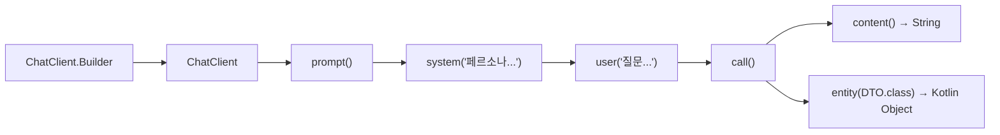

> Spring Boot 4.x 및 Spring AI 2.0.1의 공식 Google GenAI 스타터(`spring-ai-starter-google-genai`)를 연동하여, `ChatClient` Fluent API를 구성하는 표준 패턴을 정리합니다. `gemini-3.5-flash-lite` 모델을 기반으로 시스템 프롬프트(페르소나) 주입, 동기 텍스트 호출, 그리고 `.entity()`를 활용한 DTO 구조화 매핑까지 실제 동작하는 예제 코드로 살펴봅니다.

---

## Spring AI 2.0.1의 핵심: ChatClient Fluent API

과거 Spring AI 1.x 초기에는 각 공급자별 `ChatModel` 구현체(예: `GoogleGenAiChatModel`)를 직접 주입받아 `Prompt` 객체와 `ChatOptions`를 장황하게 조립해야 했습니다. 

하지만 **Spring AI 2.0.x**부터는 스프링의 `WebClient`나 `RestClient`와 동일한 철학의 **`ChatClient` Fluent API**가 도입되었습니다. 이를 통해 단일 빌더 패턴 안에서 시스템 프롬프트, 사용자 메시지, 파라미터 오버라이드, 출력 변환(Structured Outputs)을 직관적인 체이닝 방식으로 호출할 수 있습니다.



---

## 프로젝트 환경 및 의존성 설정

본 예제는 최신 [spring-ai-examples (generate-text)](https://github.com/cmsong111/spring-ai-examples/tree/master/generate-text) 모듈을 기준으로 작성되었습니다.

### 1. build.gradle.kts 설정

`spring-ai-bom:2.0.1`을 임포트하고, Google GenAI 전용 스타터인 `spring-ai-starter-google-genai`를 추가합니다:

```kotlin
plugins {
    kotlin("jvm") version "2.3.21"
    kotlin("plugin.spring") version "2.3.21"
    id("org.springframework.boot") version "4.1.1"
    id("io.spring.dependency-management") version "1.1.7"
}

extra["springAiVersion"] = "2.0.1"

dependencyManagement {
    imports {
        mavenBom("org.springframework.ai:spring-ai-bom:${property("springAiVersion")}")
    }
}

dependencies {
    implementation("org.springframework.boot:spring-boot-starter-web")
    implementation("org.springframework.ai:spring-ai-starter-google-genai")
    implementation("com.fasterxml.jackson.module:jackson-module-kotlin")
    implementation("org.jetbrains.kotlin:kotlin-reflect")

    testImplementation("org.springframework.boot:spring-boot-starter-test")
    testImplementation("org.jetbrains.kotlin:kotlin-test-junit5")
}
```

### 2. application.yaml 모델 및 API 키 구성

이전 글([Google AI Studio API 키 발급 가이드](file:///_posts/Spring/AI/2026-03-05-google-ai-studio-api-key-developer-credits.md))에서 발급받은 키를 환경 변수로 연결합니다. 모델은 속도와 가성비가 뛰어난 `gemini-3.5-flash-lite`를 기본으로 지정합니다:

```yaml
server:
  port: 8081

spring:
  application:
    name: generate-text
  ai:
    google:
      genai:
        api-key: ${SPRING_AI_GOOGLE_GENAI_API_KEY}
        chat:
          options:
            model: gemini-3.5-flash-lite
            temperature: 0.7
```

스프링 부트가 기동되면 `GoogleGenAiAutoConfiguration`이 위 프로퍼티를 감지하여 `GoogleGenAiChatModel`과 프로토타입 빈인 `ChatClient.Builder`를 자동 등록합니다:


_Spring Boot 기동 로그: GoogleGenAiChatModel이 gemini-3.5-flash-lite로 자동 구성된 모습_

---

## ChatClient 빈 등록 및 기본 시스템 프롬프트 설정

`ChatClient`는 스레드 안전(Thread-safe)하므로 애플리케이션 전역에서 사용할 기본 빈을 설정 클래스에 정의해 두면 편리합니다:

```kotlin
package io.github.cmsong111.generate_text

import org.springframework.ai.chat.client.ChatClient
import org.springframework.boot.autoconfigure.SpringBootApplication
import org.springframework.boot.runApplication
import org.springframework.context.annotation.Bean

@SpringBootApplication
class GenerateTextApplication {

    @Bean
    fun chatClient(builder: ChatClient.Builder): ChatClient {
        return builder
            .defaultSystem("당신은 친절하고 전문적인 백엔드 소프트웨어 엔지니어링 AI 어시스턴트입니다.")
            .build()
    }
}

fun main(args: Array<String>) {
    runApplication<GenerateTextApplication>(*args)
}
```

---

## 텍스트 생성 서비스 구현 (TextGenerationService)

`ChatClient`를 주입받아 세 가지 시나리오를 처리하는 비즈니스 서비스를 구성합니다:
1. **단순 프롬프트 호출**: `generateSimple(prompt)`
2. **동적 시스템 프롬프트 오버라이드**: `generateWithSystem(systemPrompt, userPrompt)`
3. **구조화된 DTO 반환**: `recommendBook(topic)`

### 1. DTO 정의 (Kotlin Data Class)

```kotlin
package io.github.cmsong111.generate_text.dto

data class BookRecommendation(
    val title: String,
    val author: String,
    val genre: String,
    val summary: String,
    val reasonsToRead: List<String>
)
```

### 2. 서비스 로직 구현

```kotlin
package io.github.cmsong111.generate_text.service

import io.github.cmsong111.generate_text.dto.BookRecommendation
import org.springframework.ai.chat.client.ChatClient
import org.springframework.stereotype.Service

@Service
class TextGenerationService(
    private val chatClient: ChatClient
) {

    /**
     * 단순 텍스트 생성 (User 프롬프트 단독 동기 호출)
     */
    fun generateSimple(prompt: String): String {
        return chatClient.prompt()
            .user(prompt)
            .call()
            .content() ?: ""
    }

    /**
     * 시스템 프롬프트(페르소나 지정)와 사용자 입력을 결합한 생성
     */
    fun generateWithSystem(systemPrompt: String, userPrompt: String): String {
        return chatClient.prompt()
            .system(systemPrompt)
            .user(userPrompt)
            .call()
            .content() ?: ""
    }

    /**
     * 구조화된 출력 (Structured Output) 반환
     * LLM의 JSON 응답을 Kotlin 객체(DTO)로 직접 역직렬화
     */
    fun recommendBook(topic: String): BookRecommendation? {
        return chatClient.prompt()
            .system("당신은 전문 북 큐레이터입니다. 추천 도서 정보를 지정된 JSON 형식에 맞추어 제공하세요.")
            .user("다음 주제나 관심사에 어울리는 최고의 도서 1권을 추천해주세요: '$topic'")
            .call()
            .entity(BookRecommendation::class.java)
    }
}
```

> [!NOTE]
> `.entity(BookRecommendation::class.java)`를 체이닝하면 Spring AI 내부의 `BeanOutputConverter`가 동작하여 프롬프트에 DTO의 JSON Schema 지침을 자동 주입하고, 모델이 반환한 JSON 문자열을 객체로 안전하게 파싱합니다.

---

## REST 컨트롤러 노출 (TextGenerationController)

외부 HTTP 클라이언트에서 손쉽게 호출할 수 있도록 웹 엔드포인트를 매핑합니다:

```kotlin
package io.github.cmsong111.generate_text.controller

import io.github.cmsong111.generate_text.dto.BookRecommendation
import io.github.cmsong111.generate_text.dto.GenerationRequest
import io.github.cmsong111.generate_text.service.TextGenerationService
import org.springframework.http.ResponseEntity
import org.springframework.web.bind.annotation.*

@RestController
@RequestMapping("/api/generate")
class TextGenerationController(
    private val textGenerationService: TextGenerationService
) {

    @GetMapping
    fun generateSimple(@RequestParam prompt: String): ResponseEntity<Map<String, String>> {
        val result = textGenerationService.generateSimple(prompt)
        return ResponseEntity.ok(mapOf("result" to result))
    }

    @PostMapping("/custom")
    fun generateCustom(@RequestBody request: GenerationRequest): ResponseEntity<Map<String, String>> {
        val result = if (request.systemPrompt != null) {
            textGenerationService.generateWithSystem(request.systemPrompt, request.prompt)
        } else {
            textGenerationService.generateSimple(request.prompt)
        }
        return ResponseEntity.ok(mapOf("result" to result))
    }

    @GetMapping("/book")
    fun recommendBook(@RequestParam topic: String): ResponseEntity<BookRecommendation> {
        val recommendation = textGenerationService.recommendBook(topic)
            ?: return ResponseEntity.notFound().build()
        return ResponseEntity.ok(recommendation)
    }
}
```

---

## 실제 동작 및 테스트 검증

실제 Google Gemini API(`gemini-3.5-flash-lite`)를 호출하는 통합 테스트를 실행하여 응답 품질과 매핑 무결성을 검증합니다:

```kotlin
package io.github.cmsong111.generate_text

import io.github.cmsong111.generate_text.service.TextGenerationService
import org.assertj.core.api.Assertions.assertThat
import org.junit.jupiter.api.Test
import org.springframework.beans.factory.annotation.Autowired
import org.springframework.boot.test.context.SpringBootTest

@SpringBootTest
class TextGenerationIntegrationTests {

    @Autowired
    private lateinit var textGenerationService: TextGenerationService

    @Test
    fun `단순 텍스트 생성 실시간 API 호출 검증`() {
        val prompt = "스프링 부트와 Spring AI의 결합이 백엔드 개발자에게 주는 가장 큰 가치를 한국어로 한 문장으로 요약해줘."
        val result = textGenerationService.generateSimple(prompt)

        println("=== [TextGeneration] Simple Generation Result ===")
        println(result)
        assertThat(result).isNotBlank()
    }

    @Test
    fun `구조화된 도서 추천 DTO 파싱 검증`() {
        val topic = "객체지향 설계와 리팩토링"
        val recommendation = textGenerationService.recommendBook(topic)

        println("=== [TextGeneration] Structured Output Result ===")
        println(recommendation)
        assertThat(recommendation).isNotNull
        assertThat(recommendation?.title).isNotBlank()
    }
}
```

### 테스트 실행 콘솔

Gradle 테스트를 실행하면 약 4초 만에 Google GenAI로부터 유료 표준 티어(`standard`)로 처리된 응답이 도착하며 테스트가 성공합니다:


_JUnit 5 실시간 통합 테스트 통과 및 BookRecommendation 객체 역직렬화 결과_

실제 출력된 로그 결과는 다음과 같습니다:

```text
=== [TextGeneration] Simple Generation Result ===
스프링 부트와 Spring AI의 결합은 백엔드 개발자가 기존에 익숙한 자바 표준 기술과 스프링 생태계 그대로를 활용하여, 복잡한 인공지능(AI) 기능을 애플리케이션에 빠르고 안정적으로 통합할 수 있게 해주는 것입니다.
=================================================

=== [TextGeneration] Structured Output Result ===
BookRecommendation(
  title=리팩토링(2판): 코드 구조를 체계적으로 개선하여 가독성 높이기, 
  author=마틴 파울러, 
  genre=기술/컴퓨터, 
  summary=소프트웨어의 내부 구조를 덩어리째 수정하지 않고 기능은 유지하면서 체계적으로 코드를 개선하는 리팩토링의 원리와 다양한 기법을 다룬 고전이자 바이블입니다., 
  reasonsToRead=[
    코드의 가독성을 높이고 유지보수를 쉽게 만드는 구체적인 기법을 배울 수 있습니다., 
    객체지향 원칙을 실제 코드에 어떻게 적용해야 하는지 명확한 예시를 통해 이해할 수 있습니다., 
    나쁜 코드를 좋은 코드로 점진적으로 개선하는 실전 역량을 기를 수 있습니다.
  ]
)
=================================================
```

### cURL 호출 결과

서버 기동 후 실제 HTTP 요청을 보내면 다음과 같이 깔끔한 JSON 응답을 얻을 수 있습니다:


_REST 엔드포인트 호출 결과: /api/generate 및 /api/generate/book_

---

## 정리 및 다음 단계

- **Spring AI 2.0.1의 `ChatClient` Fluent API**는 기존 `ChatModel` 대비 가독성과 생산성을 획기적으로 향상시킵니다.
- `spring-ai-starter-google-genai`를 통해 최소한의 YAML 설정만으로 `gemini-3.5-flash-lite` 모델을 즉시 연동할 수 있습니다.
- `.entity(Class)`를 활용하면 프롬프트 작성자가 수동으로 JSON 파싱을 구현할 필요 없이 규격화된 DTO로 즉시 바인딩됩니다.

하지만 동기(Synchronous) 방식의 `call()`은 모델이 전체 텍스트 생성을 마칠 때까지 클라이언트가 블로킹(대기)되어야 하므로 사용자의 체감 대기 시간이 길어집니다.

다음 포스트에서는 Spring WebFlux와 **Server-Sent Events(SSE)**를 결합하여, 첫 글자 응답 지연을 0.3초대로 단축하는 **실시간 스트리밍 채팅(Streaming Chat)**을 구현해 봅니다.

---

> 본 포스트의 전체 실습 코드는 [GitHub 저장소 (cmsong111/spring-ai-examples/generate-text)](https://github.com/cmsong111/spring-ai-examples/tree/master/generate-text)에서 확인하실 수 있습니다.
