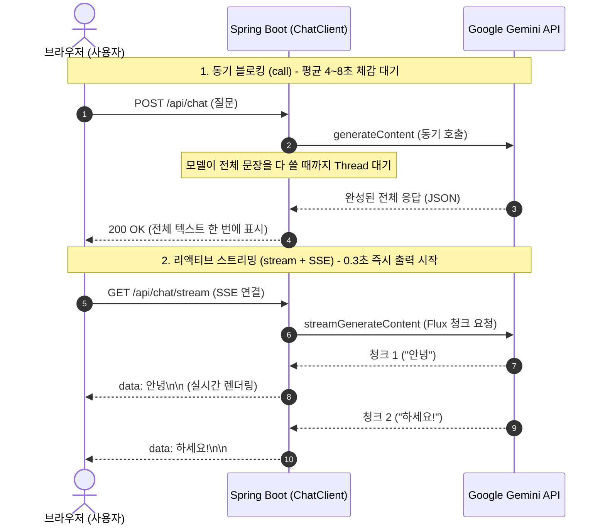

> LLM 기반 채팅 서비스를 구축할 때 사용자가 체감하는 가장 큰 병목은 "모든 문장이 완성될 때까지 멍하니 대기해야 하는 응답 지연(Time to First Token, TTFT)"입니다. 본 글에서는 Spring AI 2.0.1의 `chatClient.prompt().stream()` 리액티브 파이프라인과 HTTP 표준 **Server-Sent Events(SSE)**를 활용하여, 모델이 토큰을 생성하는 즉시 브라우저로 한 글자씩 밀어 넣어 체감 지연을 0.3초대로 단축하고 멀티턴 세션(`ChatMemory`)까지 보존하는 실전 아키텍처를 소개합니다.

---

## 동기 블로킹 vs 리액티브 실시간 스트리밍

전통적인 동기(Synchronous) API 방식은 LLM이 수백 단어의 답변 생성을 모두 마칠 때까지(평균 3~7초) HTTP 연결을 붙잡고 블로킹 상태로 대기합니다:



반면 Spring AI의 스트리밍 API는 Project Reactor의 `Flux<String>`을 기반으로 동작합니다. Google GenAI로부터 토큰 조각이 날아오는 즉시 `text/event-stream` 프로토콜을 통해 클라이언트에 흘려보내므로, 사용자는 질문을 던지자마자 타자를 치듯 타이핑되는 자연스러운 UX를 경험하게 됩니다.

---

## 프로젝트 환경 및 의존성

본 실습 코드는 [spring-ai-examples (chat-sse)](https://github.com/cmsong111/spring-ai-examples/tree/master/chat-sse) 모듈을 기반으로 합니다.

### build.gradle.kts 설정

`spring-ai-starter-model-google-genai`와 리액티브 스트림 처리를 위한 `reactor-core`, 테스트를 위한 `reactor-test`를 등록합니다:

```kotlin
plugins {
    kotlin("jvm") version "2.3.21"
    kotlin("plugin.spring") version "2.3.21"
    id("org.springframework.boot") version "4.1.1"
    id("io.spring.dependency-management") version "1.1.7"
}

dependencies {
    implementation("org.springframework.boot:spring-boot-starter-web")
    implementation("org.springframework.ai:spring-ai-starter-model-google-genai")
    implementation("io.projectreactor:reactor-core")
    
    testImplementation("org.springframework.boot:spring-boot-starter-test")
    testImplementation("io.projectreactor:reactor-test")
    testImplementation("org.jetbrains.kotlin:kotlin-test-junit5")
}
```

---

## ChatMemory & ChatClient 빈 구성

스트리밍 중에도 이전 대화 맥락을 기억하기 위해, 최근 20개의 메시지를 보존하는 슬라이딩 윈도우 인메모리 저장소(`MessageWindowChatMemory`)와 `MessageChatMemoryAdvisor`를 `ChatClient.Builder`에 등록합니다:

```kotlin
package io.github.cmsong111.chat_sse

import org.springframework.ai.chat.client.ChatClient
import org.springframework.ai.chat.client.advisor.MessageChatMemoryAdvisor
import org.springframework.ai.chat.client.advisor.SimpleLoggerAdvisor
import org.springframework.ai.chat.memory.ChatMemory
import org.springframework.ai.chat.memory.InMemoryChatMemoryRepository
import org.springframework.ai.chat.memory.MessageWindowChatMemory
import org.springframework.boot.autoconfigure.SpringBootApplication
import org.springframework.boot.runApplication
import org.springframework.context.annotation.Bean

@SpringBootApplication
class ChatSseApplication {

    @Bean
    fun chatMemory(): ChatMemory {
        return MessageWindowChatMemory.builder()
            .chatMemoryRepository(InMemoryChatMemoryRepository())
            .maxMessages(20)
            .build()
    }

    @Bean
    fun chatClient(builder: ChatClient.Builder, chatMemory: ChatMemory): ChatClient {
        return builder
            .defaultSystem("당신은 실시간으로 사용자에게 친절하고 신속하게 답변하는 AI 어시스턴트입니다.")
            .defaultAdvisors(
                MessageChatMemoryAdvisor.builder(chatMemory).build(),
                SimpleLoggerAdvisor()
            )
            .build()
    }
}

fun main(args: Array<String>) {
    runApplication<ChatSseApplication>(*args)
}
```

---

## 스트리밍 서비스 구현 (ChatSseService)

`ChatClient`의 `.stream().content()` 메서드는 호출 즉시 `Flux<String>` 리액티브 스트림을 반환합니다. 대화 세션 ID(`conversationId`)가 전달되면 advisor 파라미터로 주입하여 해당 세션의 이전 대화 히스토리를 자동으로 프롬프트에 합성합니다:

```kotlin
package io.github.cmsong111.chat_sse.service

import org.springframework.ai.chat.client.ChatClient
import org.springframework.stereotype.Service
import reactor.core.publisher.Flux

@Service
class ChatSseService(
    private val chatClient: ChatClient
) {

    /**
     * 기본 스트리밍 채팅 (기본 default 대화 세션 사용)
     */
    fun streamChat(message: String): Flux<String> {
        return streamChatWithConversation("default", message)
    }

    /**
     * 특정 conversationId를 지정하여 멀티턴 대화 맥락을 유지하는 실시간 스트리밍
     */
    fun streamChatWithConversation(conversationId: String, message: String): Flux<String> {
        return chatClient.prompt()
            .user(message)
            .advisors { advisorSpec ->
                advisorSpec.param("chat_memory_conversation_id", conversationId)
            }
            .stream()
            .content()
    }
}
```

> [!TIP]
> `MessageChatMemoryAdvisor`를 전역 어드바이저로 등록한 경우, advisor 파라미터에 `chat_memory_conversation_id`가 누락되면 `IllegalArgumentException: conversationId cannot be null`이 발생합니다. 따라서 파라미터가 비어 있을 경우 `"default"` 세션으로 위임하거나 컨트롤러에서 기본값을 할당해 주는 설계가 필수적입니다.

---

## SSE 엔드포인트 컨트롤러 구현 (ChatSseController)

스프링 컨트롤러에서 `Flux<String>`을 반환하면서 `produces = [MediaType.TEXT_EVENT_STREAM_VALUE]`를 선언하면, 스프링 웹 엔진이 클라이언트와 HTTP 청크 연결을 맺고 `data: {토큰}\n\n` 형식의 SSE 규격으로 자동 변환해 줍니다:

```kotlin
package io.github.cmsong111.chat_sse.controller

import io.github.cmsong111.chat_sse.service.ChatSseService
import org.springframework.http.MediaType
import org.springframework.web.bind.annotation.GetMapping
import org.springframework.web.bind.annotation.RequestMapping
import org.springframework.web.bind.annotation.RequestParam
import org.springframework.web.bind.annotation.RestController
import reactor.core.publisher.Flux

@RestController
@RequestMapping("/api/chat")
class ChatSseController(
    private val chatSseService: ChatSseService
) {

    /**
     * 실시간 Server-Sent Events (SSE) 스트리밍 엔드포인트
     * GET /api/chat/stream?message=안녕하세요&conversationId=session-1
     */
    @GetMapping(value = ["/stream"], produces = [MediaType.TEXT_EVENT_STREAM_VALUE])
    fun streamChat(
        @RequestParam message: String,
        @RequestParam(required = false, defaultValue = "default") conversationId: String
    ): Flux<String> {
        return chatSseService.streamChatWithConversation(conversationId, message)
    }
}
```

---

## 프론트엔드 연동: EventSource 및 Fetch ReadableStream

브라우저 프론트엔드에서는 표준 `fetch`의 `body.getReader()`를 활용하여 백엔드가 밀어주는 스트림 청크를 즉시 화면에 이어 붙일 수 있습니다:

```javascript
async function sendStreamMessage(userMessage, conversationId) {
    const url = `/api/chat/stream?message=${encodeURIComponent(userMessage)}&conversationId=${conversationId}`;
    const response = await fetch(url);
    const reader = response.body.getReader();
    const decoder = new TextDecoder("utf-8");

    const messageBubble = document.createElement("div");
    messageBubble.className = "ai-message";
    chatContainer.appendChild(messageBubble);

    while (true) {
        const { done, value } = await reader.read();
        if (done) break;

        const chunk = decoder.decode(value, { stream: true });
        // SSE 'data:' 접두사 파싱
        const lines = chunk.split("\n");
        for (const line of lines) {
            if (line.startsWith("data:")) {
                const token = line.substring(5);
                messageBubble.textContent += token;
                chatContainer.scrollTop = chatContainer.scrollHeight;
            }
        }
    }
}
```


_웹 브라우저 채팅 UI: session-user-1 세션을 기억하고 실시간으로 토큰을 렌더링하는 모습_

---

## StepVerifier 기반 리액티브 단위/통합 테스트

스트리밍 로직은 일반적인 `assertEquals`로 검증할 수 없습니다. Project Reactor의 **`StepVerifier`**를 활용하여 토큰이 정상적으로 방출(Emit)되고 최종 완료(onComplete)되는지 실시간 API 환경에서 검증합니다:

```kotlin
package io.github.cmsong111.chat_sse

import io.github.cmsong111.chat_sse.service.ChatSseService
import org.assertj.core.api.Assertions.assertThat
import org.junit.jupiter.api.Test
import org.springframework.beans.factory.annotation.Autowired
import org.springframework.boot.test.context.SpringBootTest
import reactor.test.StepVerifier

@SpringBootTest
class ChatSseIntegrationTests {

    @Autowired
    private lateinit var chatSseService: ChatSseService

    @Test
    fun `실시간 SSE 스트리밍 토큰 수신 검증`() {
        val message = "자바와 코틀린의 차이점을 짧게 3단어로 표현해줘."
        val tokenFlux = chatSseService.streamChat(message)

        val receivedTokens = mutableListOf<String>()

        StepVerifier.create(
            tokenFlux.doOnNext { token ->
                receivedTokens.add(token)
                print(token)
            }
        )
            .thenConsumeWhile { true }
            .verifyComplete()

        println("\n=== [ChatSSE] Total Tokens Received: ${receivedTokens.size} ===")
        val fullResponse = receivedTokens.joinToString("")
        assertThat(receivedTokens).isNotEmpty
        assertThat(fullResponse).isNotBlank()
    }

    @Test
    fun `대화 세션 ID 기반 멀티턴 스트리밍 대화 검증`() {
        val conversationId = "test-session-123"

        // 1번째 질문: 사용자 정보 발화
        val firstFlux = chatSseService.streamChatWithConversation(conversationId, "내 이름은 김남주야. 기억해둬.")
        StepVerifier.create(firstFlux).thenConsumeWhile { true }.verifyComplete()

        // 2번째 질문: 과거 정보 회상 질의
        val secondFlux = chatSseService.streamChatWithConversation(conversationId, "내 이름이 뭐라고?")
        val secondTokens = mutableListOf<String>()

        StepVerifier.create(secondFlux.doOnNext { secondTokens.add(it) })
            .thenConsumeWhile { true }
            .verifyComplete()

        val answer = secondTokens.joinToString("")
        println("=== [ChatSSE] Multi-turn Memory Recall ===")
        println("Answer: $answer")
        assertThat(answer).contains("김남주")
    }
}
```

### 테스트 실행 콘솔

Gradle 테스트를 구동하면 `StepVerifier`가 Gemini API에서 스트리밍되는 개별 청크를 가로채고, 2번째 멀티턴 질문에서 이전 대화("내 이름은 김남주야")를 정확히 기억하여 답변을 출력합니다:


_StepVerifier를 활용한 실시간 SSE 스트리밍 및 ChatMemory 멀티턴 회상 검증 로그_

터미널에서 직접 `curl -N`(버퍼링 비활성화 옵션)으로 호출했을 때도 다음과 같이 토큰 조각들이 순차적으로 전달됩니다:


_터미널 curl -N 실행 결과: data: 청크 단위로 토큰이 스트리밍되는 표준 SSE 페이로드_

---

## 정리 및 다음 단계

- `chatClient.prompt().stream().content()`를 활용하면 `Flux<String>` 형태로 Gemini 모델의 실시간 토큰을 수신할 수 있습니다.
- 컨트롤러에 `MediaType.TEXT_EVENT_STREAM_VALUE`를 선언하여 복잡한 웹소켓 세션 관리 없이 단방향 HTTP 표준(SSE)으로 가볍게 실시간 채팅을 구현할 수 있습니다.
- `MessageChatMemoryAdvisor`를 연결하여 스트리밍 환경에서도 이전 대화 맥락을 완벽히 유지했습니다.

하지만 현재 구현된 `InMemoryChatMemoryRepository`는 서버가 재기동되거나 다중 인스턴스로 스케일 아웃(L4/L7 분산 환경)될 경우 세션 데이터가 유실되는 한계가 있습니다.

다음 포스트에서는 분산 캐시 저장소인 **Redis**를 연동하여 서버가 재부팅되어도 안전하게 영속화되는 **`MessageChatMemoryAdvisor`와 Redis 멀티턴 세션 관리 파이프라인**을 구축해 봅니다.

---

> 본 포스트의 전체 실습 코드는 [GitHub 저장소 (cmsong111/spring-ai-examples/chat-sse)](https://github.com/cmsong111/spring-ai-examples/tree/master/chat-sse)에서 확인하실 수 있습니다.
