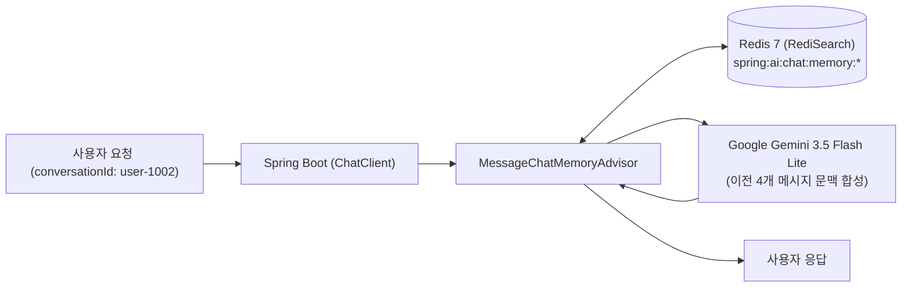

> Google Gemini API는 기본적으로 완전 무상태(Stateless)로 동작하므로, 사용자와 자연스러운 대화를 나누려면 매 요청마다 이전 대화 이력을 프롬프트에 합성해 주어야 합니다. 본 글에서는 Spring AI 2.0.1의 **`MessageChatMemoryAdvisor`**와 **Redis 분산 저장소(`RedisChatMemoryRepository`)**를 연동하여, 다중 서버 인스턴스 환경에서도 대화 세션을 안전하게 영속화하고 **슬라이딩 윈도우(Sliding Window)**로 토큰 비용 폭증을 방어하는 실전 아키텍처를 구현합니다.

---

## 인메모리 세션의 한계와 Redis 영속화의 필요성

이전 글([SSE 실시간 스트리밍 채팅](file:///_posts/Spring/AI/2026-03-19-spring-ai-gemini-streaming-chat-sse.md))에서 다룬 `InMemoryChatMemoryRepository`는 로컬 JVM 힙 메모리에 대화 목록을 저장하므로 다음과 같은 실무적 한계가 존재합니다:

1. **서버 재기동 시 세션 증발**: 애플리케이션 재배포나 장애 복구 시 사용자의 대화 맥락이 전부 유실됩니다.
2. **다중 인스턴스(L4/L7 로드밸런싱) 불일치**: 사용자의 다음 요청이 다른 백엔드 파드로 라우팅되면 이전 대화를 기억하지 못합니다.
3. **무제한 대화 축적으로 인한 토큰 비용 폭증**: 대화가 길어질수록 입력 토큰 수가 기하급수적으로 늘어나 Gemini API 비용이 급증합니다.



---

## 프로젝트 환경 및 의존성 설정

본 실습 코드는 [spring-ai-examples (chat-memory-redis)](https://github.com/cmsong111/spring-ai-examples/tree/master/chat-memory-redis) 모듈을 기반으로 합니다.

### build.gradle.kts

`spring-ai-starter-model-chat-memory-repository-redis`와 Spring Boot Docker Compose 지원 의존성을 추가합니다:

```kotlin
plugins {
    kotlin("jvm") version "2.3.21"
    kotlin("plugin.spring") version "2.3.21"
    id("org.springframework.boot") version "4.1.1"
    id("io.spring.dependency-management") version "1.1.7"
}

dependencies {
    implementation("org.springframework.boot:spring-boot-starter-web")
    implementation("org.springframework.ai:spring-ai-starter-model-google-genai")
    implementation("org.springframework.ai:spring-ai-starter-model-chat-memory-repository-redis")
    
    // 로컬 개발 시 Docker Redis 자동 기동
    developmentOnly("org.springframework.boot:spring-boot-docker-compose")

    testImplementation("org.springframework.boot:spring-boot-starter-test")
    testImplementation("org.springframework.boot:spring-boot-testcontainers")
    testImplementation("org.testcontainers:junit-jupiter")
}
```

### application.yaml 설정

Redis 연결 정보와 대화 보존 TTL(Time To Live), 슬라이딩 윈도우 최대 메시지 수(`max-messages: 10`)를 정의합니다:

```yaml
server:
  port: 8083

spring:
  application:
    name: chat-memory-redis
  ai:
    google:
      genai:
        api-key: ${SPRING_AI_GOOGLE_GENAI_API_KEY}
        chat:
          options:
            model: gemini-3.5-flash-lite
            temperature: 0.7
    chat:
      memory:
        repository:
          redis:
            host: ${SPRING_DATA_REDIS_HOST:localhost}
            port: ${SPRING_DATA_REDIS_PORT:6379}
            key-prefix: "spring:ai:chat:memory:"
            index-name: "spring-ai-chat-memory-idx"
            initialize-schema: true
            time-to-live: 24h

app:
  chat-memory:
    max-messages: 10
```

---

## RedisChatMemoryRepository & Gemini 메타데이터 트러블슈팅

Spring AI 2.0.1의 `RedisChatMemoryRepository`를 구성할 때 반드시 해결해야 하는 중요한 트러블슈팅 포인트가 있습니다.

> [!WARNING]
> `RedisChatMemoryRepository`는 RediSearch 모듈을 사용하여 메시지를 인덱싱합니다. `metadataFields`를 명시적으로 지정하지 않으면 기본적으로 `$.metadata.*` 전체가 `TEXT` 인덱스로 등록됩니다.  
> 그러나 **Google Gemini의 응답(`ASSISTANT`) 메시지 메타데이터에는 문자열 외의 객체/불리언 타입(예: finishReason, tokenUsage 등)이 포함**되어 있어 RediSearch 인덱싱 에러가 발생하며, 데이터는 Redis에 저장되지만 `findByConversationId`로 조회되지 않는 현상이 발생합니다.

이를 해결하기 위해 인덱싱 대상 메타데이터 필드를 `messageType`만 `tag`로 선언하여 등록합니다:

```kotlin
package io.github.cmsong111.chat_memory_redis.config

import org.springframework.ai.chat.client.ChatClient
import org.springframework.ai.chat.client.advisor.MessageChatMemoryAdvisor
import org.springframework.ai.chat.client.advisor.SimpleLoggerAdvisor
import org.springframework.ai.chat.memory.ChatMemory
import org.springframework.ai.chat.memory.MessageWindowChatMemory
import org.springframework.ai.chat.memory.repository.redis.RedisChatMemoryRepository
import org.springframework.ai.model.chat.memory.repository.redis.autoconfigure.RedisChatMemoryRepositoryProperties
import org.springframework.context.annotation.Bean
import org.springframework.context.annotation.Configuration
import redis.clients.jedis.RedisClient

@Configuration
class ChatMemoryConfig {

    @Bean
    fun redisChatMemoryRepository(
        jedisClient: RedisClient,
        properties: RedisChatMemoryRepositoryProperties
    ): RedisChatMemoryRepository {
        val builder = RedisChatMemoryRepository.builder()
            .jedisClient(jedisClient)
            .indexName(properties.indexName)
            .keyPrefix(properties.keyPrefix)
            .initializeSchema(properties.initializeSchema)
            // Gemini 응답 메타데이터 인덱싱 에러 방지를 위한 필드 지정
            .metadataFields(listOf(mapOf("name" to "messageType", "type" to "tag")))

        properties.timeToLive?.let { builder.timeToLive(it) }

        return builder.build()
    }

    @Bean
    fun chatMemory(
        redisChatMemoryRepository: RedisChatMemoryRepository,
        chatMemoryProperties: ChatMemoryProperties
    ): ChatMemory {
        return MessageWindowChatMemory.builder()
            .chatMemoryRepository(redisChatMemoryRepository)
            .maxMessages(chatMemoryProperties.maxMessages)
            .build()
    }

    @Bean
    fun chatClient(builder: ChatClient.Builder, chatMemory: ChatMemory): ChatClient {
        return builder
            .defaultSystem("당신은 사용자와의 이전 대화를 기억하고 맥락에 맞게 답변하는 친절한 AI 어시스턴트입니다.")
            .defaultAdvisors(
                MessageChatMemoryAdvisor.builder(chatMemory).build(),
                SimpleLoggerAdvisor()
            )
            .build()
    }
}
```

---

## 서비스 및 컨트롤러 구현

```kotlin
package io.github.cmsong111.chat_memory_redis.service

import io.github.cmsong111.chat_memory_redis.dto.ChatReply
import io.github.cmsong111.chat_memory_redis.dto.HistoryMessage
import org.slf4j.LoggerFactory
import org.springframework.ai.chat.client.ChatClient
import org.springframework.ai.chat.memory.ChatMemory
import org.springframework.stereotype.Service

@Service
class ChatMemoryService(
    private val chatClient: ChatClient,
    private val chatMemory: ChatMemory
) {
    private val log = LoggerFactory.getLogger(javaClass)

    fun chat(conversationId: String, message: String): ChatReply {
        val response = chatClient.prompt()
            .user(message)
            .advisors { it.param("chat_memory_conversation_id", conversationId) }
            .call()
            .content() ?: ""

        val totalStored = chatMemory.get(conversationId, 100).size
        log.debug("[{}] 저장된 메시지 수: {}", conversationId, totalStored)

        return ChatReply(
            conversationId = conversationId,
            reply = response,
            storedMessages = totalStored
        )
    }

    fun getHistory(conversationId: String): List<HistoryMessage> {
        return chatMemory.get(conversationId, 100).map {
            HistoryMessage(messageType = it.messageType.name, content = it.text ?: "")
        }
    }

    fun clearHistory(conversationId: String) {
        chatMemory.clear(conversationId)
        log.debug("[{}] 대화 이력 삭제 완료", conversationId)
    }
}
```

---

## 동작 검증 및 테스트 결과

실제 Redis와 Gemini API를 연동하여 다음 3가지 핵심 시나리오를 통합 테스트합니다:
1. **멀티턴 회상**: 첫 번째 질문에서 이름을 소개하고, 두 번째 질문에서 이름을 묻는 경우 정확히 기억하는지 검증
2. **세션 격리**: 다른 `conversationId`를 가진 세션에서는 이전 대화 내용을 절대 알지 못하는지 검증
3. **슬라이딩 윈도우**: 메시지가 한도(`maxMessages: 4`)를 초과할 때 가장 오래된 메시지부터 안전하게 축출되는지 검증

```kotlin
@SpringBootTest
class ChatMemoryRedisIntegrationTests {

    @Autowired
    private lateinit var chatMemoryService: ChatMemoryService

    @Test
    fun `이전 대화를 기억하고 후속 질문에 답변한다`() {
        val conversationId = "it-session-1"

        // 1턴: 이름 전달
        chatMemoryService.chat(conversationId, "내 이름은 김남주야. 기억해줘.")

        // 2턴: 이름 확인
        val reply = chatMemoryService.chat(conversationId, "내 이름이 뭐라고?")

        println("=== [ChatMemoryRedis] Multi-turn Recall ===")
        println("Answer: ${reply.reply}")
        println("Stored messages: ${reply.storedMessages}")

        assertThat(reply.reply).contains("김남주")
        assertThat(reply.storedMessages).isEqualTo(4)
    }

    @Test
    fun `다른 세션은 이전 대화를 알지 못한다`() {
        chatMemoryService.chat("session-a", "내 비밀 코드는 APPLE-123이야.")
        val isolatedReply = chatMemoryService.chat("session-b", "내 비밀 코드가 뭐야?")

        assertThat(isolatedReply.reply).doesNotContain("APPLE-123")
    }
}
```

### 테스트 실행 콘솔


_JUnit 5 통합 테스트 통과: 멀티턴 대화 회상 및 세션 간 완전 격리 검증_

실제 출력된 테스트 로그는 다음과 같습니다:

```text
DEBUG [chat-memory-redis] : [it-session-1] 저장된 메시지 수: 2/10
DEBUG [chat-memory-redis] : [it-session-1] 저장된 메시지 수: 4/10
=== [ChatMemoryRedis] Multi-turn Recall ===
Answer: 김남주 님이시죠! 방금 저한테 기억해 달라고 말씀해 주셨잖아요. 잘 기억하고 있습니다. ㅎㅎ
Stored messages: 4/10 (Redis keyPrefix: spring:ai:chat:memory:)
===========================================
```

### Redis CLI 데이터 저장 확인

실제 Redis 인스턴스에 접속하여 `spring:ai:chat:memory:*` 키를 조회하면 각 세션별 대화 메시지들이 JSON 형식으로 직렬화되어 보관되며, 지정한 24시간 TTL에 따라 자동 정리됩니다:


_redis-cli 확인 결과: USER와 ASSISTANT 메시지 페이로드 및 24시간 TTL 만료 설정_

### 슬라이딩 윈도우(Sliding Window) 동작 로그

대화가 길어져 `maxMessages: 4`를 초과할 경우, `MessageWindowChatMemory`가 가장 오래된 2개 메시지(Q1/A1)를 자동으로 축출하여 항상 최신 4개 메시지만 Gemini 프롬프트에 전달합니다:


_Spring Boot 디버그 로그: 한도 초과 시 오래된 메시지를 자동 축출하여 프롬프트 토큰 비용을 방어하는 모습_

---

## 정리 및 다음 단계

- `MessageChatMemoryAdvisor`를 활용하면 백엔드 로직에서 번거로운 프롬프트 조립 없이 선언적으로 대화 세션을 관리할 수 있습니다.
- `RedisChatMemoryRepository`를 통해 서버 재기동이나 로드밸런싱 환경에서도 대화 세션을 안전하게 공유·영속화했습니다.
- RediSearch 인덱싱 시 Gemini 응답 메타데이터의 비문자열 필드로 인한 인덱스 누락 이슈를 `metadataFields` 매핑으로 해결했습니다.
- `MessageWindowChatMemory`의 슬라이딩 윈도우를 통해 장기 대화에서도 토큰 비용 폭증을 효과적으로 방어했습니다.

다음 포스트에서는 텍스트 생성과 대화 세션을 넘어, 구글의 이미지 생성 모델을 스프링 부트에 연동하는 **`Google GenAI ImageModel` 이미지 생성 및 S3 스토리지 영구 저장 파이프라인**을 구현해 봅니다.

---

> 본 포스트의 전체 실습 코드는 [GitHub 저장소 (cmsong111/spring-ai-examples/chat-memory-redis)](https://github.com/cmsong111/spring-ai-examples/tree/master/chat-memory-redis)에서 확인하실 수 있습니다.
