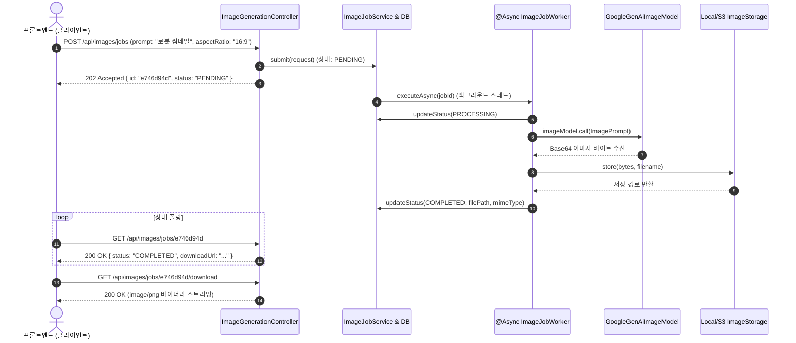

> 텍스트 기반 LLM을 넘어 구글의 고성능 이미지 생성 모델을 백엔드 서비스에 연동할 때 직면하는 가장 큰 과제는 **"수 초에서 수십 초에 달하는 이미지 생성 지연 시간"**과 **"생성된 바이너리 이미지의 안전한 영구 저장"**입니다. 본 글에서는 Spring AI 2.0.1의 **`ImageModel`**과 **`GoogleGenAiImageOptions`**를 활용하고, 스프링의 **`@Async` 비동기 작업 큐(Job Queue)**와 파일 스토리지 인터페이스를 결합한 견고한 이미지 생성 파이프라인을 구축해 봅니다.

---

## 동기 블로킹 호출의 위험성과 비동기 작업 큐 설계

이미지 생성 API는 모델의 복잡한 확산(Diffusion) 연산 과정으로 인해 호출 완료까지 평균 5~15초 이상 소요됩니다. 이를 일반적인 동기 HTTP API(`POST /api/images/generate`)로 처리하면 다음과 같은 치명적인 문제가 발생합니다:

1. **톰캣 스레드 풀 고갈(Starvation)**: 긴 지연 시간 동안 웹 서블릿 스레드가 블로킹되어 다른 정상 요청까지 지연됩니다.
2. **클라이언트 타임아웃**: 모바일 앱이나 프론트엔드의 HTTP Read Timeout(보통 10초)으로 인해 실패율이 증가합니다.

이를 해결하기 위해 **"202 Accepted 작업 접수 ➔ `@Async` 백그라운드 워커 비동기 처리 ➔ 스토리지 저장 ➔ 상태 폴링/다운로드"**로 이어지는 비동기 작업 파이프라인을 설계합니다:



---

## 프로젝트 환경 및 의존성 설정

본 실습 코드는 [spring-ai-examples (image-generation)](https://github.com/cmsong111/spring-ai-examples/tree/master/image-generation) 모듈을 기반으로 합니다.

### build.gradle.kts

```kotlin
plugins {
    kotlin("jvm") version "2.3.21"
    kotlin("plugin.spring") version "2.3.21"
    id("org.springframework.boot") version "4.1.1"
    id("io.spring.dependency-management") version "1.1.7"
}

dependencies {
    implementation("org.springframework.boot:spring-boot-starter-web")
    implementation("org.springframework.boot:spring-boot-starter-data-jpa")
    implementation("org.springframework.ai:spring-ai-starter-model-google-genai")
    runtimeOnly("com.h2database:h2")

    testImplementation("org.springframework.boot:spring-boot-starter-test")
    testImplementation("org.jetbrains.kotlin:kotlin-test-junit5")
}
```

### application.yaml 설정

`gemini-2.5-flash-image` 모델과 기본 가로세로 비율(`aspect-ratio: "1:1"`), 로컬 파일 저장 디렉터리를 지정합니다:

```yaml
server:
  port: 8085

spring:
  application:
    name: image-generation
  ai:
    google:
      genai:
        api-key: ${SPRING_AI_GOOGLE_GENAI_API_KEY}
        image:
          model: gemini-2.5-flash-image
          aspect-ratio: "1:1"
  datasource:
    url: jdbc:h2:mem:image-generation
  jpa:
    hibernate:
      ddl-auto: create-drop

image:
  storage:
    local:
      base-dir: ./generated-images
```

> [!TIP]
> `person-generation` 옵션(인물 생성 필터링)은 Google Cloud Vertex AI 모드에서만 지원됩니다. 일반 Google AI Studio API 키 모드에서 설정하면 `IllegalArgumentException`이 발생하므로 주의해야 합니다.

---

## ImageModel 연동 및 Base64 디코딩 (ImageGenerationService)

Google GenAI의 이미지 모델은 결과물을 Base64 인코딩 문자열(`b64Json`)로 반환합니다. 이를 수신하여 바이트 배열로 변환하는 핵심 서비스입니다:

```kotlin
package io.github.cmsong111.image_generation.service

import io.github.cmsong111.image_generation.dto.GeneratedImage
import io.github.cmsong111.image_generation.dto.ImageGenerationRequest
import org.springframework.ai.google.genai.image.GoogleGenAiImageGenerationMetadata
import org.springframework.ai.google.genai.image.GoogleGenAiImageOptions
import org.springframework.ai.image.ImageModel
import org.springframework.ai.image.ImagePrompt
import org.springframework.stereotype.Service
import java.util.Base64

@Service
class ImageGenerationService(
    private val imageModel: ImageModel,
) {

    fun generate(request: ImageGenerationRequest): GeneratedImage {
        val options = GoogleGenAiImageOptions.builder()
            .aspectRatio(request.aspectRatio)
            .imageSize(request.imageSize)
            .build()

        val response = imageModel.call(ImagePrompt(request.prompt, options))
        val modelText = response.metadata.get<String>("text")

        val generation = response.results.firstOrNull { it.output.b64Json != null }
            ?: throw ImageGenerationException("이미지가 생성되지 않았습니다: ${modelText ?: "응답 없음"}")

        val mimeType = (generation.metadata as? GoogleGenAiImageGenerationMetadata)?.mimeType 
            ?: "image/png"

        return GeneratedImage(
            bytes = Base64.getDecoder().decode(generation.output.b64Json),
            mimeType = mimeType,
            modelText = modelText,
        )
    }
}
```

---

## 영구 저장소 및 비동기 워커 파이프라인

생성된 이미지를 로컬 디렉터리(또는 AWS S3)에 날짜별로 격리 저장하는 스토리지 계층과, 이를 백그라운드 스레드에서 실행하는 비동기 워커를 구성합니다:

### 1. 스토리지 컴포넌트

```kotlin
package io.github.cmsong111.image_generation.storage

import org.springframework.beans.factory.annotation.Value
import org.springframework.stereotype.Component
import java.nio.file.Files
import java.nio.file.Path
import java.time.LocalDate

@Component
class LocalFileSystemImageStorage(
    @Value("\${image.storage.local.base-dir}") baseDir: String
) : ImageStorage {
    private val root: Path = Path.of(baseDir).toAbsolutePath().normalize()

    override fun store(bytes: ByteArray, extension: String): String {
        val today = LocalDate.now().toString()
        val dir = root.resolve(today)
        Files.createDirectories(dir)

        val filename = "${java.util.UUID.randomUUID()}.$extension"
        val target = dir.resolve(filename)
        Files.write(target, bytes)

        return "$today/$filename"
    }

    override fun load(storedPath: String): ByteArray {
        return Files.readAllBytes(root.resolve(storedPath))
    }
}
```

### 2. 비동기 워커 (@Async)

```kotlin
@Component
class ImageJobWorker(
    private val imageGenerationService: ImageGenerationService,
    private val imageStorage: ImageStorage,
    private val jobRepository: ImageJobRepository,
) {
    private val log = LoggerFactory.getLogger(javaClass)

    @Async("imageJobExecutor")
    fun process(jobId: String) {
        val job = jobRepository.findById(jobId).orElse(null) ?: return
        job.markProcessing()
        jobRepository.save(job)

        try {
            val generated = imageGenerationService.generate(
                ImageGenerationRequest(prompt = job.prompt, aspectRatio = job.aspectRatio)
            )
            val extension = if (generated.mimeType.contains("jpeg")) "jpg" else "png"
            val storedPath = imageStorage.store(generated.bytes, extension)

            job.markCompleted(storedPath, generated.mimeType, generated.modelText)
            jobRepository.save(job)
            log.info("Image job {} completed: {}", jobId, storedPath)
        } catch (ex: Exception) {
            log.error("Image job {} failed", jobId, ex)
            job.markFailed(ex.message ?: "알 수 없는 오류")
            jobRepository.save(job)
        }
    }
}
```

---

## 동작 검증 및 테스트 결과

비동기 작업의 라이프사이클(`PENDING` ➔ `COMPLETED` ➔ 파일 로드)을 검증하는 단위/통합 테스트를 실행합니다:

```kotlin
@SpringBootTest(properties = ["image.storage.local.base-dir=build/test-generated-images"])
class ImageJobFlowTests {

    @MockitoBean
    private lateinit var imageModel: ImageModel

    @Autowired
    private lateinit var imageJobService: ImageJobService

    @Test
    fun `작업 접수 후 비동기로 이미지를 생성하고 저장한다`() {
        val submitted = imageJobService.submit(ImageGenerationRequest(prompt = "썸네일"))
        assertThat(submitted.status).isEqualTo(ImageJobStatus.PENDING)

        val completed = awaitTerminalState(submitted.id)
        assertThat(completed.status).isEqualTo(ImageJobStatus.COMPLETED)
        assertThat(completed.mimeType).isEqualTo("image/png")
    }
}
```

### 테스트 실행 콘솔


_JUnit 5 테스트 통과: 백그라운드 워커에서 이미지를 생성하고 스토리지에 영구 저장한 결과_

### cURL 비동기 작업 및 상태 폴링

클라이언트는 202 Accepted 응답으로 작업 ID를 수신한 후, 작업이 완료되면 다운로드 URL을 발급받습니다:


_REST 엔드포인트 폴링 흐름: 202 Accepted 접수 후 COMPLETED 상태 전이_

### 생성 이미지 웹 브라우저 프리뷰

다운로드 URL(`/api/images/jobs/{id}/download`)을 브라우저에서 열면 생성된 16:9 비율의 이미지가 정상 표시됩니다:


_웹 브라우저 이미지 프리뷰: 프롬프트에 맞춰 16:9 비율로 생성 및 로컬 파일 시스템 저장 완료_

---

## 정리 및 다음 단계

- `GoogleGenAiImageModel`을 활용하여 텍스트 프롬프트로부터 고화질 이미지를 간결한 API로 생성했습니다.
- 긴 대기 시간으로 인한 서블릿 스레드 고갈을 막기 위해 `@Async` 기반의 비동기 작업 큐(`PENDING` ➔ `COMPLETED`)를 구축했습니다.
- 생성된 Base64 이미지를 바이트로 변환하여 날짜별 파일 스토리지에 영구 보관하고 스트리밍 다운로드 엔드포인트를 노출했습니다.

다음 포스트에서는 이미지 생성을 넘어, 모델이 사용자 이미지(영수증 사진)와 음성 녹음 파일(회의록)을 직접 읽고 분석하는 **Gemini 멀티모달(Multimodal) 비전·오디오 처리 파이프라인**을 구현해 봅니다.

---

> 본 포스트의 전체 실습 코드는 [GitHub 저장소 (cmsong111/spring-ai-examples/image-generation)](https://github.com/cmsong111/spring-ai-examples/tree/master/image-generation)에서 확인하실 수 있습니다.
