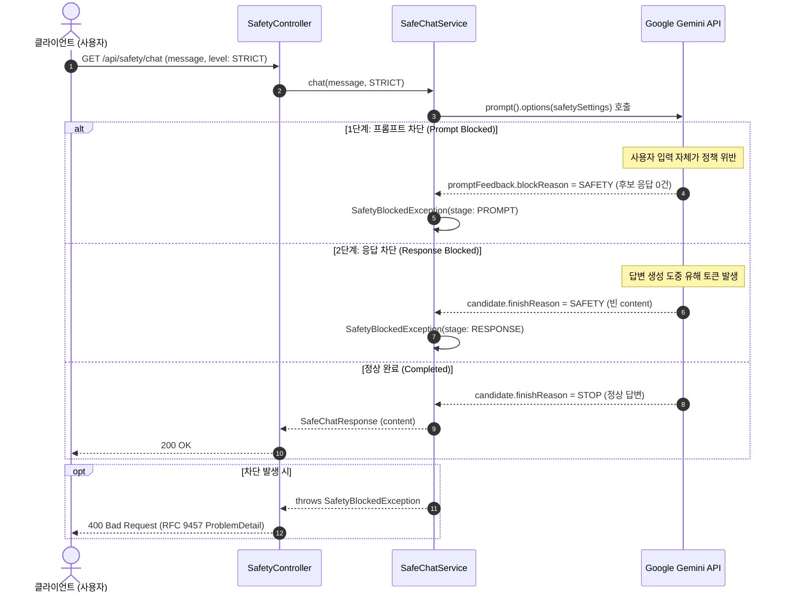

> 생성형 AI를 실제 프로덕션 서비스에 배포할 때 가장 치명적인 위험 중 하나는 **"유해 콘텐츠 생성 및 탈옥(Jailbreak) 프롬프트 노출"**입니다. Google Gemini는 인프라 레벨에서 4대 유해 카테고리(혐오 발언, 괴롭힘, 성적 콘텐츠, 위험 콘텐츠)를 실시간 감지하여 차단하는 **SafetySettings**를 내장하고 있습니다. 그러나 Spring AI 애플리케이션에서 이를 기본 상태로 사용할 경우, Gemini가 유해성으로 생성을 차단했을 때 백엔드에서 원인을 알 수 없는 **`500 Internal Server Error`**나 Spring AI 내부 변환 에러(`NoSuchElementException`)가 터져 서비스 가용성이 저하됩니다. 본 글에서는 Gemini 안전성 임계값을 비즈니스 정책 단계로 추상화하고, 차단된 요청을 안전한 **RFC 9457 `ProblemDetail` (400 Bad Request)**로 정제하는 가드레일 아키텍처를 구현해 봅니다.

---

## 안전성 필터링의 두 단계와 에러 전파 흐름

Gemini API의 유해성 검사는 요청 라이프사이클 중 두 지점에서 동작합니다:



1. **프롬프트 평가 단계 (Prompt Feedback)**: 사용자가 보낸 질문 자체가 극단적인 유해 프롬프트인 경우, Gemini는 답변 생성(Candidate)을 시작조차 하지 않고 거절합니다.
2. **응답 생성 단계 (Response Candidates)**: 질문은 정상이었으나 모델이 추론 도중 생성한 문장이 유해성 임계값을 넘긴 경우, 생성을 즉시 중단하고 `finishReason: "SAFETY"`로 마킹합니다.

---

## 프로젝트 환경 및 의존성 설정

본 실습 코드는 [spring-ai-examples (safety-settings)](https://github.com/cmsong111/spring-ai-examples/tree/master/safety-settings) 모듈을 기반으로 합니다.

### build.gradle.kts

```kotlin
plugins {
    kotlin("jvm") version "2.3.21"
    kotlin("plugin.spring") version "2.3.21"
    id("org.springframework.boot") version "4.1.1"
    id("io.spring.dependency-management") version "1.1.7"
}

dependencies {
    implementation("org.springframework.boot:spring-boot-starter-web")
    implementation("org.springframework.ai:spring-ai-starter-model-google-genai")

    testImplementation("org.springframework.boot:spring-boot-starter-test")
    testImplementation("org.jetbrains.kotlin:kotlin-test-junit5")
}
```

### 전역 application.yaml 설정

애플리케이션 전역에서 적용될 기본 임계값을 설정합니다. 4개 카테고리에 대해 중간 위험도 이상(`BLOCK_MEDIUM_AND_ABOVE`)을 기본 차단선으로 지정합니다:

```yaml
server:
  port: 8087

spring:
  application:
    name: safety-settings
  ai:
    google:
      genai:
        api-key: ${SPRING_AI_GOOGLE_GENAI_API_KEY:demo-key}
        chat:
          model: gemini-3.5-flash-lite
          safety-settings:
            - category: HARM_CATEGORY_HATE_SPEECH
              threshold: BLOCK_MEDIUM_AND_ABOVE
            - category: HARM_CATEGORY_HARASSMENT
              threshold: BLOCK_MEDIUM_AND_ABOVE
            - category: HARM_CATEGORY_SEXUALLY_EXPLICIT
              threshold: BLOCK_MEDIUM_AND_ABOVE
            - category: HARM_CATEGORY_DANGEROUS_CONTENT
              threshold: BLOCK_MEDIUM_AND_ABOVE
```

---

## 비즈니스 레벨 SafetyPolicy 추상화

Gemini의 `HarmBlockThreshold` 상수는 도메인 계층에 그대로 노출하기보다 비즈니스 목적에 맞는 정책 단계(Enum)로 캡슐화하는 것이 유지보수에 유리합니다:

- **`STRICT`**: 유해 가능성이 낮음 이상이어도 차단 (`BLOCK_LOW_AND_ABOVE`) — 청소년/교육용 서비스
- **`DEFAULT`**: 일반 서비스 기본값 (`BLOCK_MEDIUM_AND_ABOVE`)
- **`RELAXED`**: 명백히 높은 위험만 차단 (`BLOCK_ONLY_HIGH`) — 보안 침해 분석, 의료 상담 등

### service/SafetyLevel.kt & SafetyPolicy.kt

```kotlin
package io.github.cmsong111.safety_settings.service

import org.springframework.ai.google.genai.common.GoogleGenAiSafetySetting
import org.springframework.ai.google.genai.common.GoogleGenAiSafetySetting.HarmBlockThreshold
import org.springframework.ai.google.genai.common.GoogleGenAiSafetySetting.HarmCategory
import org.springframework.stereotype.Component

enum class SafetyLevel(val threshold: HarmBlockThreshold) {
    STRICT(HarmBlockThreshold.BLOCK_LOW_AND_ABOVE),
    DEFAULT(HarmBlockThreshold.BLOCK_MEDIUM_AND_ABOVE),
    RELAXED(HarmBlockThreshold.BLOCK_ONLY_HIGH)
}

@Component
class SafetyPolicy {

    fun settingsFor(level: SafetyLevel): List<GoogleGenAiSafetySetting> {
        return CATEGORIES.map { category ->
            GoogleGenAiSafetySetting.Builder()
                .withCategory(category)
                .withThreshold(level.threshold)
                .build()
        }
    }

    companion object {
        val CATEGORIES = listOf(
            HarmCategory.HARM_CATEGORY_HATE_SPEECH,
            HarmCategory.HARM_CATEGORY_HARASSMENT,
            HarmCategory.HARM_CATEGORY_SEXUALLY_EXPLICIT,
            HarmCategory.HARM_CATEGORY_DANGEROUS_CONTENT
        )
    }
}
```

---

## Spring AI 2.0.1의 치명적 함정과 SafeChatService 구현

Spring AI 2.0.1의 `GoogleGenAiChatModel` 구현체에는 **중요한 내부 동작 특성(Pitfall)**이 있습니다:

> **⚠️ Spring AI 2.0.1 NoSuchElementException 함정**:
> Gemini가 모델 응답 단계에서 `finishReason: "SAFETY"`로 생성을 차단하면, 반환되는 Candidate 내부의 `content` 텍스트 파트가 비어 있거나 `null`이 됩니다. Spring AI 내부의 `GoogleGenAiChatModel`이 SDK 응답 객체를 `AssistantMessage`로 변환할 때, 빈 `Optional` 객체에 대해 `.get()`을 호출하면서 **`java.util.NoSuchElementException: No value present`**를 발생시킵니다!

이를 별도로 핸들링하지 않으면 컨트롤러가 `500 Internal Server Error`를 응답하여, 클라이언트는 모델이 안전성 정책에 의해 차단된 것인지 백엔드 시스템 버그인지 구분할 수 없게 됩니다. 따라서 서비스 계층에서 해당 원인 예외를 잡아 정제된 `SafetyBlockedException`으로 변환해야 합니다.

### service/SafeChatService.kt

```kotlin
package io.github.cmsong111.safety_settings.service

import io.github.cmsong111.safety_settings.dto.SafeChatResponse
import io.github.cmsong111.safety_settings.exception.BlockStage
import io.github.cmsong111.safety_settings.exception.SafetyBlockedException
import org.slf4j.LoggerFactory
import org.springframework.ai.chat.client.ChatClient
import org.springframework.ai.google.genai.GoogleGenAiChatOptions
import org.springframework.stereotype.Service

@Service
class SafeChatService(
    private val chatClient: ChatClient,
    private val safetyPolicy: SafetyPolicy
) {

    private val log = LoggerFactory.getLogger(javaClass)

    fun chat(message: String, level: SafetyLevel): SafeChatResponse {
        val chatResponse = try {
            chatClient.prompt()
                .user(message)
                .options(
                    GoogleGenAiChatOptions.builder()
                        .safetySettings(safetyPolicy.settingsFor(level))
                )
                .call()
                .chatResponse()
        } catch (e: RuntimeException) {
            // Spring AI 2.0.1은 SAFETY로 차단되어 content가 비어 있는 candidate를 변환할 때
            // NoSuchElementException(Optional.get)을 던지므로 응답 단계 차단으로 간주합니다.
            if (e.hasCause<NoSuchElementException>()) {
                throw SafetyBlockedException(BlockStage.RESPONSE, "SAFETY")
            }
            throw e
        }

        // 1단계: 프롬프트 차단으로 후보 응답이 전혀 없는 경우
        val generation = chatResponse?.result
            ?: throw SafetyBlockedException(BlockStage.PROMPT, "PROMPT_BLOCKED")

        // 2단계: 응답 생성 도중 차단된 경우
        val finishReason = generation.metadata.finishReason ?: "UNKNOWN"
        log.info("Gemini finishReason={}, safetyLevel={}", finishReason, level)

        if (finishReason.uppercase() in BLOCKING_FINISH_REASONS) {
            throw SafetyBlockedException(BlockStage.RESPONSE, finishReason)
        }

        return SafeChatResponse(
            content = generation.output.text.orEmpty(),
            finishReason = finishReason,
            safetyLevel = level
        )
    }

    private inline fun <reified T : Throwable> Throwable.hasCause(): Boolean =
        generateSequence(this) { it.cause }.any { it is T }

    companion object {
        val BLOCKING_FINISH_REASONS = setOf("SAFETY", "PROHIBITED_CONTENT", "BLOCKLIST", "SPII")
    }
}
```

---

## RFC 9457 ProblemDetail 기반 400 Bad Request 변환

차단 이벤트는 시스템 장애가 아닌 **"사용자 입력의 비즈니스 가이드라인 위반"**이므로, HTTP 400 Bad Request와 표준 `ProblemDetail` 스펙으로 응답합니다:

### exception/SafetyExceptionHandler.kt

```kotlin
package io.github.cmsong111.safety_settings.exception

import org.slf4j.LoggerFactory
import org.springframework.http.HttpStatus
import org.springframework.http.ProblemDetail
import org.springframework.web.bind.annotation.ExceptionHandler
import org.springframework.web.bind.annotation.RestControllerAdvice

@RestControllerAdvice
class SafetyExceptionHandler {

    private val log = LoggerFactory.getLogger(javaClass)

    @ExceptionHandler(SafetyBlockedException::class)
    fun handleSafetyBlocked(e: SafetyBlockedException): ProblemDetail {
        log.warn("Safety guardrail triggered: stage={}, reason={}", e.stage, e.reason)

        return ProblemDetail.forStatusAndDetail(
            HttpStatus.BAD_REQUEST,
            "안전 가이드라인에 따라 처리할 수 없는 요청입니다."
        ).apply {
            title = "Request blocked by safety guardrail"
            setProperty("stage", e.stage.name)
            setProperty("reason", e.reason)
        }
    }
}
```


_그림 1. 유해 프롬프트 감지 시 반환되는 표준 RFC 9457 ProblemDetail 에러 응답_

---

## SDK Client 빈을 활용한 카테고리별 세부 평가(safetyRatings) 조회

Spring AI의 `ChatResponse` 메타데이터에는 오직 `finishReason` 문자열만 전달되고, 각 카테고리별 위험 확률(`NEGLIGIBLE`, `LOW`, `MEDIUM`, `HIGH`)인 `safetyRatings`가 누락됩니다. 관리자 대시보드나 보안 감사(Audit) 로그용으로 세부 점수가 필요한 경우, Spring AI가 자동 구성해 둔 Google GenAI SDK의 `Client` 빈을 직접 주입받아 조회할 수 있습니다:

### service/SafetyInspectionService.kt

```kotlin
@Service
class SafetyInspectionService(
    private val genAiClient: Client,
    private val safetyPolicy: SafetyPolicy,
    @Value("\${spring.ai.google.genai.chat.model}") private val model: String
) {

    fun inspect(message: String, level: SafetyLevel): SafetyInspection {
        val config = GenerateContentConfig.builder()
            .safetySettings(
                safetyPolicy.settingsFor(level).map {
                    SafetySetting.builder()
                        .category(it.category.name)
                        .threshold(it.threshold.name)
                        .build()
                }
            )
            .build()

        val response = genAiClient.models.generateContent(model, message, config)

        val promptFeedback = response.promptFeedback().orElse(null)
        val candidate = response.candidates().orElse(emptyList()).firstOrNull()

        return SafetyInspection(
            promptBlockReason = promptFeedback?.blockReason()?.orElse(null)?.toString(),
            finishReason = candidate?.finishReason()?.orElse(null)?.toString(),
            promptRatings = promptFeedback?.safetyRatings()?.orElse(emptyList()).orEmpty().map { it.toView() },
            responseRatings = candidate?.safetyRatings()?.orElse(emptyList()).orEmpty().map { it.toView() },
            text = candidate?.content()?.orElse(null)?.text()
        )
    }
}
```


_그림 2. Google GenAI SDK를 통한 4대 안전 카테고리별 위험도 평가 점수 조회 결과_

---

## 실행 및 검증

### 단위 테스트 및 통합 테스트 수행

`FakeChatModel`을 통해 정상 응답, `SAFETY` finishReason 응답, 빈 candidate 응답을 모킹하여 가드레일이 정확히 동작하는지 검증합니다:

```bash
./gradlew :safety-settings:test
```


_그림 3. SafeChatService, MockMvc 컨트롤러, 실제 Gemini 호출 통합 테스트 통과 콘솔_

### API 호출 검증

```bash
# 1. 정상 질문 호출 (200 OK)
curl -G "http://localhost:8087/api/safety/chat" \
  --data-urlencode "message=환불 정책을 안내해줘" -d "level=STRICT"

# 2. 정책 설정 조회
curl "http://localhost:8087/api/safety/policy?level=RELAXED"
```

---

## 정리

- Google Gemini는 4대 유해 카테고리(`HATE_SPEECH`, `HARASSMENT`, `SEXUALLY_EXPLICIT`, `DANGEROUS_CONTENT`)에 대해 프롬프트 및 응답 단계에서 이중 가드레일을 제공합니다.
- Spring AI 2.0.1에서 `SAFETY` 차단 시 발생하는 `NoSuchElementException`을 서비스 계층에서 안전하게 포획하여 `SafetyBlockedException`으로 전환해야 합니다.
- 유해성 차단은 서버 오류(500)가 아니므로, `@RestControllerAdvice`에서 RFC 9457 규격의 `ProblemDetail` (400 Bad Request)로 클라이언트에 명확한 실패 사유(`stage`, `reason`)를 반환하는 것이 엔터프라이즈 모범 사례입니다.
- 다음 글에서는 LLM이 사내 데이터베이스나 외부 REST API를 능동적으로 호출하여 비즈니스 로직을 수행하는 **Spring AI Gemini @Tool 기반 Function Calling(도구 호출)과 외부 API 연동**을 다룹니다.
